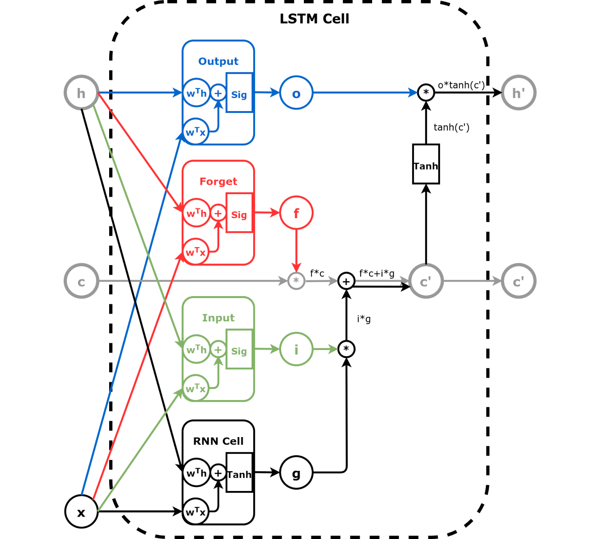
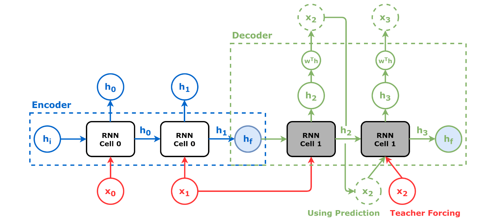
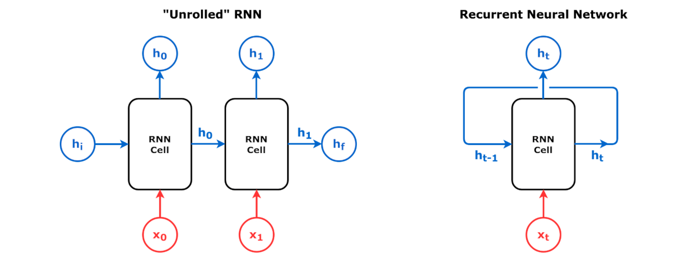
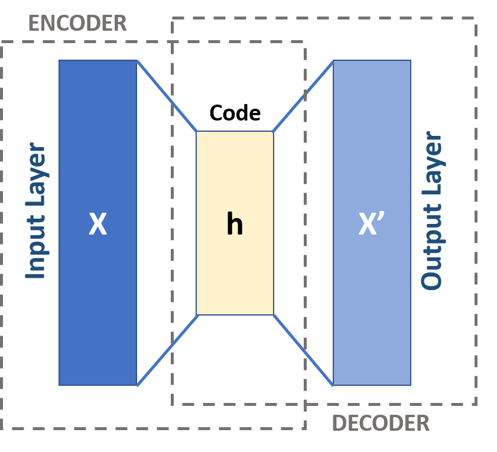
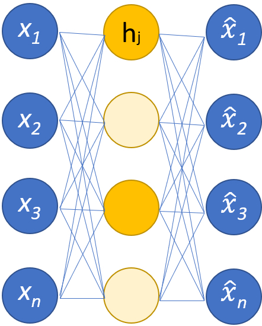
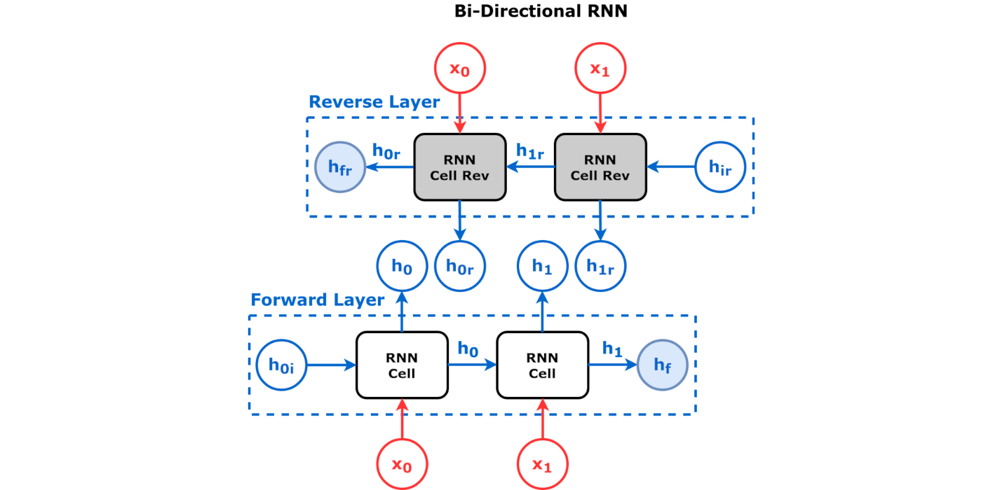
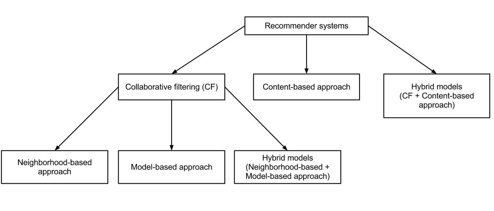
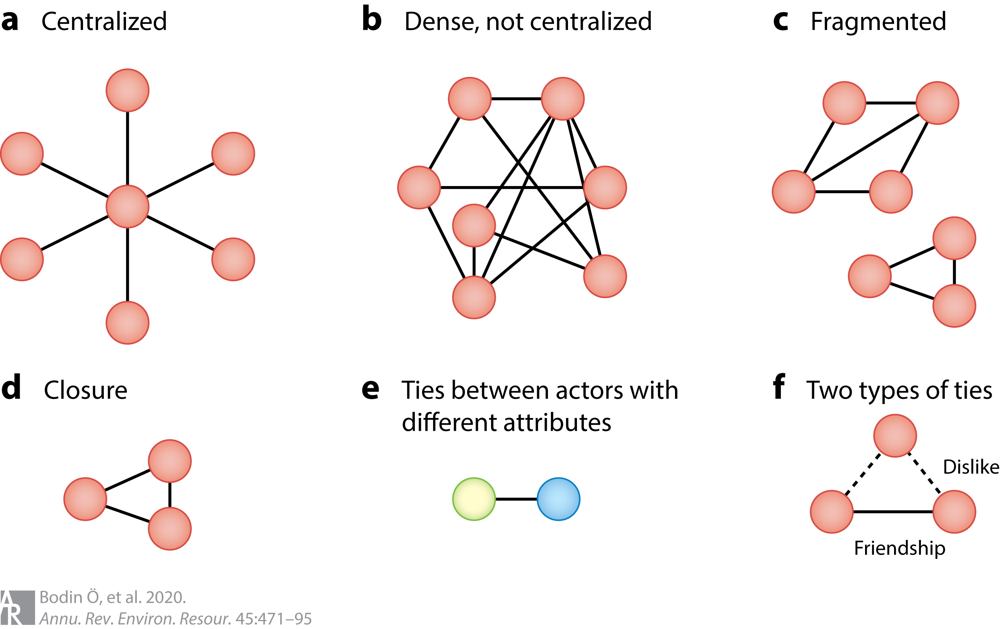
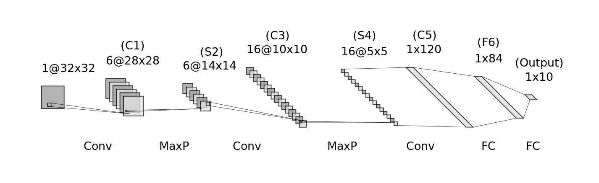

# Deep Learning: 2024 May-Jun Backlog — detailed answers

[Question paper](DL_Endsem_2024_May-Jun_Backlog.pdf) | [Study index](../Study/README.md)

Question headings are paraphrased; both sides of each OR are answered. Marks follow the paper. Examples are illustrative. The question-paper PDF link requires Git LFS hydration in this checkout. Decode links below point to converted textbook pages; the detailed answers are original explanations and also use the linked study notes.

## Q1(a) — LSTM [9 marks]

### 2. Vanishing gradients and LSTM

In BPTT, the gradient at an early time step contains products of many recurrent Jacobians. If their effective magnitudes repeatedly fall below one, the gradient shrinks, and early inputs receive little learning signal. Repeated magnitudes above one can instead cause exploding gradients. Gradient clipping limits explosions; LSTM gates provide a more direct route for retaining useful information but do not guarantee the complete elimination of vanishing gradients.

An **LSTM** keeps a cell state `c_t` and hidden state `h_t`. Forget, input and output gates decide what to retain, add and expose. The reference book's LSTM cell illustration is on [PDF page 20](../Books/DL_Reference_Units03-06.pdf#page=20).



*LSTM cell. Daniel Voigt Godoy, [book illustration](https://dvgodoy.github.io/dl-visuals/RNNs/#lstm), [CC BY 4.0](https://creativecommons.org/licenses/by/4.0/); converted to JPEG with a white background. In this figure, `c` and `h` are previous states and `c'` and `h'` are updated states.*

`σ` denotes sigmoid, `⊙` elementwise multiplication, and `[h_(t-1), x_t]` concatenation:

```text
f_t = σ(W_f [h_(t-1), x_t] + b_f)     forget gate
i_t = σ(W_i [h_(t-1), x_t] + b_i)     input gate
g_t = tanh(W_g [h_(t-1), x_t] + b_g)  candidate content
c_t = f_t ⊙ c_(t-1) + i_t ⊙ g_t      updated cell
o_t = σ(W_o [h_(t-1), x_t] + b_o)     output gate
h_t = o_t ⊙ tanh(c_t)                  exposed hidden state
```

**Explain in an exam:** (1) forget gate suppresses irrelevant old information, (2) input gate and candidate select new information, (3) additive update changes the cell state, (4) output gate selects what is exposed. Example: a language model retains a subject's number until the corresponding verb. Used in forecasting, speech, language and time series. Trade-offs: more parameters and slower training than a simple RNN.

### Step-by-step example and gradient intuition

```text
c(t-1) ──× forget gate ──┐
                         + ──> c(t) ──tanh──× output gate──> h(t)
candidate ─× input gate──┘
      gates and candidate use x(t) and h(t-1)
```

When predicting the verb in “The dogs near the gate …”, the model can learn to retain a representation of the plural subject, ignore less relevant intervening words and expose the relevant information at the verb. Gates are learned, not manually set grammar rules. Sigmoid gates have values between 0 and 1; multiplication controls how much signal passes. The additive cell-state update creates a more direct route for gradients than repeated plain-RNN nonlinear transformations, especially when forget gates are near one. It reduces, but does not guarantee removal of, vanishing gradients.

Training still uses BPTT and can need gradient clipping. LSTMs are used for language, speech and time-series prediction; their extra gates increase parameters and computation.

**References:** [Study: unit-3-rnn](../Study/unit-3-rnn.md) · [Decode page 8 image](../Books/DL_Decode_Units03-06_images/page-008.png).

## Q1(b) — Sequence-to-sequence model [9 marks]

### 3. Encoder-decoder / sequence-to-sequence



*Encoder-decoder example. Daniel Voigt Godoy, [book illustration](https://dvgodoy.github.io/dl-visuals/Seq2Seq/), [CC BY 4.0](https://creativecommons.org/licenses/by/4.0/); converted to JPEG with a white background. The example uses its final encoder input to start decoding; start-token conventions vary.*

1. Tokenize the input sequence and encode its elements into hidden states.
2. The decoder uses the encoded context and the previously generated token to predict the next token.
3. During training **teacher forcing** may feed the true preceding token; at inference the model instead uses its own prediction.
4. Generate until an end token or length limit. A translation model can map an English sentence to a Hindi sentence of different length.
5. A fixed context vector can be a bottleneck for long sequences. **Attention** lets the decoder weight different encoder states at each output step.

This sequence-to-sequence architecture is distinct from an autoencoder: a seq2seq model can map one sequence to a different target; an autoencoder is trained to reconstruct its input.

### Example and training versus inference

```text
input:  I → am → ready → [encoder] → context / encoder states
                                        ↓
                         [decoder] → Je → suis → prêt → <end>
```

The encoder reads the source in order and forms context. The decoder conditions on that context and previous output, predicting a probability distribution for its next token. During teacher-forced training, the previous target word may be provided; at inference, only already-generated words are available. An end token terminates generation, subject to a maximum length. With attention, each output can use a weighted combination of the encoder states instead of relying exclusively on a fixed-size final state. This supports different input/output lengths; incorrect attention or an inadequate training set can still cause translation errors.

**References:** [Study: unit-3-rnn](../Study/unit-3-rnn.md) · [Decode page 9 image](../Books/DL_Decode_Units03-06_images/page-009.png).

## Q2(a) — Feed-forward versus recurrent networks and RNN types [9 marks]

### 1. RNN, operation and types

A **recurrent neural network (RNN)** processes a sequence by updating a hidden state using the current input and the preceding state. Parameters are shared across time. The state summarizes earlier inputs, so the prediction depends on context.



*RNN unrolling and recurrent cell. Daniel Voigt Godoy, [book illustration](https://dvgodoy.github.io/dl-visuals/RNNs/), [CC BY 4.0](https://creativecommons.org/licenses/by/4.0/); converted to JPEG with a white background. Here `h_i` is the initial hidden state; the figure indexes the first input as `x0` rather than `x1`.*

In an unrolled drawing, the horizontal arrows carry `h(t-1)` to the next cell; each cell can produce an output. A clean equation is:

`h_t = tanh(W_xh x_t + W_hh h_(t-1) + b_h)` and `y_t = softmax(W_hy h_t + b_y)`.

**Working:** initialize `h_0`, supply `x_1`, compute `h_1`, then repeat with each new element. Calculate a loss at the required outputs and train using **backpropagation through time (BPTT)**: unroll the network, propagate the loss backward across time, add gradients for the shared parameters, and update them.

**Four recurrent input-output arrangements:**

| Arrangement | Inputs → outputs | Example |
|---|---|---|
| One-to-many | one → sequence | image caption generation |
| Many-to-one | sequence → one | sentiment classification |
| Many-to-many, delayed | input sequence → output sequence after encoding | translation via encoder-decoder |
| Many-to-many, aligned | outputs at corresponding time steps | tagging each word |

The ordinary one-to-one feed-forward model is a baseline rather than a sequential RNN. The book illustrates the two many-to-many cases on [PDF page 27](../Books/DL_Reference_Units03-06.pdf#page=27).

**Advantages:** weight sharing handles sequences of varying lengths and reduces parameter count relative to separately trained time-step models; hidden state carries past context. **Limitations:** sequential computation limits parallelism, long-range dependencies are difficult, and gradients can vanish or explode. Plain RNNs do not guarantee retention of all past information.

#### Feed-forward vs recurrent

| Feature | Feed-forward neural network | RNN |
|---|---|---|
| Flow | Input to output in a directed acyclic network | Hidden state connects successive time steps |
| Context | No built-in state across independent inputs | State represents preceding sequence context |
| Parameters | Usually different across layers | Same recurrent parameters reused across time |
| Natural input | Fixed-size vector | Sequence, potentially variable length |
| Training | Backpropagation | BPTT |
| Example | Classify a fixed feature vector | Predict the next word |

### Reading the architecture

```text
             h0       h1       h2
              ──> [RNN] ──> [RNN] ──> [RNN] ──> h3
                    ↑         ↑         ↑
                    x1        x2        x3
                    ↓         ↓         ↓
                    y1        y2        y3  (when outputs are needed)
```

The same weights are used at each box; this is one network unrolled, not three independently trained networks. For “the movie was good”, each hidden state incorporates the next word. A many-to-one sentiment classifier uses the last or pooled state to predict positive or negative. During training, BPTT sends error backwards through these linked states. Padding and masking can be used to batch variable-length sequences; they do not imply that every sequence has the same true length.

**Four arrangements:**

```text
One-to-many:          image → [h1] → [h2] → [h3]
                               ↓      ↓      ↓
                              "a"   "dog"  "runs"
Many-to-one:          word1 → [h1] → [h2] → [h3] → sentiment
                                      ↑       ↑
                                    word2   word3
Many-to-many aligned: word1 → [h1] → [h2] → [h3]
                               ↓      ↓      ↓
                              tag1   tag2   tag3
                               (word2 and word3 enter h2 and h3)
Many-to-many delayed: source words → [encoder] → [decoder] → translated words
```

In the aligned case, each input has a corresponding output; in the delayed case the input and output lengths can differ. A one-to-one feed-forward model is sometimes shown as a fifth baseline. The single input of an image-captioning model can initialize or condition a recurrent decoder.

### Worked contrast

For the sequence “not good”, a feed-forward classifier can take a fixed feature vector, but needs an explicit representation of the order or context. A recurrent classifier updates its state after “not” and again after “good”; the second update depends on both. This does not imply a feed-forward network can never handle sequences: a fixed window or engineered order-sensitive features can be supplied.

```text
FFNN:  fixed vector ──> hidden layers ──> class
RNN:   word1 ──> state1 ──> state2 ──> class
                              ↑
                            word2
```

An RNN shares its transition parameters across positions, so an input may have a different number of steps from another. Its hidden state is a learned summary, not an exact archive; long dependencies may be forgotten. A plain FFNN does not retain state between independently presented examples.

**References:** [Study: unit-3-rnn](../Study/unit-3-rnn.md) · [Decode page 1 image](../Books/DL_Decode_Units03-06_images/page-001.png).

## Q2(b) — LSTM components and advantages [9 marks]

### 2. Vanishing gradients and LSTM

In BPTT, the gradient at an early time step contains products of many recurrent Jacobians. If their effective magnitudes repeatedly fall below one, the gradient shrinks, and early inputs receive little learning signal. Repeated magnitudes above one can instead cause exploding gradients. Gradient clipping limits explosions; LSTM gates provide a more direct route for retaining useful information but do not guarantee the complete elimination of vanishing gradients.

An **LSTM** keeps a cell state `c_t` and hidden state `h_t`. Forget, input and output gates decide what to retain, add and expose. The reference book's LSTM cell illustration is on [PDF page 20](../Books/DL_Reference_Units03-06.pdf#page=20).


*LSTM cell. Daniel Voigt Godoy, [book illustration](https://dvgodoy.github.io/dl-visuals/RNNs/#lstm), [CC BY 4.0](https://creativecommons.org/licenses/by/4.0/); converted to JPEG with a white background. In this figure, `c` and `h` are previous states and `c'` and `h'` are updated states.*

`σ` denotes sigmoid, `⊙` elementwise multiplication, and `[h_(t-1), x_t]` concatenation:

```text
f_t = σ(W_f [h_(t-1), x_t] + b_f)     forget gate
i_t = σ(W_i [h_(t-1), x_t] + b_i)     input gate
g_t = tanh(W_g [h_(t-1), x_t] + b_g)  candidate content
c_t = f_t ⊙ c_(t-1) + i_t ⊙ g_t      updated cell
o_t = σ(W_o [h_(t-1), x_t] + b_o)     output gate
h_t = o_t ⊙ tanh(c_t)                  exposed hidden state
```

**Explain in an exam:** (1) forget gate suppresses irrelevant old information, (2) input gate and candidate select new information, (3) additive update changes the cell state, (4) output gate selects what is exposed. Example: a language model retains a subject's number until the corresponding verb. Used in forecasting, speech, language and time series. Trade-offs: more parameters and slower training than a simple RNN.

### Step-by-step example and gradient intuition

```text
c(t-1) ──× forget gate ──┐
                         + ──> c(t) ──tanh──× output gate──> h(t)
candidate ─× input gate──┘
      gates and candidate use x(t) and h(t-1)
```

When predicting the verb in “The dogs near the gate …”, the model can learn to retain a representation of the plural subject, ignore less relevant intervening words and expose the relevant information at the verb. Gates are learned, not manually set grammar rules. Sigmoid gates have values between 0 and 1; multiplication controls how much signal passes. The additive cell-state update creates a more direct route for gradients than repeated plain-RNN nonlinear transformations, especially when forget gates are near one. It reduces, but does not guarantee removal of, vanishing gradients.

Training still uses BPTT and can need gradient clipping. LSTMs are used for language, speech and time-series prediction; their extra gates increase parameters and computation.

**References:** [Study: unit-3-rnn](../Study/unit-3-rnn.md) · [Decode page 8 image](../Books/DL_Decode_Units03-06_images/page-008.png).

## Q3(a) — Undercomplete versus sparse autoencoder [9 marks]

### 1. Architecture, reconstruction and bottleneck

An **autoencoder** learns a representation by encoding an input and decoding it to reconstruct that same input. It generally needs no manually supplied class labels; the input itself supplies the reconstruction target, so the task is commonly called unsupervised or self-supervised representation learning.



*Autoencoder schema by Michela Massi, [Wikimedia Commons](https://commons.wikimedia.org/wiki/File:Autoencoder_schema.png), [CC BY-SA 4.0](https://creativecommons.org/licenses/by-sa/4.0/); converted to JPEG with a white background. The figure's `h` is the latent code `z` in the equations below.*

For example, `z = f(Wx+b)` and `x̂ = g(W'z+b')`; train both sets of parameters to minimize average reconstruction loss. Continuous inputs often use mean squared error (MSE); binary inputs with a probabilistic decoder may use binary cross-entropy. The choice should fit the data and decoder output.

**Working:** (1) provide training samples, (2) map each to a latent representation, (3) reconstruct it, (4) measure error, (5) backpropagate and update weights. An autoencoder is not guaranteed to learn useful structure: a sufficiently flexible model may simply copy the input. A bottleneck or regularization discourages trivial copying.

**Bottleneck:** a restriction on the information passed through the code, often a smaller latent dimension. It encourages the model to preserve information useful for reconstruction. Too small a bottleneck can discard important information and increase error.

#### Autoencoder vs PCA vs clustering

| Aspect | Autoencoder | PCA | Clustering |
|---|---|---|---|
| Objective | Learn encoding and reconstruction, typically using gradient descent | Find orthogonal linear directions maximizing projected variance | Group similar samples under a chosen criterion |
| Mapping | Can be nonlinear | Linear | Produces groups/assignments, not necessarily a reconstruction |
| Output | Latent code and reconstruction | Projection onto principal components | Cluster label or membership |
| Training | Architecture and hyperparameters matter | Closed-form decomposition is common | Algorithm-dependent, e.g. k-means |

A linear undercomplete autoencoder under suitable conditions can recover a PCA-equivalent subspace; nonlinear autoencoders are not automatically superior and may overfit.

#### Hyperparameters for an 8-mark answer

1. **Latent size:** capacity of representation and compression; too small loses information.
2. **Activation:** ReLU/tanh for hidden layers; output activation must match target range, such as sigmoid for inputs scaled to `[0,1]`.
3. **Loss:** MSE for continuous reconstruction or binary cross-entropy for suitable binary/probabilistic data.
4. **Learning rate:** update size; too large can diverge, too small can train slowly.
5. **Batch size:** examples per update; affects memory and gradient noise.
6. **Early stopping:** stop when validation loss stops improving to reduce overfitting.
7. **Initialization:** appropriate Xavier/He-style initialization helps signal and gradient flow.
8. **Regularization strength and training epochs:** tune using validation data rather than the test set.

### 2. Undercomplete and sparse autoencoders

An **undercomplete** autoencoder has a latent dimension smaller than its input dimension. The restricted code forces compression, but a nonlinear network may still learn an unhelpful mapping if overpowered.

A **sparse** autoencoder adds a penalty that encourages only a small fraction of latent units to activate for a given input. The code need not be smaller than the input.



*Single-layer sparse autoencoder by Michela Massi, [Wikimedia Commons](https://commons.wikimedia.org/wiki/File:Autoencoder_sparso.png), [CC BY-SA 4.0](https://creativecommons.org/licenses/by-sa/4.0/); converted to JPEG with a white background.*

A typical objective is:

`L = L_reconstruction + λ × sparsity_penalty`.

The penalty can use an L1 penalty on activations or a KL-divergence term comparing average activation to a small target. It encourages selective features, not necessarily a smaller number of neurons. Sparse codes can aid feature discovery, but too much sparsity harms reconstruction.

| Property | Undercomplete | Sparse |
|---|---|---|
| Main constraint | Latent dimension < input dimension | Few units active for each sample |
| Code dimension | Smaller | May be small or large |
| Mechanism | Structural bottleneck | Activation penalty |
| Typical purpose | Compression | Selective feature learning |

Both can be used together. **Regularized autoencoder** is a broader family that discourages trivial copying by adding a constraint, penalty, or noise; sparse, denoising and contractive variants are examples.

### Why the bottleneck matters

Suppose 784 pixel values pass through 32 latent units before reconstructing the image. The decoder must reconstruct from that restricted code, making a trivial identity mapping less straightforward and encouraging the preservation of useful variation. It can also reduce the size of a stored feature vector. But 32 numbers are not automatically a practical compression format: quantization, decoder size and transmission cost also matter. A bottleneck that is too narrow loses details; one that is too wide can copy the input. Tune its size against validation reconstruction and the intended downstream task.

### How sparsity changes learning

```text
input → encoder → [ 0   0.8   0   0.6   0 ] → decoder → reconstruction
                         only some units active
```

With an L1 penalty, the objective is reconstruction loss plus λ times the sum of absolute hidden activations. Increasing λ encourages more values toward zero. An alternative penalizes divergence between a small desired average activation and each unit's average activation over the training set. Unlike a merely undercomplete code, a sparse code can have more units than the input but still use few at a time. Sparse features can be selective and reusable; excessive regularization or an unsuitable penalty may degrade reconstruction and downstream accuracy. Sparsity is encouraged, not guaranteed for every sample by every penalty.

**References:** [Study: unit-4-autoencoders](../Study/unit-4-autoencoders.md) · [Decode page 12 image](../Books/DL_Decode_Units03-06_images/page-012.png) · [Decode page 13 image](../Books/DL_Decode_Units03-06_images/page-013.png).

## Q3(b) — Denoising autoencoders and their use [8 marks]

### 3. Denoising and contractive autoencoders

#### Denoising autoencoder

Corrupt the input, e.g. with masking or Gaussian noise. Feed the corrupted version to the encoder but compare the reconstruction with the **original clean input**. Repeating this process teaches the model to preserve stable features and can remove a noise pattern similar to the training corruption. It is not guaranteed to repair arbitrary noise.

#### Contractive autoencoder

A contractive autoencoder penalizes the sensitivity of the encoder representation to small input changes:

`L = L_reconstruction + λ ||∂f(x)/∂x||²_F`.

The term is the squared Frobenius norm of the encoder Jacobian. It encourages nearby inputs to have similar codes, improving local robustness. Applications include learning noise-resistant features for classification or retrieval. The penalty can make training more expensive and excessive regularization can suppress useful distinctions.

| Feature | Denoising | Contractive |
|---|---|---|
| Method | Corrupt inputs and reconstruct clean originals | Penalize encoder sensitivity to input changes |
| Main objective | Undo chosen corruption | Make local representation insensitive |
| Training cost | Multiple corrupted samples may help | Jacobian penalty adds computation |

### Denoising procedure

```text
clean image x ──> corruption (e.g. mask pixels) ──> x̃ ──> encoder ──> decoder ──> x̂
       └──────────────────── compare clean x with x̂ ────────────────────────────┘
```

Take a clean image, randomly mask some pixels, and ask the model to reconstruct the original, not the masked image. Train over many examples and corruption patterns. At inference pass a noisy image of a similar kind through the network. The model learns regularities that help infer missing content and can yield more robust features. It cannot reliably remove every unfamiliar noise type; heavy corruption can destroy information needed to reconstruct the input.

**References:** [Study: unit-4-autoencoders](../Study/unit-4-autoencoders.md) · [Decode page 12 image](../Books/DL_Decode_Units03-06_images/page-012.png) · [Decode page 14 image](../Books/DL_Decode_Units03-06_images/page-014.png).

## Q4(a) — How autoencoders work and applications [9 marks]

### 1. Architecture, reconstruction and bottleneck

An **autoencoder** learns a representation by encoding an input and decoding it to reconstruct that same input. It generally needs no manually supplied class labels; the input itself supplies the reconstruction target, so the task is commonly called unsupervised or self-supervised representation learning.


*Autoencoder schema by Michela Massi, [Wikimedia Commons](https://commons.wikimedia.org/wiki/File:Autoencoder_schema.png), [CC BY-SA 4.0](https://creativecommons.org/licenses/by-sa/4.0/); converted to JPEG with a white background. The figure's `h` is the latent code `z` in the equations below.*

For example, `z = f(Wx+b)` and `x̂ = g(W'z+b')`; train both sets of parameters to minimize average reconstruction loss. Continuous inputs often use mean squared error (MSE); binary inputs with a probabilistic decoder may use binary cross-entropy. The choice should fit the data and decoder output.

**Working:** (1) provide training samples, (2) map each to a latent representation, (3) reconstruct it, (4) measure error, (5) backpropagate and update weights. An autoencoder is not guaranteed to learn useful structure: a sufficiently flexible model may simply copy the input. A bottleneck or regularization discourages trivial copying.

**Bottleneck:** a restriction on the information passed through the code, often a smaller latent dimension. It encourages the model to preserve information useful for reconstruction. Too small a bottleneck can discard important information and increase error.

#### Autoencoder vs PCA vs clustering

| Aspect | Autoencoder | PCA | Clustering |
|---|---|---|---|
| Objective | Learn encoding and reconstruction, typically using gradient descent | Find orthogonal linear directions maximizing projected variance | Group similar samples under a chosen criterion |
| Mapping | Can be nonlinear | Linear | Produces groups/assignments, not necessarily a reconstruction |
| Output | Latent code and reconstruction | Projection onto principal components | Cluster label or membership |
| Training | Architecture and hyperparameters matter | Closed-form decomposition is common | Algorithm-dependent, e.g. k-means |

A linear undercomplete autoencoder under suitable conditions can recover a PCA-equivalent subspace; nonlinear autoencoders are not automatically superior and may overfit.

#### Hyperparameters for an 8-mark answer

1. **Latent size:** capacity of representation and compression; too small loses information.
2. **Activation:** ReLU/tanh for hidden layers; output activation must match target range, such as sigmoid for inputs scaled to `[0,1]`.
3. **Loss:** MSE for continuous reconstruction or binary cross-entropy for suitable binary/probabilistic data.
4. **Learning rate:** update size; too large can diverge, too small can train slowly.
5. **Batch size:** examples per update; affects memory and gradient noise.
6. **Early stopping:** stop when validation loss stops improving to reduce overfitting.
7. **Initialization:** appropriate Xavier/He-style initialization helps signal and gradient flow.
8. **Regularization strength and training epochs:** tune using validation data rather than the test set.

### 5. Applications and exam answer

- **Dimensionality reduction / retrieval:** encode documents or images into compact vectors, index them, encode a query, then rank items by cosine similarity or distance. The encoder must be trained on suitable data; reconstruction alone does not ensure semantic retrieval quality.
- **Denoising:** reconstruct clean signals from noisy observations after suitable training.
- **Anomaly detection:** train on normal examples and flag unusually high reconstruction error; validate a threshold, since anomalies may sometimes reconstruct well.
- **Feature learning:** use latent codes as features for a classifier.
- **Compression:** store/transmit latent codes and decode, considering quantization and reconstruction quality.
- **Generation:** use an appropriate probabilistic model such as a VAE.

For a 9-mark application answer, draw the encoder-decoder, explain training and inference separately, give two concrete applications and state a limitation.

### Training and inference walkthrough

```text
input x ──> encoder fθ ──> latent code z ──> decoder gφ ──> reconstruction x̂
   └──────────────── target for reconstruction loss ────────────┘
```

For an image of 784 normalized pixels, an encoder might produce a 32-number code and the decoder reconstruct 784 values. Compare x̂ with the original x, average the loss over a minibatch, backpropagate through both networks, and update θ and φ. Once trained, the encoder alone can supply features; the full pair reconstructs input. This is self-supervised in the sense that the target is derived from the input, without manual class labels. Architecture, latent size, output activation and loss should fit the data. A small reconstruction error alone does not prove that the representation is semantically useful.

### Two application walkthroughs

**Information retrieval:** train an encoder on representative documents or images, encode each database item, and store its vector in an index. Encode a new query by the same preprocessing and model, compute cosine similarity or another distance, and return the nearest candidates. The compact vector speeds similarity search and reduces feature storage, but a reconstruction objective alone may not preserve the semantic similarity a user wants. Evaluate retrieval with relevance-labelled queries.

**Anomaly detection:** train on normal sensor readings, then measure each new sample's reconstruction error. Choose a threshold using validation data and investigate points above it. A high error can suggest an unusual pattern, not prove a fault; some anomalies reconstruct well and normal observations may have high error. A denoising autoencoder and a classifier using latent features are other applications.

**References:** [Study: unit-4-autoencoders](../Study/unit-4-autoencoders.md) · [Decode page 12 image](../Books/DL_Decode_Units03-06_images/page-012.png) · [Decode page 17 image](../Books/DL_Decode_Units03-06_images/page-017.png).

## Q4(b) — Autoencoder bottleneck and its purpose [8 marks]

### 1. Architecture, reconstruction and bottleneck

An **autoencoder** learns a representation by encoding an input and decoding it to reconstruct that same input. It generally needs no manually supplied class labels; the input itself supplies the reconstruction target, so the task is commonly called unsupervised or self-supervised representation learning.


*Autoencoder schema by Michela Massi, [Wikimedia Commons](https://commons.wikimedia.org/wiki/File:Autoencoder_schema.png), [CC BY-SA 4.0](https://creativecommons.org/licenses/by-sa/4.0/); converted to JPEG with a white background. The figure's `h` is the latent code `z` in the equations below.*

For example, `z = f(Wx+b)` and `x̂ = g(W'z+b')`; train both sets of parameters to minimize average reconstruction loss. Continuous inputs often use mean squared error (MSE); binary inputs with a probabilistic decoder may use binary cross-entropy. The choice should fit the data and decoder output.

**Working:** (1) provide training samples, (2) map each to a latent representation, (3) reconstruct it, (4) measure error, (5) backpropagate and update weights. An autoencoder is not guaranteed to learn useful structure: a sufficiently flexible model may simply copy the input. A bottleneck or regularization discourages trivial copying.

**Bottleneck:** a restriction on the information passed through the code, often a smaller latent dimension. It encourages the model to preserve information useful for reconstruction. Too small a bottleneck can discard important information and increase error.

#### Autoencoder vs PCA vs clustering

| Aspect | Autoencoder | PCA | Clustering |
|---|---|---|---|
| Objective | Learn encoding and reconstruction, typically using gradient descent | Find orthogonal linear directions maximizing projected variance | Group similar samples under a chosen criterion |
| Mapping | Can be nonlinear | Linear | Produces groups/assignments, not necessarily a reconstruction |
| Output | Latent code and reconstruction | Projection onto principal components | Cluster label or membership |
| Training | Architecture and hyperparameters matter | Closed-form decomposition is common | Algorithm-dependent, e.g. k-means |

A linear undercomplete autoencoder under suitable conditions can recover a PCA-equivalent subspace; nonlinear autoencoders are not automatically superior and may overfit.

#### Hyperparameters for an 8-mark answer

1. **Latent size:** capacity of representation and compression; too small loses information.
2. **Activation:** ReLU/tanh for hidden layers; output activation must match target range, such as sigmoid for inputs scaled to `[0,1]`.
3. **Loss:** MSE for continuous reconstruction or binary cross-entropy for suitable binary/probabilistic data.
4. **Learning rate:** update size; too large can diverge, too small can train slowly.
5. **Batch size:** examples per update; affects memory and gradient noise.
6. **Early stopping:** stop when validation loss stops improving to reduce overfitting.
7. **Initialization:** appropriate Xavier/He-style initialization helps signal and gradient flow.
8. **Regularization strength and training epochs:** tune using validation data rather than the test set.

### Why the bottleneck matters

Suppose 784 pixel values pass through 32 latent units before reconstructing the image. The decoder must reconstruct from that restricted code, making a trivial identity mapping less straightforward and encouraging the preservation of useful variation. It can also reduce the size of a stored feature vector. But 32 numbers are not automatically a practical compression format: quantization, decoder size and transmission cost also matter. A bottleneck that is too narrow loses details; one that is too wide can copy the input. Tune its size against validation reconstruction and the intended downstream task.

**References:** [Study: unit-4-autoencoders](../Study/unit-4-autoencoders.md) · [Decode page 12 image](../Books/DL_Decode_Units03-06_images/page-012.png).

## Q5(a) — Greedy layer-wise pretraining approaches [9 marks]

### 2. Greedy layer-wise pretraining

Greedy layer-wise pretraining trains a deep model **one layer at a time**, aiming to learn a useful intermediate representation before training the complete network.

1. Train the first layer, for example as an autoencoder, using unlabelled input.
2. Obtain its hidden representations and use them as training data for the next layer.
3. Repeat until the desired depth is reached; each stage learns its local objective greedily rather than optimizing the whole final network at once.
4. Stack the layers, add a task-specific output layer, and **fine-tune** the full network on the task using backpropagation.

Examples of pretraining components include autoencoders and restricted Boltzmann machines; supervised layer-wise methods are also possible. Historically this helped initialize deep networks with limited labels and difficult optimization. Modern activations, initialization, normalization, residual connections and large datasets mean it is not always necessary. Unsupervised reconstruction and the final task can have different objectives.

**Vanishing-gradient link:** gradients propagated through many layers can shrink. Pretraining provides a better starting point, whereas residual connections and suitable architectures are other approaches; it is not a guaranteed cure.

### Two approaches and a concrete example

```text
unlabelled x → train layer 1 → h1 → train layer 2 → h2
                                      ↓
                  stack encoder layers → task head → fine-tune together
```

With stacked **autoencoders**, train the first encoder/decoder to reconstruct inputs; compute first-layer codes and train a second autoencoder to reconstruct those codes. Retain the encoders, add a classifier and fine-tune the complete network on labelled examples. With **restricted Boltzmann machines**, each stage instead learns a probabilistic model of its input; hidden activations become the next stage's input. Supervised layer-wise variants are also possible.

It is **greedy** because each stage optimizes a local objective, **layer-wise** because stages are added one at a time, and **pretraining** because joint task training follows. This can exploit unlabelled examples and improve initialization, particularly in historically difficult deep-network training. It is not guaranteed to help a particular task and has extra training/tuning cost.

**References:** [Study: unit-5-representation](../Study/unit-5-representation.md) · [Decode page 18 image](../Books/DL_Decode_Units03-06_images/page-018.png).

## Q5(b) — Why and when to use transfer learning [9 marks]

### 3. Transfer learning and domain adaptation

**Transfer learning** reuses knowledge from a source task/domain to help a target task/domain. For example, start with an image classifier pretrained on a large image collection and adapt it to classify a smaller set of medical images.

1. Select a relevant pretrained model.
2. Prepare target data with the model's required preprocessing and a separate validation/test split.
3. Replace its output head for the target labels.
4. Train the new head with the feature extractor frozen.
5. If data and compute permit, unfreeze some layers and fine-tune at a suitably small learning rate; monitor validation performance.

It can reduce data and training needs. If source and target are very different, **negative transfer** can reduce accuracy; pretrained features may carry bias. Evaluate against a target-only baseline.

**Domain adaptation** addresses a shift between source and target data distributions for a related task. Example: train sentiment analysis on product reviews and adapt to movie reviews. Approaches include fine-tuning with target labels, reweighting examples or learning domain-invariant features. Unsupervised domain adaptation uses labelled source data and unlabelled target data, with assumptions about shared task structure.

| Aspect | Transfer learning | Domain adaptation |
|---|---|---|
| Scope | Broad reuse across tasks and/or domains | Usually same or related task with domain shift |
| Example | Generic object classifier → defect classifier | Daytime driving images → nighttime driving images |
| Main concern | Whether learned knowledge transfers | Difference in feature or data distribution |

**Homogeneous adaptation:** source and target have the same feature space, e.g. RGB images from two cameras. **Heterogeneous adaptation:** feature spaces differ, e.g. text and image representations, requiring a suitable shared mapping; a shared semantic task/labels may still be needed. Same feature space does not mean identical data distributions.

### When and how to transfer

```text
source data → pretrained feature extractor ──┐
target images → same preprocessing ──────────┴→ new target head → predictions
                                      freeze first; optionally fine-tune later
```

Use transfer when the target has limited labelled data or compute and the source features are relevant. For example, take a general-image CNN, replace its last classifier with a two-class defect head, train the head on labelled factory images, then optionally unfreeze later feature layers at a small learning rate. Split by product or acquisition session if necessary to prevent leakage. Evaluate on untouched target test data, including important failure cases. Source mismatch can lead to negative transfer; compare with training from scratch or another source. Freezing preserves pretrained weights, whereas fine-tuning updates selected weights.

**References:** [Study: unit-5-representation](../Study/unit-5-representation.md) · [Decode page 19 image](../Books/DL_Decode_Units03-06_images/page-019.png).

## Q6(a) — Vanishing gradients [9 marks]

### 2. Vanishing gradients and LSTM

In BPTT, the gradient at an early time step contains products of many recurrent Jacobians. If their effective magnitudes repeatedly fall below one, the gradient shrinks, and early inputs receive little learning signal. Repeated magnitudes above one can instead cause exploding gradients. Gradient clipping limits explosions; LSTM gates provide a more direct route for retaining useful information but do not guarantee the complete elimination of vanishing gradients.

An **LSTM** keeps a cell state `c_t` and hidden state `h_t`. Forget, input and output gates decide what to retain, add and expose. The reference book's LSTM cell illustration is on [PDF page 20](../Books/DL_Reference_Units03-06.pdf#page=20).


*LSTM cell. Daniel Voigt Godoy, [book illustration](https://dvgodoy.github.io/dl-visuals/RNNs/#lstm), [CC BY 4.0](https://creativecommons.org/licenses/by/4.0/); converted to JPEG with a white background. In this figure, `c` and `h` are previous states and `c'` and `h'` are updated states.*

`σ` denotes sigmoid, `⊙` elementwise multiplication, and `[h_(t-1), x_t]` concatenation:

```text
f_t = σ(W_f [h_(t-1), x_t] + b_f)     forget gate
i_t = σ(W_i [h_(t-1), x_t] + b_i)     input gate
g_t = tanh(W_g [h_(t-1), x_t] + b_g)  candidate content
c_t = f_t ⊙ c_(t-1) + i_t ⊙ g_t      updated cell
o_t = σ(W_o [h_(t-1), x_t] + b_o)     output gate
h_t = o_t ⊙ tanh(c_t)                  exposed hidden state
```

**Explain in an exam:** (1) forget gate suppresses irrelevant old information, (2) input gate and candidate select new information, (3) additive update changes the cell state, (4) output gate selects what is exposed. Example: a language model retains a subject's number until the corresponding verb. Used in forecasting, speech, language and time series. Trade-offs: more parameters and slower training than a simple RNN.

### Step-by-step example and gradient intuition

```text
c(t-1) ──× forget gate ──┐
                         + ──> c(t) ──tanh──× output gate──> h(t)
candidate ─× input gate──┘
      gates and candidate use x(t) and h(t-1)
```

When predicting the verb in “The dogs near the gate …”, the model can learn to retain a representation of the plural subject, ignore less relevant intervening words and expose the relevant information at the verb. Gates are learned, not manually set grammar rules. Sigmoid gates have values between 0 and 1; multiplication controls how much signal passes. The additive cell-state update creates a more direct route for gradients than repeated plain-RNN nonlinear transformations, especially when forget gates are near one. It reduces, but does not guarantee removal of, vanishing gradients.

Training still uses BPTT and can need gradient clipping. LSTMs are used for language, speech and time-series prediction; their extra gates increase parameters and computation.

**References:** [Study: unit-3-rnn](../Study/unit-3-rnn.md) · [Decode page 8 image](../Books/DL_Decode_Units03-06_images/page-008.png).

## Q6(b) — Distributed representation [9 marks]

### 1. Representation learning and distributed representations

A **representation** transforms raw data into features useful for a task. Representation learning lets a model learn these features from data rather than relying exclusively on hand-designed features. A CNN can learn edges, then textures, then combinations associated with objects.

Good representations may expose task-relevant factors, suppress irrelevant variation and transfer to related tasks. However, usefulness depends on the objective, data and evaluation; a feature good for reconstruction is not automatically best for classification.

**Distributed representation:** an item or concept is encoded by a pattern across multiple units, and a unit can contribute to multiple concepts. For example, a learned word embedding can represent `cat` by a vector such as `[0.2, -0.4, 0.7, ...]`; other words share components and similar contexts can lead to nearby vectors. Numerical values are illustrative, not fixed semantic labels. Distributed codes can share statistical strength and represent combinations compactly, but may be hard to interpret and can inherit data biases.

**Challenges:** choosing useful factors without labels, disentangling correlated factors, limited or biased data, overfitting, distribution shift, invariance without losing discriminative information, computational cost, and interpreting learned features.

### Why the representation matters

```text
raw pixels / words → learned feature vector → classifier / search / another task
```

Raw pixels may change under lighting or translation even though the object class remains the same. A learned representation aims to retain distinctions relevant to the task while discounting nuisance variation. In a CNN, early filters can respond to local edges and later layers combine them into shapes. In a distributed word vector, many coordinates jointly encode a word and each coordinate can participate in representing many words; the numbers are learned, not necessarily independently interpretable. This supports reuse and combinations but can encode training-data bias.

Important challenges include obtaining representative data, separating useful factors from correlated nuisances, avoiding the loss of discriminative detail, generalizing under domain shift, and interpreting/evaluating representations. Compare downstream performance with a baseline rather than assuming a visually compressed representation is useful.

**References:** [Study: unit-5-representation](../Study/unit-5-representation.md) · [Decode page 18 image](../Books/DL_Decode_Units03-06_images/page-018.png).

## Q7(a) — Traditional and deep speech recognition [8 marks]

### 3. Automatic speech recognition (ASR)

ASR maps an audio signal to a word sequence.

**Traditional systems:** extract audio features, model acoustics using methods such as GMM-HMM, combine pronunciation lexicon and language model, then decode. **Deep systems:** neural acoustic models learn complex patterns; end-to-end systems can directly learn audio-to-token alignment, for example with CTC or encoder-decoder attention.

An RNN models dependencies across acoustic frames. A **bidirectional RNN** combines forward and backward states, using both earlier and later audio context for each frame, which can improve offline recognition. It needs future frames and is not directly suitable for strict real-time streaming. Noise, accents, speaker variation and domain mismatch can hurt accuracy. A common metric is word error rate: `(substitutions + deletions + insertions) / reference words`.



*Bidirectional RNN. Daniel Voigt Godoy, [book illustration](https://dvgodoy.github.io/dl-visuals/RNNs/#bidirectional-rnn), [CC BY 4.0](https://creativecommons.org/licenses/by/4.0/); converted to JPEG with a white background. In speech recognition the inputs can represent successive acoustic frames.*

### From audio to words

```text
speech waveform → framing / acoustic features → acoustic model
                → alignment / decoding (+ optional language model) → words
```

A traditional pipeline commonly uses MFCC-like features, GMM-HMM acoustic modelling, a pronunciation lexicon and a language model in decoding. A deep pipeline can replace the acoustic model with a neural network, or use an end-to-end CTC or attention-based encoder-decoder. CTC can learn alignments without frame-by-frame word labels, using a blank symbol and collapsing repeated outputs. An RNN captures temporal context across variable-length acoustic frames; a bidirectional RNN combines left and right context for offline transcription, but future context creates latency or prevents strictly causal operation.

Example: in noisy audio, context across frames can help distinguish similar sounds, although accents and domain shift still cause errors. Report word error rate = (substitutions + deletions + insertions) / number of reference words; lower is better.

**References:** [Study: unit-6-applications](../Study/unit-6-applications.md) · [Decode page 28 image](../Books/DL_Decode_Units03-06_images/page-028.png).

## Q7(b) — Types of recommender systems [9 marks]

### 4. Recommender systems

A recommender predicts or ranks items likely to be useful to a user.



*Recommender system approaches by Moshanin, [Wikimedia Commons](https://commons.wikimedia.org/wiki/File:Collaborative_Filtering_in_Recommender_Systems.jpg), [CC BY-SA 3.0](https://creativecommons.org/licenses/by-sa/3.0/); unchanged.*

| Approach | How it works | Strength | Limitation |
|---|---|---|---|
| Content-based | Compare item features with the user's past preferences | Can recommend a new item with known features | May over-specialize; requires informative item features |
| Collaborative filtering | Use patterns in user-item interactions or similar users/items | Can discover preferences without explicit item features | Cold-start users/items and sparse interactions |
| Hybrid | Combine content and collaborative signals | Mitigates some weaknesses of each | More complex and still depends on data quality |

**Example:** if a user watched science-fiction films, content-based filtering uses genre and themes; collaborative filtering uses the preferences of users with similar viewing behavior; a hybrid combines both.

#### Deep-learning based recommendation

Learn user and item embeddings from interactions, combine them with available side information, predict a relevance score, then rank candidate items. Sequence models can use the order of recent actions. Train and evaluate with a realistic temporal split and ranking metrics such as precision@k or recall@k. Avoid claiming high predicted score is a guaranteed preference. Cold start, popularity bias, feedback loops and privacy remain concerns.

### Ranking with learned embeddings

```text
user ID / history → user embedding ──┐
                                    ├→ scoring network → ranked items
item ID / features → item embedding ┘
```

For a movie service, interactions such as viewing or ratings train user and item embeddings. A scoring network combines them, possibly with genre and recent sequence information, and ranks candidates for each user. Explicit ratings and implicit clicks require different interpretations: a missing click is not necessarily dislike. Evaluate top-k recommendations using a temporal train/test split and metrics such as precision@k and recall@k.

Content-based systems can recommend a new item with known features but may over-specialize; collaborative systems exploit shared behavior but struggle with sparse data and new users; hybrids combine signals. Popularity feedback loops, privacy, cold starts and exposure bias require attention even in deep models.

**References:** [Study: unit-6-applications](../Study/unit-6-applications.md) · [Decode page 30 image](../Books/DL_Decode_Units03-06_images/page-030.png).

## Q8(a) — Social graph terms and centrality [8 marks]

### 2. Social network analysis

Model a social network as a graph `G = (V, E)`: **nodes** represent users or entities, **edges** represent relationships, and optional **weights** express interaction strength. Edges can be directed or undirected. Some papers misprint “edges” as “ages”; interpret from graph context.



*Social network characteristics by Örjan Bodin, María Mancilla García and Garry Robins, [Wikimedia Commons](https://commons.wikimedia.org/wiki/File:Social_network_characteristics_diagram.jpg), [CC BY 4.0](https://creativecommons.org/licenses/by/4.0/); unchanged.*

**Node-level centrality:**

| Measure | Idea | Interpretation |
|---|---|---|
| Degree | Number of incident edges; distinguish in/out degree for directed graphs | Direct connections |
| Betweenness | Fraction of shortest paths between other pairs that pass through the node | Potential bridge |
| Closeness | Inverse of total shortest-path distance to other reachable nodes; normalization varies | Proximity to the network |
| Eigenvector | Connections to influential nodes contribute more | Influence through influential neighbors |

For disconnected graphs, state the chosen reachability convention for closeness. **Network-level measures** include density (actual edges divided by possible edges; denominator depends on directedness and self-loops), average path length and clustering coefficient. A high centrality score is not proof of real-world influence.

#### Graph convolution approach

1. Create a graph from users and relationships; give nodes features such as profile or interaction embeddings.
2. For each node, collect neighbor features and aggregate them.
3. Transform the aggregate with learned weights and a nonlinearity; repeat across layers to combine wider neighborhoods.
4. Use the learned embeddings for a task such as node classification, link prediction or community analysis.

A simple GCN layer can be written `H^(l+1) = σ(Â H^l W^l)`, where `Â` is a suitably normalized adjacency matrix with self-loops. Deeper is not always better: oversmoothing, privacy, missing edges and biased interactions are important limitations.

### GCN example and graph measures

```text
user features + friendship graph → neighbor aggregation → node embeddings → task head
                                      (repeat by layer)          ↓
                                                   classify nodes / predict links
```

For an undirected graph A—B—C, B has degree 2 while A and C each have degree 1. The sole A–C shortest path passes through B, so B has greater betweenness than either endpoint. A GCN aggregates each node's own and its neighbors' features, applies learned weights and a nonlinearity, then repeats. Its embeddings can support community analysis, link prediction, recommendation or fraud detection, with appropriate labels and evaluation.

For an undirected loop-free graph with n nodes and m edges, density is 2m/[n(n−1)]. Edge weights can encode interaction frequency; directed edges can distinguish following from being followed. Measures are structural proxies, not proof of actual influence. Protect user privacy and account for missing or biased relationships.

**References:** [Study: unit-6-applications](../Study/unit-6-applications.md) · [Decode page 27 image](../Books/DL_Decode_Units03-06_images/page-027.png).

## Q8(b) — Image classification techniques and advantages of deep learning [9 marks]

### 1. Image classification and computer vision

**Image classification** assigns one or more labels to an image, such as identifying a cat. It differs from object detection, which also predicts object locations, and segmentation, which assigns labels to pixels.



*LeNet classifier illustration. Daniel Voigt Godoy, [book illustration](https://dvgodoy.github.io/dl-visuals/Architectures/#lenet), [CC BY 4.0](https://creativecommons.org/licenses/by/4.0/); converted to JPEG with a white background. This is one example of a CNN classifier; architectures vary.*

1. Split labelled images into training, validation and test sets; avoid leakage.
2. Preprocess inputs and optionally augment training images with appropriate transforms.
3. Convolution filters compute local features with shared weights; activation adds nonlinearity.
4. Pooling or strided convolutions reduce spatial dimensions; deeper layers combine features into more complex patterns.
5. A classifier outputs logits and softmax probabilities for mutually exclusive classes; cross-entropy can train the model.
6. Evaluate on held-out images using accuracy and, where useful, a confusion matrix, precision and recall.

**Traditional approach:** extract hand-engineered features such as HOG and train an SVM or another classifier. **Deep approach:** learn features and classifier jointly; transfer learning is useful when labelled data is limited. CNNs benefit from spatial locality, parameter sharing and automatic feature learning, but need computation and representative data. Examples: medical-image support, defect inspection and document recognition. A model is an aid, not a substitute for clinical judgment.

### Classification example and alternatives

```text
image → convolution → activation → pooling → deeper feature maps
      → global pooling / flatten → class logits → softmax → predicted class
```

A filter slides over local pixel regions with shared weights; activation makes the learned mapping nonlinear. Pooling or a strided convolution reduces spatial resolution. Deeper layers combine features, and a classification head produces logits. For mutually exclusive classes, softmax converts logits to class probabilities and cross-entropy trains the model. For example, a model can learn to distinguish cats and dogs from labelled training images and be assessed using a held-out test set.

Other approaches include hand-designed HOG features with an SVM and nearest-neighbour classification. Supervised methods learn from labelled examples; unsupervised clustering groups similar images without automatically naming the groups. CNN advantages include learned features, shared parameters, local spatial structure and transfer from pretrained models. They still require representative data and can fail under distribution shift.

**References:** [Study: unit-6-applications](../Study/unit-6-applications.md) · [Decode page 24 image](../Books/DL_Decode_Units03-06_images/page-024.png).
