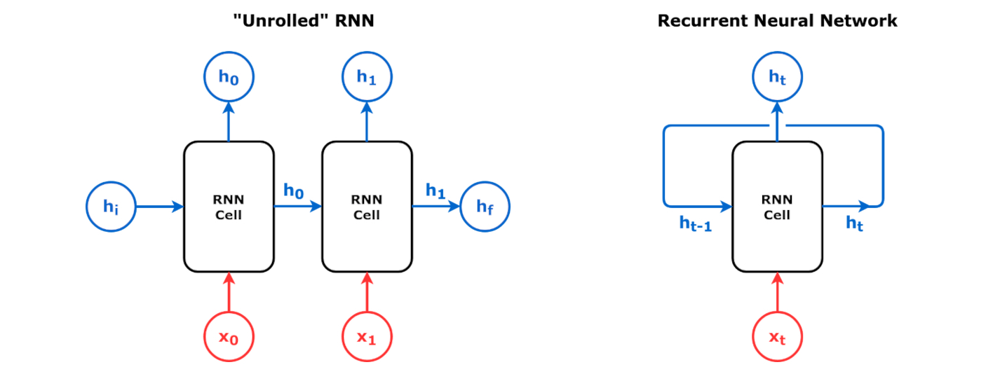
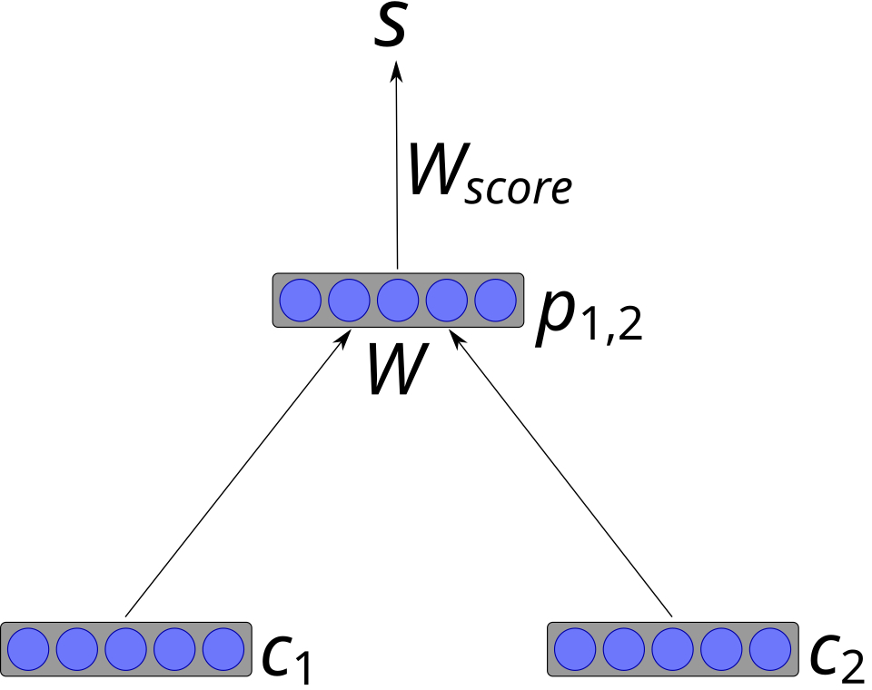
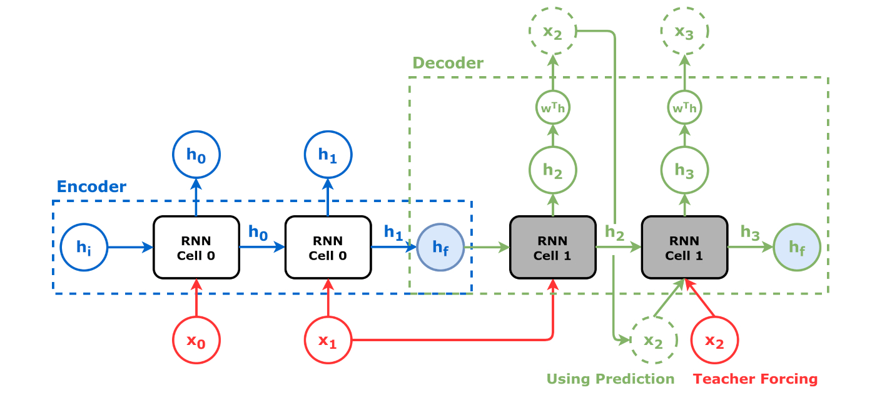
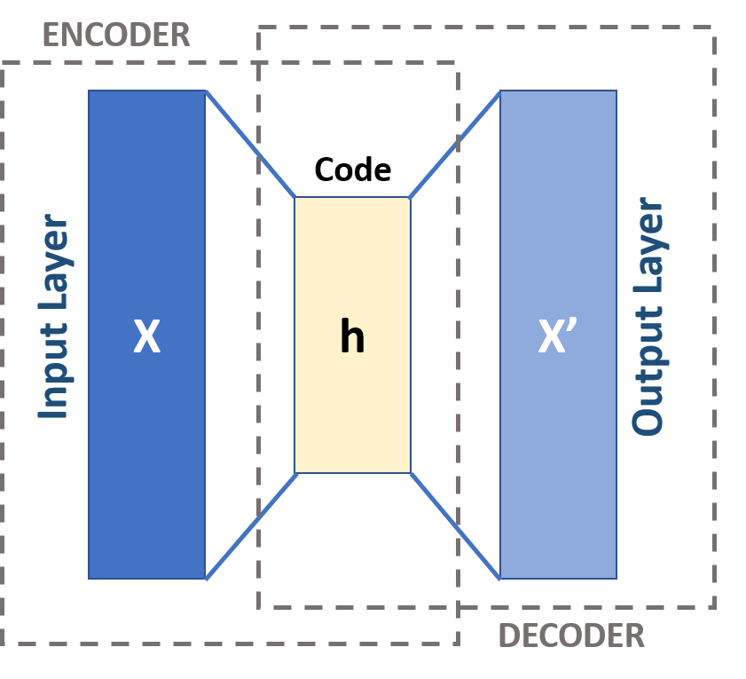
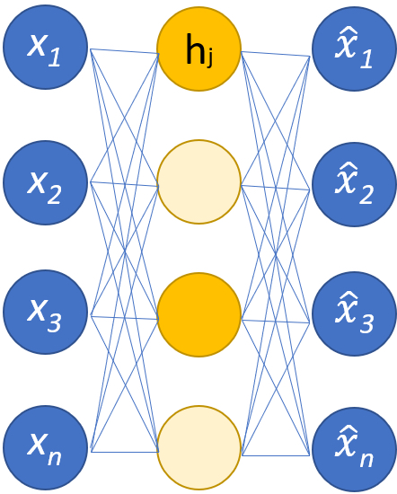
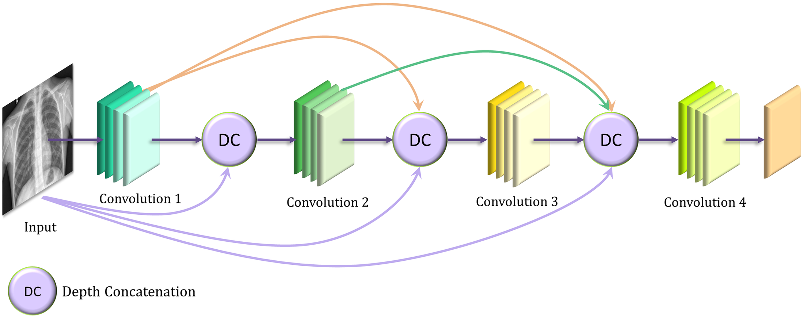
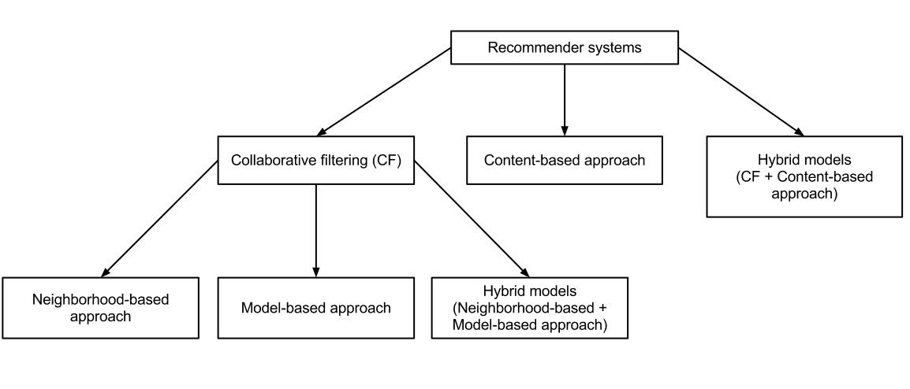
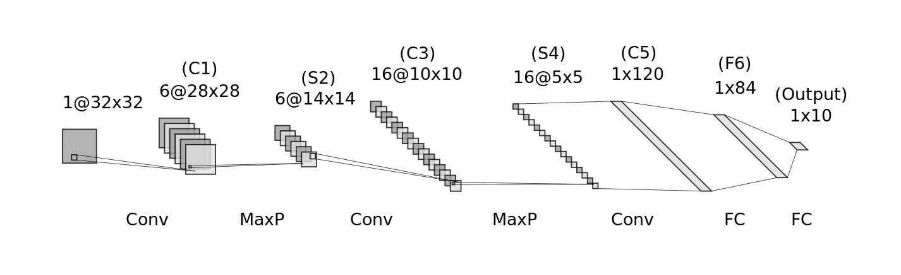
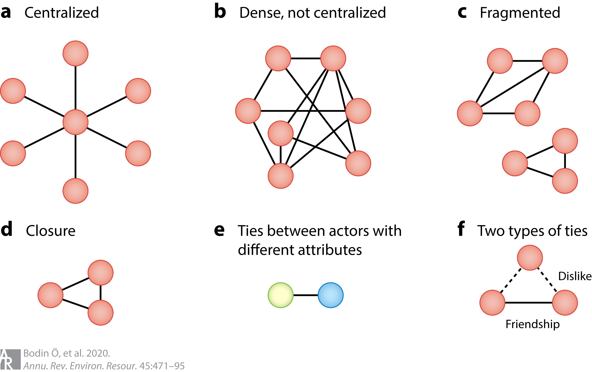

# Deep Learning: 2025 Nov-Dec — detailed answers

[Question paper](DL_Endsem_2025_Nov-Dec.pdf) | [Study index](../Study/README.md)

Question headings are paraphrased; both sides of each OR are answered. Marks follow the paper. Examples are illustrative. The question-paper PDF link requires Git LFS hydration in this checkout. Decode links below point to converted textbook pages; the detailed answers are original explanations and also use the linked study notes.

## Q1(a) — RNNs for sequence modelling and applications [9 marks]

### 1. RNN, operation and types

A **recurrent neural network (RNN)** processes a sequence by updating a hidden state using the current input and the preceding state. Parameters are shared across time. The state summarizes earlier inputs, so the prediction depends on context.



*RNN unrolling and recurrent cell. Daniel Voigt Godoy, [book illustration](https://dvgodoy.github.io/dl-visuals/RNNs/), [CC BY 4.0](https://creativecommons.org/licenses/by/4.0/); converted to JPEG with a white background. Here `h_i` is the initial hidden state; the figure indexes the first input as `x0` rather than `x1`.*

In an unrolled drawing, the horizontal arrows carry `h(t-1)` to the next cell; each cell can produce an output. A clean equation is:

`h_t = tanh(W_xh x_t + W_hh h_(t-1) + b_h)` and `y_t = softmax(W_hy h_t + b_y)`.

**Working:** initialize `h_0`, supply `x_1`, compute `h_1`, then repeat with each new element. Calculate a loss at the required outputs and train using **backpropagation through time (BPTT)**: unroll the network, propagate the loss backward across time, add gradients for the shared parameters, and update them.

**Four recurrent input-output arrangements:**

| Arrangement | Inputs → outputs | Example |
|---|---|---|
| One-to-many | one → sequence | image caption generation |
| Many-to-one | sequence → one | sentiment classification |
| Many-to-many, delayed | input sequence → output sequence after encoding | translation via encoder-decoder |
| Many-to-many, aligned | outputs at corresponding time steps | tagging each word |

The ordinary one-to-one feed-forward model is a baseline rather than a sequential RNN. The book illustrates the two many-to-many cases on [PDF page 27](../Books/DL_Reference_Units03-06.pdf#page=27).

**Advantages:** weight sharing handles sequences of varying lengths and reduces parameter count relative to separately trained time-step models; hidden state carries past context. **Limitations:** sequential computation limits parallelism, long-range dependencies are difficult, and gradients can vanish or explode. Plain RNNs do not guarantee retention of all past information.

#### Feed-forward vs recurrent

| Feature | Feed-forward neural network | RNN |
|---|---|---|
| Flow | Input to output in a directed acyclic network | Hidden state connects successive time steps |
| Context | No built-in state across independent inputs | State represents preceding sequence context |
| Parameters | Usually different across layers | Same recurrent parameters reused across time |
| Natural input | Fixed-size vector | Sequence, potentially variable length |
| Training | Backpropagation | BPTT |
| Example | Classify a fixed feature vector | Predict the next word |

### Reading the architecture

```text
             h0       h1       h2
              ──> [RNN] ──> [RNN] ──> [RNN] ──> h3
                    ↑         ↑         ↑
                    x1        x2        x3
                    ↓         ↓         ↓
                    y1        y2        y3  (when outputs are needed)
```

The same weights are used at each box; this is one network unrolled, not three independently trained networks. For “the movie was good”, each hidden state incorporates the next word. A many-to-one sentiment classifier uses the last or pooled state to predict positive or negative. During training, BPTT sends error backwards through these linked states. Padding and masking can be used to batch variable-length sequences; they do not imply that every sequence has the same true length.

**Four arrangements:**

```text
One-to-many:          image → [h1] → [h2] → [h3]
                               ↓      ↓      ↓
                              "a"   "dog"  "runs"
Many-to-one:          word1 → [h1] → [h2] → [h3] → sentiment
                                      ↑       ↑
                                    word2   word3
Many-to-many aligned: word1 → [h1] → [h2] → [h3]
                               ↓      ↓      ↓
                              tag1   tag2   tag3
                               (word2 and word3 enter h2 and h3)
Many-to-many delayed: source words → [encoder] → [decoder] → translated words
```

In the aligned case, each input has a corresponding output; in the delayed case the input and output lengths can differ. A one-to-one feed-forward model is sometimes shown as a fifth baseline. The single input of an image-captioning model can initialize or condition a recurrent decoder.

### Why variable length and memory matter

At time step t the same transition accepts a new x_t and the previous h_(t−1); neither its weight dimensions nor its parameter count depends on the number of tokens. A 3-word review and a 20-word review can therefore use the same trained transition. For minibatches, padding must be masked so padding is not mistaken for content.

The hidden state carries information forward: after reading “The food was not”, the state can influence the prediction after “good”. This makes order and preceding context relevant. It is an approximate, task-trained memory, however; it is not guaranteed to preserve every earlier token. A bidirectional RNN additionally uses later context, but needs access to it and therefore is not strictly causal. LSTM/GRU gating can improve learning of longer dependencies at extra computational cost.

**References:** [Study: unit-3-rnn](../Study/unit-3-rnn.md) · [Decode page 1 image](../Books/DL_Decode_Units03-06_images/page-001.png).

## Q1(b) — RNN versus feed-forward and RNN operation [9 marks]

### 1. RNN, operation and types

A **recurrent neural network (RNN)** processes a sequence by updating a hidden state using the current input and the preceding state. Parameters are shared across time. The state summarizes earlier inputs, so the prediction depends on context.


*RNN unrolling and recurrent cell. Daniel Voigt Godoy, [book illustration](https://dvgodoy.github.io/dl-visuals/RNNs/), [CC BY 4.0](https://creativecommons.org/licenses/by/4.0/); converted to JPEG with a white background. Here `h_i` is the initial hidden state; the figure indexes the first input as `x0` rather than `x1`.*

In an unrolled drawing, the horizontal arrows carry `h(t-1)` to the next cell; each cell can produce an output. A clean equation is:

`h_t = tanh(W_xh x_t + W_hh h_(t-1) + b_h)` and `y_t = softmax(W_hy h_t + b_y)`.

**Working:** initialize `h_0`, supply `x_1`, compute `h_1`, then repeat with each new element. Calculate a loss at the required outputs and train using **backpropagation through time (BPTT)**: unroll the network, propagate the loss backward across time, add gradients for the shared parameters, and update them.

**Four recurrent input-output arrangements:**

| Arrangement | Inputs → outputs | Example |
|---|---|---|
| One-to-many | one → sequence | image caption generation |
| Many-to-one | sequence → one | sentiment classification |
| Many-to-many, delayed | input sequence → output sequence after encoding | translation via encoder-decoder |
| Many-to-many, aligned | outputs at corresponding time steps | tagging each word |

The ordinary one-to-one feed-forward model is a baseline rather than a sequential RNN. The book illustrates the two many-to-many cases on [PDF page 27](../Books/DL_Reference_Units03-06.pdf#page=27).

**Advantages:** weight sharing handles sequences of varying lengths and reduces parameter count relative to separately trained time-step models; hidden state carries past context. **Limitations:** sequential computation limits parallelism, long-range dependencies are difficult, and gradients can vanish or explode. Plain RNNs do not guarantee retention of all past information.

#### Feed-forward vs recurrent

| Feature | Feed-forward neural network | RNN |
|---|---|---|
| Flow | Input to output in a directed acyclic network | Hidden state connects successive time steps |
| Context | No built-in state across independent inputs | State represents preceding sequence context |
| Parameters | Usually different across layers | Same recurrent parameters reused across time |
| Natural input | Fixed-size vector | Sequence, potentially variable length |
| Training | Backpropagation | BPTT |
| Example | Classify a fixed feature vector | Predict the next word |

### Worked contrast

For the sequence “not good”, a feed-forward classifier can take a fixed feature vector, but needs an explicit representation of the order or context. A recurrent classifier updates its state after “not” and again after “good”; the second update depends on both. This does not imply a feed-forward network can never handle sequences: a fixed window or engineered order-sensitive features can be supplied.

```text
FFNN:  fixed vector ──> hidden layers ──> class
RNN:   word1 ──> state1 ──> state2 ──> class
                              ↑
                            word2
```

An RNN shares its transition parameters across positions, so an input may have a different number of steps from another. Its hidden state is a learned summary, not an exact archive; long dependencies may be forgotten. A plain FFNN does not retain state between independently presented examples.

**References:** [Study: unit-3-rnn](../Study/unit-3-rnn.md) · [Decode page 1 image](../Books/DL_Decode_Units03-06_images/page-001.png).

## Q2(a) — Recursive networks for hierarchy and applications [9 marks]

### 4. Recursive neural networks and comparison

A **recursive neural network (RvNN)** repeatedly combines child representations over a tree, for example a parse tree. The same composition function is applied at different tree nodes. It is suitable when the data has known hierarchical structure, such as a parsed sentence or an expression tree.



*Recursive neural network by Daniel Hershcovich, [Wikimedia Commons](https://commons.wikimedia.org/wiki/File:Simple_recursive_neural_network.svg), [CC0 1.0](https://creativecommons.org/publicdomain/zero/1.0/); rasterized and converted to JPEG with a white background. `c1` and `c2` are child vectors; `p1,2` is their parent representation and `s` is an optional score.*

For children `h_left`, `h_right`, a simple parent representation is `h_parent = tanh(W [h_left; h_right] + b)`. Compute leaves first, then combine upwards. A tree can support sentence-level sentiment or structured document classification. A tree choice can introduce errors and tree processing can be less convenient when no reliable hierarchy is available.

| Property | Feed-forward | Recurrent RNN | Recursive RvNN |
|---|---|---|---|
| Structure | Fixed layers | Chain through time | Tree or hierarchy |
| Shared computation | Not necessarily | Across time | Across tree nodes |
| Typical input | Vector | Ordered sequence | Parse tree / expression tree |
| Context | Fixed receptive input | Earlier sequence state | Child and subtree composition |

**Related book topics:** bidirectional RNNs use both past and future context when the full sequence is available; GRU is a gated alternative to LSTM. A bidirectional model is not suitable for strictly causal prediction unless future context is available.

### Tree computation and variants

```text
                   sentence representation
                      /           \
                noun phrase      verb phrase
                 /    \           /    \
               the    film       is   good
```

Leaf vectors come from word embeddings; a shared composition function combines the children into their parent, then repeats upward. A classifier can use the root representation, or a model can label individual subtrees. In “not good”, composing the negation with “good” can change the phrase representation before the rest of the sentence is combined.

Illustrative variants include a **binary tree RvNN**, combining two children at a time; a **tree-structured LSTM**, which adds gates and cell states at tree nodes; and a **recursive autoencoder**, which composes children and learns to reconstruct child representations. Other tree shapes and composition functions are possible, so “types” are not one universally fixed list. Compared with a chain RNN, a tree exposes hierarchical relationships and shares composition parameters across nodes, but needs a suitable structure and may propagate parsing errors.

**References:** [Study: unit-3-rnn](../Study/unit-3-rnn.md) · [Decode page 1 image](../Books/DL_Decode_Units03-06_images/page-001.png).

## Q2(b) — Recursive, recurrent and feed-forward networks [9 marks]

### 4. Recursive neural networks and comparison

A **recursive neural network (RvNN)** repeatedly combines child representations over a tree, for example a parse tree. The same composition function is applied at different tree nodes. It is suitable when the data has known hierarchical structure, such as a parsed sentence or an expression tree.


*Recursive neural network by Daniel Hershcovich, [Wikimedia Commons](https://commons.wikimedia.org/wiki/File:Simple_recursive_neural_network.svg), [CC0 1.0](https://creativecommons.org/publicdomain/zero/1.0/); rasterized and converted to JPEG with a white background. `c1` and `c2` are child vectors; `p1,2` is their parent representation and `s` is an optional score.*

For children `h_left`, `h_right`, a simple parent representation is `h_parent = tanh(W [h_left; h_right] + b)`. Compute leaves first, then combine upwards. A tree can support sentence-level sentiment or structured document classification. A tree choice can introduce errors and tree processing can be less convenient when no reliable hierarchy is available.

| Property | Feed-forward | Recurrent RNN | Recursive RvNN |
|---|---|---|---|
| Structure | Fixed layers | Chain through time | Tree or hierarchy |
| Shared computation | Not necessarily | Across time | Across tree nodes |
| Typical input | Vector | Ordered sequence | Parse tree / expression tree |
| Context | Fixed receptive input | Earlier sequence state | Child and subtree composition |

**Related book topics:** bidirectional RNNs use both past and future context when the full sequence is available; GRU is a gated alternative to LSTM. A bidirectional model is not suitable for strictly causal prediction unless future context is available.

### 1. RNN, operation and types

A **recurrent neural network (RNN)** processes a sequence by updating a hidden state using the current input and the preceding state. Parameters are shared across time. The state summarizes earlier inputs, so the prediction depends on context.


*RNN unrolling and recurrent cell. Daniel Voigt Godoy, [book illustration](https://dvgodoy.github.io/dl-visuals/RNNs/), [CC BY 4.0](https://creativecommons.org/licenses/by/4.0/); converted to JPEG with a white background. Here `h_i` is the initial hidden state; the figure indexes the first input as `x0` rather than `x1`.*

In an unrolled drawing, the horizontal arrows carry `h(t-1)` to the next cell; each cell can produce an output. A clean equation is:

`h_t = tanh(W_xh x_t + W_hh h_(t-1) + b_h)` and `y_t = softmax(W_hy h_t + b_y)`.

**Working:** initialize `h_0`, supply `x_1`, compute `h_1`, then repeat with each new element. Calculate a loss at the required outputs and train using **backpropagation through time (BPTT)**: unroll the network, propagate the loss backward across time, add gradients for the shared parameters, and update them.

**Four recurrent input-output arrangements:**

| Arrangement | Inputs → outputs | Example |
|---|---|---|
| One-to-many | one → sequence | image caption generation |
| Many-to-one | sequence → one | sentiment classification |
| Many-to-many, delayed | input sequence → output sequence after encoding | translation via encoder-decoder |
| Many-to-many, aligned | outputs at corresponding time steps | tagging each word |

The ordinary one-to-one feed-forward model is a baseline rather than a sequential RNN. The book illustrates the two many-to-many cases on [PDF page 27](../Books/DL_Reference_Units03-06.pdf#page=27).

**Advantages:** weight sharing handles sequences of varying lengths and reduces parameter count relative to separately trained time-step models; hidden state carries past context. **Limitations:** sequential computation limits parallelism, long-range dependencies are difficult, and gradients can vanish or explode. Plain RNNs do not guarantee retention of all past information.

#### Feed-forward vs recurrent

| Feature | Feed-forward neural network | RNN |
|---|---|---|
| Flow | Input to output in a directed acyclic network | Hidden state connects successive time steps |
| Context | No built-in state across independent inputs | State represents preceding sequence context |
| Parameters | Usually different across layers | Same recurrent parameters reused across time |
| Natural input | Fixed-size vector | Sequence, potentially variable length |
| Training | Backpropagation | BPTT |
| Example | Classify a fixed feature vector | Predict the next word |

### Tree computation and variants

```text
                   sentence representation
                      /           \
                noun phrase      verb phrase
                 /    \           /    \
               the    film       is   good
```

Leaf vectors come from word embeddings; a shared composition function combines the children into their parent, then repeats upward. A classifier can use the root representation, or a model can label individual subtrees. In “not good”, composing the negation with “good” can change the phrase representation before the rest of the sentence is combined.

Illustrative variants include a **binary tree RvNN**, combining two children at a time; a **tree-structured LSTM**, which adds gates and cell states at tree nodes; and a **recursive autoencoder**, which composes children and learns to reconstruct child representations. Other tree shapes and composition functions are possible, so “types” are not one universally fixed list. Compared with a chain RNN, a tree exposes hierarchical relationships and shares composition parameters across nodes, but needs a suitable structure and may propagate parsing errors.

### Worked contrast

For the sequence “not good”, a feed-forward classifier can take a fixed feature vector, but needs an explicit representation of the order or context. A recurrent classifier updates its state after “not” and again after “good”; the second update depends on both. This does not imply a feed-forward network can never handle sequences: a fixed window or engineered order-sensitive features can be supplied.

```text
FFNN:  fixed vector ──> hidden layers ──> class
RNN:   word1 ──> state1 ──> state2 ──> class
                              ↑
                            word2
```

An RNN shares its transition parameters across positions, so an input may have a different number of steps from another. Its hidden state is a learned summary, not an exact archive; long dependencies may be forgotten. A plain FFNN does not retain state between independently presented examples.

**References:** [Study: unit-3-rnn](../Study/unit-3-rnn.md) · [Decode page 1 image](../Books/DL_Decode_Units03-06_images/page-001.png).

## Q3(a) — Encoder-decoder architecture and uses [8 marks]

### 3. Encoder-decoder / sequence-to-sequence



*Encoder-decoder example. Daniel Voigt Godoy, [book illustration](https://dvgodoy.github.io/dl-visuals/Seq2Seq/), [CC BY 4.0](https://creativecommons.org/licenses/by/4.0/); converted to JPEG with a white background. The example uses its final encoder input to start decoding; start-token conventions vary.*

1. Tokenize the input sequence and encode its elements into hidden states.
2. The decoder uses the encoded context and the previously generated token to predict the next token.
3. During training **teacher forcing** may feed the true preceding token; at inference the model instead uses its own prediction.
4. Generate until an end token or length limit. A translation model can map an English sentence to a Hindi sentence of different length.
5. A fixed context vector can be a bottleneck for long sequences. **Attention** lets the decoder weight different encoder states at each output step.

This sequence-to-sequence architecture is distinct from an autoencoder: a seq2seq model can map one sequence to a different target; an autoencoder is trained to reconstruct its input.

### 1. Architecture, reconstruction and bottleneck

An **autoencoder** learns a representation by encoding an input and decoding it to reconstruct that same input. It generally needs no manually supplied class labels; the input itself supplies the reconstruction target, so the task is commonly called unsupervised or self-supervised representation learning.



*Autoencoder schema by Michela Massi, [Wikimedia Commons](https://commons.wikimedia.org/wiki/File:Autoencoder_schema.png), [CC BY-SA 4.0](https://creativecommons.org/licenses/by-sa/4.0/); converted to JPEG with a white background. The figure's `h` is the latent code `z` in the equations below.*

For example, `z = f(Wx+b)` and `x̂ = g(W'z+b')`; train both sets of parameters to minimize average reconstruction loss. Continuous inputs often use mean squared error (MSE); binary inputs with a probabilistic decoder may use binary cross-entropy. The choice should fit the data and decoder output.

**Working:** (1) provide training samples, (2) map each to a latent representation, (3) reconstruct it, (4) measure error, (5) backpropagate and update weights. An autoencoder is not guaranteed to learn useful structure: a sufficiently flexible model may simply copy the input. A bottleneck or regularization discourages trivial copying.

**Bottleneck:** a restriction on the information passed through the code, often a smaller latent dimension. It encourages the model to preserve information useful for reconstruction. Too small a bottleneck can discard important information and increase error.

#### Autoencoder vs PCA vs clustering

| Aspect | Autoencoder | PCA | Clustering |
|---|---|---|---|
| Objective | Learn encoding and reconstruction, typically using gradient descent | Find orthogonal linear directions maximizing projected variance | Group similar samples under a chosen criterion |
| Mapping | Can be nonlinear | Linear | Produces groups/assignments, not necessarily a reconstruction |
| Output | Latent code and reconstruction | Projection onto principal components | Cluster label or membership |
| Training | Architecture and hyperparameters matter | Closed-form decomposition is common | Algorithm-dependent, e.g. k-means |

A linear undercomplete autoencoder under suitable conditions can recover a PCA-equivalent subspace; nonlinear autoencoders are not automatically superior and may overfit.

#### Hyperparameters for an 8-mark answer

1. **Latent size:** capacity of representation and compression; too small loses information.
2. **Activation:** ReLU/tanh for hidden layers; output activation must match target range, such as sigmoid for inputs scaled to `[0,1]`.
3. **Loss:** MSE for continuous reconstruction or binary cross-entropy for suitable binary/probabilistic data.
4. **Learning rate:** update size; too large can diverge, too small can train slowly.
5. **Batch size:** examples per update; affects memory and gradient noise.
6. **Early stopping:** stop when validation loss stops improving to reduce overfitting.
7. **Initialization:** appropriate Xavier/He-style initialization helps signal and gradient flow.
8. **Regularization strength and training epochs:** tune using validation data rather than the test set.

### Example and training versus inference

```text
input:  I → am → ready → [encoder] → context / encoder states
                                        ↓
                         [decoder] → Je → suis → prêt → <end>
```

The encoder reads the source in order and forms context. The decoder conditions on that context and previous output, predicting a probability distribution for its next token. During teacher-forced training, the previous target word may be provided; at inference, only already-generated words are available. An end token terminates generation, subject to a maximum length. With attention, each output can use a weighted combination of the encoder states instead of relying exclusively on a fixed-size final state. This supports different input/output lengths; incorrect attention or an inadequate training set can still cause translation errors.

### Training and inference walkthrough

```text
input x ──> encoder fθ ──> latent code z ──> decoder gφ ──> reconstruction x̂
   └──────────────── target for reconstruction loss ────────────┘
```

For an image of 784 normalized pixels, an encoder might produce a 32-number code and the decoder reconstruct 784 values. Compare x̂ with the original x, average the loss over a minibatch, backpropagate through both networks, and update θ and φ. Once trained, the encoder alone can supply features; the full pair reconstructs input. This is self-supervised in the sense that the target is derived from the input, without manual class labels. Architecture, latent size, output activation and loss should fit the data. A small reconstruction error alone does not prove that the representation is semantically useful.

**References:** [Study: unit-3-rnn](../Study/unit-3-rnn.md) · [Decode page 1 image](../Books/DL_Decode_Units03-06_images/page-001.png) · [Study: unit-4-autoencoders](../Study/unit-4-autoencoders.md) · [Decode page 12 image](../Books/DL_Decode_Units03-06_images/page-012.png).

## Q3(b) — Regularized autoencoders and uses [9 marks]

### 2. Undercomplete and sparse autoencoders

An **undercomplete** autoencoder has a latent dimension smaller than its input dimension. The restricted code forces compression, but a nonlinear network may still learn an unhelpful mapping if overpowered.

A **sparse** autoencoder adds a penalty that encourages only a small fraction of latent units to activate for a given input. The code need not be smaller than the input.



*Single-layer sparse autoencoder by Michela Massi, [Wikimedia Commons](https://commons.wikimedia.org/wiki/File:Autoencoder_sparso.png), [CC BY-SA 4.0](https://creativecommons.org/licenses/by-sa/4.0/); converted to JPEG with a white background.*

A typical objective is:

`L = L_reconstruction + λ × sparsity_penalty`.

The penalty can use an L1 penalty on activations or a KL-divergence term comparing average activation to a small target. It encourages selective features, not necessarily a smaller number of neurons. Sparse codes can aid feature discovery, but too much sparsity harms reconstruction.

| Property | Undercomplete | Sparse |
|---|---|---|
| Main constraint | Latent dimension < input dimension | Few units active for each sample |
| Code dimension | Smaller | May be small or large |
| Mechanism | Structural bottleneck | Activation penalty |
| Typical purpose | Compression | Selective feature learning |

Both can be used together. **Regularized autoencoder** is a broader family that discourages trivial copying by adding a constraint, penalty, or noise; sparse, denoising and contractive variants are examples.

### 5. Applications and exam answer

- **Dimensionality reduction / retrieval:** encode documents or images into compact vectors, index them, encode a query, then rank items by cosine similarity or distance. The encoder must be trained on suitable data; reconstruction alone does not ensure semantic retrieval quality.
- **Denoising:** reconstruct clean signals from noisy observations after suitable training.
- **Anomaly detection:** train on normal examples and flag unusually high reconstruction error; validate a threshold, since anomalies may sometimes reconstruct well.
- **Feature learning:** use latent codes as features for a classifier.
- **Compression:** store/transmit latent codes and decode, considering quantization and reconstruction quality.
- **Generation:** use an appropriate probabilistic model such as a VAE.

For a 9-mark application answer, draw the encoder-decoder, explain training and inference separately, give two concrete applications and state a limitation.

### How sparsity changes learning

```text
input → encoder → [ 0   0.8   0   0.6   0 ] → decoder → reconstruction
                         only some units active
```

With an L1 penalty, the objective is reconstruction loss plus λ times the sum of absolute hidden activations. Increasing λ encourages more values toward zero. An alternative penalizes divergence between a small desired average activation and each unit's average activation over the training set. Unlike a merely undercomplete code, a sparse code can have more units than the input but still use few at a time. Sparse features can be selective and reusable; excessive regularization or an unsuitable penalty may degrade reconstruction and downstream accuracy. Sparsity is encouraged, not guaranteed for every sample by every penalty.

### Two application walkthroughs

**Information retrieval:** train an encoder on representative documents or images, encode each database item, and store its vector in an index. Encode a new query by the same preprocessing and model, compute cosine similarity or another distance, and return the nearest candidates. The compact vector speeds similarity search and reduces feature storage, but a reconstruction objective alone may not preserve the semantic similarity a user wants. Evaluate retrieval with relevance-labelled queries.

**Anomaly detection:** train on normal sensor readings, then measure each new sample's reconstruction error. Choose a threshold using validation data and investigate points above it. A high error can suggest an unusual pattern, not prove a fault; some anomalies reconstruct well and normal observations may have high error. A denoising autoencoder and a classifier using latent features are other applications.

**References:** [Study: unit-4-autoencoders](../Study/unit-4-autoencoders.md) · [Decode page 12 image](../Books/DL_Decode_Units03-06_images/page-012.png).

## Q4(a) — Applications of autoencoders [8 marks]

### 5. Applications and exam answer

- **Dimensionality reduction / retrieval:** encode documents or images into compact vectors, index them, encode a query, then rank items by cosine similarity or distance. The encoder must be trained on suitable data; reconstruction alone does not ensure semantic retrieval quality.
- **Denoising:** reconstruct clean signals from noisy observations after suitable training.
- **Anomaly detection:** train on normal examples and flag unusually high reconstruction error; validate a threshold, since anomalies may sometimes reconstruct well.
- **Feature learning:** use latent codes as features for a classifier.
- **Compression:** store/transmit latent codes and decode, considering quantization and reconstruction quality.
- **Generation:** use an appropriate probabilistic model such as a VAE.

For a 9-mark application answer, draw the encoder-decoder, explain training and inference separately, give two concrete applications and state a limitation.

### Two application walkthroughs

**Information retrieval:** train an encoder on representative documents or images, encode each database item, and store its vector in an index. Encode a new query by the same preprocessing and model, compute cosine similarity or another distance, and return the nearest candidates. The compact vector speeds similarity search and reduces feature storage, but a reconstruction objective alone may not preserve the semantic similarity a user wants. Evaluate retrieval with relevance-labelled queries.

**Anomaly detection:** train on normal sensor readings, then measure each new sample's reconstruction error. Choose a threshold using validation data and investigate points above it. A high error can suggest an unusual pattern, not prove a fault; some anomalies reconstruct well and normal observations may have high error. A denoising autoencoder and a classifier using latent features are other applications.

**References:** [Study: unit-4-autoencoders](../Study/unit-4-autoencoders.md) · [Decode page 12 image](../Books/DL_Decode_Units03-06_images/page-012.png).

## Q4(b) — Contractive versus stochastic autoencoders [9 marks]

### 3. Denoising and contractive autoencoders

#### Denoising autoencoder

Corrupt the input, e.g. with masking or Gaussian noise. Feed the corrupted version to the encoder but compare the reconstruction with the **original clean input**. Repeating this process teaches the model to preserve stable features and can remove a noise pattern similar to the training corruption. It is not guaranteed to repair arbitrary noise.

#### Contractive autoencoder

A contractive autoencoder penalizes the sensitivity of the encoder representation to small input changes:

`L = L_reconstruction + λ ||∂f(x)/∂x||²_F`.

The term is the squared Frobenius norm of the encoder Jacobian. It encourages nearby inputs to have similar codes, improving local robustness. Applications include learning noise-resistant features for classification or retrieval. The penalty can make training more expensive and excessive regularization can suppress useful distinctions.

| Feature | Denoising | Contractive |
|---|---|---|
| Method | Corrupt inputs and reconstruct clean originals | Penalize encoder sensitivity to input changes |
| Main objective | Undo chosen corruption | Make local representation insensitive |
| Training cost | Multiple corrupted samples may help | Jacobian penalty adds computation |

### 4. Stochastic encoders and decoders

Unlike a deterministic mapping that gives one code for an input, a **stochastic encoder** models a conditional distribution `q(z|x)` and samples a code. A stochastic decoder models `p(x|z)` and can sample reconstructions. This represents uncertainty and can support generation.

One example is a variational autoencoder: the encoder predicts parameters of a latent distribution; a sampled latent vector goes to a decoder; training balances reconstruction quality with a KL term that encourages a chosen latent prior. Do not equate every stochastic autoencoder with a VAE, and do not claim its samples always reconstruct perfectly.

### Contractive objective and intuition

```text
x ──> encoder f ──> code z ──> decoder ──> x̂
          │                         │
  penalize sensitivity       reconstruction loss
     of z to x
```

The loss adds λ‖J_f(x)‖²_F, with J_f the matrix of partial derivatives of each code component with respect to each input component. If x changes slightly, the penalty encourages a small change in z. For sensor readings, tiny perturbations can then map to nearby codes, useful for robust feature extraction or retrieval. Unlike a denoising model, the penalty explicitly targets local encoder sensitivity; unlike a plain autoencoder, the objective has this additional term. Too large a λ can suppress meaningful distinctions, and the Jacobian adds training cost.

### Probabilistic encoding and decoding

```text
x → encoder → parameters of q(z|x) → sample z → decoder → parameters of p(x|z) → x̂
```

Instead of producing exactly one latent vector, a stochastic encoder defines a distribution over latent values. A stochastic decoder similarly defines a distribution over outputs, so repeated samples can differ. In a variational autoencoder, a Gaussian encoder can predict a mean and variance; a sample is decoded, while a KL term encourages the latent distribution toward a prior. A reparameterized sample permits gradient-based training. This is one important example, not the definition of all stochastic autoencoders. A contractive penalty instead explicitly discourages local changes to the code; stochasticity and contraction are distinct properties and can in principle coexist.

### Contractive versus stochastic

| Aspect | Contractive autoencoder | Stochastic encoder/decoder |
|---|---|---|
| Core idea | Penalize how sensitively the encoder changes with input | Model a conditional distribution and sample a code or output |
| Typical objective | Reconstruction plus encoder-Jacobian penalty | Depends on model; a VAE uses reconstruction plus a KL term |
| Goal | Locally stable features | Represent uncertainty or generate samples |
| Example | Stable representation of slightly perturbed sensor readings | Sample plausible outputs from a learned latent distribution |

These are not mutually exclusive design constraints: a model can include both stochastic components and a sensitivity penalty.

**References:** [Study: unit-4-autoencoders](../Study/unit-4-autoencoders.md) · [Decode page 12 image](../Books/DL_Decode_Units03-06_images/page-012.png).

## Q5(a) — CNN variants and one architecture in detail [9 marks]

### 4. CNN variants and DenseNet

CNN variants differ in their arrangement of convolutions, skip connections and feature reuse. Examples include:

- **LeNet:** early convolution, pooling and dense classifier architecture.
- **VGG:** stacks many small convolution filters; straightforward but can be computationally heavy.
- **Inception:** parallel branches with different receptive fields.
- **ResNet:** skip connections add earlier activations to later outputs.
- **DenseNet:** each layer receives a concatenation of all preceding feature maps within its dense block.

#### DenseNet: an exam-ready explanation

For the book's dense-block illustration, see [PDF page 70](../Books/DL_Reference_Units03-06.pdf#page=70).



*DenseNet connections by Rohit Kundu, Ritacheta Das, Zong Woo Geem, Gi-Tae Han and Ram Sarkar, [PLOS figure](https://plos.figshare.com/articles/figure/Basic_architecture_of_the_DenseNet_convolutional_neural_network_model_/16580015), [CC BY 4.0](https://creativecommons.org/licenses/by/4.0/); converted from TIFF to PNG. DC means depth (channel) concatenation.*

Within a block, `x_l = H_l([x_0, x_1, ..., x_(l-1)])`, where brackets denote **channel-wise concatenation**, not addition. `H_l` commonly includes normalization, activation and convolution. Each layer contributes `k` new feature maps, where `k` is the **growth rate**. Transition layers between blocks typically use 1×1 convolution and pooling to reduce dimensions.

Dense connections encourage feature reuse, provide short paths for gradient flow and can reduce redundant parameters. DenseNet can perform well in image classification, including with limited data when transfer learning is appropriate; no model is best for every dataset. Concatenation increases feature-map memory and implementation cost. Compare models on the same held-out data before claiming superiority.

### Follow feature maps through a dense block

```text
x0 ─────┬────────────┬──────────────┐
        ↓            ↓              ↓
       H1 → x1 ──────┼──────────────┤
                     ↓              ↓
                H2([x0,x1]) → x2 ───┤
                                    ↓
                           H3([x0,x1,x2]) → x3
```

If x0 has 64 channels and each layer contributes growth rate k=16, the third layer receives 64+16+16=96 channels; after it produces 16 channels, the block output has 112. Each H generally includes normalization, activation and convolution. Between dense blocks a transition layer can use 1×1 convolution and pooling; global average pooling and a classifier can produce class scores.

Dense concatenation reuses early features and creates shorter paths for gradient flow, often allowing parameter-efficient feature learning. Unlike ResNet's elementwise addition, DenseNet keeps earlier maps by concatenating channels. It can be useful for classification, but memory cost and latency may rise because many maps must be retained. Whether it is good for a given dataset must be established using held-out evaluation.

**References:** [Study: unit-5-representation](../Study/unit-5-representation.md) · [Decode page 19 image](../Books/DL_Decode_Units03-06_images/page-019.png).

## Q5(b) — Domain adaptation examples [9 marks]

### 3. Transfer learning and domain adaptation

**Transfer learning** reuses knowledge from a source task/domain to help a target task/domain. For example, start with an image classifier pretrained on a large image collection and adapt it to classify a smaller set of medical images.

1. Select a relevant pretrained model.
2. Prepare target data with the model's required preprocessing and a separate validation/test split.
3. Replace its output head for the target labels.
4. Train the new head with the feature extractor frozen.
5. If data and compute permit, unfreeze some layers and fine-tune at a suitably small learning rate; monitor validation performance.

It can reduce data and training needs. If source and target are very different, **negative transfer** can reduce accuracy; pretrained features may carry bias. Evaluate against a target-only baseline.

**Domain adaptation** addresses a shift between source and target data distributions for a related task. Example: train sentiment analysis on product reviews and adapt to movie reviews. Approaches include fine-tuning with target labels, reweighting examples or learning domain-invariant features. Unsupervised domain adaptation uses labelled source data and unlabelled target data, with assumptions about shared task structure.

| Aspect | Transfer learning | Domain adaptation |
|---|---|---|
| Scope | Broad reuse across tasks and/or domains | Usually same or related task with domain shift |
| Example | Generic object classifier → defect classifier | Daytime driving images → nighttime driving images |
| Main concern | Whether learned knowledge transfers | Difference in feature or data distribution |

**Homogeneous adaptation:** source and target have the same feature space, e.g. RGB images from two cameras. **Heterogeneous adaptation:** feature spaces differ, e.g. text and image representations, requiring a suitable shared mapping; a shared semantic task/labels may still be needed. Same feature space does not mean identical data distributions.

### Domain adaptation in practice

A **domain** includes the feature space and input distribution; a task defines the prediction objective. Consider labelled daytime road images (source) and mostly unlabelled nighttime road images (target), both for pedestrian detection. The task is related but the lighting distribution shifts. Start from the source model, then use labelled target examples for fine-tuning if available, or use an unsupervised domain-adaptation method with labelled source and unlabelled target. Reweighting, domain-invariant features or carefully validated augmentation are possible strategies.

In **homogeneous** adaptation the feature spaces match, such as RGB images from different cameras; their distributions may still differ. In **heterogeneous** adaptation feature spaces differ and a shared representation or mapping is needed. Domain adaptation is a focused case of transfer; broader transfer can also involve a different task. Neither guarantees improvement: target labels or a suitable evaluation set are needed to measure target performance.

**References:** [Study: unit-5-representation](../Study/unit-5-representation.md) · [Decode page 19 image](../Books/DL_Decode_Units03-06_images/page-019.png).

## Q6(a) — Distributed representation examples [9 marks]

### 1. Representation learning and distributed representations

A **representation** transforms raw data into features useful for a task. Representation learning lets a model learn these features from data rather than relying exclusively on hand-designed features. A CNN can learn edges, then textures, then combinations associated with objects.

Good representations may expose task-relevant factors, suppress irrelevant variation and transfer to related tasks. However, usefulness depends on the objective, data and evaluation; a feature good for reconstruction is not automatically best for classification.

**Distributed representation:** an item or concept is encoded by a pattern across multiple units, and a unit can contribute to multiple concepts. For example, a learned word embedding can represent `cat` by a vector such as `[0.2, -0.4, 0.7, ...]`; other words share components and similar contexts can lead to nearby vectors. Numerical values are illustrative, not fixed semantic labels. Distributed codes can share statistical strength and represent combinations compactly, but may be hard to interpret and can inherit data biases.

**Challenges:** choosing useful factors without labels, disentangling correlated factors, limited or biased data, overfitting, distribution shift, invariance without losing discriminative information, computational cost, and interpreting learned features.

### Why the representation matters

```text
raw pixels / words → learned feature vector → classifier / search / another task
```

Raw pixels may change under lighting or translation even though the object class remains the same. A learned representation aims to retain distinctions relevant to the task while discounting nuisance variation. In a CNN, early filters can respond to local edges and later layers combine them into shapes. In a distributed word vector, many coordinates jointly encode a word and each coordinate can participate in representing many words; the numbers are learned, not necessarily independently interpretable. This supports reuse and combinations but can encode training-data bias.

Important challenges include obtaining representative data, separating useful factors from correlated nuisances, avoiding the loss of discriminative detail, generalizing under domain shift, and interpreting/evaluating representations. Compare downstream performance with a baseline rather than assuming a visually compressed representation is useful.

**References:** [Study: unit-5-representation](../Study/unit-5-representation.md) · [Decode page 19 image](../Books/DL_Decode_Units03-06_images/page-019.png).

## Q6(b) — Greedy layer-wise pretraining [9 marks]

### 2. Greedy layer-wise pretraining

Greedy layer-wise pretraining trains a deep model **one layer at a time**, aiming to learn a useful intermediate representation before training the complete network.

1. Train the first layer, for example as an autoencoder, using unlabelled input.
2. Obtain its hidden representations and use them as training data for the next layer.
3. Repeat until the desired depth is reached; each stage learns its local objective greedily rather than optimizing the whole final network at once.
4. Stack the layers, add a task-specific output layer, and **fine-tune** the full network on the task using backpropagation.

Examples of pretraining components include autoencoders and restricted Boltzmann machines; supervised layer-wise methods are also possible. Historically this helped initialize deep networks with limited labels and difficult optimization. Modern activations, initialization, normalization, residual connections and large datasets mean it is not always necessary. Unsupervised reconstruction and the final task can have different objectives.

**Vanishing-gradient link:** gradients propagated through many layers can shrink. Pretraining provides a better starting point, whereas residual connections and suitable architectures are other approaches; it is not a guaranteed cure.

### Two approaches and a concrete example

```text
unlabelled x → train layer 1 → h1 → train layer 2 → h2
                                      ↓
                  stack encoder layers → task head → fine-tune together
```

With stacked **autoencoders**, train the first encoder/decoder to reconstruct inputs; compute first-layer codes and train a second autoencoder to reconstruct those codes. Retain the encoders, add a classifier and fine-tune the complete network on labelled examples. With **restricted Boltzmann machines**, each stage instead learns a probabilistic model of its input; hidden activations become the next stage's input. Supervised layer-wise variants are also possible.

It is **greedy** because each stage optimizes a local objective, **layer-wise** because stages are added one at a time, and **pretraining** because joint task training follows. This can exploit unlabelled examples and improve initialization, particularly in historically difficult deep-network training. It is not guaranteed to help a particular task and has extra training/tuning cost.

**References:** [Study: unit-5-representation](../Study/unit-5-representation.md) · [Decode page 19 image](../Books/DL_Decode_Units03-06_images/page-019.png).

## Q7(a) — Deep learning techniques in NLP [8 marks]

### 5. Natural language processing (NLP)

NLP enables computers to process or generate human language. Applications include translation, sentiment analysis, question answering, information extraction, summarization and chat assistants.

#### RNN-based framework

Convert text to tokens, map tokens to embeddings, process them in order using recurrent states and apply an appropriate task head. For sentiment classification, the final or pooled representation predicts a label; for named-entity recognition, each time step can output a tag. Encoder-decoder architectures can generate translations.

**CNN for NLP:** convolutions over token embeddings capture local patterns such as phrases, followed by pooling and a classifier. Compared with a simple fixed-window CNN, an RNN naturally maintains a state over variable-length sequences. This does **not** make RNNs universally better: CNNs can be parallelized and expanded to larger contexts, while attention-based transformers are widely used for long-range context. Explain the trade-off rather than stating an unconditional preference.

**Limitations:** ambiguous language, long context, out-of-vocabulary or domain-specific terms, bias and unreliable outputs. Evaluate with task-appropriate metrics such as accuracy/F1 for classification or tagging.

### Worked NLP pipelines

```text
text → tokenize → embeddings → RNN states → task head → sentiment / token labels
text → tokenize → embeddings → CNN phrase filters → pool → class
```

For sentiment, a recurrent model reads “not very good” in sequence and uses a final or pooled representation for a positive/negative classifier. For named-entity recognition it predicts a tag at each position. CNN filters over neighboring word embeddings detect local n-gram patterns and can be evaluated in parallel; larger contexts require stacked/dilated layers or other design choices. RNNs naturally carry sequential state and accept variable lengths, but can forget long context and are slower to parallelize. They are not universally preferable to CNNs or transformers.

Other NLP tasks include translation, question answering, summarization, speech transcription post-processing, language modelling and information extraction. Use metrics matched to the task, such as classification accuracy or entity F1, on held-out data.

**References:** [Study: unit-6-applications](../Study/unit-6-applications.md) · [Decode page 23 image](../Books/DL_Decode_Units03-06_images/page-023.png).

## Q7(b) — Deep-learning recommender systems [9 marks]

### 4. Recommender systems

A recommender predicts or ranks items likely to be useful to a user.



*Recommender system approaches by Moshanin, [Wikimedia Commons](https://commons.wikimedia.org/wiki/File:Collaborative_Filtering_in_Recommender_Systems.jpg), [CC BY-SA 3.0](https://creativecommons.org/licenses/by-sa/3.0/); unchanged.*

| Approach | How it works | Strength | Limitation |
|---|---|---|---|
| Content-based | Compare item features with the user's past preferences | Can recommend a new item with known features | May over-specialize; requires informative item features |
| Collaborative filtering | Use patterns in user-item interactions or similar users/items | Can discover preferences without explicit item features | Cold-start users/items and sparse interactions |
| Hybrid | Combine content and collaborative signals | Mitigates some weaknesses of each | More complex and still depends on data quality |

**Example:** if a user watched science-fiction films, content-based filtering uses genre and themes; collaborative filtering uses the preferences of users with similar viewing behavior; a hybrid combines both.

#### Deep-learning based recommendation

Learn user and item embeddings from interactions, combine them with available side information, predict a relevance score, then rank candidate items. Sequence models can use the order of recent actions. Train and evaluate with a realistic temporal split and ranking metrics such as precision@k or recall@k. Avoid claiming high predicted score is a guaranteed preference. Cold start, popularity bias, feedback loops and privacy remain concerns.

### Ranking with learned embeddings

```text
user ID / history → user embedding ──┐
                                    ├→ scoring network → ranked items
item ID / features → item embedding ┘
```

For a movie service, interactions such as viewing or ratings train user and item embeddings. A scoring network combines them, possibly with genre and recent sequence information, and ranks candidates for each user. Explicit ratings and implicit clicks require different interpretations: a missing click is not necessarily dislike. Evaluate top-k recommendations using a temporal train/test split and metrics such as precision@k and recall@k.

Content-based systems can recommend a new item with known features but may over-specialize; collaborative systems exploit shared behavior but struggle with sparse data and new users; hybrids combine signals. Popularity feedback loops, privacy, cold starts and exposure bias require attention even in deep models.

**References:** [Study: unit-6-applications](../Study/unit-6-applications.md) · [Decode page 23 image](../Books/DL_Decode_Units03-06_images/page-023.png).

## Q8(a) — CNNs in computer vision [8 marks]

### 1. Image classification and computer vision

**Image classification** assigns one or more labels to an image, such as identifying a cat. It differs from object detection, which also predicts object locations, and segmentation, which assigns labels to pixels.



*LeNet classifier illustration. Daniel Voigt Godoy, [book illustration](https://dvgodoy.github.io/dl-visuals/Architectures/#lenet), [CC BY 4.0](https://creativecommons.org/licenses/by/4.0/); converted to JPEG with a white background. This is one example of a CNN classifier; architectures vary.*

1. Split labelled images into training, validation and test sets; avoid leakage.
2. Preprocess inputs and optionally augment training images with appropriate transforms.
3. Convolution filters compute local features with shared weights; activation adds nonlinearity.
4. Pooling or strided convolutions reduce spatial dimensions; deeper layers combine features into more complex patterns.
5. A classifier outputs logits and softmax probabilities for mutually exclusive classes; cross-entropy can train the model.
6. Evaluate on held-out images using accuracy and, where useful, a confusion matrix, precision and recall.

**Traditional approach:** extract hand-engineered features such as HOG and train an SVM or another classifier. **Deep approach:** learn features and classifier jointly; transfer learning is useful when labelled data is limited. CNNs benefit from spatial locality, parameter sharing and automatic feature learning, but need computation and representative data. Examples: medical-image support, defect inspection and document recognition. A model is an aid, not a substitute for clinical judgment.

### Classification example and alternatives

```text
image → convolution → activation → pooling → deeper feature maps
      → global pooling / flatten → class logits → softmax → predicted class
```

A filter slides over local pixel regions with shared weights; activation makes the learned mapping nonlinear. Pooling or a strided convolution reduces spatial resolution. Deeper layers combine features, and a classification head produces logits. For mutually exclusive classes, softmax converts logits to class probabilities and cross-entropy trains the model. For example, a model can learn to distinguish cats and dogs from labelled training images and be assessed using a held-out test set.

Other approaches include hand-designed HOG features with an SVM and nearest-neighbour classification. Supervised methods learn from labelled examples; unsupervised clustering groups similar images without automatically naming the groups. CNN advantages include learned features, shared parameters, local spatial structure and transfer from pretrained models. They still require representative data and can fail under distribution shift.

### Beyond whole-image classification

CNNs provide spatial features for **classification** (one or more image labels), **detection** (class plus bounding boxes) and **segmentation** (a label per pixel). A classifier aggregates learned maps into a class score; a detector adds localization heads, while a segmentation model retains or restores spatial resolution. Examples include defect inspection, document recognition and medical-image assistance. Other deep-learning applications include speech transcription, language translation, recommendation, time-series forecasting and anomaly detection. These are different output tasks, not interchangeable names. Accuracy depends on data and deployment conditions; a medical model requires appropriate validation and human oversight.

**References:** [Study: unit-6-applications](../Study/unit-6-applications.md) · [Decode page 23 image](../Books/DL_Decode_Units03-06_images/page-023.png).

## Q8(b) — Social network analysis with deep architectures [9 marks]

### 2. Social network analysis

Model a social network as a graph `G = (V, E)`: **nodes** represent users or entities, **edges** represent relationships, and optional **weights** express interaction strength. Edges can be directed or undirected. Some papers misprint “edges” as “ages”; interpret from graph context.



*Social network characteristics by Örjan Bodin, María Mancilla García and Garry Robins, [Wikimedia Commons](https://commons.wikimedia.org/wiki/File:Social_network_characteristics_diagram.jpg), [CC BY 4.0](https://creativecommons.org/licenses/by/4.0/); unchanged.*

**Node-level centrality:**

| Measure | Idea | Interpretation |
|---|---|---|
| Degree | Number of incident edges; distinguish in/out degree for directed graphs | Direct connections |
| Betweenness | Fraction of shortest paths between other pairs that pass through the node | Potential bridge |
| Closeness | Inverse of total shortest-path distance to other reachable nodes; normalization varies | Proximity to the network |
| Eigenvector | Connections to influential nodes contribute more | Influence through influential neighbors |

For disconnected graphs, state the chosen reachability convention for closeness. **Network-level measures** include density (actual edges divided by possible edges; denominator depends on directedness and self-loops), average path length and clustering coefficient. A high centrality score is not proof of real-world influence.

#### Graph convolution approach

1. Create a graph from users and relationships; give nodes features such as profile or interaction embeddings.
2. For each node, collect neighbor features and aggregate them.
3. Transform the aggregate with learned weights and a nonlinearity; repeat across layers to combine wider neighborhoods.
4. Use the learned embeddings for a task such as node classification, link prediction or community analysis.

A simple GCN layer can be written `H^(l+1) = σ(Â H^l W^l)`, where `Â` is a suitably normalized adjacency matrix with self-loops. Deeper is not always better: oversmoothing, privacy, missing edges and biased interactions are important limitations.

### GCN example and graph measures

```text
user features + friendship graph → neighbor aggregation → node embeddings → task head
                                      (repeat by layer)          ↓
                                                   classify nodes / predict links
```

For an undirected graph A—B—C, B has degree 2 while A and C each have degree 1. The sole A–C shortest path passes through B, so B has greater betweenness than either endpoint. A GCN aggregates each node's own and its neighbors' features, applies learned weights and a nonlinearity, then repeats. Its embeddings can support community analysis, link prediction, recommendation or fraud detection, with appropriate labels and evaluation.

For an undirected loop-free graph with n nodes and m edges, density is 2m/[n(n−1)]. Edge weights can encode interaction frequency; directed edges can distinguish following from being followed. Measures are structural proxies, not proof of actual influence. Protect user privacy and account for missing or biased relationships.

**References:** [Study: unit-6-applications](../Study/unit-6-applications.md) · [Decode page 23 image](../Books/DL_Decode_Units03-06_images/page-023.png).
