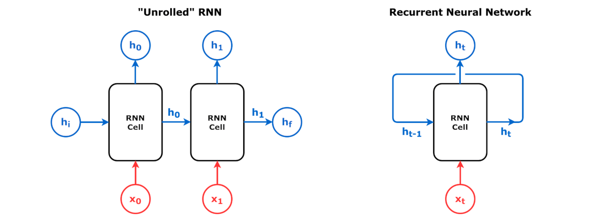
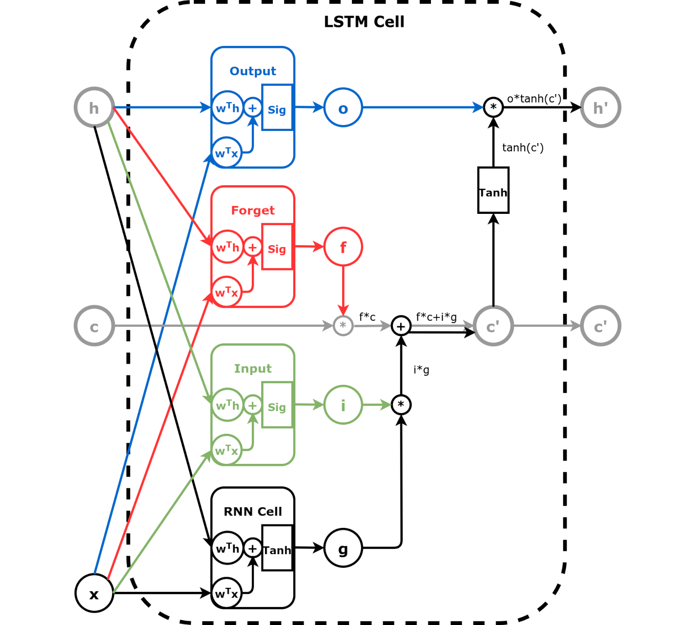
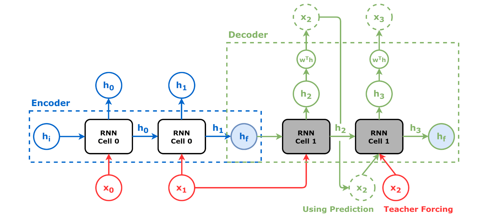
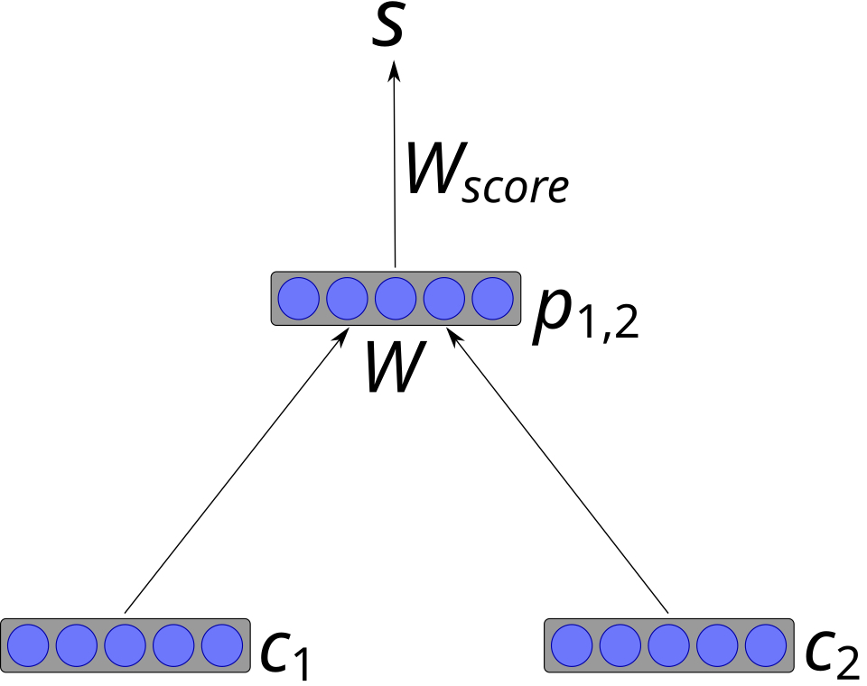

# Unit 3: recurrent neural networks

[Study index](README.md) | Book: [reference, PDF pp. 1–32](../Books/DL_Reference_Units03-06.pdf#page=1). See also [RNN supplement](../Books/DL_TechKnowledge_Unit03_RNN_Supplement.pdf#page=1), whose printed Unit IV belongs to a different syllabus.

## 1. RNN, operation and types

**PYQs:** N22 Q1(a), Q2(b); N23 Q1(b); M24 Q2(a); M25 Q1(a); N25 Q1(a,b); M26 Q1(a,b).

A **recurrent neural network (RNN)** processes a sequence by updating a hidden state using the current input and the preceding state. Parameters are shared across time. The state summarizes earlier inputs, so the prediction depends on context.



*RNN unrolling and recurrent cell. Daniel Voigt Godoy, [book illustration](https://dvgodoy.github.io/dl-visuals/RNNs/), [CC BY 4.0](https://creativecommons.org/licenses/by/4.0/); converted to JPEG with a white background. Here `h_i` is the initial hidden state; the figure indexes the first input as `x0` rather than `x1`.*

In an unrolled drawing, the horizontal arrows carry `h(t-1)` to the next cell; each cell can produce an output. A clean equation is:

`h_t = tanh(W_xh x_t + W_hh h_(t-1) + b_h)` and `y_t = softmax(W_hy h_t + b_y)`.

**Working:** initialize `h_0`, supply `x_1`, compute `h_1`, then repeat with each new element. Calculate a loss at the required outputs and train using **backpropagation through time (BPTT)**: unroll the network, propagate the loss backward across time, add gradients for the shared parameters, and update them.

**Four recurrent input-output arrangements:**

| Arrangement | Inputs → outputs | Example |
|---|---|---|
| One-to-many | one → sequence | image caption generation |
| Many-to-one | sequence → one | sentiment classification |
| Many-to-many, delayed | input sequence → output sequence after encoding | translation via encoder-decoder |
| Many-to-many, aligned | outputs at corresponding time steps | tagging each word |

The ordinary one-to-one feed-forward model is a baseline rather than a sequential RNN. The book illustrates the two many-to-many cases on [PDF page 27](../Books/DL_Reference_Units03-06.pdf#page=27).

**Advantages:** weight sharing handles sequences of varying lengths and reduces parameter count relative to separately trained time-step models; hidden state carries past context. **Limitations:** sequential computation limits parallelism, long-range dependencies are difficult, and gradients can vanish or explode. Plain RNNs do not guarantee retention of all past information.

### Feed-forward vs recurrent

| Feature | Feed-forward neural network | RNN |
|---|---|---|
| Flow | Input to output in a directed acyclic network | Hidden state connects successive time steps |
| Context | No built-in state across independent inputs | State represents preceding sequence context |
| Parameters | Usually different across layers | Same recurrent parameters reused across time |
| Natural input | Fixed-size vector | Sequence, potentially variable length |
| Training | Backpropagation | BPTT |
| Example | Classify a fixed feature vector | Predict the next word |

## 2. Vanishing gradients and LSTM

**PYQs:** N22 Q2(a); M23 Q1(b); N23 Q2(a); M24 Q1(a), Q2(b), Q6(a); M25 Q2(b); M26 Q2(a).

In BPTT, the gradient at an early time step contains products of many recurrent Jacobians. If their effective magnitudes repeatedly fall below one, the gradient shrinks, and early inputs receive little learning signal. Repeated magnitudes above one can instead cause exploding gradients. Gradient clipping limits explosions; LSTM gates provide a more direct route for retaining useful information but do not guarantee the complete elimination of vanishing gradients.

An **LSTM** keeps a cell state `c_t` and hidden state `h_t`. Forget, input and output gates decide what to retain, add and expose. The reference book's LSTM cell illustration is on [PDF page 20](../Books/DL_Reference_Units03-06.pdf#page=20).



*LSTM cell. Daniel Voigt Godoy, [book illustration](https://dvgodoy.github.io/dl-visuals/RNNs/#lstm), [CC BY 4.0](https://creativecommons.org/licenses/by/4.0/); converted to JPEG with a white background. In this figure, `c` and `h` are previous states and `c'` and `h'` are updated states.*

`σ` denotes sigmoid, `⊙` elementwise multiplication, and `[h_(t-1), x_t]` concatenation:

```text
f_t = σ(W_f [h_(t-1), x_t] + b_f)     forget gate
i_t = σ(W_i [h_(t-1), x_t] + b_i)     input gate
g_t = tanh(W_g [h_(t-1), x_t] + b_g)  candidate content
c_t = f_t ⊙ c_(t-1) + i_t ⊙ g_t      updated cell
o_t = σ(W_o [h_(t-1), x_t] + b_o)     output gate
h_t = o_t ⊙ tanh(c_t)                  exposed hidden state
```

**Explain in an exam:** (1) forget gate suppresses irrelevant old information, (2) input gate and candidate select new information, (3) additive update changes the cell state, (4) output gate selects what is exposed. Example: a language model retains a subject's number until the corresponding verb. Used in forecasting, speech, language and time series. Trade-offs: more parameters and slower training than a simple RNN.

## 3. Encoder-decoder / sequence-to-sequence

**PYQs:** N22 Q1(b); M23 Q2(a); N23 Q2(b); M24 Q1(b); N25 Q3(a), as an architecture pattern.



*Encoder-decoder example. Daniel Voigt Godoy, [book illustration](https://dvgodoy.github.io/dl-visuals/Seq2Seq/), [CC BY 4.0](https://creativecommons.org/licenses/by/4.0/); converted to JPEG with a white background. The example uses its final encoder input to start decoding; start-token conventions vary.*

1. Tokenize the input sequence and encode its elements into hidden states.
2. The decoder uses the encoded context and the previously generated token to predict the next token.
3. During training **teacher forcing** may feed the true preceding token; at inference the model instead uses its own prediction.
4. Generate until an end token or length limit. A translation model can map an English sentence to a Hindi sentence of different length.
5. A fixed context vector can be a bottleneck for long sequences. **Attention** lets the decoder weight different encoder states at each output step.

This sequence-to-sequence architecture is distinct from an autoencoder: a seq2seq model can map one sequence to a different target; an autoencoder is trained to reconstruct its input.

## 4. Recursive neural networks and comparison

**PYQs:** M23 Q1(a), Q2(b); N23 Q2(b); M25 Q2(a); N25 Q2(a,b); M26 Q2(b).

A **recursive neural network (RvNN)** repeatedly combines child representations over a tree, for example a parse tree. The same composition function is applied at different tree nodes. It is suitable when the data has known hierarchical structure, such as a parsed sentence or an expression tree.



*Recursive neural network by Daniel Hershcovich, [Wikimedia Commons](https://commons.wikimedia.org/wiki/File:Simple_recursive_neural_network.svg), [CC0 1.0](https://creativecommons.org/publicdomain/zero/1.0/); rasterized and converted to JPEG with a white background. `c1` and `c2` are child vectors; `p1,2` is their parent representation and `s` is an optional score.*

For children `h_left`, `h_right`, a simple parent representation is `h_parent = tanh(W [h_left; h_right] + b)`. Compute leaves first, then combine upwards. A tree can support sentence-level sentiment or structured document classification. A tree choice can introduce errors and tree processing can be less convenient when no reliable hierarchy is available.

| Property | Feed-forward | Recurrent RNN | Recursive RvNN |
|---|---|---|---|
| Structure | Fixed layers | Chain through time | Tree or hierarchy |
| Shared computation | Not necessarily | Across time | Across tree nodes |
| Typical input | Vector | Ordered sequence | Parse tree / expression tree |
| Context | Fixed receptive input | Earlier sequence state | Child and subtree composition |

**Related book topics:** bidirectional RNNs use both past and future context when the full sequence is available; GRU is a gated alternative to LSTM. A bidirectional model is not suitable for strictly causal prediction unless future context is available.
