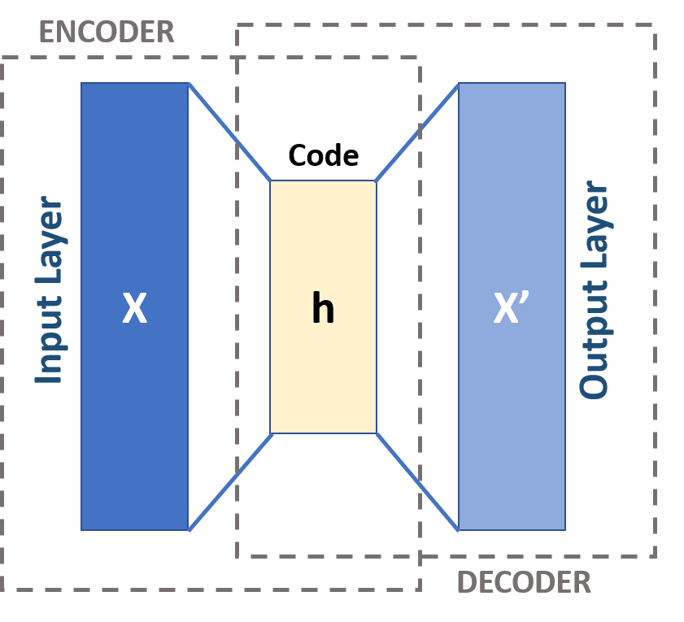
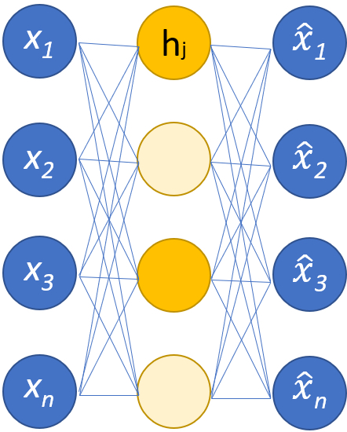

# Unit 4: autoencoders

[Study index](README.md) | Book: [reference, PDF pp. 33–50](../Books/DL_Reference_Units03-06.pdf#page=33).

## 1. Architecture, reconstruction and bottleneck

**PYQs:** N22 Q3(a); M23 Q4(b); M24 Q4(a,b); M25 Q3(a); N25 Q3(a); M26 Q3(a,b,c).

An **autoencoder** learns a representation by encoding an input and decoding it to reconstruct that same input. It generally needs no manually supplied class labels; the input itself supplies the reconstruction target, so the task is commonly called unsupervised or self-supervised representation learning.

*Autoencoder schema by Michela Massi, [Wikimedia Commons](https://commons.wikimedia.org/wiki/File:Autoencoder_schema.png), [CC BY-SA 4.0](https://creativecommons.org/licenses/by-sa/4.0/); converted to JPEG with a white background. The figure's `h` is the latent code `z` in the equations below.*

For example, `z = f(Wx+b)` and `x̂ = g(W'z+b')`; train both sets of parameters to minimize average reconstruction loss. Continuous inputs often use mean squared error (MSE); binary inputs with a probabilistic decoder may use binary cross-entropy. The choice should fit the data and decoder output.

**Working:** (1) provide training samples, (2) map each to a latent representation, (3) reconstruct it, (4) measure error, (5) backpropagate and update weights. An autoencoder is not guaranteed to learn useful structure: a sufficiently flexible model may simply copy the input. A bottleneck or regularization discourages trivial copying.

**Bottleneck:** a restriction on the information passed through the code, often a smaller latent dimension. It encourages the model to preserve information useful for reconstruction. Too small a bottleneck can discard important information and increase error.

### Autoencoder vs PCA vs clustering

| Aspect | Autoencoder | PCA | Clustering |
|---|---|---|---|
| Objective | Learn encoding and reconstruction, typically using gradient descent | Find orthogonal linear directions maximizing projected variance | Group similar samples under a chosen criterion |
| Mapping | Can be nonlinear | Linear | Produces groups/assignments, not necessarily a reconstruction |
| Output | Latent code and reconstruction | Projection onto principal components | Cluster label or membership |
| Training | Architecture and hyperparameters matter | Closed-form decomposition is common | Algorithm-dependent, e.g. k-means |

A linear undercomplete autoencoder under suitable conditions can recover a PCA-equivalent subspace; nonlinear autoencoders are not automatically superior and may overfit.

### Hyperparameters for an 8-mark answer

1. **Latent size:** capacity of representation and compression; too small loses information.
2. **Activation:** ReLU/tanh for hidden layers; output activation must match target range, such as sigmoid for inputs scaled to `[0,1]`.
3. **Loss:** MSE for continuous reconstruction or binary cross-entropy for suitable binary/probabilistic data.
4. **Learning rate:** update size; too large can diverge, too small can train slowly.
5. **Batch size:** examples per update; affects memory and gradient noise.
6. **Early stopping:** stop when validation loss stops improving to reduce overfitting.
7. **Initialization:** appropriate Xavier/He-style initialization helps signal and gradient flow.
8. **Regularization strength and training epochs:** tune using validation data rather than the test set.

## 2. Undercomplete and sparse autoencoders

**PYQs:** M23 Q3(a), Q4(a); N23 Q4(a,b); M24 Q3(a); M25 Q3(a,b); M26 Q4(c).

An **undercomplete** autoencoder has a latent dimension smaller than its input dimension. The restricted code forces compression, but a nonlinear network may still learn an unhelpful mapping if overpowered.

A **sparse** autoencoder adds a penalty that encourages only a small fraction of latent units to activate for a given input. The code need not be smaller than the input.

*Single-layer sparse autoencoder by Michela Massi, [Wikimedia Commons](https://commons.wikimedia.org/wiki/File:Autoencoder_sparso.png), [CC BY-SA 4.0](https://creativecommons.org/licenses/by-sa/4.0/); converted to JPEG with a white background.*

A typical objective is:

`L = L_reconstruction + λ × sparsity_penalty`.

The penalty can use an L1 penalty on activations or a KL-divergence term comparing average activation to a small target. It encourages selective features, not necessarily a smaller number of neurons. Sparse codes can aid feature discovery, but too much sparsity harms reconstruction.

| Property | Undercomplete | Sparse |
|---|---|---|
| Main constraint | Latent dimension < input dimension | Few units active for each sample |
| Code dimension | Smaller | May be small or large |
| Mechanism | Structural bottleneck | Activation penalty |
| Typical purpose | Compression | Selective feature learning |

Both can be used together. **Regularized autoencoder** is a broader family that discourages trivial copying by adding a constraint, penalty, or noise; sparse, denoising and contractive variants are examples.

## 3. Denoising and contractive autoencoders

**PYQs:** N22 Q3(b), Q4(b); N23 Q3(b); M24 Q3(b); M25 Q4(b); N25 Q4(b); M26 Q4(a,b).

### Denoising autoencoder

Corrupt the input, e.g. with masking or Gaussian noise. Feed the corrupted version to the encoder but compare the reconstruction with the **original clean input**. Repeating this process teaches the model to preserve stable features and can remove a noise pattern similar to the training corruption. It is not guaranteed to repair arbitrary noise.

### Contractive autoencoder

A contractive autoencoder penalizes the sensitivity of the encoder representation to small input changes:

`L = L_reconstruction + λ ||∂f(x)/∂x||²_F`.

The term is the squared Frobenius norm of the encoder Jacobian. It encourages nearby inputs to have similar codes, improving local robustness. Applications include learning noise-resistant features for classification or retrieval. The penalty can make training more expensive and excessive regularization can suppress useful distinctions.

| Feature | Denoising | Contractive |
|---|---|---|
| Method | Corrupt inputs and reconstruct clean originals | Penalize encoder sensitivity to input changes |
| Main objective | Undo chosen corruption | Make local representation insensitive |
| Training cost | Multiple corrupted samples may help | Jacobian penalty adds computation |

## 4. Stochastic encoders and decoders

**PYQs:** M25 Q4(a); N25 Q4(b).

Unlike a deterministic mapping that gives one code for an input, a **stochastic encoder** models a conditional distribution `q(z|x)` and samples a code. A stochastic decoder models `p(x|z)` and can sample reconstructions. This represents uncertainty and can support generation.

One example is a variational autoencoder: the encoder predicts parameters of a latent distribution; a sampled latent vector goes to a decoder; training balances reconstruction quality with a KL term that encourages a chosen latent prior. Do not equate every stochastic autoencoder with a VAE, and do not claim its samples always reconstruct perfectly.

## 5. Applications and exam answer

**PYQs:** N22 Q4(a); M23 Q3(b); N23 Q3(a); M24 Q4(a); N25 Q4(a).

- **Dimensionality reduction / retrieval:** encode documents or images into compact vectors, index them, encode a query, then rank items by cosine similarity or distance. The encoder must be trained on suitable data; reconstruction alone does not ensure semantic retrieval quality.
- **Denoising:** reconstruct clean signals from noisy observations after suitable training.
- **Anomaly detection:** train on normal examples and flag unusually high reconstruction error; validate a threshold, since anomalies may sometimes reconstruct well.
- **Feature learning:** use latent codes as features for a classifier.
- **Compression:** store/transmit latent codes and decode, considering quantization and reconstruction quality.
- **Generation:** use an appropriate probabilistic model such as a VAE.

For a 9-mark application answer, draw the encoder-decoder, explain training and inference separately, give two concrete applications and state a limitation.
