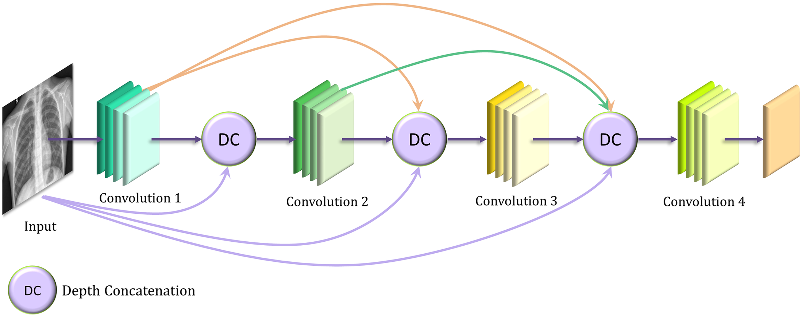

# Unit 5: representation learning

[Study index](README.md) | Book: [reference, PDF pp. 51–72](../Books/DL_Reference_Units03-06.pdf#page=51).

## 1. Representation learning and distributed representations

**PYQs:** N22 Q5(b), Q6(a); M23 Q6(b); M24 Q6(b); N25 Q6(a); M26 Q6(a).

A **representation** transforms raw data into features useful for a task. Representation learning lets a model learn these features from data rather than relying exclusively on hand-designed features. A CNN can learn edges, then textures, then combinations associated with objects.

Good representations may expose task-relevant factors, suppress irrelevant variation and transfer to related tasks. However, usefulness depends on the objective, data and evaluation; a feature good for reconstruction is not automatically best for classification.

**Distributed representation:** an item or concept is encoded by a pattern across multiple units, and a unit can contribute to multiple concepts. For example, a learned word embedding can represent `cat` by a vector such as `[0.2, -0.4, 0.7, ...]`; other words share components and similar contexts can lead to nearby vectors. Numerical values are illustrative, not fixed semantic labels. Distributed codes can share statistical strength and represent combinations compactly, but may be hard to interpret and can inherit data biases.

**Challenges:** choosing useful factors without labels, disentangling correlated factors, limited or biased data, overfitting, distribution shift, invariance without losing discriminative information, computational cost, and interpreting learned features.

## 2. Greedy layer-wise pretraining

**PYQs:** N22 Q5(a); M23 Q6(a); N23 Q5(a); M24 Q5(a); M25 Q6(b); N25 Q6(b).

Greedy layer-wise pretraining trains a deep model **one layer at a time**, aiming to learn a useful intermediate representation before training the complete network.

1. Train the first layer, for example as an autoencoder, using unlabelled input.
2. Obtain its hidden representations and use them as training data for the next layer.
3. Repeat until the desired depth is reached; each stage learns its local objective greedily rather than optimizing the whole final network at once.
4. Stack the layers, add a task-specific output layer, and **fine-tune** the full network on the task using backpropagation.

Examples of pretraining components include autoencoders and restricted Boltzmann machines; supervised layer-wise methods are also possible. Historically this helped initialize deep networks with limited labels and difficult optimization. Modern activations, initialization, normalization, residual connections and large datasets mean it is not always necessary. Unsupervised reconstruction and the final task can have different objectives.

**Vanishing-gradient link:** gradients propagated through many layers can shrink. Pretraining provides a better starting point, whereas residual connections and suitable architectures are other approaches; it is not a guaranteed cure.

## 3. Transfer learning and domain adaptation

**PYQs:** N22 Q6(b); M23 Q5(a); N23 Q6(b); M24 Q5(b); M25 Q5(b), Q6(a); N25 Q5(b); M26 Q5(b,c), Q6(c).

**Transfer learning** reuses knowledge from a source task/domain to help a target task/domain. For example, start with an image classifier pretrained on a large image collection and adapt it to classify a smaller set of medical images.

1. Select a relevant pretrained model.
2. Prepare target data with the model's required preprocessing and a separate validation/test split.
3. Replace its output head for the target labels.
4. Train the new head with the feature extractor frozen.
5. If data and compute permit, unfreeze some layers and fine-tune at a suitably small learning rate; monitor validation performance.

It can reduce data and training needs. If source and target are very different, **negative transfer** can reduce accuracy; pretrained features may carry bias. Evaluate against a target-only baseline.

**Domain adaptation** addresses a shift between source and target data distributions for a related task. Example: train sentiment analysis on product reviews and adapt to movie reviews. Approaches include fine-tuning with target labels, reweighting examples or learning domain-invariant features. Unsupervised domain adaptation uses labelled source data and unlabelled target data, with assumptions about shared task structure.

| Aspect | Transfer learning | Domain adaptation |
|---|---|---|
| Scope | Broad reuse across tasks and/or domains | Usually same or related task with domain shift |
| Example | Generic object classifier → defect classifier | Daytime driving images → nighttime driving images |
| Main concern | Whether learned knowledge transfers | Difference in feature or data distribution |

**Homogeneous adaptation:** source and target have the same feature space, e.g. RGB images from two cameras. **Heterogeneous adaptation:** feature spaces differ, e.g. text and image representations, requiring a suitable shared mapping; a shared semantic task/labels may still be needed. Same feature space does not mean identical data distributions.

## 4. CNN variants and DenseNet

**PYQs:** M23 Q5(b); N23 Q5(b), Q6(a); M25 Q5(a); N25 Q5(a); M26 Q5(a), Q6(b).

CNN variants differ in their arrangement of convolutions, skip connections and feature reuse. Examples include:

- **LeNet:** early convolution, pooling and dense classifier architecture.
- **VGG:** stacks many small convolution filters; straightforward but can be computationally heavy.
- **Inception:** parallel branches with different receptive fields.
- **ResNet:** skip connections add earlier activations to later outputs.
- **DenseNet:** each layer receives a concatenation of all preceding feature maps within its dense block.

### DenseNet: an exam-ready explanation

For the book's dense-block illustration, see [PDF page 70](../Books/DL_Reference_Units03-06.pdf#page=70).

*DenseNet connections by Rohit Kundu, Ritacheta Das, Zong Woo Geem, Gi-Tae Han and Ram Sarkar, [PLOS figure](https://plos.figshare.com/articles/figure/Basic_architecture_of_the_DenseNet_convolutional_neural_network_model_/16580015), [CC BY 4.0](https://creativecommons.org/licenses/by/4.0/); converted from TIFF to PNG. DC means depth (channel) concatenation.*

Within a block, `x_l = H_l([x_0, x_1, ..., x_(l-1)])`, where brackets denote **channel-wise concatenation**, not addition. `H_l` commonly includes normalization, activation and convolution. Each layer contributes `k` new feature maps, where `k` is the **growth rate**. Transition layers between blocks typically use 1×1 convolution and pooling to reduce dimensions.

Dense connections encourage feature reuse, provide short paths for gradient flow and can reduce redundant parameters. DenseNet can perform well in image classification, including with limited data when transfer learning is appropriate; no model is best for every dataset. Concatenation increases feature-map memory and implementation cost. Compare models on the same held-out data before claiming superiority.
