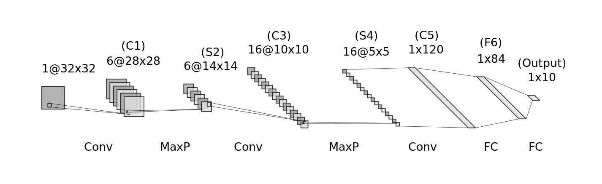
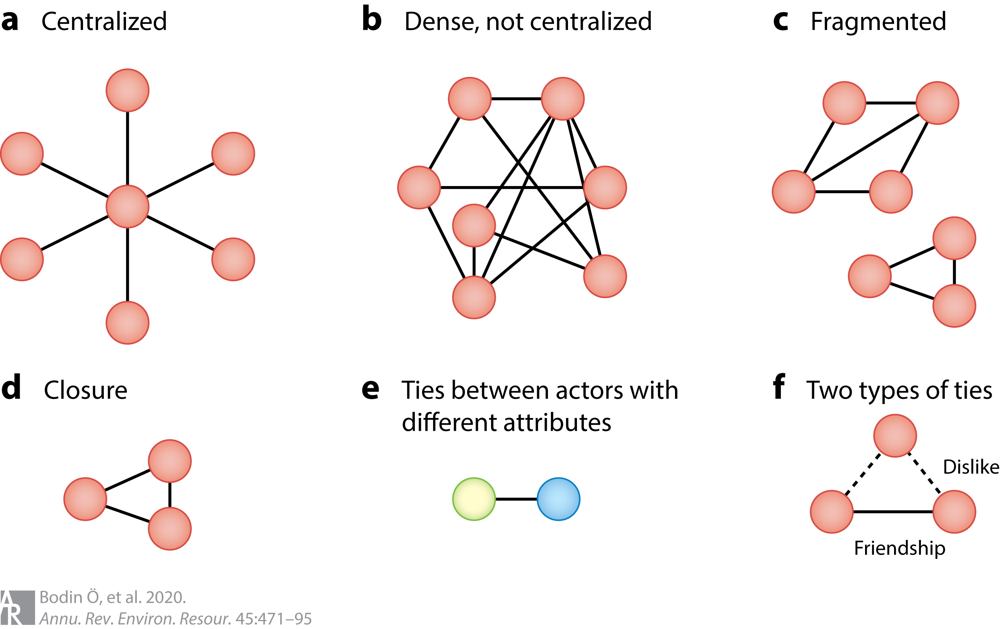
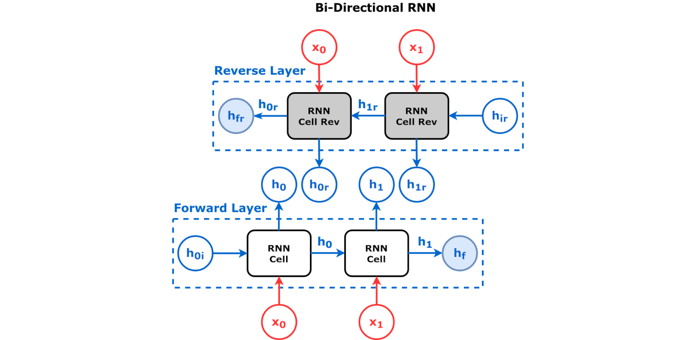
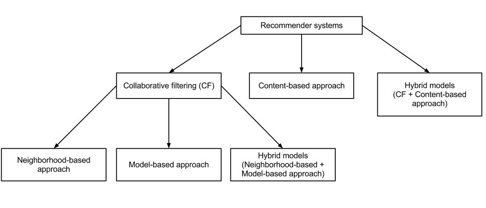

# Unit 6: applications of deep learning

[Study index](README.md) | Book: [reference, PDF pp. 73–90](../Books/DL_Reference_Units03-06.pdf#page=73).

## 1. Image classification and computer vision

**PYQs:** N22 Q7(b); M23 Q8(b); N23 Q8(a); M24 Q8(b); M25 Q8(a); N25 Q8(a); M26 Q7(b).

**Image classification** assigns one or more labels to an image, such as identifying a cat. It differs from object detection, which also predicts object locations, and segmentation, which assigns labels to pixels.

*LeNet classifier illustration. Daniel Voigt Godoy, [book illustration](https://dvgodoy.github.io/dl-visuals/Architectures/#lenet), [CC BY 4.0](https://creativecommons.org/licenses/by/4.0/); converted to JPEG with a white background. This is one example of a CNN classifier; architectures vary.*

1. Split labelled images into training, validation and test sets; avoid leakage.
2. Preprocess inputs and optionally augment training images with appropriate transforms.
3. Convolution filters compute local features with shared weights; activation adds nonlinearity.
4. Pooling or strided convolutions reduce spatial dimensions; deeper layers combine features into more complex patterns.
5. A classifier outputs logits and softmax probabilities for mutually exclusive classes; cross-entropy can train the model.
6. Evaluate on held-out images using accuracy and, where useful, a confusion matrix, precision and recall.

**Traditional approach:** extract hand-engineered features such as HOG and train an SVM or another classifier. **Deep approach:** learn features and classifier jointly; transfer learning is useful when labelled data is limited. CNNs benefit from spatial locality, parameter sharing and automatic feature learning, but need computation and representative data. Examples: medical-image support, defect inspection and document recognition. A model is an aid, not a substitute for clinical judgment.

## 2. Social network analysis

**PYQs:** N22 Q7(a); M23 Q8(a); M24 Q8(a); M25 Q8(b); N25 Q8(b); M26 Q8(b).

Model a social network as a graph `G = (V, E)`: **nodes** represent users or entities, **edges** represent relationships, and optional **weights** express interaction strength. Edges can be directed or undirected. Some papers misprint “edges” as “ages”; interpret from graph context.

*Social network characteristics by Örjan Bodin, María Mancilla García and Garry Robins, [Wikimedia Commons](https://commons.wikimedia.org/wiki/File:Social_network_characteristics_diagram.jpg), [CC BY 4.0](https://creativecommons.org/licenses/by/4.0/); unchanged.*

**Node-level centrality:**

| Measure | Idea | Interpretation |
|---|---|---|
| Degree | Number of incident edges; distinguish in/out degree for directed graphs | Direct connections |
| Betweenness | Fraction of shortest paths between other pairs that pass through the node | Potential bridge |
| Closeness | Inverse of total shortest-path distance to other reachable nodes; normalization varies | Proximity to the network |
| Eigenvector | Connections to influential nodes contribute more | Influence through influential neighbors |

For disconnected graphs, state the chosen reachability convention for closeness. **Network-level measures** include density (actual edges divided by possible edges; denominator depends on directedness and self-loops), average path length and clustering coefficient. A high centrality score is not proof of real-world influence.

### Graph convolution approach

1. Create a graph from users and relationships; give nodes features such as profile or interaction embeddings.
2. For each node, collect neighbor features and aggregate them.
3. Transform the aggregate with learned weights and a nonlinearity; repeat across layers to combine wider neighborhoods.
4. Use the learned embeddings for a task such as node classification, link prediction or community analysis.

A simple GCN layer can be written `H^(l+1) = σ(Â H^l W^l)`, where `Â` is a suitably normalized adjacency matrix with self-loops. Deeper is not always better: oversmoothing, privacy, missing edges and biased interactions are important limitations.

## 3. Automatic speech recognition (ASR)

**PYQs:** N22 Q8(b); N23 Q7(a); M24 Q7(a).

ASR maps an audio signal to a word sequence.

**Traditional systems:** extract audio features, model acoustics using methods such as GMM-HMM, combine pronunciation lexicon and language model, then decode. **Deep systems:** neural acoustic models learn complex patterns; end-to-end systems can directly learn audio-to-token alignment, for example with CTC or encoder-decoder attention.

An RNN models dependencies across acoustic frames. A **bidirectional RNN** combines forward and backward states, using both earlier and later audio context for each frame, which can improve offline recognition. It needs future frames and is not directly suitable for strict real-time streaming. Noise, accents, speaker variation and domain mismatch can hurt accuracy. A common metric is word error rate: `(substitutions + deletions + insertions) / reference words`.

*Bidirectional RNN. Daniel Voigt Godoy, [book illustration](https://dvgodoy.github.io/dl-visuals/RNNs/#bidirectional-rnn), [CC BY 4.0](https://creativecommons.org/licenses/by/4.0/); converted to JPEG with a white background. In speech recognition the inputs can represent successive acoustic frames.*

## 4. Recommender systems

**PYQs:** N22 Q8(a); M23 Q7(b); N23 Q7(b); M24 Q7(b); M25 Q7(a); N25 Q7(b); M26 Q7(a).

A recommender predicts or ranks items likely to be useful to a user.

*Recommender system approaches by Moshanin, [Wikimedia Commons](https://commons.wikimedia.org/wiki/File:Collaborative_Filtering_in_Recommender_Systems.jpg), [CC BY-SA 3.0](https://creativecommons.org/licenses/by-sa/3.0/); unchanged.*

| Approach | How it works | Strength | Limitation |
|---|---|---|---|
| Content-based | Compare item features with the user's past preferences | Can recommend a new item with known features | May over-specialize; requires informative item features |
| Collaborative filtering | Use patterns in user-item interactions or similar users/items | Can discover preferences without explicit item features | Cold-start users/items and sparse interactions |
| Hybrid | Combine content and collaborative signals | Mitigates some weaknesses of each | More complex and still depends on data quality |

**Example:** if a user watched science-fiction films, content-based filtering uses genre and themes; collaborative filtering uses the preferences of users with similar viewing behavior; a hybrid combines both.

### Deep-learning based recommendation

Learn user and item embeddings from interactions, combine them with available side information, predict a relevance score, then rank candidate items. Sequence models can use the order of recent actions. Train and evaluate with a realistic temporal split and ranking metrics such as precision@k or recall@k. Avoid claiming high predicted score is a guaranteed preference. Cold start, popularity bias, feedback loops and privacy remain concerns.

## 5. Natural language processing (NLP)

**PYQs:** N22 Q7(a); M23 Q7(a); N23 Q8(b); M25 Q7(b); N25 Q7(a); M26 Q8(a).

NLP enables computers to process or generate human language. Applications include translation, sentiment analysis, question answering, information extraction, summarization and chat assistants.

### RNN-based framework

Convert text to tokens, map tokens to embeddings, process them in order using recurrent states and apply an appropriate task head. For sentiment classification, the final or pooled representation predicts a label; for named-entity recognition, each time step can output a tag. Encoder-decoder architectures can generate translations.

**CNN for NLP:** convolutions over token embeddings capture local patterns such as phrases, followed by pooling and a classifier. Compared with a simple fixed-window CNN, an RNN naturally maintains a state over variable-length sequences. This does **not** make RNNs universally better: CNNs can be parallelized and expanded to larger contexts, while attention-based transformers are widely used for long-range context. Explain the trade-off rather than stating an unconditional preference.

**Limitations:** ambiguous language, long context, out-of-vocabulary or domain-specific terms, bias and unreliable outputs. Evaluate with task-appropriate metrics such as accuracy/F1 for classification or tagging.
