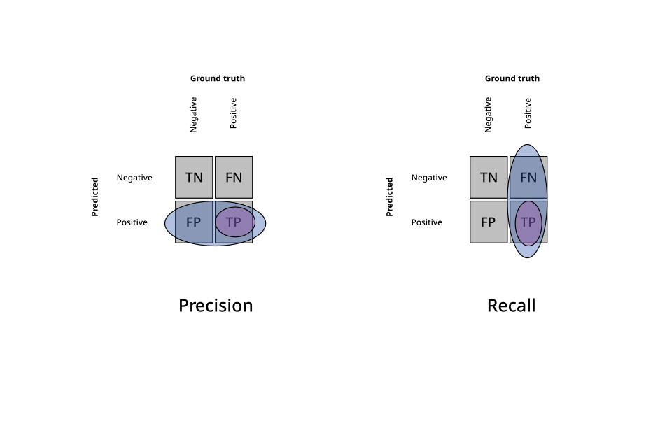
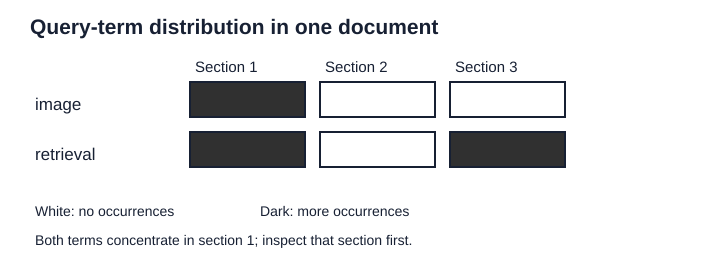
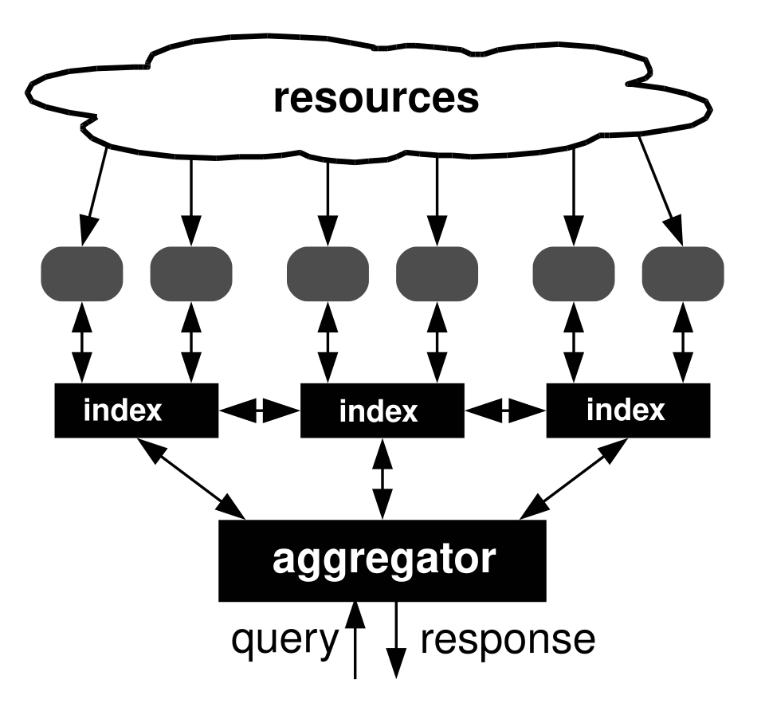
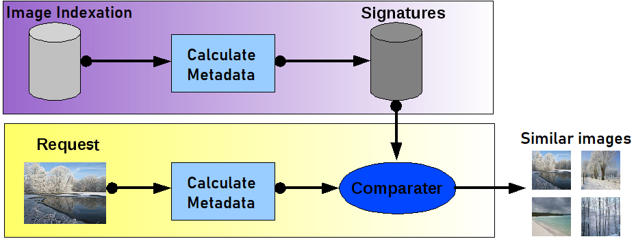
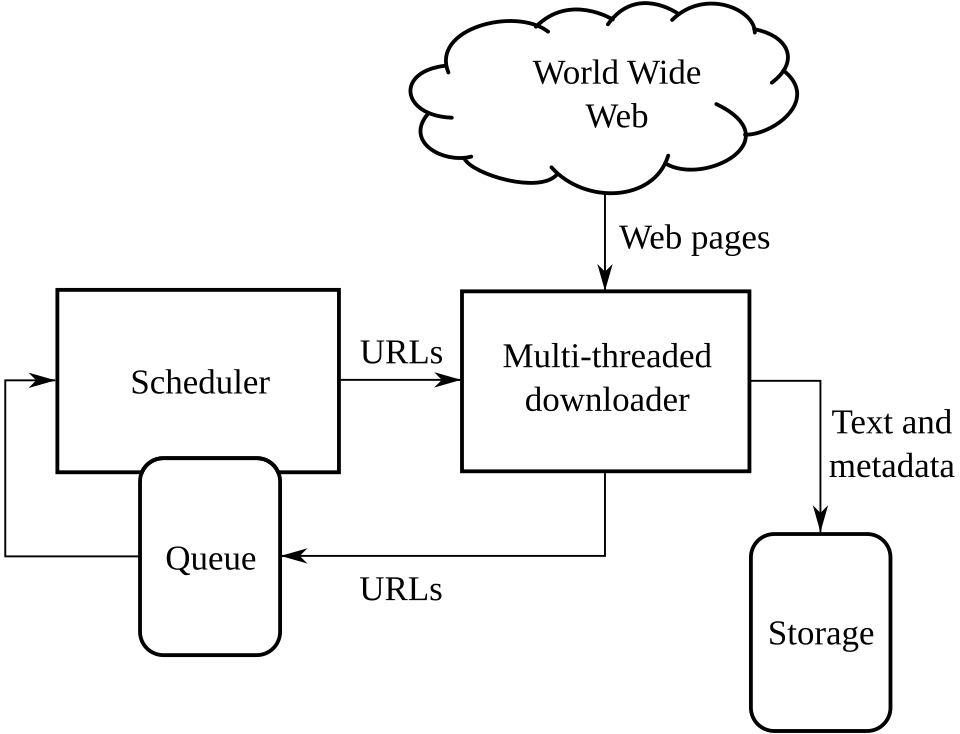
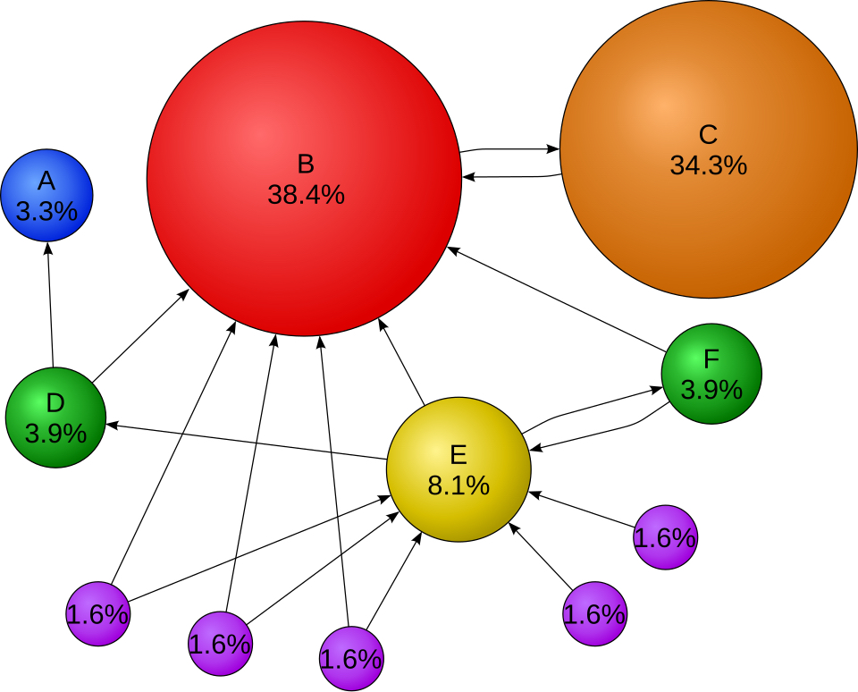
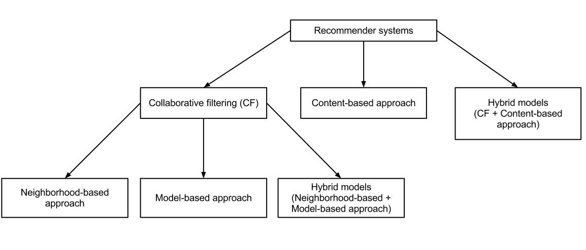
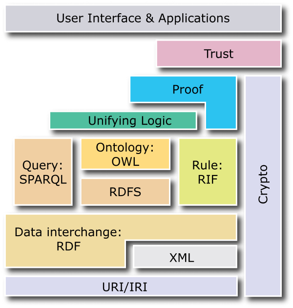
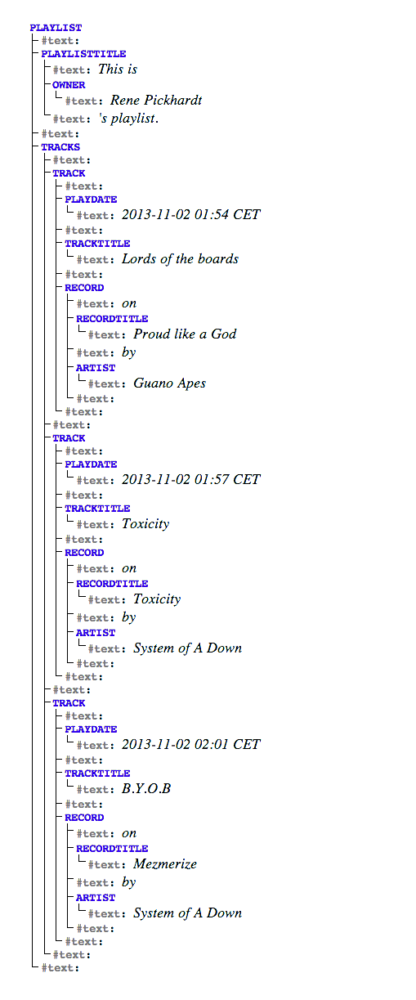

# ISR: 2022 Nov-Dec — detailed answers

[Question paper](ISR_Endsem_2022_Nov-Dec.pdf) | [ISR study index](../Study/README.md)

Question headings are paraphrased; both sides of each OR are answered. Examples are illustrative unless identified as paper data. The paper PDF may require Git LFS hydration. Book links use PDF viewer page numbers.

## Q1(a) — Calculate precision and recall for the supplied document sets

The relevant set contains 10 documents and the retrieved set contains 15. Their intersection is `{d120, d50, d9, d25, d3}`, so TP = 5, FP = 10 and FN = 5.

**Precision** = 5/15 = **33.33%**; **recall** = 5/10 = **50%**. The first is the fraction of retrieved documents that are relevant; the second is the fraction of relevant documents found.



*Precision and recall by kindlychung, [Wikimedia Commons / Openclipart](https://commons.wikimedia.org/wiki/File:Precision_recall.svg), [CC0 / public domain](https://creativecommons.org/publicdomain/zero/1.0/); rasterized and converted to JPEG with a white background. Interpret “predicted positive” as “retrieved” and “ground-truth positive” as “relevant.”*

**References:**
- [Decode ISR, unit 3, PDF page 3](../Books/ISR_Decode_Units03-06.pdf#page=3).
- [ISR Unit 3 study notes](../Study/unit-3-evaluation.md).

## Q1(b) — Measures for evaluating system performance

An information retrieval (IR) system searches a document collection for an **information need** expressed as a query. Evaluation asks how well the returned results meet that need, not just how quickly the software runs.

An offline test collection normally includes documents, representative queries and **relevance judgments**. The judgments serve as the reference against which systems are compared. A fair comparison uses the same queries and judgments, the same cutoff, and reports performance across queries. Operational evaluation can also consider latency, cost and usability; no one measure captures every goal.

| | Relevant to query | Not relevant |
|---|---:|---:|
| Retrieved | True positive (TP) | False positive (FP) |
| Not retrieved | False negative (FN) | True negative (TN) |


*Precision and recall by kindlychung, [Wikimedia Commons / Openclipart](https://commons.wikimedia.org/wiki/File:Precision_recall.svg), [CC0 / public domain](https://creativecommons.org/publicdomain/zero/1.0/); rasterized and converted to JPEG with a white background. Interpret “predicted positive” as “retrieved” and “ground-truth positive” as “relevant.”*

For the book's Venn diagrams of relevant and retrieved sets, see [PDF page 3](../Books/ISR_Decode_Units03-06.pdf#page=3).

**Precision = TP / (TP + FP)** = relevant retrieved / all retrieved. It answers: “Of what I returned, how much is useful?”

**Recall = TP / (TP + FN)** = relevant retrieved / all relevant. It answers: “Of all useful items, how many did I find?”

If nothing is retrieved, precision's denominator is zero; if there are no relevant items, recall's denominator is zero. State the evaluation convention instead of dividing by zero. True negatives are usually huge in IR, so accuracy alone can be misleading.

`F1 = 2PR / (P + R)` is the harmonic mean of precision `P` and recall `R`. It is high only when both are high. With `P = 0.75` and `R = 0.5625`, `F1 ≈ 0.643` or **64.3%**.

`Fβ = (1 + β²)PR / (β²P + R)`. For this standard convention, `β > 1` emphasizes recall; `β < 1` emphasizes precision. With `β = 1`, it becomes F1. When both P and R are zero, F1 is commonly defined as zero by evaluation convention.

The complementary **E-measure** is `Eβ = 1 − Fβ`; lower is better. Always show the exact formula or convention used, because texts sometimes parameterize the precision/recall weight differently.

| Measure | What it evaluates | Key point |
|---|---|---|
| Precision@k | Relevant results in top k divided by k | Useful for a fixed-size first page; specify k |
| Average precision (AP) | Average of P@rank over ranks containing relevant items, divided by total relevant items | Rewards placing multiple relevant results early |
| Mean average precision (MAP) | Mean AP over queries | Uses binary judgments and captures ranking over queries |
| Reciprocal rank (RR) | `1 / rank of first relevant result` | Measures how soon the first answer appears |
| MRR | Mean RR across queries | Useful for a single satisfactory answer |
| DCG / NDCG | Discounted graded relevance | Rewards highly relevant items near the top |

**MRR example:** first relevant result at ranks 1, 2 and 4 for three queries gives `MRR = (1 + 1/2 + 1/4)/3 ≈ 0.583`. If a query has no relevant result in the evaluated list, its RR is conventionally zero. MRR does not reward additional relevant results after the first.

**AP example:** suppose four retrieved results have binary relevance `[1, 0, 1, 0]`, and the collection contains three relevant items total. Relevant items occur at ranks 1 and 3, with `P@1 = 1` and `P@3 = 2/3`; `AP = (1 + 2/3)/3 ≈ 0.556`. The third relevant item was missed, so it remains in the denominator.

#### DCG and NDCG worked example

For a cutoff `k`, one common convention is `DCG@k = Σ(i=1..k) (2^rel_i − 1) / log₂(i + 1)`, where `rel_i` is a graded relevance score. Other courses may use raw relevance instead of `2^rel − 1`; use the convention required by the question consistently.

Suppose the first three results have grades `[3, 0, 2]`:

| Rank | Grade | Gain `2^grade − 1` | Discounted gain |
|---|---:|---:|---:|
| 1 | 3 | 7 | `7/log₂2 = 7` |
| 2 | 0 | 0 | `0/log₂3 = 0` |
| 3 | 2 | 3 | `3/log₂4 = 1.5` |

`DCG@3 = 8.5`. The ideal ordering of these same three judged items is `[3, 2, 0]`, so `IDCG@3 = 7 + 3/log₂3 ≈ 8.893`. Thus `NDCG@3 = DCG/IDCG ≈ 0.956`. In a full test collection, compute the ideal ordering from all judged candidate documents, not merely from the returned three. If IDCG is zero, state the chosen evaluation convention.

**References:**
- [Decode ISR, unit 3, PDF page 5](../Books/ISR_Decode_Units03-06.pdf#page=5).
- [ISR Unit 3 study notes](../Study/unit-3-evaluation.md).

## Q1(c) — Techniques for specifying a query in information visualization

Information visualization presents documents, relationships or results visually to help users navigate and interpret them. A search interface supports the full cycle:

1. **Start:** suggest examples, recent searches, categories, collections or overviews rather than leaving a user with only a blank box.
2. **Specify:** allow keywords, phrases, Boolean operators, filters and other controls.
3. **Inspect:** show titles, snippets with highlighted terms, dates, source and useful metadata; preview full context.
4. **Refine:** support facets, query editing, related terms and relevance feedback.
5. **Understand:** use ranked lists, timelines, clusters, maps or link views where the visualization suits the data. Provide legends and accessible text alternatives.

| Query technique | Example | Benefit / limitation |
|---|---|---|
| Keyword or phrase | `"information retrieval"` | Fast and familiar; ambiguous terms may need refinement |
| Boolean | `(image OR video) AND retrieval NOT medical` | Explicit set logic; precedence and syntax can be difficult |
| Faceted | Filter by year, type and author after a query | Easy progressive narrowing; depends on reliable metadata |
| Form / fielded | Title contains “web”; year ≥ 2022 | Makes structure explicit; users need to know fields |
| Query by example | Upload an image similar to the desired item | Useful when words are hard to specify; similarity can miss meaning |
| Natural language | “Find recent papers on image search” | Accessible, but interpretation can be ambiguous |
| Direct visual selection | Select a region on a map or drag a range on a timeline | Supports exploration; must be usable without relying only on color |

#### Graphical query specification

A **query** is a representation of an information need that the system can process. Query specification includes choosing the collection or fields as well as expressing the terms and their relationships. A graphical interface can make these relationships visible rather than requiring users to remember a query language.

- **Boolean query:** `("image" OR "video") AND retrieval` finds documents containing retrieval and at least one of the media terms. Parentheses make the intended grouping explicit; exact Boolean matching need not rank the matches.
- **Faceted query:** first search for `retrieval`, then select media type = image and year = 2024. The selected values narrow the result set; the user can remove a facet to broaden it again.
- **Form filling and menus:** enter `retrieval` in the title field and choose a year from a menu. Fields expose the available metadata, although an appropriate field must exist.
- **Venn diagrams and VQuery:** represent terms by circles or ovals. Overlapping regions show combinations of terms; selecting the overlap of `image` and `retrieval` specifies their AND. VQuery lets users position term ovals and select regions. Counts can help the user see how restrictive a combination is.
- **Natural language and free text:** a user writes “find recent papers on image retrieval”; the system interprets the words rather than requiring explicit Boolean operators. Interpretation can be ambiguous.
- **Direct manipulation:** users interact with visible objects through incremental, reversible actions with immediate feedback. Moving an oval or choosing a facet lets them revise their query without typing a complex expression.

See the textbook's [VQuery diagram, PDF page 18](../Books/ISR_Technical_Units03-06.pdf#page=18), and [query specification discussion, pages 15–17](../Books/ISR_Technical_Units03-06.pdf#page=15). For an exam answer, define the query, explain at least three techniques with examples, and describe how the interface makes refinement easier.

#### Showing document context and result sets

These techniques help users **inspect results**, rather than all being ways to formulate a query:

| Technique | What it shows | Example and use |
|---|---|---|
| Document surrogate | A compact substitute such as title, author, date and snippet | A user scans a result list before opening full documents; snippets can omit important context. |
| KWIC (keyword in context) | Each query-term occurrence with nearby words | For `retrieval`, show “…image **retrieval** using texture…” so the reader can judge the sense of the match. |
| TileBars | Query-term or term-group frequencies across consecutive document sections | Rows correspond to terms or groups, columns to sections; darker tiles indicate more occurrences. Overlap helps identify sections discussing multiple terms. Clicking a tile can open that section. |
| SeeSoft | Compact lines of text with visual highlighting | Shows the distribution of matches across a long text; users zoom in for details. |
| InfoCrystal | Counts of documents matching different combinations of query terms | Also works as a visual query language: select term combinations instead of writing complex Boolean expressions. |
| SuperBook | A document's table of contents alongside its content | Expanding sections helps locate hits while preserving the document's hierarchy. |

For example, if a document has three sections and the TileBar row for `image` is dark only in section 1 while the row for `retrieval` is dark in sections 1 and 3, section 1 is a promising place to inspect both terms. TileBars show **distribution, not meaning or guaranteed relevance**. Do not confuse them with interface title bars or with VQuery's query-specification diagram.



*Original illustrative diagram for this guide; the shades represent relative term frequency, not exact counts.*

See the book's [KWIC figure, page 19](../Books/ISR_Technical_Units03-06.pdf#page=19), [TileBars description, page 20](../Books/ISR_Technical_Units03-06.pdf#page=20), and [InfoCrystal and SuperBook, page 21](../Books/ISR_Technical_Units03-06.pdf#page=21).

**References:**
- [Decode ISR, unit 3, PDF page 7](../Books/ISR_Decode_Units03-06.pdf#page=7).
- [ISR Unit 3 study notes](../Study/unit-3-evaluation.md).
- [Technical: query specification and VQuery, page 15](../Books/ISR_Technical_Units03-06.pdf#page=15); [VQuery figure, page 18](../Books/ISR_Technical_Units03-06.pdf#page=18); [TileBars, page 20](../Books/ISR_Technical_Units03-06.pdf#page=20).

## Q2(a) — User-oriented evaluation measures

System metrics use judgments and ranked results; user-oriented measures consider the searcher's **actual task and experience**. Measure on representative users and tasks, with clear conditions and consent.

| Measure | How it is observed | Why it matters |
|---|---|---|
| Task success / answer correctness | Whether the task or answer meets defined criteria | Measures the practical outcome |
| Time to first useful result / completion | Time from task start to useful result or completion | Measures effort and delay |
| Interaction effort | Number of queries, clicks, reformulations, pages inspected | Captures workload; fewer clicks alone need not mean better |
| Satisfaction / perceived relevance | Questionnaire or rating after task | Captures subjective experience |
| Coverage and novelty | Useful distinct information found, including new items | Helps exploratory searches |
| Accessibility and usability | Observed ability to use controls, including keyboard and assistive technology | Enables different users to search effectively |

Clicks and dwell time are **proxies**, affected by presentation and position bias, not guaranteed judgments. Combine behavioral data with feedback and outcomes.

#### Textbook user-oriented ratios

The book also defines measures relative to what the user already knows or expects. Let `R` be relevant documents, `A` retrieved documents and `K` the documents already known to the user:

| Measure | Definition | Interpretation |
|---|---|---|
| Coverage ratio | `|R ∩ A ∩ K| / |R ∩ K|` | Fraction of the known relevant documents that were retrieved |
| Novelty ratio | `|(R ∩ A) \ K| / |R ∩ A|` | Fraction of relevant retrieved documents that were previously unknown to the user |
| Relative recall | Relevant documents found / number of relevant documents the user expected to find | Compares actual discoveries to the user's expectation, not necessarily to the true total |
| Recall effort | Number of relevant documents the user expected to find / number of documents examined in the attempt | Relates the user's expected yield to examination effort; state the examination stopping point |

**Example:** suppose the user knows four relevant documents, the system retrieves three of them, and it also retrieves two previously unknown relevant documents. Coverage is `3/4 = 75%`; novelty is `2/5 = 40%`. If the user expected four relevant documents and found five, relative recall is `5/4 = 1.25` under this definition; unlike ordinary recall, it may exceed one. If ten documents were examined to complete the search, recall effort is `4/10 = 0.4`. These ratios require nonzero denominators and a clearly specified user, query and assessment procedure.

See the textbook's [user-oriented measures and diagram, PDF pages 12–13](../Books/ISR_Technical_Units03-06.pdf#page=12). Different sources may define user-centric measures differently, so state the chosen convention.

**Example:** give users the same task of finding a relevant research paper. Measure time to a correct paper, task success, number of reformulations and a satisfaction rating. A fast answer is not useful if it is wrong; compare measures together.

**References:**
- [Decode ISR, unit 3, PDF page 6](../Books/ISR_Decode_Units03-06.pdf#page=6).
- [ISR Unit 3 study notes](../Study/unit-3-evaluation.md).
- [Technical: user-oriented ratios, pages 12–13](../Books/ISR_Technical_Units03-06.pdf#page=12).

## Q2(b) — Define precision and recall, illustrate and justify their use

An information retrieval (IR) system searches a document collection for an **information need** expressed as a query. Evaluation asks how well the returned results meet that need, not just how quickly the software runs.

An offline test collection normally includes documents, representative queries and **relevance judgments**. The judgments serve as the reference against which systems are compared. A fair comparison uses the same queries and judgments, the same cutoff, and reports performance across queries. Operational evaluation can also consider latency, cost and usability; no one measure captures every goal.

| | Relevant to query | Not relevant |
|---|---:|---:|
| Retrieved | True positive (TP) | False positive (FP) |
| Not retrieved | False negative (FN) | True negative (TN) |


*Precision and recall by kindlychung, [Wikimedia Commons / Openclipart](https://commons.wikimedia.org/wiki/File:Precision_recall.svg), [CC0 / public domain](https://creativecommons.org/publicdomain/zero/1.0/); rasterized and converted to JPEG with a white background. Interpret “predicted positive” as “retrieved” and “ground-truth positive” as “relevant.”*

For the book's Venn diagrams of relevant and retrieved sets, see [PDF page 3](../Books/ISR_Decode_Units03-06.pdf#page=3).

**Precision = TP / (TP + FP)** = relevant retrieved / all retrieved. It answers: “Of what I returned, how much is useful?”

**Recall = TP / (TP + FN)** = relevant retrieved / all relevant. It answers: “Of all useful items, how many did I find?”

If nothing is retrieved, precision's denominator is zero; if there are no relevant items, recall's denominator is zero. State the evaluation convention instead of dividing by zero. True negatives are usually huge in IR, so accuracy alone can be misleading.

**Example:** if 20 results contain 15 relevant items and 30 relevant items exist in total, precision is 15/20 = 75% and recall is 15/30 = 50%. Precision assesses result quality; recall assesses coverage.

**References:**
- [Decode ISR, unit 3, PDF page 3](../Books/ISR_Decode_Units03-06.pdf#page=3).
- [ISR Unit 3 study notes](../Study/unit-3-evaluation.md).

## Q2(c) — Relevance judgments, group judgments and pseudo feedback

**Relevance** is how useful a document is to a particular information need. Human assessors judge document–query pairs, often as binary relevant/not relevant or on a graded scale. A document can be topically related yet unhelpful to a particular user. Assessing every document is costly, so test collections often pool results from several systems and judge those candidates; unjudged is not inherently irrelevant.

**Group relevance judgments:** several people independently assess the same item, then aggregate their judgments by majority vote or discussion. This can reduce dependence on one assessor and reveal disagreements, but relevance remains context-dependent; record the aggregation rule and measure agreement.

**Explicit relevance feedback:** the user marks retrieved results relevant or nonrelevant; the system adjusts query terms or weights and searches again. **Pseudo relevance feedback:** automatically assume the top few initial results are relevant, extract representative terms, expand/reweight the query, and rerun it. It needs no user labeling but can drift toward the wrong topic if the first results are poor.

Example: a search for `jaguar` returns car pages; expansion with `engine` may help a car search but harm an animal search. Ask for feedback or use context to disambiguate.

**References:**
- [Decode ISR, unit 3, PDF page 13](../Books/ISR_Decode_Units03-06.pdf#page=13).
- [ISR Unit 3 study notes](../Study/unit-3-evaluation.md).

## Q3(a) — Distributed IR and its architecture

**Distributed information retrieval** searches across multiple separately managed collections or indexes and combines useful results. For example, a university portal may search its library catalog, repository and departmental archives without storing every document in one central index.



*Federated search concept by JakobVoss, [Wikimedia Commons](https://commons.wikimedia.org/wiki/File:Federated-search-en.svg), [CC BY-SA 3.0](https://creativecommons.org/licenses/by-sa/3.0/); rasterized and converted to JPEG with a white background. The aggregator corresponds to the broker; the figure is one possible organization, not a requirement that local indexes exchange data directly.*

The usual components are:

1. **User interface:** receives the information need and displays results.
2. **Broker / mediator:** interprets the query and coordinates the search.
3. **Resource descriptions:** summarize each collection, for example its vocabulary, size and statistics.
4. **Source selection:** estimates which collections are likely to contain relevant documents.
5. **Local search engines:** execute the query against selected collections.
6. **Result merging:** normalizes or estimates comparable scores, handles duplicates and creates one ranked list.

**Example:** For `renewable energy`, the broker selects a research repository and engineering library, dispatches the query, collects their top results, merges them and shows one ranked list. If the medical archive is unlikely to contain useful material, the broker can omit it to save time. If the source summary is stale, it may overlook a useful collection.

| Centralized collection | Distributed collection |
|---|---|
| Documents or a unified index are managed at one logical center | Sources retain separate local indexes and may have separate owners |
| Uniform indexing makes global scoring easier | Independent scoring and vocabularies complicate merging |
| Queries avoid broker-to-source fan-out | Sources can be selected and searched concurrently |
| Central indexing requires access, storage and updates | Local autonomy is preserved, but failures and communication latency matter |

Centralized systems can still be physically sharded; “distributed IR” here emphasizes searching separate collections, not merely running a search service on multiple machines.

#### Source selection

The broker stores a **collection representation**, such as term frequencies, document counts, sampled documents or other summaries. For a query, it scores collections by estimated usefulness, selects the best few within a cost budget, then sends them the query. A collection with high query-term coverage and many matching documents may be a good candidate. If the full contents are private, summaries can be built through sampling rather than direct access.

**Trade-off:** querying more sources can improve recall but increases latency, traffic and result-merging work. Querying too few risks missing relevant results. Resource descriptions must be updated as collections change.

For an examination answer, distinguish **resource selection** from document ranking: the former decides *where* to search, the latter orders *individual documents*. A broker might first select two of ten libraries using sampled vocabulary, send the same query to both, then merge their documents. It should not compare raw scores blindly when the local systems use different scales.

#### Distributed query processing and merging

1. Parse and normalize the query; choose sources using their summaries.
2. Translate the query if sources use different field names, syntax or languages.
3. Dispatch it, often in parallel, and request a limited number of results from each.
4. Each source applies its local index and ranking algorithm.
5. The broker gathers results, reconciles duplicates, makes scores more comparable when possible, and returns a merged ranking.
6. Log failures and timeouts; partial results should be identified as partial rather than presented as a complete search.

**Important:** a score of 0.8 from one engine need not mean the same thing as 0.8 from another. Different scoring models, collection sizes and local term statistics make merging difficult. A slow or unreachable source, overlapping documents and privacy restrictions further complicate processing.

#### Collection partitioning

Partitioning divides a large collection into manageable parts. **Horizontal / document partitioning** assigns whole documents to shards, for example by document ID, topic or geography. A term query can be run on relevant shards and their results merged. **Vertical / term partitioning** assigns portions of an index, such as sets of terms, to different servers; query terms may require contacting multiple servers and combining postings.

| Choice | Benefit | Limitation |
|---|---|---|
| Document-based | Easy to add documents; each shard can search independently | Broad queries may fan out to many shards; skewed topic partitions can miss results if selection is wrong |
| Term-based | Each term's postings are stored together | Multi-term queries require network transfer and intersections across term servers |
| Topic-based documents | A source selector can avoid unrelated shards | Documents span topics; reclassification and uneven loads are difficult |

Use replication for availability, monitor load, and account for updates. Partitioning a single managed collection is related to, but not identical to, federating independently managed sources.

#### Automatic feature extraction

A **feature** is a measurable property used to represent a document, query or collection. Automatic extraction turns raw data into searchable signals, saving manual effort:

1. Acquire documents or permitted samples and parse their format.
2. For text, tokenize, normalize case, optionally remove stop words or stem, and extract terms, phrases, entities and fields.
3. Compute weights such as TF–IDF or aggregate term statistics across a source to create a resource description.
4. For images, audio or video, extract features such as color histograms, texture, embeddings or temporal descriptors.
5. Store features and indexes, refresh them as collections change, and use them for source selection or local matching.

Example: a sample from the engineering archive has frequent terms `solar`, `inverter` and `grid`; its summary can make it a promising source for a solar-energy query. Extraction may be noisy, lose meaning or reflect a biased sample; features are not the same as a human relevance judgment.

**References:**
- [Decode ISR, unit 4, PDF page 16](../Books/ISR_Decode_Units03-06.pdf#page=16).
- [ISR Unit 4 study notes](../Study/unit-4-distributed-multimedia.md).

## Q3(b) — Collection partitioning in distributed IR

**Distributed information retrieval** searches across multiple separately managed collections or indexes and combines useful results. For example, a university portal may search its library catalog, repository and departmental archives without storing every document in one central index.


*Federated search concept by JakobVoss, [Wikimedia Commons](https://commons.wikimedia.org/wiki/File:Federated-search-en.svg), [CC BY-SA 3.0](https://creativecommons.org/licenses/by-sa/3.0/); rasterized and converted to JPEG with a white background. The aggregator corresponds to the broker; the figure is one possible organization, not a requirement that local indexes exchange data directly.*

The usual components are:

1. **User interface:** receives the information need and displays results.
2. **Broker / mediator:** interprets the query and coordinates the search.
3. **Resource descriptions:** summarize each collection, for example its vocabulary, size and statistics.
4. **Source selection:** estimates which collections are likely to contain relevant documents.
5. **Local search engines:** execute the query against selected collections.
6. **Result merging:** normalizes or estimates comparable scores, handles duplicates and creates one ranked list.

**Example:** For `renewable energy`, the broker selects a research repository and engineering library, dispatches the query, collects their top results, merges them and shows one ranked list. If the medical archive is unlikely to contain useful material, the broker can omit it to save time. If the source summary is stale, it may overlook a useful collection.

| Centralized collection | Distributed collection |
|---|---|
| Documents or a unified index are managed at one logical center | Sources retain separate local indexes and may have separate owners |
| Uniform indexing makes global scoring easier | Independent scoring and vocabularies complicate merging |
| Queries avoid broker-to-source fan-out | Sources can be selected and searched concurrently |
| Central indexing requires access, storage and updates | Local autonomy is preserved, but failures and communication latency matter |

Centralized systems can still be physically sharded; “distributed IR” here emphasizes searching separate collections, not merely running a search service on multiple machines.


Partitioning divides a large collection into manageable parts. **Horizontal / document partitioning** assigns whole documents to shards, for example by document ID, topic or geography. A term query can be run on relevant shards and their results merged. **Vertical / term partitioning** assigns portions of an index, such as sets of terms, to different servers; query terms may require contacting multiple servers and combining postings.

| Choice | Benefit | Limitation |
|---|---|---|
| Document-based | Easy to add documents; each shard can search independently | Broad queries may fan out to many shards; skewed topic partitions can miss results if selection is wrong |
| Term-based | Each term's postings are stored together | Multi-term queries require network transfer and intersections across term servers |
| Topic-based documents | A source selector can avoid unrelated shards | Documents span topics; reclassification and uneven loads are difficult |

Use replication for availability, monitor load, and account for updates. Partitioning a single managed collection is related to, but not identical to, federating independently managed sources.

**References:**
- [Decode ISR, unit 4, PDF page 16](../Books/ISR_Decode_Units03-06.pdf#page=16).
- [ISR Unit 4 study notes](../Study/unit-4-distributed-multimedia.md).

## Q4(a) — Working of the MULTOS data model

**MULTOS** is a historical **MULTimedia Office Server**, a client–server document-management system designed to file and retrieve complex multimedia office documents. It models document collections, document types, document attributes and the internal organization of a document, rather than treating every document as one undifferentiated string.

| View | What it describes | Letter example |
|---|---|---|
| Logical structure | Content organization | Letter, heading, body, signature |
| Layout structure | Presentation on pages | Pages, frames, positions |
| Conceptual structure | Domain-specific meaning and relationships | Sender, recipient, address, date |

**Working:** a client creates or requests a document; a document server stores the object, type, attributes and components; a query may combine attributes and content; matching documents or components are retrieved and presented. A type can constrain what components an instance contains. For example, a letter type can include sender and recipient; the corresponding components of a particular letter contain their actual values. The book illustrates a conceptual letter structure on [PDF page 28](../Books/ISR_Decode_Units03-06.pdf#page=28).

**Why useful:** structured retrieval can locate a letter by sender, its text, or a component. **Limitations:** models and clients must agree on document structure; managing diverse media, permissions and efficient similarity search adds complexity. Distinguish the historical MULTOS model from generic modern database features.

For example, the query “letters from Patil about retrieval” combines a sender attribute with a content condition. The server identifies matching document instances and returns the selected document or component; a client presents it according to the stored layout. Logical structure describes *what parts exist*, layout describes *how they appear*, and conceptual structure relates parts to *domain meaning*. These views are complementary rather than three separate documents.

**References:**
- [Decode ISR, unit 4, PDF page 27](../Books/ISR_Decode_Units03-06.pdf#page=27).
- [ISR Unit 4 study notes](../Study/unit-4-distributed-multimedia.md).

## Q4(b) — Query languages for multimedia IR

**Multimedia IR** retrieves image, audio, video, text or combinations of these in response to a query, often using similarity rather than exact equality. In a content-based image search, the user submits a sample picture; the system extracts its visual features and ranks stored images with similar features.



*Content-based image retrieval schema by Xiawi, [Wikimedia Commons](https://commons.wikimedia.org/wiki/File:Schema_of_content-based_image_retrieval_%28CBIR%29.png), [CC BY-SA 3.0](https://creativecommons.org/licenses/by-sa/3.0/); converted to JPEG with a white background. “Metadata” here refers to extracted image descriptors/signatures, not only manually supplied captions.*


A multimedia query language needs a way to specify an example or features, metadata restrictions, spatial/temporal relationships and possibly weights or similarity thresholds. Processing parses the request, filters or indexes candidates, computes similarity, ranks results and supports refinement. Unlike a conventional exact database selection, an approximate query may return graded matches.

Example: “Show clips shorter than 30 seconds in which a vehicle appears **before** a pedestrian; rank by similarity to this sample.” Duration is an exact filter; recognition and similarity may be approximate. Results can vary with the feature model and threshold.

**References:**
- [Decode ISR, unit 4, PDF page 29](../Books/ISR_Decode_Units03-06.pdf#page=29).
- [ISR Unit 4 study notes](../Study/unit-4-distributed-multimedia.md).

## Q5(a) — Searching the web

The **web** is a collection of resources identified by URLs and connected by hyperlinks. Resources include text, images, multimedia and structured data, provided by many independent owners. The web is large, heterogeneous, dynamic, multilingual, partly duplicated and partly inaccessible to crawlers. It includes spam and pages whose contents require authentication, forms or other interaction.

An example search-engine workflow:

1. **Discovery and crawling:** start with seed URLs, download allowed pages and discover more links.
2. **Processing:** parse documents, extract text, metadata and links, remove or identify duplicates, and normalize terms.
3. **Indexing:** build an inverted index mapping each term to the documents (and often positions) containing it.
4. **Query processing:** tokenize the user's query, interpret spelling or intent, and retrieve candidate documents from the index.
5. **Ranking:** score candidates using relevance signals, possibly including text, links, freshness and other factors.
6. **Presentation:** show ranked titles, URLs and snippets; support filtering, reformulation and feedback.

For example, a crawler discovers a university's public course page and the indexer associates its terms with its document ID. Later, the query `information retrieval` retrieves candidate IDs from the index; the ranker orders candidates and the interface displays titles and snippets. **Offline** crawling/indexing and **online** query processing are different phases: the engine does not normally crawl the entire web for every query.

**Example inverted index:** if document D1 contains “web retrieval” and D2 contains “image retrieval”, postings for `retrieval` include D1 and D2, while `web` points to D1. For `web retrieval`, the engine can efficiently identify D1 without scanning every document at query time.

| Search engine | Web directory | Meta-searcher |
|---|---|---|
| Crawls or receives pages and indexes them | Organizes selected resources into categories, often curated | Sends a query to multiple search services and merges their responses |
| Broad keyword search | Browsing by subject | Wider coverage without necessarily maintaining its own full index |
| May contain stale or low-quality pages | Human curation can be costly and incomplete | Dependent on providers and difficult score merging |

#### Challenges in web search

- **Scale and speed:** huge collections require distributed storage, indexing and low query latency.
- **Change and freshness:** pages appear, move, change or disappear; recrawling everything immediately is impractical.
- **Quality and spam:** duplicate pages, manipulation and misleading content degrade results.
- **Heterogeneity:** multiple languages, formats, scripts and media complicate parsing and relevance.
- **Ambiguity:** short queries such as `java` can mean a programming language, island or coffee.
- **Coverage:** authenticated, dynamically generated, blocked or unlinked resources may not be crawled; absence from the index is not proof that a page does not exist.
- **Privacy and fairness:** user data and ranking choices require careful handling.



*Web crawler architecture, vector version by dnet based on Carlos Castillo's diagram, [Wikimedia Commons](https://commons.wikimedia.org/wiki/File:WebCrawlerArchitecture.svg), [CC BY-SA 3.0](https://creativecommons.org/licenses/by-sa/3.0/); rasterized and converted to JPEG with a white background. Storage can feed an indexer, a separate step not shown in this figure.*

The figure depicts crawling; the indexer, query processor and ranker described above complete the search-engine mechanism. The textbook's [distributed crawler–indexer diagram](../Books/ISR_Decode_Units03-06.pdf#page=48) provides another architecture.

**References:**
- [Decode ISR, unit 5, PDF page 41](../Books/ISR_Decode_Units03-06.pdf#page=41).
- [ISR Unit 5 study notes](../Study/unit-5-web-search.md).

## Q5(b) — Crawler–indexer architecture

A **web crawler** automatically discovers and fetches web resources to build or refresh a collection. It does not itself decide that a page is relevant to every user's query; the indexer and ranking components handle other parts of search.


*Web crawler architecture, vector version by dnet based on Carlos Castillo's diagram, [Wikimedia Commons](https://commons.wikimedia.org/wiki/File:WebCrawlerArchitecture.svg), [CC BY-SA 3.0](https://creativecommons.org/licenses/by-sa/3.0/); rasterized and converted to JPEG with a white background. Storage can feed an indexer, a separate step not shown in this figure.*

#### Components and operation

1. **Seed URLs:** known starting pages.
2. **URL frontier / queue:** discovered URLs awaiting a fetch; avoids repeatedly scheduling identical normalized URLs.
3. **Scheduler:** chooses the next URL, observes site policies and spacing, and prioritizes important or stale content.
4. **DNS resolver and fetcher:** resolve the host and retrieve the allowed resource over HTTP(S), subject to timeouts and error handling.
5. **Parser / link extractor:** extract text, metadata and outgoing URLs; resolve relative links against the page URL.
6. **Duplicate detection and filters:** avoid repeated content and disallowed URL patterns; add suitable new links to the frontier.
7. **Storage and indexer:** store or pass processed documents to the indexer, which builds searchable term-to-document postings.
8. **Revisit policy:** schedule previously fetched pages again when appropriate; update or remove obsolete index entries.

**Walk-through:** starting at an allowed department home page, the fetcher obtains HTML, the parser extracts a link to a course page, and the frontier schedules it. The indexer tokenizes the course page and adds its document ID to relevant postings. When the page changes, a later revisit updates the indexed content. The scheduling and duplicate checks prevent the crawler from blindly following the same links forever.

#### Harvest: a distributed crawler–indexer architecture

The textbook also discusses **Harvest**, a historical modular distributed architecture. Its [architecture diagram is on PDF page 48](../Books/ISR_Decode_Units03-06.pdf#page=48).

1. A **gatherer** collects documents from one or more servers and extracts resource descriptions or summaries from supported formats.
2. A **broker** receives those descriptions, builds an index and offers a query interface. A broker can combine information from multiple gatherers, and a gatherer can supply multiple brokers.
3. A **replicator** provides replicas to help handle demand; an **object cache** can reduce repeated transfers and access latency.
4. A user sends a query to the broker; the broker searches its index and returns relevant references. The user can then obtain the original object, potentially using the cache.

Example: a university gatherer summarizes public library pages and sends descriptions to an academic broker. A research broker may reuse the same descriptions instead of independently crawling everything. Compared with gathering full documents at one central site, this can distribute work and reduce transferred data, but summaries must be maintained and may omit information useful for a query. Harvest's gatherers and brokers are a particular historical design; modern crawlers need not use those names.

Use `robots.txt` guidance and published access policies, avoid overwhelming servers, and respect permissions and applicable terms. `robots.txt` is not an authentication mechanism or permission to access private data.

#### Crawling strategies

| Strategy | Idea | Trade-off |
|---|---|---|
| Breadth-first | Explore links level by level from seeds | Broad coverage but may spend effort on low-value areas |
| Depth-first | Follow a path deeply before backtracking | Can find deep pages but delay wider coverage |
| Focused | Prioritize pages and links relevant to a topic | Efficient for a domain, but relevance estimates can exclude useful paths |
| Priority / freshness-based | Rank URLs by importance or expected change | Useful under limited budget; estimates can be wrong |
| Incremental recrawl | Revisit existing pages according to change rate | Improves freshness within budget, not instant completeness |

#### Centralized versus distributed search architecture

| Aspect | Centralized | Distributed |
|---|---|---|
| Index/control | One logical index or coordinator | Multiple index shards or independently managed search sources |
| Scaling | Simpler management, but a logical bottleneck can emerge | Parallel indexing and queries; better capacity if balanced |
| Failure | A single point of failure unless replicated | Individual node failure can yield partial results; coordination and replicas needed |
| Ranking | Global statistics easier to maintain | Global scoring and merging require coordination |
| Cost | Less network coordination | More synchronization, network traffic and operational complexity |

A centralized logical index can still be physically distributed; distinguish an implementation's deployment from whether it searches independent collections.

**References:**
- [Decode ISR, unit 5, PDF page 47](../Books/ISR_Decode_Units03-06.pdf#page=47).
- [ISR Unit 5 study notes](../Study/unit-5-web-search.md).
- [Decode: Harvest diagram and components, pages 48–49](../Books/ISR_Decode_Units03-06.pdf#page=48).

## Q5(c) — Role and strategies of a web crawler

A **web crawler** automatically discovers and fetches web resources to build or refresh a collection. It does not itself decide that a page is relevant to every user's query; the indexer and ranking components handle other parts of search.


*Web crawler architecture, vector version by dnet based on Carlos Castillo's diagram, [Wikimedia Commons](https://commons.wikimedia.org/wiki/File:WebCrawlerArchitecture.svg), [CC BY-SA 3.0](https://creativecommons.org/licenses/by-sa/3.0/); rasterized and converted to JPEG with a white background. Storage can feed an indexer, a separate step not shown in this figure.*

#### Components and operation

1. **Seed URLs:** known starting pages.
2. **URL frontier / queue:** discovered URLs awaiting a fetch; avoids repeatedly scheduling identical normalized URLs.
3. **Scheduler:** chooses the next URL, observes site policies and spacing, and prioritizes important or stale content.
4. **DNS resolver and fetcher:** resolve the host and retrieve the allowed resource over HTTP(S), subject to timeouts and error handling.
5. **Parser / link extractor:** extract text, metadata and outgoing URLs; resolve relative links against the page URL.
6. **Duplicate detection and filters:** avoid repeated content and disallowed URL patterns; add suitable new links to the frontier.
7. **Storage and indexer:** store or pass processed documents to the indexer, which builds searchable term-to-document postings.
8. **Revisit policy:** schedule previously fetched pages again when appropriate; update or remove obsolete index entries.

**Walk-through:** starting at an allowed department home page, the fetcher obtains HTML, the parser extracts a link to a course page, and the frontier schedules it. The indexer tokenizes the course page and adds its document ID to relevant postings. When the page changes, a later revisit updates the indexed content. The scheduling and duplicate checks prevent the crawler from blindly following the same links forever.

#### Harvest: a distributed crawler–indexer architecture

The textbook also discusses **Harvest**, a historical modular distributed architecture. Its [architecture diagram is on PDF page 48](../Books/ISR_Decode_Units03-06.pdf#page=48).

1. A **gatherer** collects documents from one or more servers and extracts resource descriptions or summaries from supported formats.
2. A **broker** receives those descriptions, builds an index and offers a query interface. A broker can combine information from multiple gatherers, and a gatherer can supply multiple brokers.
3. A **replicator** provides replicas to help handle demand; an **object cache** can reduce repeated transfers and access latency.
4. A user sends a query to the broker; the broker searches its index and returns relevant references. The user can then obtain the original object, potentially using the cache.

Example: a university gatherer summarizes public library pages and sends descriptions to an academic broker. A research broker may reuse the same descriptions instead of independently crawling everything. Compared with gathering full documents at one central site, this can distribute work and reduce transferred data, but summaries must be maintained and may omit information useful for a query. Harvest's gatherers and brokers are a particular historical design; modern crawlers need not use those names.

Use `robots.txt` guidance and published access policies, avoid overwhelming servers, and respect permissions and applicable terms. `robots.txt` is not an authentication mechanism or permission to access private data.

#### Crawling strategies

| Strategy | Idea | Trade-off |
|---|---|---|
| Breadth-first | Explore links level by level from seeds | Broad coverage but may spend effort on low-value areas |
| Depth-first | Follow a path deeply before backtracking | Can find deep pages but delay wider coverage |
| Focused | Prioritize pages and links relevant to a topic | Efficient for a domain, but relevance estimates can exclude useful paths |
| Priority / freshness-based | Rank URLs by importance or expected change | Useful under limited budget; estimates can be wrong |
| Incremental recrawl | Revisit existing pages according to change rate | Improves freshness within budget, not instant completeness |

#### Centralized versus distributed search architecture

| Aspect | Centralized | Distributed |
|---|---|---|
| Index/control | One logical index or coordinator | Multiple index shards or independently managed search sources |
| Scaling | Simpler management, but a logical bottleneck can emerge | Parallel indexing and queries; better capacity if balanced |
| Failure | A single point of failure unless replicated | Individual node failure can yield partial results; coordination and replicas needed |
| Ranking | Global statistics easier to maintain | Global scoring and merging require coordination |
| Cost | Less network coordination | More synchronization, network traffic and operational complexity |

A centralized logical index can still be physically distributed; distinguish an implementation's deployment from whether it searches independent collections.

**References:**
- [Decode ISR, unit 5, PDF page 47](../Books/ISR_Decode_Units03-06.pdf#page=47).
- [ISR Unit 5 study notes](../Study/unit-5-web-search.md).
- [Decode: Harvest diagram and components, pages 48–49](../Books/ISR_Decode_Units03-06.pdf#page=48).

## Q6(a) — Hyperlink structure and link-based searching

A **hyperlink** connects a source document or element to a target resource. In HTML, `<a href="https://example.com/guide">study guide</a>` has a destination in `href` and visible **anchor text** “study guide.” A URL generally contains a scheme, host, optional port, path, optional query and fragment; not every component is required.

Links help a crawler discover new pages. Anchor text can provide descriptive context about the target, and the link graph supports algorithms such as PageRank or hub/authority analysis. Links can be broken, misleading, paid or deliberately manipulated, so they should not be treated as proof of quality.

**Ranking** orders candidate results so the most useful are likely to appear first. It matters because users often inspect only the first few results. A search score can incorporate query–document text similarity, term location, page quality, freshness and other signals. Different systems use different signals; ranking is not synonymous with PageRank.

**PageRank** is a link-based measure motivated by a random web surfer: a page receives importance from incoming links, particularly from important pages. Each linking page divides its contribution across outgoing links. A damping factor allows a random jump to any page, preventing the surfer from remaining trapped in a link structure.



*Illustrative PageRank graph by 345Kai and Stannered, [Wikimedia Commons](https://commons.wikimedia.org/wiki/File:PageRanks-Example.svg), public domain; rasterized and converted to JPEG with a white background. Percentages describe this particular graph and damping setting, not general web traffic.*

`PR(A) = (1−d)/N + d × Σ[PR(T) / outdegree(T)]`, summing over pages `T` linking to A; `N` is the number of pages, and `d` is commonly set to 0.85. For dangling pages with no outgoing links, redistribute their rank according to the chosen teleportation distribution, commonly uniformly. Start with equal ranks and iterate until the scores converge.

**One iteration:** three pages start at `1/3`; A links to B, B links to A and C, and C links to A. With `d = 0.85`, base contribution is `0.15/3 = 0.05`:

| Page | Incoming contributions | Updated rank |
|---|---|---:|
| A | B contributes `1/6`, C contributes `1/3` | `0.05 + 0.85(1/6 + 1/3) = 0.475` |
| B | A contributes `1/3` | `0.05 + 0.85/3 ≈ 0.333` |
| C | B contributes `1/6` | `0.05 + 0.85/6 ≈ 0.192` |

These are **first-iteration** values, not the converged final scores. A highly linked page is not necessarily relevant, reliable or current for a given query; link spam can manipulate signals. Explain PageRank alongside query relevance rather than claiming it is the only ranking criterion.

**References:**
- [Decode ISR, unit 5, PDF page 55](../Books/ISR_Decode_Units03-06.pdf#page=55).
- [ISR Unit 5 study notes](../Study/unit-5-web-search.md).

## Q6(b) — Characterizing the web

The **web** is a collection of resources identified by URLs and connected by hyperlinks. Resources include text, images, multimedia and structured data, provided by many independent owners. The web is large, heterogeneous, dynamic, multilingual, partly duplicated and partly inaccessible to crawlers. It includes spam and pages whose contents require authentication, forms or other interaction.

An example search-engine workflow:

1. **Discovery and crawling:** start with seed URLs, download allowed pages and discover more links.
2. **Processing:** parse documents, extract text, metadata and links, remove or identify duplicates, and normalize terms.
3. **Indexing:** build an inverted index mapping each term to the documents (and often positions) containing it.
4. **Query processing:** tokenize the user's query, interpret spelling or intent, and retrieve candidate documents from the index.
5. **Ranking:** score candidates using relevance signals, possibly including text, links, freshness and other factors.
6. **Presentation:** show ranked titles, URLs and snippets; support filtering, reformulation and feedback.

For example, a crawler discovers a university's public course page and the indexer associates its terms with its document ID. Later, the query `information retrieval` retrieves candidate IDs from the index; the ranker orders candidates and the interface displays titles and snippets. **Offline** crawling/indexing and **online** query processing are different phases: the engine does not normally crawl the entire web for every query.

**Example inverted index:** if document D1 contains “web retrieval” and D2 contains “image retrieval”, postings for `retrieval` include D1 and D2, while `web` points to D1. For `web retrieval`, the engine can efficiently identify D1 without scanning every document at query time.

| Search engine | Web directory | Meta-searcher |
|---|---|---|
| Crawls or receives pages and indexes them | Organizes selected resources into categories, often curated | Sends a query to multiple search services and merges their responses |
| Broad keyword search | Browsing by subject | Wider coverage without necessarily maintaining its own full index |
| May contain stale or low-quality pages | Human curation can be costly and incomplete | Dependent on providers and difficult score merging |

#### Challenges in web search

- **Scale and speed:** huge collections require distributed storage, indexing and low query latency.
- **Change and freshness:** pages appear, move, change or disappear; recrawling everything immediately is impractical.
- **Quality and spam:** duplicate pages, manipulation and misleading content degrade results.
- **Heterogeneity:** multiple languages, formats, scripts and media complicate parsing and relevance.
- **Ambiguity:** short queries such as `java` can mean a programming language, island or coffee.
- **Coverage:** authenticated, dynamically generated, blocked or unlinked resources may not be crawled; absence from the index is not proof that a page does not exist.
- **Privacy and fairness:** user data and ranking choices require careful handling.

**References:**
- [Decode ISR, unit 5, PDF page 44](../Books/ISR_Decode_Units03-06.pdf#page=44).
- [ISR Unit 5 study notes](../Study/unit-5-web-search.md).

## Q6(c) — Web scraping with an example

**Web scraping** extracts selected data from pages, typically by fetching HTML and parsing its structure. Crawling discovers and fetches pages, while scraping extracts desired fields; a project may use both.

For example, to collect public product names and prices: verify access terms and any available API, request allowed pages at a polite rate, parse each listing, extract name and price, validate the extracted values, and store them with a source and timestamp. Layout changes, JavaScript-rendered content, inaccessible pages and inconsistent markup can break scrapers.

| Tool | Purpose | Important detail |
|---|---|---|
| Python `requests` | Makes HTTP requests and exposes status, headers and response body | Set timeouts; call `raise_for_status()` to surface HTTP errors |
| Beautiful Soup (`bs4`) | Parses HTML/XML and provides tag/CSS selection | Parse the returned HTML; it does not fetch pages or execute JavaScript |

Minimal illustrative code, assuming dependencies are installed and the site permits access:

```python
import requests
from bs4 import BeautifulSoup

response = requests.get("https://example.com/", timeout=10)
response.raise_for_status()
document = BeautifulSoup(response.text, "html.parser")
heading = document.select_one("h1")
if heading is None:
    raise ValueError("Expected page heading was not found")
print(heading.get_text(strip=True))
```

In an exam, describe request, status check, parsing, selection and extraction separately. Avoid bypassing login, access restrictions, rate limits or technical barriers; do not collect personal data unnecessarily. HTML can change, so a selector should be checked and errors reported.

**References:**
- [Decode ISR, unit 5, PDF page 56](../Books/ISR_Decode_Units03-06.pdf#page=56).
- [ISR Unit 5 study notes](../Study/unit-5-web-search.md).

## Q7(a) — Recommender systems and collaborative filtering

A **recommender system** ranks or suggests items likely to be useful to a user, based on the user's preferences, item features and/or patterns across users. Items can be documents, books, films, courses or products. Unlike a conventional search that starts with an explicit query, recommendation may proactively use a profile; real systems can combine both.



*Recommender system approaches by Moshanin, [Wikimedia Commons](https://commons.wikimedia.org/wiki/File:Collaborative_Filtering_in_Recommender_Systems.jpg), [CC BY-SA 3.0](https://creativecommons.org/licenses/by-sa/3.0/); unchanged.*


Collaborative filtering predicts interests from user–item interactions. **User-based CF** finds users with similar rating patterns and recommends items they liked that the target user has not seen. **Item-based CF** finds items with similar interaction patterns and recommends items related to those the user liked. Model-based approaches such as matrix factorization learn user and item representations from the interaction matrix.

**Example:** A and B both liked documents X and Y. B also liked Z, which A has not read. A user-based recommender may suggest Z to A, subject to sufficient evidence. Common issues are sparse ratings, cold-start users/items, popularity bias and changing preferences.

For a user-based system, collect ratings or interactions, compute similarity over comparable items, select neighbors, aggregate their evidence for unseen items and rank the predictions. A simple illustrative rating matrix is:

| User | Document X | Document Y | Document Z |
|---|---:|---:|---:|
| A | 5 | 4 | Not rated |
| B | 5 | 4 | 5 |

Because A and B agree on X and Y, B's rating makes Z a candidate for A. This is a prediction, not a certainty; two shared ratings alone are weak evidence. Missing ratings mean **unknown**, not zero. An item-based variant instead compares columns and recommends items similar in interaction patterns to those A liked.

**References:**
- [Decode ISR, unit 6, PDF page 69](../Books/ISR_Decode_Units03-06.pdf#page=69).
- [ISR Unit 6 study notes](../Study/unit-6-advanced-ir.md).

## Q7(b) — Semantic web

The **semantic web** adds machine-processable meaning and relationships to web data so software can combine and query information from different sources. It extends the web rather than replacing ordinary pages. It does not imply machines understand language like humans.



*Semantic Web Stack, credited to W3C on [Wikimedia Commons](https://commons.wikimedia.org/wiki/File:Semantic_Web_Stack.png), public domain as described there; converted to JPEG with a white background. This is a conceptual historical stack, not a mandatory implementation sequence.*

| Technology | Role |
|---|---|
| URI / IRI | Identifies an entity or resource |
| RDF | Represents statements as subject–predicate–object triples |
| RDFS | Provides basic vocabulary for classes and properties |
| OWL | Expresses richer ontology classes, relationships and constraints |
| SPARQL | Queries RDF graphs |

**Example triples:** `(Book1, hasAuthor, Author1)` and `(Author1, worksAt, University1)`. A SPARQL query can find books by authors working at University1, even when facts originate from linked datasets. URIs help distinguish entities with the same name.

**Advantages:** data integration, explicit relationships, structured queries and some forms of automated inference. **Limitations:** inconsistent vocabularies, incomplete or incorrect data, identity matching, privacy and the cost of creating and maintaining reliable knowledge graphs. RDF has several serializations; it is **not limited to XML**.

**References:**
- [Decode ISR, unit 6, PDF page 74](../Books/ISR_Decode_Units03-06.pdf#page=74).
- [ISR Unit 6 study notes](../Study/unit-6-advanced-ir.md).

## Q8(a) — Text-centric versus data-centric XML retrieval

**XML** (Extensible Markup Language) represents data with nested, named elements and optional attributes. XML encodes both content and structure; it does not by itself specify how the content looks. The nesting forms a tree: one document root contains child elements, which can contain further children or text.

```xml
<article id="A1">
  <title>Image retrieval</title>
  <section>
    <heading>Features</heading>
    <p>Color and texture describe an image.</p>
  </section>
</article>
```

The document root is `article`; `title` and `section` are children; `p` is nested inside `section`. A search might return the whole article, just the section, or just a paragraph. A structural query can ask for `retrieval` specifically in a title.



*DOM tree of an XML playlist by Steffen Staab, [Wikimedia Commons](https://commons.wikimedia.org/wiki/File:DOM-Tree-Example-For-WebScience-MOOC.png), [CC BY-SA 3.0](https://creativecommons.org/licenses/by-sa/3.0/); unchanged. Element names and their indentation show parent–child relationships.*

#### Text-centric versus data-centric XML

| Aspect | Text-centric | Data-centric |
|---|---|---|
| Main content | Natural-language prose with markup | Structured fields and relationships |
| Examples | Articles, manuals, reports | Product records, scientific data, business records |
| Structure | Often irregular or mixed with text | Often more regular, schema-oriented and deeply structured |
| Typical query | Find sections discussing image retrieval | Find products with `price < 500` and a specified category |
| Matching | Ranked relevance and approximate text matching | Often exact conditions and structured query evaluation |
| Returned unit | Relevant article, section or paragraph | Record, value or structured element |

This distinction describes typical use, not a hard boundary: a document may need both ranked text search and exact structural conditions.

For example, a book's `<section>` elements contain prose and benefit from ranked topical matching, whereas a catalog's `<product><price>` values support exact numeric comparisons. A product description can also contain prose; a practical system can apply `price < 500` first and then rank the matching descriptions by relevance. The output must identify the element and preserve enough context for the user to understand it.

#### XML retrieval challenges

1. **Retrieval granularity:** decide whether to return the document, section or paragraph. Small fragments may lack context; whole documents may contain too much irrelevant text.
2. **Nested and overlapping results:** a relevant paragraph and its containing section can both match; returning both can repeat content.
3. **Content and structure:** a match in a title may be more informative than a match in a footnote; a path restriction can improve precision but miss differently structured documents.
4. **Heterogeneous schema:** different sources may use `<author>`, `<creator>` or entirely different structures.
5. **Ranking and statistics:** term frequency, document frequency and length normalization need to reflect the chosen unit.
6. **Index size and efficiency:** encoding many possible paths and element combinations creates sparse, high-dimensional indexes.
7. **Presentation:** show enough surrounding context to interpret the returned element.

**References:**
- [Decode ISR, unit 6, PDF page 60](../Books/ISR_Decode_Units03-06.pdf#page=60).
- [ISR Unit 6 study notes](../Study/unit-6-advanced-ir.md).

## Q8(b) — Content-based recommendation of documents

A **recommender system** ranks or suggests items likely to be useful to a user, based on the user's preferences, item features and/or patterns across users. Items can be documents, books, films, courses or products. Unlike a conventional search that starts with an explicit query, recommendation may proactively use a profile; real systems can combine both.


*Recommender system approaches by Moshanin, [Wikimedia Commons](https://commons.wikimedia.org/wiki/File:Collaborative_Filtering_in_Recommender_Systems.jpg), [CC BY-SA 3.0](https://creativecommons.org/licenses/by-sa/3.0/); unchanged.*


1. **Content analyzer:** extract document features such as words, TF–IDF vectors, topics, authors or subject tags.
2. **Profile learner:** build a user-interest profile from documents the user explicitly rated or implicitly interacted with; update it as preferences change.
3. **Filtering and ranking:** compare candidate document vectors with the profile, for example using cosine similarity.
4. **Presentation and feedback:** show the top items, explain matched features where useful, and incorporate feedback.

**Worked example:** features are `[security, retrieval]`. A user's normalized interest profile is proportional to `(2,1)`. Document A has `(1,0)`, document B `(0,1)`:

- `cos(user,A) = 2/√5 ≈ 0.894`.
- `cos(user,B) = 1/√5 ≈ 0.447`.

Document A ranks first under this simple model. A cold-start user has no reliable profile; new documents can be recommended if their content features exist. Excessive similarity can cause **overspecialization**: only familiar topics are shown.

**References:**
- [Decode ISR, unit 6, PDF page 71](../Books/ISR_Decode_Units03-06.pdf#page=71).
- [ISR Unit 6 study notes](../Study/unit-6-advanced-ir.md).
