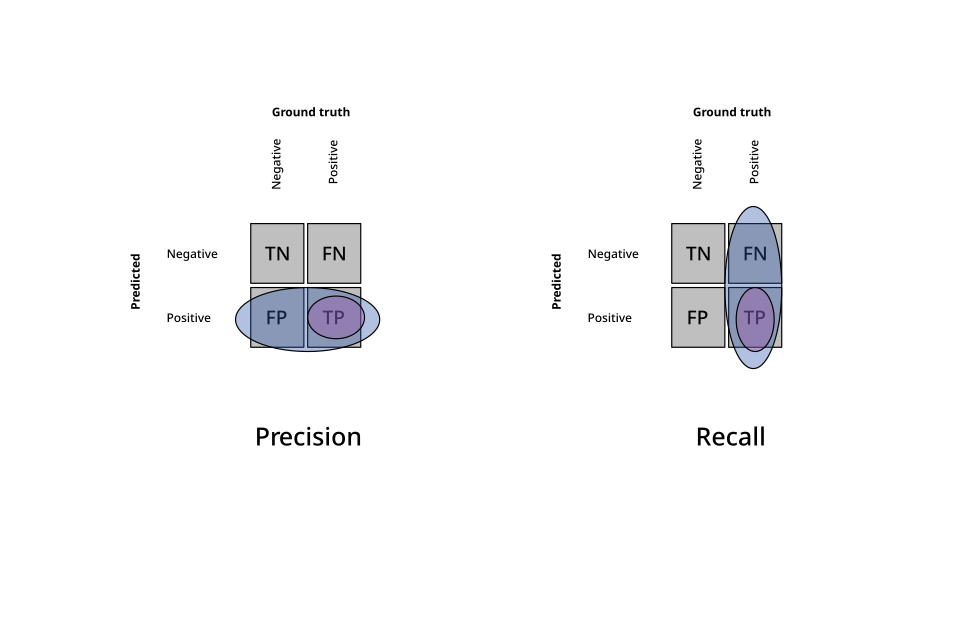
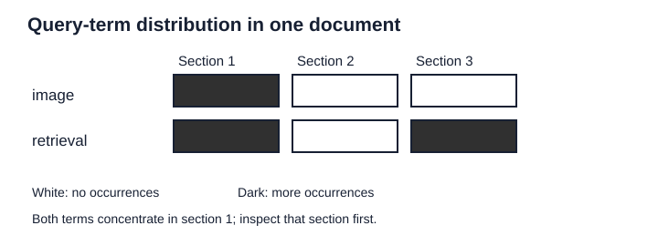

# Unit 3: evaluation and visualization of IR systems

[Study index](README.md) | Book: [evaluation and visualization, PDF pages 3–15](../Books/ISR_Decode_Units03-06.pdf#page=3).

## 1. Why evaluate an IR system?

**PYQs:** N22 Q1(a,b), Q2(a,b); M23 Q1(a,b); N23 Q1(a,b,c); M24 Q1(b); N24 Q1(a); M25 Q1(b,c); N25 Q1(b), Q2(c); M26 Q1(b).

An information retrieval (IR) system searches a document collection for an **information need** expressed as a query. Evaluation asks how well the returned results meet that need, not just how quickly the software runs.

An offline test collection normally includes documents, representative queries and **relevance judgments**. The judgments serve as the reference against which systems are compared. A fair comparison uses the same queries and judgments, the same cutoff, and reports performance across queries. Operational evaluation can also consider latency, cost and usability; no one measure captures every goal.

| | Relevant to query | Not relevant |
|---|---:|---:|
| Retrieved | True positive (TP) | False positive (FP) |
| Not retrieved | False negative (FN) | True negative (TN) |

*Precision and recall by kindlychung, [Wikimedia Commons / Openclipart](https://commons.wikimedia.org/wiki/File:Precision_recall.svg), [CC0 / public domain](https://creativecommons.org/publicdomain/zero/1.0/); rasterized and converted to JPEG with a white background. Interpret “predicted positive” as “retrieved” and “ground-truth positive” as “relevant.”*

For the book's Venn diagrams of relevant and retrieved sets, see [PDF page 3](../Books/ISR_Decode_Units03-06.pdf#page=3).

**Precision = TP / (TP + FP)** = relevant retrieved / all retrieved. It answers: “Of what I returned, how much is useful?”

**Recall = TP / (TP + FN)** = relevant retrieved / all relevant. It answers: “Of all useful items, how many did I find?”

If nothing is retrieved, precision's denominator is zero; if there are no relevant items, recall's denominator is zero. State the evaluation convention instead of dividing by zero. True negatives are usually huge in IR, so accuracy alone can be misleading.

### Worked PYQ numericals

| Paper and data | Intersection or TP | Precision | Recall |
|---|---:|---:|---:|
| N23 Q1(a): 160 relevant, 120 retrieved, 90 relevant retrieved | 90 | `90/120 = 0.75 = 75%` | `90/160 = 0.5625 = 56.25%` |
| N24 Q1(a): 8 relevant, 11 retrieved; common IDs `d3,d7,d14,d23,d25` | 5 | `5/11 ≈ 45.45%` | `5/8 = 62.5%` |
| N22 Q1(a): 10 relevant, 15 retrieved; common IDs `d120,d50,d9,d25,d3` | 5 | `5/15 ≈ 33.33%` | `5/10 = 50%` |
| M25/N25 Q1(b): 80 records on the topic, 60 retrieved, 45 relevant retrieved | 45 | `45/60 = 75%` | `45/80 = 56.25%`, **if all 80 topic records are relevant** |

For M25/N25, the wording does not explicitly say all 80 records are relevant. State the assumption; without the total number of relevant records, recall is not uniquely determined. In set questions, first compute the intersection, not the number of items on either list.

### Precision–recall trade-off

Broadening a query or lowering a decision threshold often retrieves more relevant items **and** more irrelevant ones: recall can rise while precision falls. Tightening a query can have the opposite effect. This is a common tendency, not a mathematical law: a better ranking can improve both. Medical evidence searches may emphasize recall; a short top-results list often emphasizes precision.

## 2. F-score and E-measure

**PYQs:** M23 Q2(b); N23 Q2(b); M24 Q1(b), Q2(b); M25 Q2(b); N25 Q2(b); M26 Q2(b).

`F1 = 2PR / (P + R)` is the harmonic mean of precision `P` and recall `R`. It is high only when both are high. With `P = 0.75` and `R = 0.5625`, `F1 ≈ 0.643` or **64.3%**.

`Fβ = (1 + β²)PR / (β²P + R)`. For this standard convention, `β > 1` emphasizes recall; `β < 1` emphasizes precision. With `β = 1`, it becomes F1. When both P and R are zero, F1 is commonly defined as zero by evaluation convention.

The complementary **E-measure** is `Eβ = 1 − Fβ`; lower is better. Always show the exact formula or convention used, because texts sometimes parameterize the precision/recall weight differently.

## 3. Ranking measures: P@k, AP, MRR, DCG and NDCG

**PYQs:** M23 Q1(b,c), Q2(b); N23 Q2(b); M24 Q2(b); N24 Q1(b); M25 Q1(a), Q2(b); N25 Q1(a), Q2(b); M26 Q2(b).

| Measure | What it evaluates | Key point |
|---|---|---|
| Precision@k | Relevant results in top k divided by k | Useful for a fixed-size first page; specify k |
| Average precision (AP) | Average of P@rank over ranks containing relevant items, divided by total relevant items | Rewards placing multiple relevant results early |
| Mean average precision (MAP) | Mean AP over queries | Uses binary judgments and captures ranking over queries |
| Reciprocal rank (RR) | `1 / rank of first relevant result` | Measures how soon the first answer appears |
| MRR | Mean RR across queries | Useful for a single satisfactory answer |
| DCG / NDCG | Discounted graded relevance | Rewards highly relevant items near the top |

**MRR example:** first relevant result at ranks 1, 2 and 4 for three queries gives `MRR = (1 + 1/2 + 1/4)/3 ≈ 0.583`. If a query has no relevant result in the evaluated list, its RR is conventionally zero. MRR does not reward additional relevant results after the first.

**AP example:** suppose four retrieved results have binary relevance `[1, 0, 1, 0]`, and the collection contains three relevant items total. Relevant items occur at ranks 1 and 3, with `P@1 = 1` and `P@3 = 2/3`; `AP = (1 + 2/3)/3 ≈ 0.556`. The third relevant item was missed, so it remains in the denominator.

### DCG and NDCG worked example

For a cutoff `k`, one common convention is `DCG@k = Σ(i=1..k) (2^rel_i − 1) / log₂(i + 1)`, where `rel_i` is a graded relevance score. Other courses may use raw relevance instead of `2^rel − 1`; use the convention required by the question consistently.

Suppose the first three results have grades `[3, 0, 2]`:

| Rank | Grade | Gain `2^grade − 1` | Discounted gain |
|---|---:|---:|---:|
| 1 | 3 | 7 | `7/log₂2 = 7` |
| 2 | 0 | 0 | `0/log₂3 = 0` |
| 3 | 2 | 3 | `3/log₂4 = 1.5` |

`DCG@3 = 8.5`. The ideal ordering of these same three judged items is `[3, 2, 0]`, so `IDCG@3 = 7 + 3/log₂3 ≈ 8.893`. Thus `NDCG@3 = DCG/IDCG ≈ 0.956`. In a full test collection, compute the ideal ordering from all judged candidate documents, not merely from the returned three. If IDCG is zero, state the chosen evaluation convention.

## 4. Relevance judgments and feedback

**PYQs:** N22 Q2(c); N24 Q2(b); M26 Q2(c).

**Relevance** is how useful a document is to a particular information need. Human assessors judge document–query pairs, often as binary relevant/not relevant or on a graded scale. A document can be topically related yet unhelpful to a particular user. Assessing every document is costly, so test collections often pool results from several systems and judge those candidates; unjudged is not inherently irrelevant.

**Group relevance judgments:** several people independently assess the same item, then aggregate their judgments by majority vote or discussion. This can reduce dependence on one assessor and reveal disagreements, but relevance remains context-dependent; record the aggregation rule and measure agreement.

**Explicit relevance feedback:** the user marks retrieved results relevant or nonrelevant; the system adjusts query terms or weights and searches again. **Pseudo relevance feedback:** automatically assume the top few initial results are relevant, extract representative terms, expand/reweight the query, and rerun it. It needs no user labeling but can drift toward the wrong topic if the first results are poor.

Example: a search for `jaguar` returns car pages; expansion with `engine` may help a car search but harm an animal search. Ask for feedback or use context to disambiguate.

## 5. User-oriented measures

**PYQs:** N22 Q2(a); M23 Q2(a); N23 Q2(a); M24 Q2(a); N24 Q2(a); M25 Q2(a); N25 Q2(a); M26 Q1(c).

System metrics use judgments and ranked results; user-oriented measures consider the searcher's **actual task and experience**. Measure on representative users and tasks, with clear conditions and consent.

| Measure | How it is observed | Why it matters |
|---|---|---|
| Task success / answer correctness | Whether the task or answer meets defined criteria | Measures the practical outcome |
| Time to first useful result / completion | Time from task start to useful result or completion | Measures effort and delay |
| Interaction effort | Number of queries, clicks, reformulations, pages inspected | Captures workload; fewer clicks alone need not mean better |
| Satisfaction / perceived relevance | Questionnaire or rating after task | Captures subjective experience |
| Coverage and novelty | Useful distinct information found, including new items | Helps exploratory searches |
| Accessibility and usability | Observed ability to use controls, including keyboard and assistive technology | Enables different users to search effectively |

Clicks and dwell time are **proxies**, affected by presentation and position bias, not guaranteed judgments. Combine behavioral data with feedback and outcomes.

### Textbook user-oriented ratios

The book also defines measures relative to what the user already knows or expects. Let `R` be relevant documents, `A` retrieved documents and `K` the documents already known to the user:

| Measure | Definition | Interpretation |
|---|---|---|
| Coverage ratio | `|R ∩ A ∩ K| / |R ∩ K|` | Fraction of the known relevant documents that were retrieved |
| Novelty ratio | `|(R ∩ A) \ K| / |R ∩ A|` | Fraction of relevant retrieved documents that were previously unknown to the user |
| Relative recall | Relevant documents found / number of relevant documents the user expected to find | Compares actual discoveries to the user's expectation, not necessarily to the true total |
| Recall effort | Number of relevant documents the user expected to find / number of documents examined in the attempt | Relates the user's expected yield to examination effort; state the examination stopping point |

**Example:** suppose the user knows four relevant documents, the system retrieves three of them, and it also retrieves two previously unknown relevant documents. Coverage is `3/4 = 75%`; novelty is `2/5 = 40%`. If the user expected four relevant documents and found five, relative recall is `5/4 = 1.25` under this definition; unlike ordinary recall, it may exceed one. If ten documents were examined to complete the search, recall effort is `4/10 = 0.4`. These ratios require nonzero denominators and a clearly specified user, query and assessment procedure.

See the textbook's [user-oriented measures and diagram, PDF pages 12–13](../Books/ISR_Technical_Units03-06.pdf#page=12). Different sources may define user-centric measures differently, so state the chosen convention.

## 6. Visualization, query specification and interface support

**PYQs:** N22 Q1(c); M23 Q2(c); N23 Q2(c); M24 Q1(a); N24 Q1(c); M25 Q2(c); N25 Q1(c); M26 Q1(a), Q2(a).

Information visualization presents documents, relationships or results visually to help users navigate and interpret them. A search interface supports the full cycle:

1. **Start:** suggest examples, recent searches, categories, collections or overviews rather than leaving a user with only a blank box.
2. **Specify:** allow keywords, phrases, Boolean operators, filters and other controls.
3. **Inspect:** show titles, snippets with highlighted terms, dates, source and useful metadata; preview full context.
4. **Refine:** support facets, query editing, related terms and relevance feedback.
5. **Understand:** use ranked lists, timelines, clusters, maps or link views where the visualization suits the data. Provide legends and accessible text alternatives.

| Query technique | Example | Benefit / limitation |
|---|---|---|
| Keyword or phrase | `"information retrieval"` | Fast and familiar; ambiguous terms may need refinement |
| Boolean | `(image OR video) AND retrieval NOT medical` | Explicit set logic; precedence and syntax can be difficult |
| Faceted | Filter by year, type and author after a query | Easy progressive narrowing; depends on reliable metadata |
| Form / fielded | Title contains “web”; year ≥ 2022 | Makes structure explicit; users need to know fields |
| Query by example | Upload an image similar to the desired item | Useful when words are hard to specify; similarity can miss meaning |
| Natural language | “Find recent papers on image search” | Accessible, but interpretation can be ambiguous |
| Direct visual selection | Select a region on a map or drag a range on a timeline | Supports exploration; must be usable without relying only on color |

### Graphical query specification

A **query** is a representation of an information need that the system can process. Query specification includes choosing the collection or fields as well as expressing the terms and their relationships. A graphical interface can make these relationships visible rather than requiring users to remember a query language.

- **Boolean query:** `("image" OR "video") AND retrieval` finds documents containing retrieval and at least one of the media terms. Parentheses make the intended grouping explicit; exact Boolean matching need not rank the matches.
- **Faceted query:** first search for `retrieval`, then select media type = image and year = 2024. The selected values narrow the result set; the user can remove a facet to broaden it again.
- **Form filling and menus:** enter `retrieval` in the title field and choose a year from a menu. Fields expose the available metadata, although an appropriate field must exist.
- **Venn diagrams and VQuery:** represent terms by circles or ovals. Overlapping regions show combinations of terms; selecting the overlap of `image` and `retrieval` specifies their AND. VQuery lets users position term ovals and select regions. Counts can help the user see how restrictive a combination is.
- **Natural language and free text:** a user writes “find recent papers on image retrieval”; the system interprets the words rather than requiring explicit Boolean operators. Interpretation can be ambiguous.
- **Direct manipulation:** users interact with visible objects through incremental, reversible actions with immediate feedback. Moving an oval or choosing a facet lets them revise their query without typing a complex expression.

See the textbook's [VQuery diagram, PDF page 18](../Books/ISR_Technical_Units03-06.pdf#page=18), and [query specification discussion, pages 15–17](../Books/ISR_Technical_Units03-06.pdf#page=15). For an exam answer, define the query, explain at least three techniques with examples, and describe how the interface makes refinement easier.

### Showing document context and result sets

These techniques help users **inspect results**, rather than all being ways to formulate a query:

| Technique | What it shows | Example and use |
|---|---|---|
| Document surrogate | A compact substitute such as title, author, date and snippet | A user scans a result list before opening full documents; snippets can omit important context. |
| KWIC (keyword in context) | Each query-term occurrence with nearby words | For `retrieval`, show “…image **retrieval** using texture…” so the reader can judge the sense of the match. |
| TileBars | Query-term or term-group frequencies across consecutive document sections | Rows correspond to terms or groups, columns to sections; darker tiles indicate more occurrences. Overlap helps identify sections discussing multiple terms. Clicking a tile can open that section. |
| SeeSoft | Compact lines of text with visual highlighting | Shows the distribution of matches across a long text; users zoom in for details. |
| InfoCrystal | Counts of documents matching different combinations of query terms | Also works as a visual query language: select term combinations instead of writing complex Boolean expressions. |
| SuperBook | A document's table of contents alongside its content | Expanding sections helps locate hits while preserving the document's hierarchy. |

For example, if a document has three sections and the TileBar row for `image` is dark only in section 1 while the row for `retrieval` is dark in sections 1 and 3, section 1 is a promising place to inspect both terms. TileBars show **distribution, not meaning or guaranteed relevance**. Do not confuse them with interface title bars or with VQuery's query-specification diagram.

*Original illustrative diagram for this guide; the shades represent relative term frequency, not exact counts.*

See the book's [KWIC figure, page 19](../Books/ISR_Technical_Units03-06.pdf#page=19), [TileBars description, page 20](../Books/ISR_Technical_Units03-06.pdf#page=20), and [InfoCrystal and SuperBook, page 21](../Books/ISR_Technical_Units03-06.pdf#page=21).
