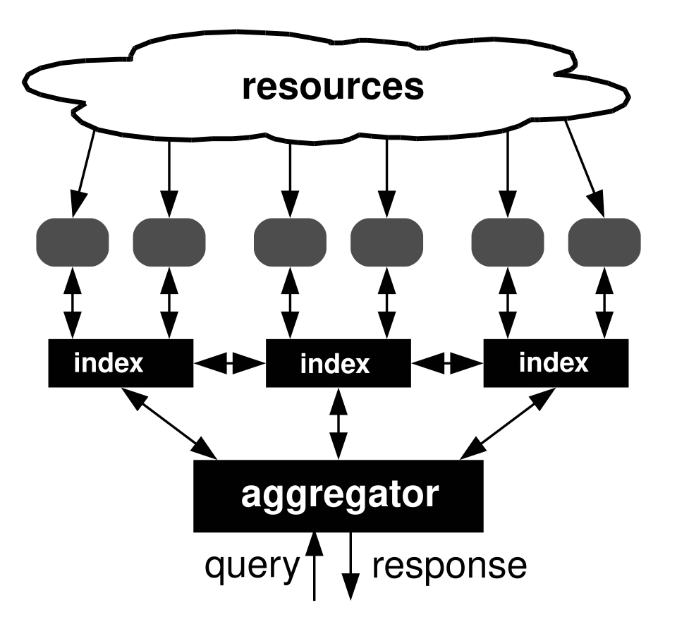
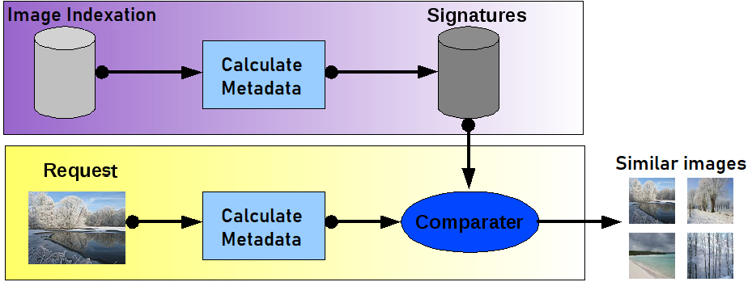

# Unit 4: distributed and multimedia information retrieval

[Study index](README.md) | Book: [distributed IR, PDF pages 16–20](../Books/ISR_Decode_Units03-06.pdf#page=16) | [multimedia IR, PDF pages 21–40](../Books/ISR_Decode_Units03-06.pdf#page=21).

## 1. Distributed IR: architecture and workflow

**PYQs:** N22 Q3(a); M23 Q3(a,b); N23 Q3(a); M24 Q3(a); N24 Q3(a), Q4(b); M26 Q3(a).

**Distributed information retrieval** searches across multiple separately managed collections or indexes and combines useful results. For example, a university portal may search its library catalog, repository and departmental archives without storing every document in one central index.

*Federated search concept by JakobVoss, [Wikimedia Commons](https://commons.wikimedia.org/wiki/File:Federated-search-en.svg), [CC BY-SA 3.0](https://creativecommons.org/licenses/by-sa/3.0/); rasterized and converted to JPEG with a white background. The aggregator corresponds to the broker; the figure is one possible organization, not a requirement that local indexes exchange data directly.*

The usual components are:

1. **User interface:** receives the information need and displays results.
2. **Broker / mediator:** interprets the query and coordinates the search.
3. **Resource descriptions:** summarize each collection, for example its vocabulary, size and statistics.
4. **Source selection:** estimates which collections are likely to contain relevant documents.
5. **Local search engines:** execute the query against selected collections.
6. **Result merging:** normalizes or estimates comparable scores, handles duplicates and creates one ranked list.

**Example:** For `renewable energy`, the broker selects a research repository and engineering library, dispatches the query, collects their top results, merges them and shows one ranked list. If the medical archive is unlikely to contain useful material, the broker can omit it to save time. If the source summary is stale, it may overlook a useful collection.

| Centralized collection | Distributed collection |
|---|---|
| Documents or a unified index are managed at one logical center | Sources retain separate local indexes and may have separate owners |
| Uniform indexing makes global scoring easier | Independent scoring and vocabularies complicate merging |
| Queries avoid broker-to-source fan-out | Sources can be selected and searched concurrently |
| Central indexing requires access, storage and updates | Local autonomy is preserved, but failures and communication latency matter |

Centralized systems can still be physically sharded; “distributed IR” here emphasizes searching separate collections, not merely running a search service on multiple machines.

### Source selection

**PYQs:** M23 Q3(a); N23 Q3(a).

The broker stores a **collection representation**, such as term frequencies, document counts, sampled documents or other summaries. For a query, it scores collections by estimated usefulness, selects the best few within a cost budget, then sends them the query. A collection with high query-term coverage and many matching documents may be a good candidate. If the full contents are private, summaries can be built through sampling rather than direct access.

**Trade-off:** querying more sources can improve recall but increases latency, traffic and result-merging work. Querying too few risks missing relevant results. Resource descriptions must be updated as collections change.

For an examination answer, distinguish **resource selection** from document ranking: the former decides *where* to search, the latter orders *individual documents*. A broker might first select two of ten libraries using sampled vocabulary, send the same query to both, then merge their documents. It should not compare raw scores blindly when the local systems use different scales.

### Distributed query processing and merging

**PYQs:** M23 Q3(b); N24 Q4(b).

1. Parse and normalize the query; choose sources using their summaries.
2. Translate the query if sources use different field names, syntax or languages.
3. Dispatch it, often in parallel, and request a limited number of results from each.
4. Each source applies its local index and ranking algorithm.
5. The broker gathers results, reconciles duplicates, makes scores more comparable when possible, and returns a merged ranking.
6. Log failures and timeouts; partial results should be identified as partial rather than presented as a complete search.

**Important:** a score of 0.8 from one engine need not mean the same thing as 0.8 from another. Different scoring models, collection sizes and local term statistics make merging difficult. A slow or unreachable source, overlapping documents and privacy restrictions further complicate processing.

### Collection partitioning

**PYQs:** N22 Q3(b); M23 Q4(b); N23 Q4(b); N24 Q3(b); M26 Q3(b).

Partitioning divides a large collection into manageable parts. **Horizontal / document partitioning** assigns whole documents to shards, for example by document ID, topic or geography. A term query can be run on relevant shards and their results merged. **Vertical / term partitioning** assigns portions of an index, such as sets of terms, to different servers; query terms may require contacting multiple servers and combining postings.

| Choice | Benefit | Limitation |
|---|---|---|
| Document-based | Easy to add documents; each shard can search independently | Broad queries may fan out to many shards; skewed topic partitions can miss results if selection is wrong |
| Term-based | Each term's postings are stored together | Multi-term queries require network transfer and intersections across term servers |
| Topic-based documents | A source selector can avoid unrelated shards | Documents span topics; reclassification and uneven loads are difficult |

Use replication for availability, monitor load, and account for updates. Partitioning a single managed collection is related to, but not identical to, federating independently managed sources.

### Automatic feature extraction

**PYQs:** M24 Q3(a); M26 Q3(a).

A **feature** is a measurable property used to represent a document, query or collection. Automatic extraction turns raw data into searchable signals, saving manual effort:

1. Acquire documents or permitted samples and parse their format.
2. For text, tokenize, normalize case, optionally remove stop words or stem, and extract terms, phrases, entities and fields.
3. Compute weights such as TF–IDF or aggregate term statistics across a source to create a resource description.
4. For images, audio or video, extract features such as color histograms, texture, embeddings or temporal descriptors.
5. Store features and indexes, refresh them as collections change, and use them for source selection or local matching.

Example: a sample from the engineering archive has frequent terms `solar`, `inverter` and `grid`; its summary can make it a promising source for a solar-energy query. Extraction may be noisy, lose meaning or reflect a biased sample; features are not the same as a human relevance judgment.

## 2. Multimedia IR: architecture and data modelling

**PYQs:** M23 Q4(a); N23 Q3(b), Q4(a); M25 Q3(a); N25 Q3(a); M26 Q4(b).

**Multimedia IR** retrieves image, audio, video, text or combinations of these in response to a query, often using similarity rather than exact equality. In a content-based image search, the user submits a sample picture; the system extracts its visual features and ranks stored images with similar features.

*Content-based image retrieval schema by Xiawi, [Wikimedia Commons](https://commons.wikimedia.org/wiki/File:Schema_of_content-based_image_retrieval_%28CBIR%29.png), [CC BY-SA 3.0](https://creativecommons.org/licenses/by-sa/3.0/); converted to JPEG with a white background. “Metadata” here refers to extracted image descriptors/signatures, not only manually supplied captions.*

### Architecture and stages

1. **Ingest and store** multimedia objects with identifiers, media type, metadata and access permissions.
2. **Extract features:** color, shape and texture for images; spectral or temporal features for sound; frames, motion and audio for video. Some systems also use captions or learned embeddings.
3. **Index** feature vectors and textual metadata so that the system can find candidate objects efficiently.
4. **Formulate a query:** text, attributes, an example image/audio clip, sketches, spatial relations or a combination.
5. **Match and rank:** compare query and indexed descriptors using a suitable distance or similarity; apply any exact metadata filters.
6. **Present results and gather feedback:** show thumbnails or playable previews; allow users to mark relevance and refine.

**Semantic gap:** similar low-level features do not guarantee the same meaning. A blue sea and a blue car might have similar dominant colors but different subjects. Feature quality, computation, large storage needs and privacy are practical limitations.

### Data modelling

A multimedia data model describes both **logical objects** and their internal representation: object ID, type, metadata, components, features, relationships and access rights. A video can have a title, duration, scenes, frames and audio tracks; timestamps preserve temporal relationships. An image can have regions, captions and feature vectors.

| Query predicate | Example |
|---|---|
| Attribute | Videos with duration under five minutes |
| Content / similarity | Images visually similar to a sample |
| Spatial | A person to the left of a vehicle |
| Temporal | A sound occurs before a scene change |
| Semantic | Pictures containing a bicycle, based on annotations or a classifier |

Exact field matches and approximate similarity scores may be combined. Feature extraction and semantic labels can be uncertain; a score is not a guarantee of true meaning.

Consider a five-minute wildlife video: the model stores its ID, title and duration, links it to audio and video tracks, and assigns timestamps to scenes. Extracted visual descriptors describe frames; recognized speech or captions provide text. A request for “birds near water in the first minute” combines a temporal restriction with uncertain visual or text-based evidence. The system should return a ranked clip and enough context to inspect it, rather than pretending the recognition is exact.

### Multimedia query language

**PYQs:** N22 Q4(b).

A multimedia query language needs a way to specify an example or features, metadata restrictions, spatial/temporal relationships and possibly weights or similarity thresholds. Processing parses the request, filters or indexes candidates, computes similarity, ranks results and supports refinement. Unlike a conventional exact database selection, an approximate query may return graded matches.

Example: “Show clips shorter than 30 seconds in which a vehicle appears **before** a pedestrian; rank by similarity to this sample.” Duration is an exact filter; recognition and similarity may be approximate. Results can vary with the feature model and threshold.

## 3. Commercial DBMS support

**PYQs:** M24 Q3(b); M25 Q3(b); N25 Q4(b); M26 Q4(a).

A DBMS can store or reference media and manage associated structured metadata:

- **BLOB** for binary data such as an image; **CLOB** for large text. A database may instead store a secure file/object-store reference.
- Tables and indexes for IDs, titles, dates, ownership and permissions.
- Object-relational features, user-defined types and functions for structured or application-specific descriptors.
- Text, spatial or vector indexes and extensions where the particular product supports them.
- Transactions, access control, backup and recovery for consistent management.

Example: a `Media` table stores an ID, title, timestamp, a BLOB or object URL, and an image-feature vector. A metadata filter narrows the candidate set, then an appropriate similarity function ranks the candidates. **Storing a BLOB does not itself enable visual search**: extraction, similarity computation and suitable indexing must be supplied.

Product-specific names, limits and multimedia extensions vary by product and version. Older book examples are historical; do not assume every DBMS supports the same media operations.

## 4. MULTOS multimedia office server

**PYQs:** N22 Q4(a); M24 Q4(b); N24 Q4(a); M25 Q4(b); N25 Q3(b).

**MULTOS** is a historical **MULTimedia Office Server**, a client–server document-management system designed to file and retrieve complex multimedia office documents. It models document collections, document types, document attributes and the internal organization of a document, rather than treating every document as one undifferentiated string.

| View | What it describes | Letter example |
|---|---|---|
| Logical structure | Content organization | Letter, heading, body, signature |
| Layout structure | Presentation on pages | Pages, frames, positions |
| Conceptual structure | Domain-specific meaning and relationships | Sender, recipient, address, date |

**Working:** a client creates or requests a document; a document server stores the object, type, attributes and components; a query may combine attributes and content; matching documents or components are retrieved and presented. A type can constrain what components an instance contains. For example, a letter type can include sender and recipient; the corresponding components of a particular letter contain their actual values. The book illustrates a conceptual letter structure on [PDF page 28](../Books/ISR_Decode_Units03-06.pdf#page=28).

**Why useful:** structured retrieval can locate a letter by sender, its text, or a component. **Limitations:** models and clients must agree on document structure; managing diverse media, permissions and efficient similarity search adds complexity. Distinguish the historical MULTOS model from generic modern database features.

For example, the query “letters from Patil about retrieval” combines a sender attribute with a content condition. The server identifies matching document instances and returns the selected document or component; a client presents it according to the stored layout. Logical structure describes *what parts exist*, layout describes *how they appear*, and conceptual structure relates parts to *domain meaning*. These views are complementary rather than three separate documents.

## 5. GEMINI: generic multimedia indexing

**PYQs:** M24 Q4(a); M25 Q4(a); N25 Q4(a); M26 Q4(b).

**GEMINI** (GEneric Multimedia INdexIng) accelerates similarity search by first filtering objects in a lower-dimensional **feature space** and then checking surviving candidates using the original distance. See [book PDF pages 33–34](../Books/ISR_Decode_Units03-06.pdf#page=33).

For query `q`, object `x` and distance threshold `ε`:

1. Choose an original distance `D(q,x)` appropriate for the media.
2. Map each object and the query to a compact feature vector `f(x)`.
3. Index stored features using a suitable spatial access method.
4. Find candidates whose **feature-space lower-bound distance** `d(f(q),f(x)) ≤ ε`.
5. Compute the original distance for each candidate and return only objects with `D(q,x) ≤ ε`.

The no-false-dismissal guarantee requires `d(f(q), f(x)) ≤ D(q,x)` for every pair under the chosen transformation and distances. A candidate may pass the inexpensive filter and fail the exact check: that is a **false positive**, which the second stage removes. If the lower-bound property is absent, exact recall is not guaranteed.

**Small example:** let `q = (1,2)`, `x = (2,3)`, original distance be Euclidean, and feature be the first coordinate. The feature distance is `|1−2| = 1`, while the full distance is `√2 ≈ 1.414`. With `ε = 1.2`, `x` passes the feature filter but is rejected by the full comparison. With `ε = 1.5`, it passes both. Using the first-coordinate distance is a lower bound on full Euclidean distance.

**Benefits:** avoids expensive full comparisons for many objects and separates the generic indexing method from media-specific features. **Limitations:** weak features yield many false positives; dimensionality and index overhead can reduce the benefit; guarantees depend on the distance bound.
