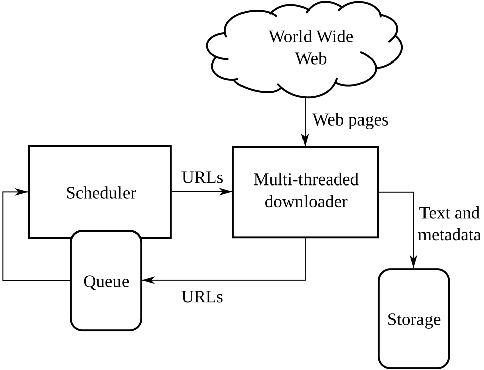
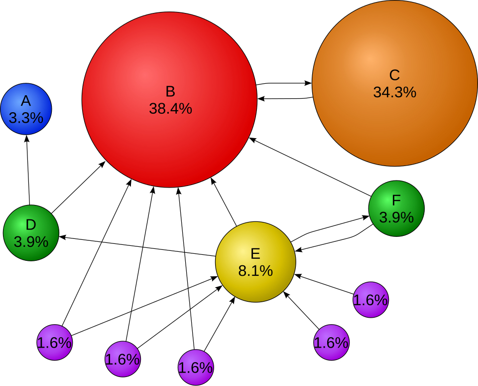

# Unit 5: web searching

[Study index](README.md) | Book: [web searching, PDF pages 41–59](../Books/ISR_Decode_Units03-06.pdf#page=41); [crawler-indexer and ranking, PDF pages 47–52](../Books/ISR_Decode_Units03-06.pdf#page=47).

## 1. The web and search-engine mechanism

**PYQs:** N22 Q5(a); M23 Q5(a), Q6(b); N23 Q6(b); M24 Q5(a); N24 Q5(b); M25 Q5(a); N25 Q5(a); M26 Q6(b).

The **web** is a collection of resources identified by URLs and connected by hyperlinks. Resources include text, images, multimedia and structured data, provided by many independent owners. The web is large, heterogeneous, dynamic, multilingual, partly duplicated and partly inaccessible to crawlers. It includes spam and pages whose contents require authentication, forms or other interaction.

An example search-engine workflow:

1. **Discovery and crawling:** start with seed URLs, download allowed pages and discover more links.
2. **Processing:** parse documents, extract text, metadata and links, remove or identify duplicates, and normalize terms.
3. **Indexing:** build an inverted index mapping each term to the documents (and often positions) containing it.
4. **Query processing:** tokenize the user's query, interpret spelling or intent, and retrieve candidate documents from the index.
5. **Ranking:** score candidates using relevance signals, possibly including text, links, freshness and other factors.
6. **Presentation:** show ranked titles, URLs and snippets; support filtering, reformulation and feedback.

**Example inverted index:** if document D1 contains “web retrieval” and D2 contains “image retrieval”, postings for `retrieval` include D1 and D2, while `web` points to D1. For `web retrieval`, the engine can efficiently identify D1 without scanning every document at query time.

| Search engine | Web directory | Meta-searcher |
|---|---|---|
| Crawls or receives pages and indexes them | Organizes selected resources into categories, often curated | Sends a query to multiple search services and merges their responses |
| Broad keyword search | Browsing by subject | Wider coverage without necessarily maintaining its own full index |
| May contain stale or low-quality pages | Human curation can be costly and incomplete | Dependent on providers and difficult score merging |

### Challenges in web search

**PYQs:** M25 Q6(c); N25 Q5(c); M26 Q6(b).

- **Scale and speed:** huge collections require distributed storage, indexing and low query latency.
- **Change and freshness:** pages appear, move, change or disappear; recrawling everything immediately is impractical.
- **Quality and spam:** duplicate pages, manipulation and misleading content degrade results.
- **Heterogeneity:** multiple languages, formats, scripts and media complicate parsing and relevance.
- **Ambiguity:** short queries such as `java` can mean a programming language, island or coffee.
- **Coverage:** authenticated, dynamically generated, blocked or unlinked resources may not be crawled; absence from the index is not proof that a page does not exist.
- **Privacy and fairness:** user data and ranking choices require careful handling.

## 2. Crawlers and crawler-indexer architecture

**PYQs:** N22 Q5(b,c); M23 Q6(b); N23 Q6(b); M24 Q5(b), Q6(c); N24 Q5(a,b); M25 Q6(b); N25 Q5(b); M26 Q5(a).

A **web crawler** automatically discovers and fetches web resources to build or refresh a collection. It does not itself decide that a page is relevant to every user's query; the indexer and ranking components handle other parts of search.



*Web crawler architecture, vector version by dnet based on Carlos Castillo's diagram, [Wikimedia Commons](https://commons.wikimedia.org/wiki/File:WebCrawlerArchitecture.svg), [CC BY-SA 3.0](https://creativecommons.org/licenses/by-sa/3.0/); rasterized and converted to JPEG with a white background. Storage can feed an indexer, a separate step not shown in this figure.*

### Components and operation

1. **Seed URLs:** known starting pages.
2. **URL frontier / queue:** discovered URLs awaiting a fetch; avoids repeatedly scheduling identical normalized URLs.
3. **Scheduler:** chooses the next URL, observes site policies and spacing, and prioritizes important or stale content.
4. **DNS resolver and fetcher:** resolve the host and retrieve the allowed resource over HTTP(S), subject to timeouts and error handling.
5. **Parser / link extractor:** extract text, metadata and outgoing URLs; resolve relative links against the page URL.
6. **Duplicate detection and filters:** avoid repeated content and disallowed URL patterns; add suitable new links to the frontier.
7. **Storage and indexer:** store or pass processed documents to the indexer, which builds searchable term-to-document postings.
8. **Revisit policy:** schedule previously fetched pages again when appropriate; update or remove obsolete index entries.

Use `robots.txt` guidance and published access policies, avoid overwhelming servers, and respect permissions and applicable terms. `robots.txt` is not an authentication mechanism or permission to access private data.

### Crawling strategies

| Strategy | Idea | Trade-off |
|---|---|---|
| Breadth-first | Explore links level by level from seeds | Broad coverage but may spend effort on low-value areas |
| Depth-first | Follow a path deeply before backtracking | Can find deep pages but delay wider coverage |
| Focused | Prioritize pages and links relevant to a topic | Efficient for a domain, but relevance estimates can exclude useful paths |
| Priority / freshness-based | Rank URLs by importance or expected change | Useful under limited budget; estimates can be wrong |
| Incremental recrawl | Revisit existing pages according to change rate | Improves freshness within budget, not instant completeness |

### Centralized versus distributed search architecture

| Aspect | Centralized | Distributed |
|---|---|---|
| Index/control | One logical index or coordinator | Multiple index shards or independently managed search sources |
| Scaling | Simpler management, but a logical bottleneck can emerge | Parallel indexing and queries; better capacity if balanced |
| Failure | A single point of failure unless replicated | Individual node failure can yield partial results; coordination and replicas needed |
| Ranking | Global statistics easier to maintain | Global scoring and merging require coordination |
| Cost | Less network coordination | More synchronization, network traffic and operational complexity |

A centralized logical index can still be physically distributed; distinguish an implementation's deployment from whether it searches independent collections.

## 3. Ranking and PageRank

**PYQs:** M23 Q5(b); N23 Q5(a); M24 Q6(b); M25 Q5(b); N25 Q6(b); M26 Q6(a).

**Ranking** orders candidate results so the most useful are likely to appear first. It matters because users often inspect only the first few results. A search score can incorporate query–document text similarity, term location, page quality, freshness and other signals. Different systems use different signals; ranking is not synonymous with PageRank.

**PageRank** is a link-based measure motivated by a random web surfer: a page receives importance from incoming links, particularly from important pages. Each linking page divides its contribution across outgoing links. A damping factor allows a random jump to any page, preventing the surfer from remaining trapped in a link structure.



*Illustrative PageRank graph by 345Kai and Stannered, [Wikimedia Commons](https://commons.wikimedia.org/wiki/File:PageRanks-Example.svg), public domain; rasterized and converted to JPEG with a white background. Percentages describe this particular graph and damping setting, not general web traffic.*

`PR(A) = (1−d)/N + d × Σ[PR(T) / outdegree(T)]`, summing over pages `T` linking to A; `N` is the number of pages, and `d` is commonly set to 0.85. For dangling pages with no outgoing links, redistribute their rank according to the chosen teleportation distribution, commonly uniformly. Start with equal ranks and iterate until the scores converge.

**One iteration:** three pages start at `1/3`; A links to B, B links to A and C, and C links to A. With `d = 0.85`, base contribution is `0.15/3 = 0.05`:

| Page | Incoming contributions | Updated rank |
|---|---|---:|
| A | B contributes `1/6`, C contributes `1/3` | `0.05 + 0.85(1/6 + 1/3) = 0.475` |
| B | A contributes `1/3` | `0.05 + 0.85/3 ≈ 0.333` |
| C | B contributes `1/6` | `0.05 + 0.85/6 ≈ 0.192` |

These are **first-iteration** values, not the converged final scores. A highly linked page is not necessarily relevant, reliable or current for a given query; link spam can manipulate signals. Explain PageRank alongside query relevance rather than claiming it is the only ranking criterion.

## 4. Hyperlinks and searching using links

**PYQs:** N22 Q6(a); M26 Q6(c).

A **hyperlink** connects a source document or element to a target resource. In HTML, `<a href="https://example.com/guide">study guide</a>` has a destination in `href` and visible **anchor text** “study guide.” A URL generally contains a scheme, host, optional port, path, optional query and fragment; not every component is required.

Links help a crawler discover new pages. Anchor text can provide descriptive context about the target, and the link graph supports algorithms such as PageRank or hub/authority analysis. Links can be broken, misleading, paid or deliberately manipulated, so they should not be treated as proof of quality.

## 5. Web scraping, Requests and Beautiful Soup

**PYQs:** N22 Q6(c); M23 Q5(c), Q6(c); N23 Q5(b); M24 Q5(c), Q6(a); N24 Q6(b); M25 Q5(c), Q6(a); N25 Q6(a,c); M26 Q5(b,c).

**Web scraping** extracts selected data from pages, typically by fetching HTML and parsing its structure. Crawling discovers and fetches pages, while scraping extracts desired fields; a project may use both.

For example, to collect public product names and prices: verify access terms and any available API, request allowed pages at a polite rate, parse each listing, extract name and price, validate the extracted values, and store them with a source and timestamp. Layout changes, JavaScript-rendered content, inaccessible pages and inconsistent markup can break scrapers.

| Tool | Purpose | Important detail |
|---|---|---|
| Python `requests` | Makes HTTP requests and exposes status, headers and response body | Set timeouts; call `raise_for_status()` to surface HTTP errors |
| Beautiful Soup (`bs4`) | Parses HTML/XML and provides tag/CSS selection | Parse the returned HTML; it does not fetch pages or execute JavaScript |

Minimal illustrative code, assuming dependencies are installed and the site permits access:

```python
import requests
from bs4 import BeautifulSoup

response = requests.get("https://example.com/", timeout=10)
response.raise_for_status()
document = BeautifulSoup(response.text, "html.parser")
heading = document.select_one("h1")
if heading is None:
    raise ValueError("Expected page heading was not found")
print(heading.get_text(strip=True))
```

In an exam, describe request, status check, parsing, selection and extraction separately. Avoid bypassing login, access restrictions, rate limits or technical barriers; do not collect personal data unnecessarily. HTML can change, so a selector should be checked and errors reported.
