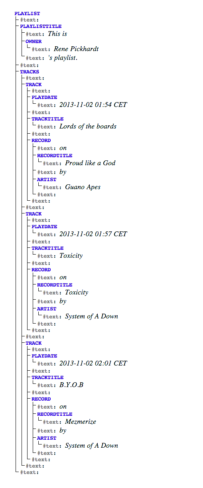
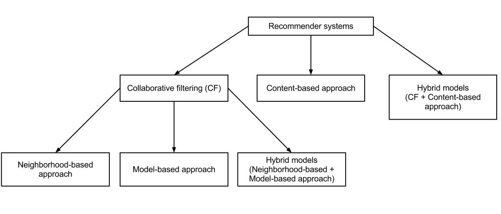
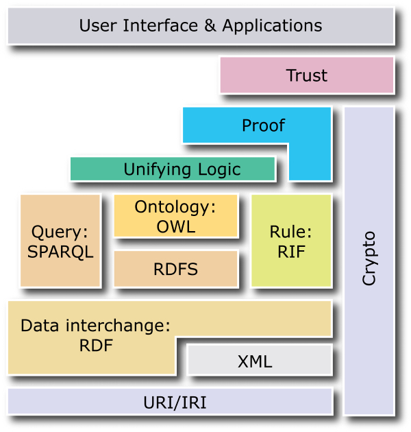

# Unit 6: advanced information retrieval

[Study index](README.md) | Book: [XML retrieval, PDF pages 60–66](../Books/ISR_Decode_Units03-06.pdf#page=60) | [recommendation and semantic web, PDF pages 67–75](../Books/ISR_Decode_Units03-06.pdf#page=67).

## 1. XML and structured retrieval

**PYQs:** N22 Q8(a); M23 Q8(a); N23 Q7(b), Q8(a); M24 Q7(a,b); N24 Q7(b), Q8(a); M25 Q7(b); N25 Q7(b); M26 Q7(b), Q8(b).

**XML** (Extensible Markup Language) represents data with nested, named elements and optional attributes. XML encodes both content and structure; it does not by itself specify how the content looks. The nesting forms a tree: one document root contains child elements, which can contain further children or text.

```xml
<article id="A1">
  <title>Image retrieval</title>
  <section>
    <heading>Features</heading>
    <p>Color and texture describe an image.</p>
  </section>
</article>
```

The document root is `article`; `title` and `section` are children; `p` is nested inside `section`. A search might return the whole article, just the section, or just a paragraph. A structural query can ask for `retrieval` specifically in a title.



*DOM tree of an XML playlist by Steffen Staab, [Wikimedia Commons](https://commons.wikimedia.org/wiki/File:DOM-Tree-Example-For-WebScience-MOOC.png), [CC BY-SA 3.0](https://creativecommons.org/licenses/by-sa/3.0/); unchanged. Element names and their indentation show parent–child relationships.*

### Text-centric versus data-centric XML

| Aspect | Text-centric | Data-centric |
|---|---|---|
| Main content | Natural-language prose with markup | Structured fields and relationships |
| Examples | Articles, manuals, reports | Product records, scientific data, business records |
| Structure | Often irregular or mixed with text | Often more regular, schema-oriented and deeply structured |
| Typical query | Find sections discussing image retrieval | Find products with `price < 500` and a specified category |
| Matching | Ranked relevance and approximate text matching | Often exact conditions and structured query evaluation |
| Returned unit | Relevant article, section or paragraph | Record, value or structured element |

This distinction describes typical use, not a hard boundary: a document may need both ranked text search and exact structural conditions.

For example, a book's `<section>` elements contain prose and benefit from ranked topical matching, whereas a catalog's `<product><price>` values support exact numeric comparisons. A product description can also contain prose; a practical system can apply `price < 500` first and then rank the matching descriptions by relevance. The output must identify the element and preserve enough context for the user to understand it.

### XML retrieval challenges

**PYQs:** N24 Q7(b).

1. **Retrieval granularity:** decide whether to return the document, section or paragraph. Small fragments may lack context; whole documents may contain too much irrelevant text.
2. **Nested and overlapping results:** a relevant paragraph and its containing section can both match; returning both can repeat content.
3. **Content and structure:** a match in a title may be more informative than a match in a footnote; a path restriction can improve precision but miss differently structured documents.
4. **Heterogeneous schema:** different sources may use `<author>`, `<creator>` or entirely different structures.
5. **Ranking and statistics:** term frequency, document frequency and length normalization need to reflect the chosen unit.
6. **Index size and efficiency:** encoding many possible paths and element combinations creates sparse, high-dimensional indexes.
7. **Presentation:** show enough surrounding context to interpret the returned element.

## 2. Vector space model for XML retrieval

**PYQs:** N23 Q7(b); M24 Q7(b); M25 Q7(b); N25 Q7(b); M26 Q8(b).

In the **vector space model**, represent a document or XML element and the query as vectors of weighted terms. Term weights may combine term frequency and inverse document frequency (TF–IDF). Compare the vectors with cosine similarity and rank the larger scores first.

`cos(q,d) = (q · d) / (||q|| × ||d||)`.

To incorporate XML structure, dimensions can include a term and its field or path, such as `(title, retrieval)` or `(section/p, image)`. Alternatively, score text within selected elements and apply structural constraints separately. Specify which elements are indexed and how nested matches are deduplicated.

**Worked example:** use dimensions `(title:retrieval, paragraph:retrieval)` with `q = (1,1)`. Let element A be `(2,0)` and element B `(1,1)`:

- `cos(q,A) = 2/(√2 × 2) ≈ 0.707`.
- `cos(q,B) = 2/(√2 × √2) = 1`.

Under these illustrative weights, B ranks above A. In practice, weights and query intent matter: if the user specifically requests a title match, the system could restrict or weight the title field differently. A zero-length vector needs an explicit handling convention; cosine is otherwise undefined.

## 3. Recommender systems

**PYQs:** N22 Q7(a), Q8(b); M23 Q7(a,b), Q8(b); N23 Q7(a), Q8(b); M24 Q8(a,b); N24 Q7(a), Q8(b); M25 Q7(a), Q8(a,b); N25 Q7(a), Q8(a,b); M26 Q7(a), Q8(a).

A **recommender system** ranks or suggests items likely to be useful to a user, based on the user's preferences, item features and/or patterns across users. Items can be documents, books, films, courses or products. Unlike a conventional search that starts with an explicit query, recommendation may proactively use a profile; real systems can combine both.



*Recommender system approaches by Moshanin, [Wikimedia Commons](https://commons.wikimedia.org/wiki/File:Collaborative_Filtering_in_Recommender_Systems.jpg), [CC BY-SA 3.0](https://creativecommons.org/licenses/by-sa/3.0/); unchanged.*

### Content-based recommendation of documents

1. **Content analyzer:** extract document features such as words, TF–IDF vectors, topics, authors or subject tags.
2. **Profile learner:** build a user-interest profile from documents the user explicitly rated or implicitly interacted with; update it as preferences change.
3. **Filtering and ranking:** compare candidate document vectors with the profile, for example using cosine similarity.
4. **Presentation and feedback:** show the top items, explain matched features where useful, and incorporate feedback.

**Worked example:** features are `[security, retrieval]`. A user's normalized interest profile is proportional to `(2,1)`. Document A has `(1,0)`, document B `(0,1)`:

- `cos(user,A) = 2/√5 ≈ 0.894`.
- `cos(user,B) = 1/√5 ≈ 0.447`.

Document A ranks first under this simple model. A cold-start user has no reliable profile; new documents can be recommended if their content features exist. Excessive similarity can cause **overspecialization**: only familiar topics are shown.

### Collaborative filtering

Collaborative filtering predicts interests from user–item interactions. **User-based CF** finds users with similar rating patterns and recommends items they liked that the target user has not seen. **Item-based CF** finds items with similar interaction patterns and recommends items related to those the user liked. Model-based approaches such as matrix factorization learn user and item representations from the interaction matrix.

**Example:** A and B both liked documents X and Y. B also liked Z, which A has not read. A user-based recommender may suggest Z to A, subject to sufficient evidence. Common issues are sparse ratings, cold-start users/items, popularity bias and changing preferences.

For a user-based system, collect ratings or interactions, compute similarity over comparable items, select neighbors, aggregate their evidence for unseen items and rank the predictions. A simple illustrative rating matrix is:

| User | Document X | Document Y | Document Z |
|---|---:|---:|---:|
| A | 5 | 4 | Not rated |
| B | 5 | 4 | 5 |

Because A and B agree on X and Y, B's rating makes Z a candidate for A. This is a prediction, not a certainty; two shared ratings alone are weak evidence. Missing ratings mean **unknown**, not zero. An item-based variant instead compares columns and recommends items similar in interaction patterns to those A liked.

### Comparison

| Aspect | Content-based | Collaborative |
|---|---|---|
| Main evidence | Item features plus this user's profile | Interactions across users and items |
| Similarity | User profile versus item content | User–user, item–item or learned interaction patterns |
| New item | Can recommend if useful content features exist | Difficult with no interactions |
| New user | Difficult without preferences | Difficult without interactions |
| Diversity | Can over-specialize around known interests | Can discover items unlike previously liked content |
| Dependency | Good item descriptors | Sufficient, reasonably representative interactions |
| Explanation | “Matches your interest in retrieval” | “Users with similar interactions liked this” |

**Hybrid systems** combine the two kinds of evidence to mitigate some weaknesses. They do not automatically eliminate cold start or bias. Evaluate with a realistic temporal split and ranking measures such as precision@k or recall@k; protect user data and consider diversity, fairness and feedback loops.

## 4. Semantic web

**PYQs:** N22 Q7(b).

The **semantic web** adds machine-processable meaning and relationships to web data so software can combine and query information from different sources. It extends the web rather than replacing ordinary pages. It does not imply machines understand language like humans.



*Semantic Web Stack, credited to W3C on [Wikimedia Commons](https://commons.wikimedia.org/wiki/File:Semantic_Web_Stack.png), public domain as described there; converted to JPEG with a white background. This is a conceptual historical stack, not a mandatory implementation sequence.*

| Technology | Role |
|---|---|
| URI / IRI | Identifies an entity or resource |
| RDF | Represents statements as subject–predicate–object triples |
| RDFS | Provides basic vocabulary for classes and properties |
| OWL | Expresses richer ontology classes, relationships and constraints |
| SPARQL | Queries RDF graphs |

**Example triples:** `(Book1, hasAuthor, Author1)` and `(Author1, worksAt, University1)`. A SPARQL query can find books by authors working at University1, even when facts originate from linked datasets. URIs help distinguish entities with the same name.

**Advantages:** data integration, explicit relationships, structured queries and some forms of automated inference. **Limitations:** inconsistent vocabularies, incomplete or incorrect data, identity matching, privacy and the cost of creating and maintaining reliable knowledge graphs. RDF has several serializations; it is **not limited to XML**.
