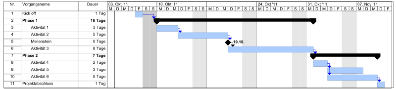
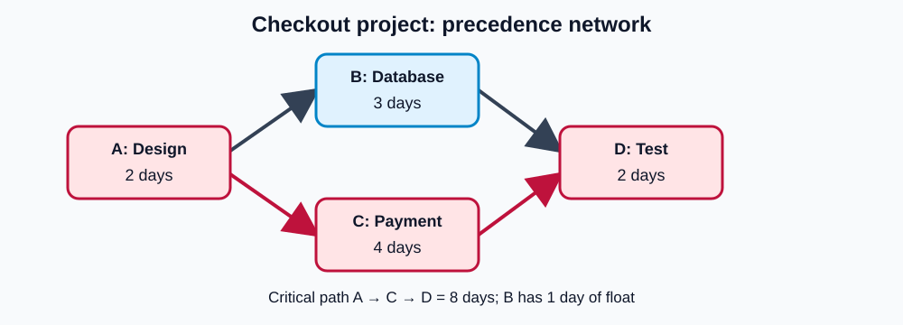
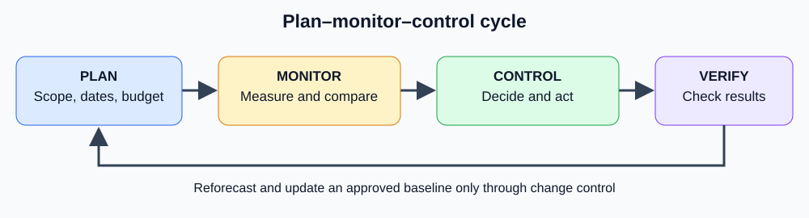
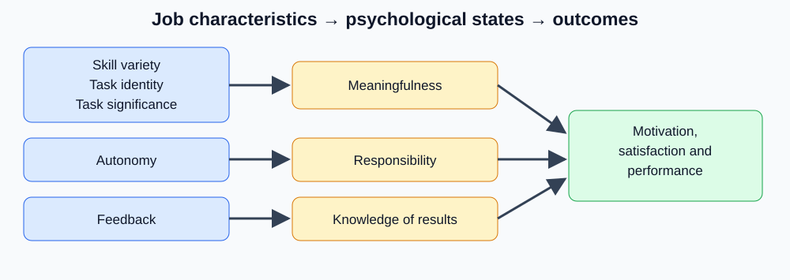
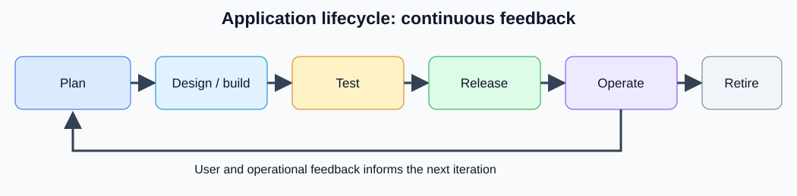

# SPM: 2022 Nov-Dec — detailed answers

[Question paper](SPM_Endsem_2022_Nov-Dec.pdf) | [Study index](../Study/README.md)

Question headings are paraphrased. Both sides of every OR are answered; use the paper's actual marks and instructions in the exam. Each response is prepared for approximately nine marks. Examples are illustrative, not paper data.

## Q1(a) — Objectives of activity planning with an example

### Activity planning and identification

**Activity planning** turns project deliverables into an ordered, resourced and time-bound set of tasks. It aims to establish a realistic completion date, coordinate dependencies, allocate people and equipment, identify critical work, estimate cash flows, communicate responsibilities, and create a baseline for control. It also exposes risks and supports alternative schedules.

**Objectives in detail:**

1. **Feasibility:** check whether the required work can fit the available time, budget and people; identify an unrealistic deadline early.
2. **Coordination:** identify the order of work and the outputs each activity must receive from its predecessors.
3. **Resource allocation:** arrange staff, tools and infrastructure when they are needed, resolving conflicts between simultaneous tasks.
4. **Control:** establish measurable dates and milestones so actual progress can be compared with the authorized baseline.
5. **Communication and accountability:** make ownership, delivery dates and dependencies clear to team members and stakeholders.
6. **Risk and cash-flow planning:** expose deadline-sensitive activities and forecast when major costs will occur.

**Identify activities** using: (1) a product-based approach, decomposing deliverables into products and then the tasks needed to create them; (2) an activity-based approach, decomposing the work into phases and tasks through a work breakdown structure (WBS); or (3) a hybrid combining deliverables and lifecycle activities. Workshops, past plans, expert judgment and checklists help find missing tasks. Each activity should have an owner, output, estimate and completion criteria.

**Example:** For an online shopping system, decompose the checkout deliverable into design, payment integration and testing. Identify procurement or security review as dependencies, estimate each task, assign owners and reserve time for rework. The manager compares planned and actual completion against this baseline.

| Approach | How activities are found | Checkout illustration |
|---|---|---|
| Product-based | List deliverables, break each into components and ask what work produces them | Payment module → interface specification, implementation and verified tests |
| Activity-based | Start from lifecycle phases and decompose the work | Analysis → design → development → testing → deployment |
| Hybrid | Cross-check a product breakdown against lifecycle activities | For each component include design, build, review, test and release |

The hybrid cross-check helps detect forgotten tasks, such as deployment or documentation. Excessively broad tasks conceal progress; excessively tiny tasks create unnecessary administration. Stop decomposing when a task has a clear deliverable, owner and practical estimate.

For a textbook example of a product breakdown, see [Technical book figure 3.3.2, PDF page 8](../Books/SPM_Technical_Units03-06.pdf#page=8).

**Scheduling steps:** define scope and deliverables → list activities → identify dependencies → estimate durations and resources → draw the network → calculate early/late dates → resolve resource conflicts → approve and monitor the baseline. A milestone schedule shows major zero-duration events; a detailed activity schedule records individual tasks; a Gantt chart shows their durations against time. Milestones communicate progress but cannot replace the detailed schedule.

**Further study:** [Unit 3: Activity planning and identification](../Study/unit-3-activity-risk.md#activity-planning-and-identification).

## Q1(b) — Scheduling techniques and CPM versus PERT

### Scheduling techniques and CPM versus PERT

**Scheduling techniques** include Gantt charts (bars against a calendar), milestone charts (major events), critical path method (CPM), program evaluation and review technique (PERT) and precedence networks. The network shows dependency logic; the Gantt chart is especially useful for communicating dates and progress.

| Aspect | CPM | PERT |
|---|---|---|
| Duration | Typically one deterministic estimate per activity | Optimistic `O`, most likely `M`, pessimistic `P` |
| Main use | Identify critical path; analyze time/cost trade-offs | Plan under uncertain activity durations |
| Calculation | Fixed activity durations | Expected duration `(O + 4M + P)/6` |
| Risk | Deterministic dates do not capture uncertainty | Estimates uncertainty under simplifying assumptions |

Both use dependency networks and can identify a critical path. CPM can also incorporate uncertain estimates; the distinction is a useful textbook convention, not a strict rule. For checkout, use CPM with agreed estimates for integration tasks; use PERT when a new payment provider makes duration uncertain. A Gantt chart is readable, but does not by itself reveal all dependencies or resource conflicts.



*Gantt diagram by Frank Murmann, [Wikimedia Commons](https://commons.wikimedia.org/wiki/File:Gantt_diagramm.svg), released into the public domain by its author; unmodified. The German labels “Aktivität”, “Dauer” and “Meilenstein” mean activity, duration and milestone. Bars represent scheduled durations; arrows show dependencies and the diamond is a milestone.*

For another example, see the [Technical book's project-plan bar chart, figure 3.4.1, PDF page 12](../Books/SPM_Technical_Units03-06.pdf#page=12).

**How to use the techniques:** First identify activities, predecessors and durations. Draw a network and calculate the earliest and latest times to identify the critical path; translate dates into a Gantt chart for communication. Add milestones for decision points such as approval and deployment. Where estimates are uncertain, record the optimistic, most likely and pessimistic values, and use PERT to understand their effect on the planned duration. Review dates after resource allocation: the theoretical critical path assumes the resources needed for parallel work are available.

**Time–cost trade-off:** CPM can be used to explore *crashing*: add resources or use a faster method for a critical activity, then recompute the network and cost. Shortening a noncritical activity within its float does not necessarily shorten the project. Crashing may raise cost or make another path critical; it is not always feasible.

**Further study:** [Unit 3: Scheduling techniques and CPM versus PERT](../Study/unit-3-activity-risk.md#scheduling-techniques-and-cpm-versus-pert).

## Q2(a) — Network model with a sketch

### Network models and dependencies

A **network model** represents activities and their dependencies. In an activity-on-node (AON) diagram, nodes represent activities and arrows represent precedence. It exposes parallelism and supports critical-path calculations.



*Original diagram. Red marks the critical path; durations are illustrative days.*

```text
Start -> A: design (2) -> B: database (3) --+
                     \-> C: payment (4) ----+-> D: test (2) -> Finish
```

Construct it by listing activities and durations, identifying immediate predecessors, drawing arrows without cycles, checking start/end connections and verifying the dependency sequence. Here A precedes B and C; B and C both precede D. B and C are parallel in the logic, although actual execution also requires sufficient resources. A is D's indirect predecessor; B is A's successor. For example, design precedes database creation, while payment integration and database work can proceed concurrently after design.

The paths are `A-B-D = 7` and `A-C-D = 8` days; the latter is the **critical path**, so its activities have zero total float in this example. The network assumes durations, dependencies and available resources are valid; dependencies must be revisited as the project changes.

**Precedence terminology:** A *predecessor* must finish before the dependent activity starts under the finish-to-start assumption; a *successor* follows it. Parallel activities are not ordered relative to one another in the network. Thus A is the immediate predecessor of B and C; B and C are immediate predecessors of D. If C slips by two days, D cannot begin until day 8 and the project finishes on day 10. If B slips one day, it still finishes by day 6, so D's start remains unchanged.

**Good network rules:** each activity needs a clear start and finish, dependencies must not form a cycle, and an arrow must represent a real constraint. Check for omitted external approvals and test environments. Other representations, including activity-on-arrow, place activities on arrows; label the convention used in a drawing.

**Further study:** [Unit 3: Network models and dependencies](../Study/unit-3-activity-risk.md#network-models-and-dependencies).

## Q2(b) — Forward and backward passes with an example

### Network models and dependencies

A **network model** represents activities and their dependencies. In an activity-on-node (AON) diagram, nodes represent activities and arrows represent precedence. It exposes parallelism and supports critical-path calculations.


*Original diagram. Red marks the critical path; durations are illustrative days.*

```text
Start -> A: design (2) -> B: database (3) --+
                     \-> C: payment (4) ----+-> D: test (2) -> Finish
```

Construct it by listing activities and durations, identifying immediate predecessors, drawing arrows without cycles, checking start/end connections and verifying the dependency sequence. Here A precedes B and C; B and C both precede D. B and C are parallel in the logic, although actual execution also requires sufficient resources. A is D's indirect predecessor; B is A's successor. For example, design precedes database creation, while payment integration and database work can proceed concurrently after design.

The paths are `A-B-D = 7` and `A-C-D = 8` days; the latter is the **critical path**, so its activities have zero total float in this example. The network assumes durations, dependencies and available resources are valid; dependencies must be revisited as the project changes.

**Precedence terminology:** A *predecessor* must finish before the dependent activity starts under the finish-to-start assumption; a *successor* follows it. Parallel activities are not ordered relative to one another in the network. Thus A is the immediate predecessor of B and C; B and C are immediate predecessors of D. If C slips by two days, D cannot begin until day 8 and the project finishes on day 10. If B slips one day, it still finishes by day 6, so D's start remains unchanged.

**Good network rules:** each activity needs a clear start and finish, dependencies must not form a cycle, and an arrow must represent a real constraint. Check for omitted external approvals and test environments. Other representations, including activity-on-arrow, place activities on arrows; label the convention used in a drawing.

### Forward pass and backward pass

The **forward pass** finds earliest start (ES) and earliest finish (EF): `EF = ES + duration`; at a merge, ES is the maximum EF of all immediate predecessors. The **backward pass** finds latest finish (LF) and latest start (LS): `LS = LF − duration`; at a split, LF is the minimum LS of immediate successors. Set final LF to project duration unless an imposed deadline is specified. Total float is `LS − ES = LF − EF`.

Using the preceding network:

| Activity | Duration | Predecessor | ES | EF | LS | LF | Float |
|---|---:|---|---:|---:|---:|---:|---:|
| A | 2 | — | 0 | 2 | 0 | 2 | 0 |
| B | 3 | A | 2 | 5 | 3 | 6 | 1 |
| C | 4 | A | 2 | 6 | 2 | 6 | 0 |
| D | 2 | B, C | 6 | 8 | 6 | 8 | 0 |

The forward pass uses `max(5,6)=6` for D; the backward pass uses `min(3,2)=2` as A's LF. Project duration is **8 days** and `A-C-D` is critical. B can slip one day without delaying completion, assuming no other changes. Forward pass asks “how soon?”; backward pass asks “how late without delaying the finish?”.

**Calculation walkthrough:**

1. Start A at day 0: `ES(A)=0`, `EF(A)=0+2=2`.
2. B and C follow A, so both start at day 2. B finishes on day 5 and C on day 6.
3. D waits for **both** activities: `ES(D)=max(5,6)=6`, `EF(D)=6+2=8`.
4. Work backward from the day-8 finish: `LF(D)=8`, `LS(D)=6`.
5. Both B and C must finish by day 6: B's `LS=6−3=3`, C's `LS=6−4=2`.
6. A must finish by the earlier of its successors' latest starts: `LF(A)=min(3,2)=2`, so `LS(A)=0`.

| Comparison | Forward pass | Backward pass |
|---|---|---|
| Direction | Start to finish | Finish to start |
| Finds | Earliest start and finish | Latest start and finish |
| At multiple connections | Use maximum predecessor EF | Use minimum successor LS |
| Purpose | Find earliest completion | Find allowable delay and float |

**Further study:** [Unit 3: Network models and dependencies](../Study/unit-3-activity-risk.md#network-models-and-dependencies) · [Unit 3: Forward pass and backward pass](../Study/unit-3-activity-risk.md#forward-pass-and-backward-pass).

## Q3(a) — Tools and methods for monitoring project operations

### Monitoring and control framework

**Project tracking** collects and compares actual progress against the plan; **control** chooses and implements actions to correct unacceptable deviations. Monitoring observes and reports, while control acts and checks the effect. Establish a framework by defining scope and a baseline, breaking work into measurable deliverables, choosing metrics and tolerances, assigning owners, agreeing collection/reporting intervals, analyzing variances and risks, escalating decisions, implementing approved actions and reviewing results.



*Original diagram. Feedback is used to revise forecasts and improve the plan.*

```text
Set plan and baseline -> Collect actual data -> Compare -> Decide action
       ^                                                 |
       +----------- Verify results and update <----------+
```

In an online shop project, set payment integration as a milestone, collect weekly completion and expenditure, compare them with the baseline, investigate a delay, approve an appropriate corrective action, and review its effects. A good status report identifies the reporting period, accomplishments, planned next steps, variances, risks/issues, decisions required and accountable owners; it is accurate, timely, concise and actionable.

**Tools and methods:** milestone reviews, Gantt or slip charts, dashboards, issue and risk registers, stand-ups, status reports, timesheets, earned value analysis and change control. Use evidence from tests or completed deliverables, not only subjective “percent done”. Measurements should be consistent and privacy-aware; avoid using individual metrics as punishment.

**Building the framework step by step:**

1. Establish an approved scope, schedule and cost baseline, including measurable acceptance criteria.
2. Select leading and lagging indicators: for example, unresolved blockers and accepted tests.
3. Assign a responsible owner and data source to each indicator; agree reporting frequency and quality checks.
4. Define tolerances, such as a milestone slip requiring escalation beyond two working days.
5. Compare actuals and forecasts with the baseline, investigate causes and evaluate options.
6. Authorize corrective action, document decisions and check whether it actually resolves the variance.

A framework also needs an escalation route and a change authority: the project manager may correct minor staffing issues, whereas a baseline scope or budget change may require sponsor approval. Recording a forecast separately from the baseline preserves a meaningful comparison.

### Collecting and reporting project data

Collect completed work, effort, cost, defects, risk, milestones and forecast using consistent definitions. Methods include in-person interviews (rich context, more costly), phone/video interviews (remote access, less nonverbal context), online forms (scalable but may lack detail), direct observation, automated tool reports, logs and document reviews. Triangulate sources, validate data, establish cadence and protect sensitive information.

Partial completion can be reported with **0/100** (credit only at completion), **50/50** (half on start and half on finish), weighted milestones, or evidence-based percent complete. Choose consistently: subjective percentages may exaggerate progress. For checkout testing, award earned progress only when agreed test cases are accepted.

Example: a test package worth 100 budget units has four agreed milestones weighted 10%, 20%, 30% and 40%. If the first two are accepted, earned progress is `10 + 20 = 30` units, not an arbitrary 60% because the activity has been underway for several weeks. In an interview, ask what has been completed, what evidence supports it, what is blocked and what completion date is now realistic. Validate the answers against test records and record unresolved disagreements.

### Visualizing progress


*Abstract Kanban Board by Jennifer Falco, [Wikimedia Commons](https://commons.wikimedia.org/wiki/File:Abstract_Kanban_Board.svg), [CC BY 4.0](https://creativecommons.org/licenses/by/4.0/); unmodified. Each card is a work item, and its column shows its current workflow stage.*

| Technique | Purpose and example | Limitation |
|---|---|---|
| Gantt chart | Bars show start, finish and progress of checkout tasks | Complex dependencies are hard to read at scale |
| Milestone chart | Shows approval, test and release dates | Does not show detailed work |
| Slip chart | Compares planned and forecast/actual milestone dates over time | Requires regular reliable estimates |
| Kanban board | Displays workflow and bottlenecks in To do, Doing, Done | Card count alone is not business value |
| Calendar | Shows events, deadlines and availability | Limited insight into dependencies |
| S-curve / earned value chart | Compares cumulative baseline, earned value and actual cost over time | Depends on a credible baseline and progress measurement |
| Dashboard | Summarizes exceptions, risk and KPIs | Can hide context or encourage metric gaming |

```text
To do            Doing               Done
[refund tests]   [payment gateway]   [checkout design]
```

Limit work in progress when using Kanban, define “Done”, and investigate aging blocked cards. A visualization helps prompt a conversation; it does not replace checking the underlying data.

**How to read the visualizations:** A Gantt chart shows whether the bar for payment testing extends beyond its baseline date. A milestone chart highlights whether gateway approval was achieved. A slip chart tracks how the forecast milestone date changes at successive reviews: repeated rightward movement signals growing delay. A Kanban board reveals work accumulating in a state; confirm whether the constraint is capacity, missing inputs or a policy problem before taking action. An S-curve can show that actual expenditure is above plan while earned value is below plan.

**Example dashboard:** report release forecast, accepted stories, open critical defects, budget and top risks for the same reporting date; mark an overdue approval with its owner and next action. Use labels in addition to colors so the information remains accessible.

See the [Technical book's traffic-light assessment, figure 4.4.2, PDF page 56](../Books/SPM_Technical_Units03-06.pdf#page=56), for a different way to record status over successive weeks. Define the meaning of each status before reporting.

**Further study:** [Unit 4: Monitoring and control framework](../Study/unit-4-tracking-control.md#monitoring-and-control-framework) · [Unit 4: Collecting and reporting project data](../Study/unit-4-tracking-control.md#collecting-and-reporting-project-data) · [Unit 4: Visualizing progress](../Study/unit-4-tracking-control.md#visualizing-progress).

## Q3(b) — Techniques for visualizing progress

### Visualizing progress


*Abstract Kanban Board by Jennifer Falco, [Wikimedia Commons](https://commons.wikimedia.org/wiki/File:Abstract_Kanban_Board.svg), [CC BY 4.0](https://creativecommons.org/licenses/by/4.0/); unmodified. Each card is a work item, and its column shows its current workflow stage.*

| Technique | Purpose and example | Limitation |
|---|---|---|
| Gantt chart | Bars show start, finish and progress of checkout tasks | Complex dependencies are hard to read at scale |
| Milestone chart | Shows approval, test and release dates | Does not show detailed work |
| Slip chart | Compares planned and forecast/actual milestone dates over time | Requires regular reliable estimates |
| Kanban board | Displays workflow and bottlenecks in To do, Doing, Done | Card count alone is not business value |
| Calendar | Shows events, deadlines and availability | Limited insight into dependencies |
| S-curve / earned value chart | Compares cumulative baseline, earned value and actual cost over time | Depends on a credible baseline and progress measurement |
| Dashboard | Summarizes exceptions, risk and KPIs | Can hide context or encourage metric gaming |

```text
To do            Doing               Done
[refund tests]   [payment gateway]   [checkout design]
```

Limit work in progress when using Kanban, define “Done”, and investigate aging blocked cards. A visualization helps prompt a conversation; it does not replace checking the underlying data.

**How to read the visualizations:** A Gantt chart shows whether the bar for payment testing extends beyond its baseline date. A milestone chart highlights whether gateway approval was achieved. A slip chart tracks how the forecast milestone date changes at successive reviews: repeated rightward movement signals growing delay. A Kanban board reveals work accumulating in a state; confirm whether the constraint is capacity, missing inputs or a policy problem before taking action. An S-curve can show that actual expenditure is above plan while earned value is below plan.

**Example dashboard:** report release forecast, accepted stories, open critical defects, budget and top risks for the same reporting date; mark an overdue approval with its owner and next action. Use labels in addition to colors so the information remains accessible.

See the [Technical book's traffic-light assessment, figure 4.4.2, PDF page 56](../Books/SPM_Technical_Units03-06.pdf#page=56), for a different way to record status over successive weeks. Define the meaning of each status before reporting.

**Further study:** [Unit 4: Visualizing progress](../Study/unit-4-tracking-control.md#visualizing-progress).

## Q4(a) — Project control and control mechanisms

### Plan-monitor-control cycle and mechanisms

**Plan:** set objectives, schedule, budget and acceptance criteria. **Monitor:** measure actual results and compare with the baseline. **Control:** analyze root causes, choose corrective/preventive actions, obtain approval where needed, implement, and check whether results improved. Repeat throughout the project.

Example: checkout testing is planned to finish in week 4; at the review only half is complete. Investigate blocked test data, assign a data owner and reforecast. Escalate if the revised delivery exceeds tolerance; track whether the remedy removed the bottleneck. Do not silently change the approved baseline to conceal variance.

| Mechanism | When or how it operates | Example |
|---|---|---|
| Feedforward / preventive | Before work, reduce expected deviations | Validate requirements and test environment |
| Concurrent / steering | During work, measure and adjust | Review a sprint and resolve blockers |
| Feedback / post-action | After output, compare with standards | Inspect test results and fix defects |
| Change control | Authorize changes to controlled baselines | Approve a scope increase after impact analysis |

Use the mechanism appropriate to the risk and cost of correction; preventive controls reduce rework but do not replace feedback.

For the delayed checkout tests, a preventive control is checking environment readiness before testing starts. Concurrent control is a daily review of blocked tests while testing is underway. Feedback control is inspection of completed test results and defect trends. The manager selects corrective action based on the cause: adding testers will not fix an unavailable test environment, and may increase cost without reducing delay.

**Further study:** [Unit 4: Plan-monitor-control cycle and mechanisms](../Study/unit-4-tracking-control.md#plan-monitor-control-cycle-and-mechanisms).

## Q4(b) — Plan–monitor–control cycle with an example

### Plan-monitor-control cycle and mechanisms

**Plan:** set objectives, schedule, budget and acceptance criteria. **Monitor:** measure actual results and compare with the baseline. **Control:** analyze root causes, choose corrective/preventive actions, obtain approval where needed, implement, and check whether results improved. Repeat throughout the project.

Example: checkout testing is planned to finish in week 4; at the review only half is complete. Investigate blocked test data, assign a data owner and reforecast. Escalate if the revised delivery exceeds tolerance; track whether the remedy removed the bottleneck. Do not silently change the approved baseline to conceal variance.

| Mechanism | When or how it operates | Example |
|---|---|---|
| Feedforward / preventive | Before work, reduce expected deviations | Validate requirements and test environment |
| Concurrent / steering | During work, measure and adjust | Review a sprint and resolve blockers |
| Feedback / post-action | After output, compare with standards | Inspect test results and fix defects |
| Change control | Authorize changes to controlled baselines | Approve a scope increase after impact analysis |

Use the mechanism appropriate to the risk and cost of correction; preventive controls reduce rework but do not replace feedback.

For the delayed checkout tests, a preventive control is checking environment readiness before testing starts. Concurrent control is a daily review of blocked tests while testing is underway. Feedback control is inspection of completed test results and defect trends. The manager selects corrective action based on the cause: adding testers will not fix an unavailable test environment, and may increase cost without reducing delay.

**Further study:** [Unit 4: Plan-monitor-control cycle and mechanisms](../Study/unit-4-tracking-control.md#plan-monitor-control-cycle-and-mechanisms).

## Q5(a) — Selecting the right person and recruitment

### Selecting the right person

1. Analyze the role, responsibilities and expected outcomes.
2. Define essential and desirable skills, experience and fair selection criteria.
3. Advertise the role and source a diverse applicant pool.
4. Screen consistently against job-related requirements.
5. Use structured interviews and relevant work samples, with reasonable accommodations.
6. Check references appropriately, compare evidence and select.
7. Make an offer, onboard, mentor and review progress.

Example: a payment-integration role requires API and security skills, collaboration and testing. A consistent practical exercise can reveal relevant skills; interview ratings should follow a common rubric. Avoid personal stereotypes and unnecessary sensitive data. Recruitment is only a start: training and clear feedback help the person succeed.

**Instruction in the best methods:** identify the skills needed for the role and compare them with current capability; agree a learning plan; use onboarding, mentoring, demonstrations and supervised practice; then assess results through feedback and actual work. Document team standards while leaving room to improve them. For the payment role, pair a new developer with an experienced engineer on a sandbox integration and review security and test results before independent work.

In a structured selection exercise, define criteria before reviewing candidates. For example, score API reasoning, testing, security and communication against the same rubric and combine interview evidence with a work sample. Provide feedback to the successful candidate during onboarding and revisit the skills plan after the first milestone. This limits inconsistent decisions, though no single test perfectly predicts performance.

**Further study:** [Unit 5: Selecting the right person](../Study/unit-5-people-teams.md#selecting-the-right-person).

## Q5(b) — Leadership and approaches

### Leadership and management

**Leadership** influences people toward shared goals. Management plans, organizes, coordinates and controls work; leadership emphasizes direction, motivation, alignment and change. Effective project managers usually need both.

| Aspect | Management | Leadership |
|---|---|---|
| Focus | Plans, resources, consistency | Vision, people, adaptation |
| Example | Allocate test capacity and track schedule | Explain release purpose and build commitment |
| Time horizon | Operational control and delivery | Direction and sustainable change |

Approaches include trait (personal qualities), behavioral (what leaders do), and contingency/situational (style depends on context). Styles include autocratic (fast centralized decisions), democratic (participation), laissez-faire/delegative (team autonomy), transactional (agreed goals and feedback/rewards), and transformational (shared vision and development). No style is always best: urgent incident response may require decisive coordination; design decisions benefit from team participation. Clearly explain authority, listen and remain accountable.

| Style | Advantage | Risk if overused |
|---|---|---|
| Autocratic | Quick direction in a time-critical incident | Reduces participation and may miss expertise |
| Democratic | Better buy-in and broader ideas | Consultation can delay urgent decisions |
| Delegative | Develops ownership in a capable team | Unclear boundaries can leave decisions unmade |
| Transactional | Clarifies expectations and feedback | Can overemphasize short-term targets |
| Transformational | Builds commitment around a shared vision | A vision needs concrete delivery and follow-through |

For example, the leader can invite the team to choose a checkout design but direct a coordinated rollback during an outage. A manager then allocates time, updates the risk register and monitors whether the rollback restores service.

**Further study:** [Unit 5: Leadership and management](../Study/unit-5-people-teams.md#leadership-and-management).

## Q6(a) — Hackman–Oldham job characteristics model

### Job characteristics model

The Hackman–Oldham model connects job design to motivation through five core characteristics:



*Original illustration of the model; outcomes depend on individual and organizational conditions.*

1. **Skill variety:** use different skills, such as coding and customer communication.
2. **Task identity:** complete an identifiable whole, such as delivering a checkout feature.
3. **Task significance:** understand its effect on users and business.
4. **Autonomy:** have appropriate discretion over implementation.
5. **Feedback:** receive usable information about performance from work and stakeholders.

```text
Variety + identity + significance -> experienced meaningfulness
Autonomy -------------------------> experienced responsibility
Feedback -------------------------> knowledge of results
                                  -> motivation, satisfaction, performance
```

The model's illustrative motivating potential score is `MPS = ((variety + identity + significance)/3) × autonomy × feedback`. Example: scores 4, 3, 5, 4 and 3 give `MPS = ((4+3+5)/3) × 4 × 3 = 48`. Scores depend on the scale used and are diagnostic rather than an absolute prediction. Improve a repetitive development role by giving ownership from design through release, user context, choice within standards and timely test/user feedback. Individual growth needs and organizational conditions affect outcomes.

**Interpretation:** A developer who only fixes isolated UI defects may see little task identity. Assigning responsibility for the whole checkout flow, within appropriate review and security boundaries, increases ownership. Discussing how accessibility improvements help shoppers strengthens task significance; automated tests and user feedback improve knowledge of results. An autonomy score of zero would make the model's multiplicative score zero even when other scores are high, illustrating why job design must consider all five dimensions.

**Further study:** [Unit 5: Job characteristics model](../Study/unit-5-people-teams.md#job-characteristics-model).

## Q6(b) — Five fundamental stages of development

The paper does not specify which development model; this answer interprets it as the five stages of team development, consistent with the unit's topic. State that assumption.

### Team formation and motivation

Tuckman's model describes **forming** (orientation), **storming** (conflict and roles), **norming** (agreed working practices), **performing** (effective cooperation) and **adjourning** (closure). Teams can revisit stages when membership or scope changes; the stages are a useful model, not an inevitable fixed sequence.

For a checkout team, establish goals and introductions; resolve disagreements about responsibilities; agree coding and review norms; deliver and improve together; then document lessons and recognize contributions at closure.

Motivation can be improved through fair pay and safe conditions, clear meaningful objectives, autonomy with support, recognition, timely feedback, learning, manageable workload, participation and growth opportunities. Managers should ask individuals what helps them and review whether interventions work.

| Stage | Typical behavior | Helpful manager action |
|---|---|---|
| Forming | Members seek purpose and responsibilities | Clarify goal, roles and working agreements |
| Storming | Conflicts arise over priorities or methods | Facilitate respectful discussion and decisions |
| Norming | The team agrees routines and expectations | Reinforce useful norms and feedback |
| Performing | Members coordinate and solve problems effectively | Delegate, remove obstacles and support improvement |
| Adjourning | Work ends or the team changes | Complete handover, capture lessons and recognize work |

To improve motivation, connect a task to customer value, offer training and appropriate autonomy, recognize specific contributions, and provide timely feedback. Check workload and prerequisites: asking for “more motivation” cannot compensate for unavailable tools or an unsafe schedule.

**Further study:** [Unit 5: Team formation and motivation](../Study/unit-5-people-teams.md#team-formation-and-motivation).

## Q7(a) — Visibility in DevOps and how Azure DevOps enables it

### Visibility, traceability, collaboration and extensibility

* **Visibility:** stakeholders can see current work, progress, blockers and delivery status, subject to access permissions. Enable it using shared boards/backlogs, dashboards and reports, and build/test/release status.
* **Traceability:** links connect a requirement or work item to commits, tests, builds and releases. It helps change impact analysis and audit, though links must be maintained.
* **Collaboration:** shared work items, discussion, pull requests, notifications and reviews help developers, testers and stakeholders coordinate. Agree ownership and communication norms.
* **Extensibility:** APIs, service hooks, extensions and integrations can adapt workflows and connect external systems. Evaluate permissions, compatibility and maintenance before adding extensions.

Example: the checkout story links to a pull request, automated tests and a pipeline run. The team sees a failed test on a dashboard, discusses the fix on the work item, then traces the successful deployment to the release. Sensitive data should not be exposed merely to increase visibility.

**Three ways to enable visibility:** (1) publish a prioritized backlog and board with clear work states and owners; (2) show team dashboards or reports for milestones, defects and relevant trends; (3) make build, test and deployment results visible with links to the associated work. Agree who needs access, update work promptly and explain what each metric means.

Traceability answers “what changed and why?”, collaboration answers “how do the people coordinate?”, visibility answers “what is happening?”, and extensibility answers “how can the process connect to other tools?”. Together they improve decision-making, but inaccurate links or outdated status can create false confidence.

### Azure Boards

Boards organizes work into items such as epics, features, stories or backlog items, tasks and bugs; exact types depend on the process. A backlog orders work, a sprint view plans an iteration, and a Kanban board shows workflow. Queries, links, tags and dashboards help find and report work.

```text
Backlog           Active              Done
Refund story      Payment API         Cart UI
```

For a checkout story, record acceptance criteria, assign a responsible person, add development and test tasks, link the pull request and update status only after the agreed definition of done. Reprioritize when a payment compliance issue becomes urgent.


*Abstract Kanban Board by Jennifer Falco, [Wikimedia Commons](https://commons.wikimedia.org/wiki/File:Abstract_Kanban_Board.svg), [CC BY 4.0](https://creativecommons.org/licenses/by/4.0/); unmodified. This generic board illustrates the concept rather than the Azure DevOps interface.*

For an example of a work item assigned to a team member in the book, see [figure 6.5.3, PDF page 115](../Books/SPM_Technical_Units03-06.pdf#page=115). The depicted interface may differ from current product versions.

Example story: “As a shopper, I want confirmation after payment so I know my order was placed.” Acceptance criteria include showing an order number after successful payment and a helpful message if payment fails. Tasks may include implementing the callback, writing tests and updating the UI. A bug found during review is linked to the story; the item moves to Done only when the agreed tests and review are complete. A board column represents a workflow state, not a guarantee of quality by itself.

**Further study:** [Unit 6: Visibility, traceability, collaboration and extensibility](../Study/unit-6-azure-agile.md#visibility-traceability-collaboration-and-extensibility) · [Unit 6: Azure Boards](../Study/unit-6-azure-agile.md#azure-boards).

## Q7(b) — ALM tools, selection criteria and examples

### Application lifecycle management

**Application lifecycle management (ALM)** coordinates a software product from initial idea through retirement, integrating people, processes, artifacts and tools. Typical stages are requirements and planning, design, development, testing, release/deployment, operation and maintenance, and eventual retirement. These stages overlap and repeat in iterative work; ALM is broader than coding or a single release.



*Original diagram. Phases can overlap and repeat; retirement occurs when the application is no longer needed.*

```text
Idea -> Plan -> Design -> Build -> Test -> Release -> Operate
         ^                                           |
         +---------------- feedback -----------------+
```

For an online shop, capture a checkout requirement, plan it as a work item, link its code and tests, deploy the approved build, monitor incidents and use feedback to update the backlog. Traceable links enable teams to assess the impact of a change and demonstrate what was tested.

ALM tools can include Azure DevOps, Jira combined with development tools, and GitLab; configurations and features vary. Select based on requirements coverage, traceability, version control and CI integration, reporting, access control, extensibility, usability, hosting, support and total cost. A tool does not automatically supply a sound development process.

| Lifecycle stage | Main activities | Online-shopping example |
|---|---|---|
| Requirements and planning | Identify users, priorities, constraints and acceptance criteria | Record a secure-payment story |
| Design and development | Decide architecture and implement changes | Build the gateway adapter |
| Testing | Verify functionality, integration and quality attributes | Run payment and failure-path tests |
| Release | Approve and deploy a known version | Publish and deploy the tested build |
| Operation and maintenance | Monitor, support, fix and improve the product | Investigate declined-payment incidents |
| Retirement | Remove or migrate the application safely | Archive required records and decommission a legacy gateway |

For tool selection, list required capabilities and constraints, trial the candidates on a representative workflow, check security and administration costs, and evaluate integrations and export options. For example, a small team may prioritize usability and repository integration while a regulated organization may require stronger audit and hosting controls.

**Further study:** [Unit 6: Application lifecycle management](../Study/unit-6-azure-agile.md#application-lifecycle-management).

## Q7(c) — Azure Boards with an example

### Azure Boards

Boards organizes work into items such as epics, features, stories or backlog items, tasks and bugs; exact types depend on the process. A backlog orders work, a sprint view plans an iteration, and a Kanban board shows workflow. Queries, links, tags and dashboards help find and report work.

```text
Backlog           Active              Done
Refund story      Payment API         Cart UI
```

For a checkout story, record acceptance criteria, assign a responsible person, add development and test tasks, link the pull request and update status only after the agreed definition of done. Reprioritize when a payment compliance issue becomes urgent.


*Abstract Kanban Board by Jennifer Falco, [Wikimedia Commons](https://commons.wikimedia.org/wiki/File:Abstract_Kanban_Board.svg), [CC BY 4.0](https://creativecommons.org/licenses/by/4.0/); unmodified. This generic board illustrates the concept rather than the Azure DevOps interface.*

For an example of a work item assigned to a team member in the book, see [figure 6.5.3, PDF page 115](../Books/SPM_Technical_Units03-06.pdf#page=115). The depicted interface may differ from current product versions.

Example story: “As a shopper, I want confirmation after payment so I know my order was placed.” Acceptance criteria include showing an order number after successful payment and a helpful message if payment fails. Tasks may include implementing the callback, writing tests and updating the UI. A bug found during review is linked to the story; the item moves to Done only when the agreed tests and review are complete. A board column represents a workflow state, not a guarantee of quality by itself.

**Further study:** [Unit 6: Azure Boards](../Study/unit-6-azure-agile.md#azure-boards).

## Q8(a) — Application lifecycle and phases

### Application lifecycle management

**Application lifecycle management (ALM)** coordinates a software product from initial idea through retirement, integrating people, processes, artifacts and tools. Typical stages are requirements and planning, design, development, testing, release/deployment, operation and maintenance, and eventual retirement. These stages overlap and repeat in iterative work; ALM is broader than coding or a single release.


*Original diagram. Phases can overlap and repeat; retirement occurs when the application is no longer needed.*

```text
Idea -> Plan -> Design -> Build -> Test -> Release -> Operate
         ^                                           |
         +---------------- feedback -----------------+
```

For an online shop, capture a checkout requirement, plan it as a work item, link its code and tests, deploy the approved build, monitor incidents and use feedback to update the backlog. Traceable links enable teams to assess the impact of a change and demonstrate what was tested.

ALM tools can include Azure DevOps, Jira combined with development tools, and GitLab; configurations and features vary. Select based on requirements coverage, traceability, version control and CI integration, reporting, access control, extensibility, usability, hosting, support and total cost. A tool does not automatically supply a sound development process.

| Lifecycle stage | Main activities | Online-shopping example |
|---|---|---|
| Requirements and planning | Identify users, priorities, constraints and acceptance criteria | Record a secure-payment story |
| Design and development | Decide architecture and implement changes | Build the gateway adapter |
| Testing | Verify functionality, integration and quality attributes | Run payment and failure-path tests |
| Release | Approve and deploy a known version | Publish and deploy the tested build |
| Operation and maintenance | Monitor, support, fix and improve the product | Investigate declined-payment incidents |
| Retirement | Remove or migrate the application safely | Archive required records and decommission a legacy gateway |

For tool selection, list required capabilities and constraints, trial the candidates on a representative workflow, check security and administration costs, and evaluate integrations and export options. For example, a small team may prioritize usability and repository integration while a regulated organization may require stronger audit and hosting controls.

**Further study:** [Unit 6: Application lifecycle management](../Study/unit-6-azure-agile.md#application-lifecycle-management).

## Q8(b) — Four developer-practice metrics

### Metrics and reporting

Metrics inform decisions; define the question, unit, data source, time window and limitations before measuring. Use a balanced set and validate data quality.

| Metric | Definition / interpretation | Caution |
|---|---|---|
| Lead time | Time from request to delivery, with explicit start/end | Context and work type affect comparisons |
| Cycle time | Time from work start to completion | Define workflow states consistently |
| Throughput | Work items completed per interval | Item sizes differ |
| Velocity | Story points completed per sprint | Team-specific estimates, not productivity ranking |
| Defect escape rate | Defects found after release relative to an agreed denominator | Severity and detection effort matter |
| Build success rate | Successful builds divided by total builds in a period | Can be gamed by excluding failures |
| Deployment frequency | Deployments per time period | Must be paired with quality and reliability |
| Change failure rate | Failed deployments / deployments under an agreed definition | Definitions must be consistent |
| Mean time to restore | Average restoration time for included incidents | Report distribution and severity too |

Developer practice metrics can include build success, test pass rate, code-review turnaround and escaped defects. Agile reports include sprint burndown, burnup, cumulative flow and velocity charts. A burndown plots remaining work; a burnup shows completed work and scope; cumulative flow shows work in each state over time; velocity shows points completed per iteration. Example: a widening “testing” band in cumulative flow suggests a bottleneck to investigate, not proof of an individual failure.

For a concrete developer-practice report, suppose 18 of 20 builds pass: build success is `18/20 = 90%`. If 48 of 50 executed tests pass, test pass rate is `48/50 = 96%`; this says nothing about untested requirements or test quality. Review turnaround is measured from pull-request creation to an agreed review event; a rising median may identify a review bottleneck. Track escaped defects by release and severity to focus quality improvement, not blame. Compare trends only when definitions and context are stable.

For four report examples, a team can inspect (1) **sprint burndown** to see whether remaining work is falling, (2) **burnup** to distinguish progress from scope growth, (3) **cumulative flow** to identify accumulating work in a state, and (4) **velocity** to inform the same team's tentative iteration planning. Unexpected scope changes and inconsistent estimates make the charts less reliable; discuss underlying work before acting.

**Further study:** [Unit 6: Metrics and reporting](../Study/unit-6-azure-agile.md#metrics-and-reporting).

## Q8(c) — Reports for metrics in agile projects

### Metrics and reporting

Metrics inform decisions; define the question, unit, data source, time window and limitations before measuring. Use a balanced set and validate data quality.

| Metric | Definition / interpretation | Caution |
|---|---|---|
| Lead time | Time from request to delivery, with explicit start/end | Context and work type affect comparisons |
| Cycle time | Time from work start to completion | Define workflow states consistently |
| Throughput | Work items completed per interval | Item sizes differ |
| Velocity | Story points completed per sprint | Team-specific estimates, not productivity ranking |
| Defect escape rate | Defects found after release relative to an agreed denominator | Severity and detection effort matter |
| Build success rate | Successful builds divided by total builds in a period | Can be gamed by excluding failures |
| Deployment frequency | Deployments per time period | Must be paired with quality and reliability |
| Change failure rate | Failed deployments / deployments under an agreed definition | Definitions must be consistent |
| Mean time to restore | Average restoration time for included incidents | Report distribution and severity too |

Developer practice metrics can include build success, test pass rate, code-review turnaround and escaped defects. Agile reports include sprint burndown, burnup, cumulative flow and velocity charts. A burndown plots remaining work; a burnup shows completed work and scope; cumulative flow shows work in each state over time; velocity shows points completed per iteration. Example: a widening “testing” band in cumulative flow suggests a bottleneck to investigate, not proof of an individual failure.

For a concrete developer-practice report, suppose 18 of 20 builds pass: build success is `18/20 = 90%`. If 48 of 50 executed tests pass, test pass rate is `48/50 = 96%`; this says nothing about untested requirements or test quality. Review turnaround is measured from pull-request creation to an agreed review event; a rising median may identify a review bottleneck. Track escaped defects by release and severity to focus quality improvement, not blame. Compare trends only when definitions and context are stable.

For four report examples, a team can inspect (1) **sprint burndown** to see whether remaining work is falling, (2) **burnup** to distinguish progress from scope growth, (3) **cumulative flow** to identify accumulating work in a state, and (4) **velocity** to inform the same team's tentative iteration planning. Unexpected scope changes and inconsistent estimates make the charts less reliable; discuss underlying work before acting.

**Further study:** [Unit 6: Metrics and reporting](../Study/unit-6-azure-agile.md#metrics-and-reporting).
