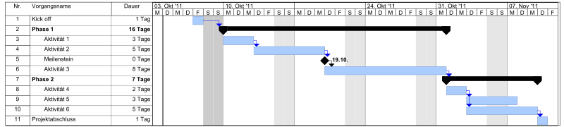
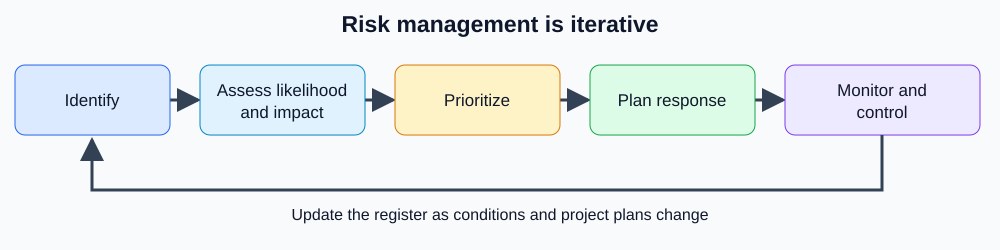
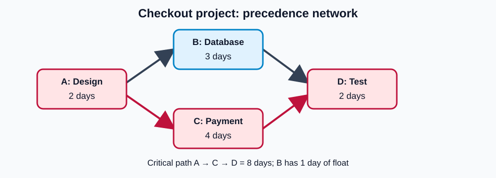
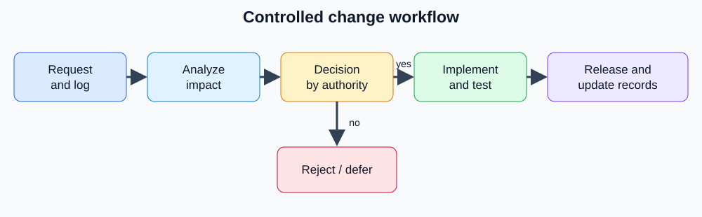
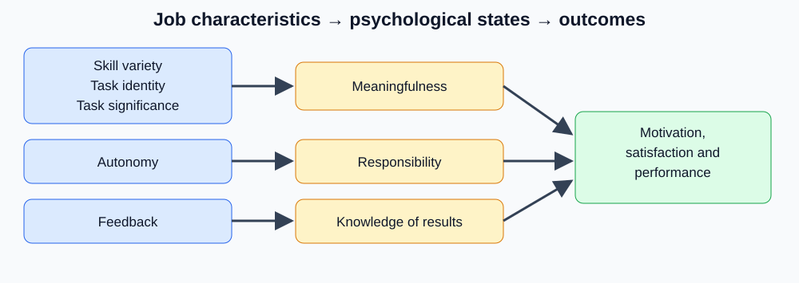
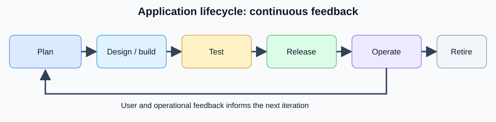

# SPM: 2023 May-Jun Backlog — detailed answers

[Question paper](SPM_Endsem_2023_May-Jun_Backlog.pdf) | [Study index](../Study/README.md)

Question headings are paraphrased. Both sides of every OR are answered; use the paper's actual marks and instructions in the exam. Each response is prepared for approximately nine marks. Examples are illustrative, not paper data.

## Q1(a) — Scheduling techniques and CPM versus PERT

### Scheduling techniques and CPM versus PERT

**Scheduling techniques** include Gantt charts (bars against a calendar), milestone charts (major events), critical path method (CPM), program evaluation and review technique (PERT) and precedence networks. The network shows dependency logic; the Gantt chart is especially useful for communicating dates and progress.

| Aspect | CPM | PERT |
|---|---|---|
| Duration | Typically one deterministic estimate per activity | Optimistic `O`, most likely `M`, pessimistic `P` |
| Main use | Identify critical path; analyze time/cost trade-offs | Plan under uncertain activity durations |
| Calculation | Fixed activity durations | Expected duration `(O + 4M + P)/6` |
| Risk | Deterministic dates do not capture uncertainty | Estimates uncertainty under simplifying assumptions |

Both use dependency networks and can identify a critical path. CPM can also incorporate uncertain estimates; the distinction is a useful textbook convention, not a strict rule. For checkout, use CPM with agreed estimates for integration tasks; use PERT when a new payment provider makes duration uncertain. A Gantt chart is readable, but does not by itself reveal all dependencies or resource conflicts.



*Gantt diagram by Frank Murmann, [Wikimedia Commons](https://commons.wikimedia.org/wiki/File:Gantt_diagramm.svg), released into the public domain by its author; unmodified. The German labels “Aktivität”, “Dauer” and “Meilenstein” mean activity, duration and milestone. Bars represent scheduled durations; arrows show dependencies and the diamond is a milestone.*

For another example, see the [Technical book's project-plan bar chart, figure 3.4.1, PDF page 12](../Books/SPM_Technical_Units03-06.pdf#page=12).

**How to use the techniques:** First identify activities, predecessors and durations. Draw a network and calculate the earliest and latest times to identify the critical path; translate dates into a Gantt chart for communication. Add milestones for decision points such as approval and deployment. Where estimates are uncertain, record the optimistic, most likely and pessimistic values, and use PERT to understand their effect on the planned duration. Review dates after resource allocation: the theoretical critical path assumes the resources needed for parallel work are available.

**Time–cost trade-off:** CPM can be used to explore *crashing*: add resources or use a faster method for a critical activity, then recompute the network and cost. Shortening a noncritical activity within its float does not necessarily shorten the project. Crashing may raise cost or make another path critical; it is not always feasible.

**Further study:** [Unit 3: Scheduling techniques and CPM versus PERT](../Study/unit-3-activity-risk.md#scheduling-techniques-and-cpm-versus-pert).

## Q1(b) — Project risk management and processes

### Risk management process

A **risk** is an uncertain event or condition that may affect objectives; an issue has already occurred. Risk management is the iterative identification, assessment, response and monitoring of uncertainty, not a guarantee of avoiding every problem.



*Original diagram: risk management continues as project conditions change.*

```text
Identify -> Assess probability and impact -> Prioritize -> Plan response
    ^                                              |
    +------- Monitor, control and update <---------+
```

1. **Identify:** use brainstorming, interviews, checklists, historical data and assumption analysis; record cause, event and consequence.
2. **Assess:** estimate probability and impact on cost, schedule, quality or security; use a qualitative matrix or a justified numerical model.
3. **Prioritize:** compare exposures and urgency; `probability × impact` provides an approximate expected loss for a quantified risk.
4. **Plan:** select response, owner, trigger, budget and contingency; record residual and secondary risks.
5. **Monitor and control:** check triggers and effectiveness, implement responses, track issues, reassess and close or escalate risks.

**Example:** payment gateway approval might take 5 extra days with probability 0.3. Expected schedule impact considered in isolation is `0.3 × 5 = 1.5 days`; it is not automatically a 1.5-day project delay because path, float and dependencies matter. Assign an owner to obtain approval early and define an escalation trigger.

**Risk versus issue:** “Approval may arrive late” is a risk; “approval is now overdue” is an issue requiring action. A *risk owner* tracks the uncertain event and response; a trigger is an observable warning, such as no vendor response by a specified date. A contingency is an action or reserve used if the risk occurs. Reassess after each review because new information can change the priority or reveal a new risk.

**Further study:** [Unit 3: Risk management process](../Study/unit-3-activity-risk.md#risk-management-process).

## Q2(a) — Risk identification framework and types

### IT risk identification and prioritization

An **IT project risk identification framework** systematically reviews sources across the project's lifecycle: requirements and scope, technology and architecture, people and suppliers, security and compliance, schedule and cost, operations and external environment. Review stakeholders and assumptions, collect potential events using interviews, checklists, past project lessons and workshops, then document each risk in a register.

| Category | Example for online shopping | Potential consequence |
|---|---|---|
| Requirements | Payment rules change late | Rework and delay |
| Technical | Gateway API proves incompatible | Integration fails |
| People | Key developer becomes unavailable | Reduced capacity |
| External/vendor | Provider approval is late | Testing cannot start |
| Security/compliance | Customer data is exposed | Incident and regulatory impact |
| Schedule/cost | Estimates omit integration testing | Budget or deadline overrun |

Score likelihood and impact on an agreed scale, for example 1–5, and use the product as a screening priority. A rare catastrophic breach must not be dismissed solely because its product score is low. Record assumptions, use qualitative judgment, review correlation and assign owners. A risk register includes ID, cause/event/effect, category, probability, impact, response, owner and status.

**Illustrative register entry:**

| Field | Payment integration risk |
|---|---|
| Cause → event → effect | Vendor review takes longer than assumed → credentials arrive late → integration testing may slip |
| Likelihood / impact | Medium / high, assessed with team judgment |
| Owner | Payment integration lead |
| Response | Submit documents early and schedule a vendor checkpoint |
| Trigger / contingency | No approval by agreed checkpoint → escalate and evaluate backup provider |
| Review | Check weekly; update likelihood, status and residual exposure |

**Identification techniques** are complementary: interviews expose stakeholder concerns; brainstorming generates alternatives; checklists use lessons from earlier projects; document and assumption reviews find weak requirements or dependencies; and a work breakdown review finds risks associated with specific deliverables. A probability-impact matrix helps rank threats, but its scores are ordinal unless the chosen scales justify arithmetic.

**Further study:** [Unit 3: IT risk identification and prioritization](../Study/unit-3-activity-risk.md#it-risk-identification-and-prioritization).

## Q2(b) — Network diagrams and activity relationships

### Network models and dependencies

A **network model** represents activities and their dependencies. In an activity-on-node (AON) diagram, nodes represent activities and arrows represent precedence. It exposes parallelism and supports critical-path calculations.



*Original diagram. Red marks the critical path; durations are illustrative days.*

```text
Start -> A: design (2) -> B: database (3) --+
                     \-> C: payment (4) ----+-> D: test (2) -> Finish
```

Construct it by listing activities and durations, identifying immediate predecessors, drawing arrows without cycles, checking start/end connections and verifying the dependency sequence. Here A precedes B and C; B and C both precede D. B and C are parallel in the logic, although actual execution also requires sufficient resources. A is D's indirect predecessor; B is A's successor. For example, design precedes database creation, while payment integration and database work can proceed concurrently after design.

The paths are `A-B-D = 7` and `A-C-D = 8` days; the latter is the **critical path**, so its activities have zero total float in this example. The network assumes durations, dependencies and available resources are valid; dependencies must be revisited as the project changes.

**Precedence terminology:** A *predecessor* must finish before the dependent activity starts under the finish-to-start assumption; a *successor* follows it. Parallel activities are not ordered relative to one another in the network. Thus A is the immediate predecessor of B and C; B and C are immediate predecessors of D. If C slips by two days, D cannot begin until day 8 and the project finishes on day 10. If B slips one day, it still finishes by day 6, so D's start remains unchanged.

**Good network rules:** each activity needs a clear start and finish, dependencies must not form a cycle, and an arrow must represent a real constraint. Check for omitted external approvals and test environments. Other representations, including activity-on-arrow, place activities on arrows; label the convention used in a drawing.

**Further study:** [Unit 3: Network models and dependencies](../Study/unit-3-activity-risk.md#network-models-and-dependencies).

## Q3(a) — Change control flow in SCM

### Software configuration management

**Software configuration management (SCM)** identifies, controls, records and audits changes to software artifacts across their lifecycle. A configuration item (CI) can be source code, requirements, tests, builds or configuration; a **baseline** is an agreed version that changes only through an authorized process.

Core tasks: identify CIs and naming rules; manage versions and branches; control change requests; record configuration status and history; audit whether changes and deliverables match approvals; build and release reproducibly. For an online shop, version the payment API code, tests and deployment configuration together, review changes and label the release.

Participants typically include the requester, project manager, configuration manager, developers, testers, release manager and the change authority or CCB. The configuration manager maintains identification and records; developers implement approved changes; testers verify them; the CCB makes decisions within its authority; and release staff package an approved baseline. A small project may combine roles but should preserve appropriate review.

Git tracks versions and supports branches, reviews and merges; Team Foundation Server/Azure DevOps Server provides integrated version control and work management; Ansible helps define and apply infrastructure configuration. Ansible is not a substitute for version control: store its playbooks in a versioned repository. Choose tools based on access control, traceability, integration and audit needs.

**Typical SCM lifecycle:** identify the requirements document, source repository and deployment playbooks as configuration items; record approved versions as a baseline; link a change request to commits and tests; record its approval and implementation status; audit that the released artifacts match the approved versions. A version label makes it possible to recreate or investigate a release. An audit can check both that required changes were implemented and that the recorded configuration matches what was delivered.

### Change control and version control



*Original diagram. An unapproved change does not proceed to implementation as an approved baseline change.*

```text
Request -> Log and classify -> Impact analysis -> Change authority decision
                                                       |             |
                                              reject/defer        approve
                                                                     |
                                  update records <- release <- test <- implement
```

The change request states the reason, affected items, priority and requester. Analyze effects on scope, cost, schedule, risks and dependencies; the appropriate change control board (CCB) or delegated authority approves, rejects or defers. Implement approved changes in a branch, review and test them, update documentation and baselines if authorized, and notify stakeholders. Typical request types include corrective, preventive, defect repair and enhancement.

**Version control** records artifact history and supports branching, comparison and rollback. **Change control** governs whether and how a proposed change is authorized. For example, adding refund support needs approval of scope and budget; Git then records the reviewed implementation and release tag. A commit alone is not evidence that the business change was approved.

**Worked example:** A stakeholder requests refunds after checkout. Log the request and analyze payment-provider compatibility, security, testing effort and delivery cost. The CCB may reject it, defer it, or approve it with a revised delivery date. On approval, implement and review the change, run refund and regression tests, then release and update the change record and affected documentation. Emergency fixes can use an expedited process, but still need documented authority and later review.

**Further study:** [Unit 4: Software configuration management](../Study/unit-4-tracking-control.md#software-configuration-management) · [Unit 4: Change control and version control](../Study/unit-4-tracking-control.md#change-control-and-version-control).

## Q3(b) — Project control mechanisms

### Plan-monitor-control cycle and mechanisms

**Plan:** set objectives, schedule, budget and acceptance criteria. **Monitor:** measure actual results and compare with the baseline. **Control:** analyze root causes, choose corrective/preventive actions, obtain approval where needed, implement, and check whether results improved. Repeat throughout the project.

Example: checkout testing is planned to finish in week 4; at the review only half is complete. Investigate blocked test data, assign a data owner and reforecast. Escalate if the revised delivery exceeds tolerance; track whether the remedy removed the bottleneck. Do not silently change the approved baseline to conceal variance.

| Mechanism | When or how it operates | Example |
|---|---|---|
| Feedforward / preventive | Before work, reduce expected deviations | Validate requirements and test environment |
| Concurrent / steering | During work, measure and adjust | Review a sprint and resolve blockers |
| Feedback / post-action | After output, compare with standards | Inspect test results and fix defects |
| Change control | Authorize changes to controlled baselines | Approve a scope increase after impact analysis |

Use the mechanism appropriate to the risk and cost of correction; preventive controls reduce rework but do not replace feedback.

For the delayed checkout tests, a preventive control is checking environment readiness before testing starts. Concurrent control is a daily review of blocked tests while testing is underway. Feedback control is inspection of completed test results and defect trends. The manager selects corrective action based on the cause: adding testers will not fix an unavailable test environment, and may increase cost without reducing delay.

**Further study:** [Unit 4: Plan-monitor-control cycle and mechanisms](../Study/unit-4-tracking-control.md#plan-monitor-control-cycle-and-mechanisms).

## Q4(a) — Team structures and virtual teams

### Team structures and organization

A **functional** structure groups staff by specialty; expertise is deep but cross-functional coordination can be slow. A **projectized** structure assigns people largely to a project manager, improving focus but potentially duplicating specialists. A **matrix** shares authority between functional and project managers; it improves sharing but can create conflicting priorities. In software teams, centralized/chief-programmer arrangements emphasize a designated technical lead; decentralized arrangements distribute decisions and communication. Hybrid structures are common.

Four useful team types are functional, cross-functional, self-managing and virtual. A cross-functional checkout team can include developers, testers, design and security. A virtual team collaborates across locations/time zones using documented decisions, overlapping hours, accessible channels and explicit handoffs. Remote work requires deliberate trust and communication; co-location alone does not ensure cooperation.

| Team type | How it works | Advantage and challenge |
|---|---|---|
| Functional | People with similar specialties work under a functional lead | Deep expertise; handoffs can slow a project |
| Cross-functional | Different specialties jointly deliver a result | Faster feedback; differing priorities need coordination |
| Self-managing | Team organizes day-to-day work within agreed boundaries | Ownership and adaptability; requires clear accountability |
| Virtual | Members collaborate across locations | Access to diverse expertise; time zones and trust need attention |

These are overlapping categories rather than mutually exclusive labels: a virtual team may also be cross-functional. Select a structure based on project size, complexity, authority and available skills.

The [Technical book's stepwise planning and collaboration figure 5.9.1, PDF page 90](../Books/SPM_Technical_Units03-06.pdf#page=90), shows how project planning and team coordination interact.

**Organization structure comparison:** In a functional organization, a developer reports to the development manager and may serve several projects. In a projectized organization, the checkout manager has more direct control of project staff. In a matrix, the developer may answer to both a functional manager and project manager; agree priorities and conflict-resolution authority in advance. Stronger project control can improve delivery focus, while shared functional groups retain specialist expertise.

**Further study:** [Unit 5: Team structures and organization](../Study/unit-5-people-teams.md#team-structures-and-organization).

## Q4(b) — Plan–monitor–control cycle

### Plan-monitor-control cycle and mechanisms

**Plan:** set objectives, schedule, budget and acceptance criteria. **Monitor:** measure actual results and compare with the baseline. **Control:** analyze root causes, choose corrective/preventive actions, obtain approval where needed, implement, and check whether results improved. Repeat throughout the project.

Example: checkout testing is planned to finish in week 4; at the review only half is complete. Investigate blocked test data, assign a data owner and reforecast. Escalate if the revised delivery exceeds tolerance; track whether the remedy removed the bottleneck. Do not silently change the approved baseline to conceal variance.

| Mechanism | When or how it operates | Example |
|---|---|---|
| Feedforward / preventive | Before work, reduce expected deviations | Validate requirements and test environment |
| Concurrent / steering | During work, measure and adjust | Review a sprint and resolve blockers |
| Feedback / post-action | After output, compare with standards | Inspect test results and fix defects |
| Change control | Authorize changes to controlled baselines | Approve a scope increase after impact analysis |

Use the mechanism appropriate to the risk and cost of correction; preventive controls reduce rework but do not replace feedback.

For the delayed checkout tests, a preventive control is checking environment readiness before testing starts. Concurrent control is a daily review of blocked tests while testing is underway. Feedback control is inspection of completed test results and defect trends. The manager selects corrective action based on the cause: adding testers will not fix an unavailable test environment, and may increase cost without reducing delay.

**Further study:** [Unit 4: Plan-monitor-control cycle and mechanisms](../Study/unit-4-tracking-control.md#plan-monitor-control-cycle-and-mechanisms).

## Q5(a) — Leadership approaches

### Leadership and management

**Leadership** influences people toward shared goals. Management plans, organizes, coordinates and controls work; leadership emphasizes direction, motivation, alignment and change. Effective project managers usually need both.

| Aspect | Management | Leadership |
|---|---|---|
| Focus | Plans, resources, consistency | Vision, people, adaptation |
| Example | Allocate test capacity and track schedule | Explain release purpose and build commitment |
| Time horizon | Operational control and delivery | Direction and sustainable change |

Approaches include trait (personal qualities), behavioral (what leaders do), and contingency/situational (style depends on context). Styles include autocratic (fast centralized decisions), democratic (participation), laissez-faire/delegative (team autonomy), transactional (agreed goals and feedback/rewards), and transformational (shared vision and development). No style is always best: urgent incident response may require decisive coordination; design decisions benefit from team participation. Clearly explain authority, listen and remain accountable.

| Style | Advantage | Risk if overused |
|---|---|---|
| Autocratic | Quick direction in a time-critical incident | Reduces participation and may miss expertise |
| Democratic | Better buy-in and broader ideas | Consultation can delay urgent decisions |
| Delegative | Develops ownership in a capable team | Unclear boundaries can leave decisions unmade |
| Transactional | Clarifies expectations and feedback | Can overemphasize short-term targets |
| Transformational | Builds commitment around a shared vision | A vision needs concrete delivery and follow-through |

For example, the leader can invite the team to choose a checkout design but direct a coordinated rollback during an outage. A manager then allocates time, updates the risk register and monitors whether the rollback restores service.

**Further study:** [Unit 5: Leadership and management](../Study/unit-5-people-teams.md#leadership-and-management).

## Q5(b) — Four types of teams

### Team structures and organization

A **functional** structure groups staff by specialty; expertise is deep but cross-functional coordination can be slow. A **projectized** structure assigns people largely to a project manager, improving focus but potentially duplicating specialists. A **matrix** shares authority between functional and project managers; it improves sharing but can create conflicting priorities. In software teams, centralized/chief-programmer arrangements emphasize a designated technical lead; decentralized arrangements distribute decisions and communication. Hybrid structures are common.

Four useful team types are functional, cross-functional, self-managing and virtual. A cross-functional checkout team can include developers, testers, design and security. A virtual team collaborates across locations/time zones using documented decisions, overlapping hours, accessible channels and explicit handoffs. Remote work requires deliberate trust and communication; co-location alone does not ensure cooperation.

| Team type | How it works | Advantage and challenge |
|---|---|---|
| Functional | People with similar specialties work under a functional lead | Deep expertise; handoffs can slow a project |
| Cross-functional | Different specialties jointly deliver a result | Faster feedback; differing priorities need coordination |
| Self-managing | Team organizes day-to-day work within agreed boundaries | Ownership and adaptability; requires clear accountability |
| Virtual | Members collaborate across locations | Access to diverse expertise; time zones and trust need attention |

These are overlapping categories rather than mutually exclusive labels: a virtual team may also be cross-functional. Select a structure based on project size, complexity, authority and available skills.

The [Technical book's stepwise planning and collaboration figure 5.9.1, PDF page 90](../Books/SPM_Technical_Units03-06.pdf#page=90), shows how project planning and team coordination interact.

**Organization structure comparison:** In a functional organization, a developer reports to the development manager and may serve several projects. In a projectized organization, the checkout manager has more direct control of project staff. In a matrix, the developer may answer to both a functional manager and project manager; agree priorities and conflict-resolution authority in advance. Stronger project control can improve delivery focus, while shared functional groups retain specialist expertise.

**Further study:** [Unit 5: Team structures and organization](../Study/unit-5-people-teams.md#team-structures-and-organization).

## Q6(a) — Hackman–Oldham model

### Job characteristics model

The Hackman–Oldham model connects job design to motivation through five core characteristics:



*Original illustration of the model; outcomes depend on individual and organizational conditions.*

1. **Skill variety:** use different skills, such as coding and customer communication.
2. **Task identity:** complete an identifiable whole, such as delivering a checkout feature.
3. **Task significance:** understand its effect on users and business.
4. **Autonomy:** have appropriate discretion over implementation.
5. **Feedback:** receive usable information about performance from work and stakeholders.

```text
Variety + identity + significance -> experienced meaningfulness
Autonomy -------------------------> experienced responsibility
Feedback -------------------------> knowledge of results
                                  -> motivation, satisfaction, performance
```

The model's illustrative motivating potential score is `MPS = ((variety + identity + significance)/3) × autonomy × feedback`. Example: scores 4, 3, 5, 4 and 3 give `MPS = ((4+3+5)/3) × 4 × 3 = 48`. Scores depend on the scale used and are diagnostic rather than an absolute prediction. Improve a repetitive development role by giving ownership from design through release, user context, choice within standards and timely test/user feedback. Individual growth needs and organizational conditions affect outcomes.

**Interpretation:** A developer who only fixes isolated UI defects may see little task identity. Assigning responsibility for the whole checkout flow, within appropriate review and security boundaries, increases ownership. Discussing how accessibility improvements help shoppers strengthens task significance; automated tests and user feedback improve knowledge of results. An autonomy score of zero would make the model's multiplicative score zero even when other scores are high, illustrating why job design must consider all five dimensions.

**Further study:** [Unit 5: Job characteristics model](../Study/unit-5-people-teams.md#job-characteristics-model).

## Q6(b) — Objectives of managing people and teams

### Managing people and organizational behavior

Managing people aims to recruit suitable skills, clarify responsibilities, motivate and develop staff, build healthy teams, support ethical conduct and deliver project objectives sustainably. **Organizational behavior** studies how individuals, groups and organizational structures affect behavior at work.

Individual differences include ability, personality, values, experience and motivation; team factors include trust, norms, communication, conflict and group dynamics; organizational factors include culture, incentives, structure and leadership. For example, a talented developer may still struggle if requirements are unclear or a team discourages questions.

Theories provide lenses, not guarantees: Maslow's hierarchy suggests different categories of needs, Herzberg distinguishes hygiene factors from motivators, and expectancy theory relates motivation to perceived effort–performance–reward relationships. Apply them cautiously: ask people what matters, offer fair conditions and recognize meaningful work rather than assuming a universal hierarchy.

| Perspective | Main idea | Project-management application |
|---|---|---|
| Maslow | People can have physiological, safety, social, esteem and growth needs | Provide fair conditions and belonging as well as learning opportunities; do not assume everyone progresses through a fixed sequence |
| Herzberg | Working conditions can prevent dissatisfaction, while achievement, recognition and responsibility can support satisfaction | Fix poor working conditions and give meaningful ownership; pay alone need not solve every motivation problem |
| Expectancy | Effort is more motivating when people believe it can produce performance and a valued result | Provide tools, attainable goals and a transparent link between contribution and recognition |

Individual personality and experience affect how people prefer to communicate; group dynamics affect whether information is shared and problems are raised. Organizational norms also matter: a blame-oriented culture can hide defects even when staff are technically skilled. A manager should observe outcomes and ask for feedback instead of using a theory to label individuals.

### Making a team, decision making and communication

Good teams need a shared goal, complementary skills, clear roles, manageable size, trust and psychological safety, agreed decisions, coordination, feedback and conflict resolution. A decision process defines the problem, gathers evidence, considers alternatives, chooses with explicit authority, records the decision and revisits outcomes. Consensus can improve buy-in but may take time; urgent issues may need a delegated decision.

For example, a checkout team needs developers, testers and domain knowledge; one person owns payment integration while another owns acceptance testing. They agree response times and escalation rules, review dependencies weekly, and resolve a dispute about scope against the shared release goal. Trust lets members report defects early; complementary skills alone do not help if responsibilities and handoffs are unclear.

**Coordination dependencies** arise when one person's output, shared resource or decision affects another. Manage them through interface agreements, a visible dependency board, milestones and explicit owners. A communication plan identifies audience, purpose, channel, frequency, owner and escalation path: daily team stand-up for blockers, weekly stakeholder report for status and immediate incident channel for security issues. Genres include reports, meetings, chat and technical documentation; select a channel suitable for urgency and permanence.

| Team factor | Why it matters | Example practice |
|---|---|---|
| Shared goal | Aligns individual work | Agree a release outcome and acceptance criteria |
| Complementary skills | Covers delivery and quality needs | Include security and testing alongside development |
| Roles and authority | Prevents duplicated or missed work | Name an owner for gateway integration |
| Trust and communication | Makes blockers and defects visible | Encourage questions and review decisions openly |
| Coordination and feedback | Keeps dependent work aligned | Agree an API contract and check progress weekly |
| Conflict resolution | Keeps disagreement productive | Compare options against criteria and record the decision |

**Further study:** [Unit 5: Managing people and organizational behavior](../Study/unit-5-people-teams.md#managing-people-and-organizational-behavior) · [Unit 5: Making a team, decision making and communication](../Study/unit-5-people-teams.md#making-a-team-decision-making-and-communication).

## Q7(a) — Azure DevOps project management features

### Azure DevOps and TFS

Azure DevOps is a set of services for planning and delivering software. Core components include **Boards** for work items and planning, **Repos** for version control, **Pipelines** for builds and deployments, **Test Plans** for test management, and **Artifacts** for packages. Access depends on product edition, configuration and licensing.

| Aspect | TFS / Azure DevOps Server | Azure DevOps Services |
|---|---|---|
| Hosting | Primarily self-managed, on-premises deployment | Microsoft-hosted cloud service |
| Administration | Organization manages server and upgrades | Provider manages service infrastructure |
| Updates | Installed by the organization | Delivered to the service |
| Version control | Supported options depend on version/configuration | Git and TFVC support depends on project setup |

Team Foundation Server (TFS) is the older name of the on-premises product now called Azure DevOps Server. Features and availability differ across versions; avoid treating TFS as an entirely unrelated product. Both support integrated planning, code and delivery workflows.

**Components in an example:** Boards stores the checkout requirement and tasks; Repos stores implementation and review history; Pipelines builds and tests a version; Test Plans can organize manual test cases; Artifacts stores packages. Linking these records supports impact analysis: when a checkout story changes, a reviewer can find its associated code and tests. Availability and organization policies should be checked for the version in use.

### Azure Boards

Boards organizes work into items such as epics, features, stories or backlog items, tasks and bugs; exact types depend on the process. A backlog orders work, a sprint view plans an iteration, and a Kanban board shows workflow. Queries, links, tags and dashboards help find and report work.

```text
Backlog           Active              Done
Refund story      Payment API         Cart UI
```

For a checkout story, record acceptance criteria, assign a responsible person, add development and test tasks, link the pull request and update status only after the agreed definition of done. Reprioritize when a payment compliance issue becomes urgent.


*Abstract Kanban Board by Jennifer Falco, [Wikimedia Commons](https://commons.wikimedia.org/wiki/File:Abstract_Kanban_Board.svg), [CC BY 4.0](https://creativecommons.org/licenses/by/4.0/); unmodified. This generic board illustrates the concept rather than the Azure DevOps interface.*

For an example of a work item assigned to a team member in the book, see [figure 6.5.3, PDF page 115](../Books/SPM_Technical_Units03-06.pdf#page=115). The depicted interface may differ from current product versions.

Example story: “As a shopper, I want confirmation after payment so I know my order was placed.” Acceptance criteria include showing an order number after successful payment and a helpful message if payment fails. Tasks may include implementing the callback, writing tests and updating the UI. A bug found during review is linked to the story; the item moves to Done only when the agreed tests and review are complete. A board column represents a workflow state, not a guarantee of quality by itself.

**Further study:** [Unit 6: Azure DevOps and TFS](../Study/unit-6-azure-agile.md#azure-devops-and-tfs) · [Unit 6: Azure Boards](../Study/unit-6-azure-agile.md#azure-boards).

## Q7(b) — Agile management with Azure DevOps and TFS

### Agile management with Azure DevOps

Agile project management delivers value iteratively, prioritizes feedback and adapts plans. Create a product backlog, order work by value and risk, refine user stories with acceptance criteria, plan an iteration, track execution, demonstrate working software and retrospect. Azure Boards supports backlog items, sprint planning, assignments, task boards and queries; Repos and Pipelines connect implementation and delivery.

Example: prioritize checkout before recommendations; split checkout into stories for cart, payment and confirmation; review a working increment with users at sprint end. Benefits include a shared view of priorities and traceability from work to delivery. Do not equate use of a board with being agile.

Common Azure DevOps process templates include **Agile, Scrum, CMMI and Basic**, depending on product version and project configuration. Scrum emphasizes product backlog items and sprints; Agile typically uses user stories; CMMI supports more formal process tracking; Basic offers a simpler issue/epic/task model. Choose to fit governance and team needs; all can support iterative working when used appropriately.

Good practices: keep items small and testable, set explicit acceptance criteria, prioritize continuously, limit work in progress, automate relevant tests, review increments with stakeholders, make blockers visible, retrospect and improve. Avoid using velocity as a target for comparing teams.

**Iteration example:** The product owner places payment confirmation ahead of promotional features because it is necessary for purchase completion. The team agrees acceptance criteria, breaks the story into tasks and tests, then tracks work daily on the board. At the review, stakeholders try the feature and request a clearer failure message. The team records that feedback, updates the backlog and discusses how to improve testing in the retrospective. The board supports the conversation; working software and feedback are the objective.

### Azure DevOps and TFS

Azure DevOps is a set of services for planning and delivering software. Core components include **Boards** for work items and planning, **Repos** for version control, **Pipelines** for builds and deployments, **Test Plans** for test management, and **Artifacts** for packages. Access depends on product edition, configuration and licensing.

| Aspect | TFS / Azure DevOps Server | Azure DevOps Services |
|---|---|---|
| Hosting | Primarily self-managed, on-premises deployment | Microsoft-hosted cloud service |
| Administration | Organization manages server and upgrades | Provider manages service infrastructure |
| Updates | Installed by the organization | Delivered to the service |
| Version control | Supported options depend on version/configuration | Git and TFVC support depends on project setup |

Team Foundation Server (TFS) is the older name of the on-premises product now called Azure DevOps Server. Features and availability differ across versions; avoid treating TFS as an entirely unrelated product. Both support integrated planning, code and delivery workflows.

**Components in an example:** Boards stores the checkout requirement and tasks; Repos stores implementation and review history; Pipelines builds and tests a version; Test Plans can organize manual test cases; Artifacts stores packages. Linking these records supports impact analysis: when a checkout story changes, a reviewer can find its associated code and tests. Availability and organization policies should be checked for the version in use.

**Further study:** [Unit 6: Agile management with Azure DevOps](../Study/unit-6-azure-agile.md#agile-management-with-azure-devops) · [Unit 6: Azure DevOps and TFS](../Study/unit-6-azure-agile.md#azure-devops-and-tfs).

## Q7(c) — Methodologies and process templates

### Agile management with Azure DevOps

Agile project management delivers value iteratively, prioritizes feedback and adapts plans. Create a product backlog, order work by value and risk, refine user stories with acceptance criteria, plan an iteration, track execution, demonstrate working software and retrospect. Azure Boards supports backlog items, sprint planning, assignments, task boards and queries; Repos and Pipelines connect implementation and delivery.

Example: prioritize checkout before recommendations; split checkout into stories for cart, payment and confirmation; review a working increment with users at sprint end. Benefits include a shared view of priorities and traceability from work to delivery. Do not equate use of a board with being agile.

Common Azure DevOps process templates include **Agile, Scrum, CMMI and Basic**, depending on product version and project configuration. Scrum emphasizes product backlog items and sprints; Agile typically uses user stories; CMMI supports more formal process tracking; Basic offers a simpler issue/epic/task model. Choose to fit governance and team needs; all can support iterative working when used appropriately.

Good practices: keep items small and testable, set explicit acceptance criteria, prioritize continuously, limit work in progress, automate relevant tests, review increments with stakeholders, make blockers visible, retrospect and improve. Avoid using velocity as a target for comparing teams.

**Iteration example:** The product owner places payment confirmation ahead of promotional features because it is necessary for purchase completion. The team agrees acceptance criteria, breaks the story into tasks and tests, then tracks work daily on the board. At the review, stakeholders try the feature and request a clearer failure message. The team records that feedback, updates the backlog and discusses how to improve testing in the retrospective. The board supports the conversation; working software and feedback are the objective.

**Further study:** [Unit 6: Agile management with Azure DevOps](../Study/unit-6-azure-agile.md#agile-management-with-azure-devops).

## Q8(a) — Ways of enabling visibility

### Visibility, traceability, collaboration and extensibility

* **Visibility:** stakeholders can see current work, progress, blockers and delivery status, subject to access permissions. Enable it using shared boards/backlogs, dashboards and reports, and build/test/release status.
* **Traceability:** links connect a requirement or work item to commits, tests, builds and releases. It helps change impact analysis and audit, though links must be maintained.
* **Collaboration:** shared work items, discussion, pull requests, notifications and reviews help developers, testers and stakeholders coordinate. Agree ownership and communication norms.
* **Extensibility:** APIs, service hooks, extensions and integrations can adapt workflows and connect external systems. Evaluate permissions, compatibility and maintenance before adding extensions.

Example: the checkout story links to a pull request, automated tests and a pipeline run. The team sees a failed test on a dashboard, discusses the fix on the work item, then traces the successful deployment to the release. Sensitive data should not be exposed merely to increase visibility.

**Three ways to enable visibility:** (1) publish a prioritized backlog and board with clear work states and owners; (2) show team dashboards or reports for milestones, defects and relevant trends; (3) make build, test and deployment results visible with links to the associated work. Agree who needs access, update work promptly and explain what each metric means.

Traceability answers “what changed and why?”, collaboration answers “how do the people coordinate?”, visibility answers “what is happening?”, and extensibility answers “how can the process connect to other tools?”. Together they improve decision-making, but inaccurate links or outdated status can create false confidence.

### Azure Boards

Boards organizes work into items such as epics, features, stories or backlog items, tasks and bugs; exact types depend on the process. A backlog orders work, a sprint view plans an iteration, and a Kanban board shows workflow. Queries, links, tags and dashboards help find and report work.

```text
Backlog           Active              Done
Refund story      Payment API         Cart UI
```

For a checkout story, record acceptance criteria, assign a responsible person, add development and test tasks, link the pull request and update status only after the agreed definition of done. Reprioritize when a payment compliance issue becomes urgent.


*Abstract Kanban Board by Jennifer Falco, [Wikimedia Commons](https://commons.wikimedia.org/wiki/File:Abstract_Kanban_Board.svg), [CC BY 4.0](https://creativecommons.org/licenses/by/4.0/); unmodified. This generic board illustrates the concept rather than the Azure DevOps interface.*

For an example of a work item assigned to a team member in the book, see [figure 6.5.3, PDF page 115](../Books/SPM_Technical_Units03-06.pdf#page=115). The depicted interface may differ from current product versions.

Example story: “As a shopper, I want confirmation after payment so I know my order was placed.” Acceptance criteria include showing an order number after successful payment and a helpful message if payment fails. Tasks may include implementing the callback, writing tests and updating the UI. A bug found during review is linked to the story; the item moves to Done only when the agreed tests and review are complete. A board column represents a workflow state, not a guarantee of quality by itself.

**Further study:** [Unit 6: Visibility, traceability, collaboration and extensibility](../Study/unit-6-azure-agile.md#visibility-traceability-collaboration-and-extensibility) · [Unit 6: Azure Boards](../Study/unit-6-azure-agile.md#azure-boards).

## Q8(b) — Application lifecycle management

### Application lifecycle management

**Application lifecycle management (ALM)** coordinates a software product from initial idea through retirement, integrating people, processes, artifacts and tools. Typical stages are requirements and planning, design, development, testing, release/deployment, operation and maintenance, and eventual retirement. These stages overlap and repeat in iterative work; ALM is broader than coding or a single release.



*Original diagram. Phases can overlap and repeat; retirement occurs when the application is no longer needed.*

```text
Idea -> Plan -> Design -> Build -> Test -> Release -> Operate
         ^                                           |
         +---------------- feedback -----------------+
```

For an online shop, capture a checkout requirement, plan it as a work item, link its code and tests, deploy the approved build, monitor incidents and use feedback to update the backlog. Traceable links enable teams to assess the impact of a change and demonstrate what was tested.

ALM tools can include Azure DevOps, Jira combined with development tools, and GitLab; configurations and features vary. Select based on requirements coverage, traceability, version control and CI integration, reporting, access control, extensibility, usability, hosting, support and total cost. A tool does not automatically supply a sound development process.

| Lifecycle stage | Main activities | Online-shopping example |
|---|---|---|
| Requirements and planning | Identify users, priorities, constraints and acceptance criteria | Record a secure-payment story |
| Design and development | Decide architecture and implement changes | Build the gateway adapter |
| Testing | Verify functionality, integration and quality attributes | Run payment and failure-path tests |
| Release | Approve and deploy a known version | Publish and deploy the tested build |
| Operation and maintenance | Monitor, support, fix and improve the product | Investigate declined-payment incidents |
| Retirement | Remove or migrate the application safely | Archive required records and decommission a legacy gateway |

For tool selection, list required capabilities and constraints, trial the candidates on a representative workflow, check security and administration costs, and evaluate integrations and export options. For example, a small team may prioritize usability and repository integration while a regulated organization may require stronger audit and hosting controls.

**Further study:** [Unit 6: Application lifecycle management](../Study/unit-6-azure-agile.md#application-lifecycle-management).

## Q8(c) — Customizing Azure DevOps process templates

### Customizing process templates

Adapt work-item types, fields, states, rules and boards to the team's needs where the chosen Azure DevOps process model permits it. First identify the information needed, map the workflow, test a small change, document the rules, migrate or update existing items carefully and gather feedback. Inherited-process customization in Services and XML-based approaches on some Server installations differ by version; verify the current product documentation. Avoid excessive mandatory fields that make reporting harder.

For example, the team may need a “security review required” field and a visible review state for payment work. Define who updates it and what qualifies for completion, test the change with a small group, check existing reporting and permissions, then document the new workflow. Measure whether the customization improved coordination rather than adding fields simply because the tool allows them.

**Further study:** [Unit 6: Customizing process templates](../Study/unit-6-azure-agile.md#customizing-process-templates).
