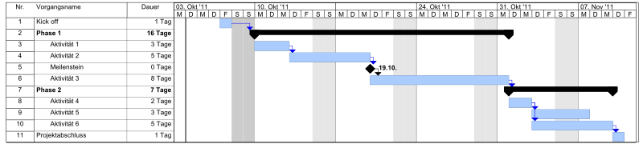
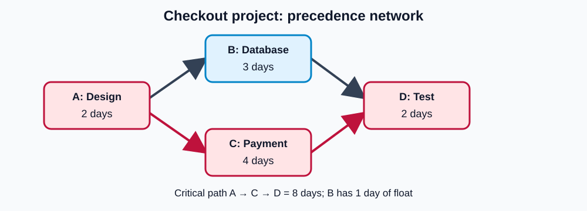
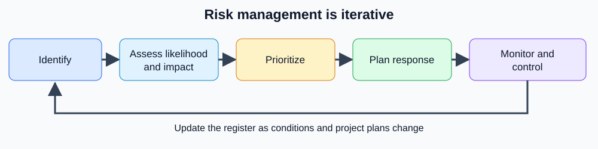
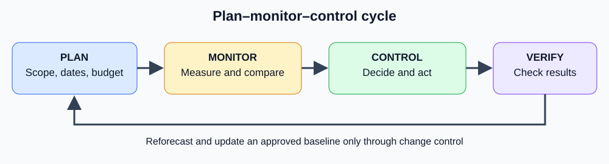
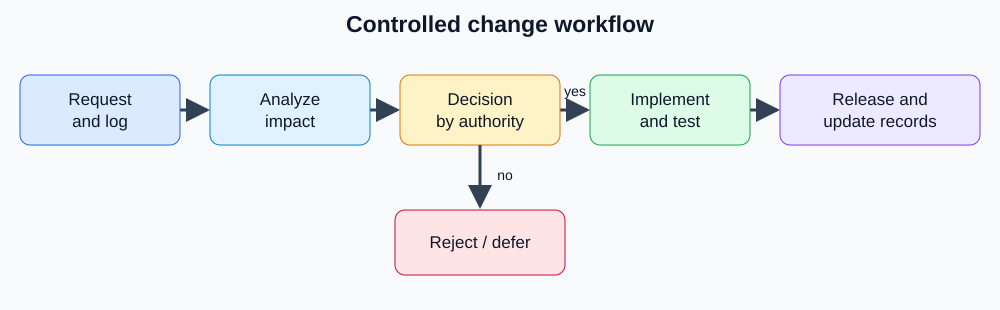
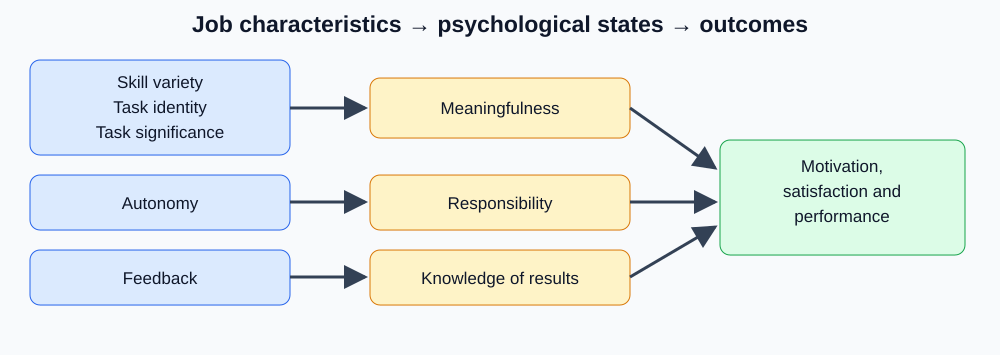
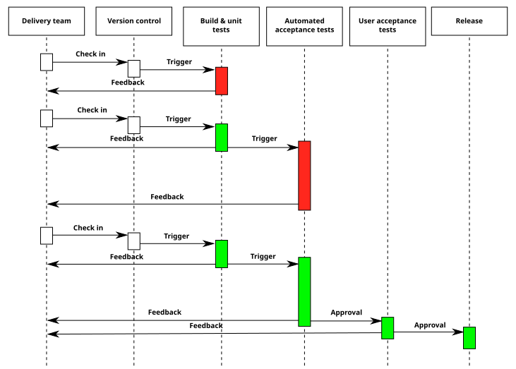
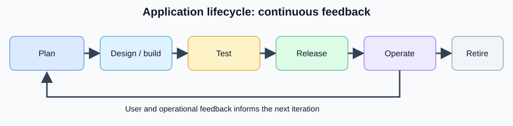

# SPM: 2023 Nov-Dec — detailed answers

[Question paper](SPM_Endsem_2023_Nov-Dec.pdf) | [Study index](../Study/README.md)

Question headings are paraphrased. Both sides of every OR are answered; use the paper's actual marks and instructions in the exam. Each response is prepared for approximately nine marks. Examples are illustrative, not paper data.

## Q1(a) — CPM versus PERT and network early/late dates

### Scheduling techniques and CPM versus PERT

**Scheduling techniques** include Gantt charts (bars against a calendar), milestone charts (major events), critical path method (CPM), program evaluation and review technique (PERT) and precedence networks. The network shows dependency logic; the Gantt chart is especially useful for communicating dates and progress.

| Aspect | CPM | PERT |
|---|---|---|
| Duration | Typically one deterministic estimate per activity | Optimistic `O`, most likely `M`, pessimistic `P` |
| Main use | Identify critical path; analyze time/cost trade-offs | Plan under uncertain activity durations |
| Calculation | Fixed activity durations | Expected duration `(O + 4M + P)/6` |
| Risk | Deterministic dates do not capture uncertainty | Estimates uncertainty under simplifying assumptions |

Both use dependency networks and can identify a critical path. CPM can also incorporate uncertain estimates; the distinction is a useful textbook convention, not a strict rule. For checkout, use CPM with agreed estimates for integration tasks; use PERT when a new payment provider makes duration uncertain. A Gantt chart is readable, but does not by itself reveal all dependencies or resource conflicts.



*Gantt diagram by Frank Murmann, [Wikimedia Commons](https://commons.wikimedia.org/wiki/File:Gantt_diagramm.svg), released into the public domain by its author; unmodified. The German labels “Aktivität”, “Dauer” and “Meilenstein” mean activity, duration and milestone. Bars represent scheduled durations; arrows show dependencies and the diamond is a milestone.*

For another example, see the [Technical book's project-plan bar chart, figure 3.4.1, PDF page 12](../Books/SPM_Technical_Units03-06.pdf#page=12).

**How to use the techniques:** First identify activities, predecessors and durations. Draw a network and calculate the earliest and latest times to identify the critical path; translate dates into a Gantt chart for communication. Add milestones for decision points such as approval and deployment. Where estimates are uncertain, record the optimistic, most likely and pessimistic values, and use PERT to understand their effect on the planned duration. Review dates after resource allocation: the theoretical critical path assumes the resources needed for parallel work are available.

**Time–cost trade-off:** CPM can be used to explore *crashing*: add resources or use a faster method for a critical activity, then recompute the network and cost. Shortening a noncritical activity within its float does not necessarily shorten the project. Crashing may raise cost or make another path critical; it is not always feasible.

### Network models and dependencies

A **network model** represents activities and their dependencies. In an activity-on-node (AON) diagram, nodes represent activities and arrows represent precedence. It exposes parallelism and supports critical-path calculations.



*Original diagram. Red marks the critical path; durations are illustrative days.*

```text
Start -> A: design (2) -> B: database (3) --+
                     \-> C: payment (4) ----+-> D: test (2) -> Finish
```

Construct it by listing activities and durations, identifying immediate predecessors, drawing arrows without cycles, checking start/end connections and verifying the dependency sequence. Here A precedes B and C; B and C both precede D. B and C are parallel in the logic, although actual execution also requires sufficient resources. A is D's indirect predecessor; B is A's successor. For example, design precedes database creation, while payment integration and database work can proceed concurrently after design.

The paths are `A-B-D = 7` and `A-C-D = 8` days; the latter is the **critical path**, so its activities have zero total float in this example. The network assumes durations, dependencies and available resources are valid; dependencies must be revisited as the project changes.

**Precedence terminology:** A *predecessor* must finish before the dependent activity starts under the finish-to-start assumption; a *successor* follows it. Parallel activities are not ordered relative to one another in the network. Thus A is the immediate predecessor of B and C; B and C are immediate predecessors of D. If C slips by two days, D cannot begin until day 8 and the project finishes on day 10. If B slips one day, it still finishes by day 6, so D's start remains unchanged.

**Good network rules:** each activity needs a clear start and finish, dependencies must not form a cycle, and an arrow must represent a real constraint. Check for omitted external approvals and test environments. Other representations, including activity-on-arrow, place activities on arrows; label the convention used in a drawing.

### Forward pass and backward pass

The **forward pass** finds earliest start (ES) and earliest finish (EF): `EF = ES + duration`; at a merge, ES is the maximum EF of all immediate predecessors. The **backward pass** finds latest finish (LF) and latest start (LS): `LS = LF − duration`; at a split, LF is the minimum LS of immediate successors. Set final LF to project duration unless an imposed deadline is specified. Total float is `LS − ES = LF − EF`.

Using the preceding network:

| Activity | Duration | Predecessor | ES | EF | LS | LF | Float |
|---|---:|---|---:|---:|---:|---:|---:|
| A | 2 | — | 0 | 2 | 0 | 2 | 0 |
| B | 3 | A | 2 | 5 | 3 | 6 | 1 |
| C | 4 | A | 2 | 6 | 2 | 6 | 0 |
| D | 2 | B, C | 6 | 8 | 6 | 8 | 0 |

The forward pass uses `max(5,6)=6` for D; the backward pass uses `min(3,2)=2` as A's LF. Project duration is **8 days** and `A-C-D` is critical. B can slip one day without delaying completion, assuming no other changes. Forward pass asks “how soon?”; backward pass asks “how late without delaying the finish?”.

**Calculation walkthrough:**

1. Start A at day 0: `ES(A)=0`, `EF(A)=0+2=2`.
2. B and C follow A, so both start at day 2. B finishes on day 5 and C on day 6.
3. D waits for **both** activities: `ES(D)=max(5,6)=6`, `EF(D)=6+2=8`.
4. Work backward from the day-8 finish: `LF(D)=8`, `LS(D)=6`.
5. Both B and C must finish by day 6: B's `LS=6−3=3`, C's `LS=6−4=2`.
6. A must finish by the earlier of its successors' latest starts: `LF(A)=min(3,2)=2`, so `LS(A)=0`.

| Comparison | Forward pass | Backward pass |
|---|---|---|
| Direction | Start to finish | Finish to start |
| Finds | Earliest start and finish | Latest start and finish |
| At multiple connections | Use maximum predecessor EF | Use minimum successor LS |
| Purpose | Find earliest completion | Find allowable delay and float |

**Further study:** [Unit 3: Scheduling techniques and CPM versus PERT](../Study/unit-3-activity-risk.md#scheduling-techniques-and-cpm-versus-pert) · [Unit 3: Network models and dependencies](../Study/unit-3-activity-risk.md#network-models-and-dependencies) · [Unit 3: Forward pass and backward pass](../Study/unit-3-activity-risk.md#forward-pass-and-backward-pass).

## Q1(b) — Activity planning, schedule types and sequencing

### Activity planning and identification

**Activity planning** turns project deliverables into an ordered, resourced and time-bound set of tasks. It aims to establish a realistic completion date, coordinate dependencies, allocate people and equipment, identify critical work, estimate cash flows, communicate responsibilities, and create a baseline for control. It also exposes risks and supports alternative schedules.

**Objectives in detail:**

1. **Feasibility:** check whether the required work can fit the available time, budget and people; identify an unrealistic deadline early.
2. **Coordination:** identify the order of work and the outputs each activity must receive from its predecessors.
3. **Resource allocation:** arrange staff, tools and infrastructure when they are needed, resolving conflicts between simultaneous tasks.
4. **Control:** establish measurable dates and milestones so actual progress can be compared with the authorized baseline.
5. **Communication and accountability:** make ownership, delivery dates and dependencies clear to team members and stakeholders.
6. **Risk and cash-flow planning:** expose deadline-sensitive activities and forecast when major costs will occur.

**Identify activities** using: (1) a product-based approach, decomposing deliverables into products and then the tasks needed to create them; (2) an activity-based approach, decomposing the work into phases and tasks through a work breakdown structure (WBS); or (3) a hybrid combining deliverables and lifecycle activities. Workshops, past plans, expert judgment and checklists help find missing tasks. Each activity should have an owner, output, estimate and completion criteria.

**Example:** For an online shopping system, decompose the checkout deliverable into design, payment integration and testing. Identify procurement or security review as dependencies, estimate each task, assign owners and reserve time for rework. The manager compares planned and actual completion against this baseline.

| Approach | How activities are found | Checkout illustration |
|---|---|---|
| Product-based | List deliverables, break each into components and ask what work produces them | Payment module → interface specification, implementation and verified tests |
| Activity-based | Start from lifecycle phases and decompose the work | Analysis → design → development → testing → deployment |
| Hybrid | Cross-check a product breakdown against lifecycle activities | For each component include design, build, review, test and release |

The hybrid cross-check helps detect forgotten tasks, such as deployment or documentation. Excessively broad tasks conceal progress; excessively tiny tasks create unnecessary administration. Stop decomposing when a task has a clear deliverable, owner and practical estimate.

For a textbook example of a product breakdown, see [Technical book figure 3.3.2, PDF page 8](../Books/SPM_Technical_Units03-06.pdf#page=8).

**Scheduling steps:** define scope and deliverables → list activities → identify dependencies → estimate durations and resources → draw the network → calculate early/late dates → resolve resource conflicts → approve and monitor the baseline. A milestone schedule shows major zero-duration events; a detailed activity schedule records individual tasks; a Gantt chart shows their durations against time. Milestones communicate progress but cannot replace the detailed schedule.

### Network models and dependencies

A **network model** represents activities and their dependencies. In an activity-on-node (AON) diagram, nodes represent activities and arrows represent precedence. It exposes parallelism and supports critical-path calculations.


*Original diagram. Red marks the critical path; durations are illustrative days.*

```text
Start -> A: design (2) -> B: database (3) --+
                     \-> C: payment (4) ----+-> D: test (2) -> Finish
```

Construct it by listing activities and durations, identifying immediate predecessors, drawing arrows without cycles, checking start/end connections and verifying the dependency sequence. Here A precedes B and C; B and C both precede D. B and C are parallel in the logic, although actual execution also requires sufficient resources. A is D's indirect predecessor; B is A's successor. For example, design precedes database creation, while payment integration and database work can proceed concurrently after design.

The paths are `A-B-D = 7` and `A-C-D = 8` days; the latter is the **critical path**, so its activities have zero total float in this example. The network assumes durations, dependencies and available resources are valid; dependencies must be revisited as the project changes.

**Precedence terminology:** A *predecessor* must finish before the dependent activity starts under the finish-to-start assumption; a *successor* follows it. Parallel activities are not ordered relative to one another in the network. Thus A is the immediate predecessor of B and C; B and C are immediate predecessors of D. If C slips by two days, D cannot begin until day 8 and the project finishes on day 10. If B slips one day, it still finishes by day 6, so D's start remains unchanged.

**Good network rules:** each activity needs a clear start and finish, dependencies must not form a cycle, and an arrow must represent a real constraint. Check for omitted external approvals and test environments. Other representations, including activity-on-arrow, place activities on arrows; label the convention used in a drawing.

**Further study:** [Unit 3: Activity planning and identification](../Study/unit-3-activity-risk.md#activity-planning-and-identification) · [Unit 3: Network models and dependencies](../Study/unit-3-activity-risk.md#network-models-and-dependencies).

## Q2(a) — Risk response strategies and schedule risk

### Risk responses and schedule risk

For **threats**, avoid by changing the plan, mitigate by reducing likelihood or impact, transfer appropriate financial responsibility through contract or insurance, or accept with a contingency. For opportunities, common responses are exploit, enhance, share or accept. Transferring a contract does not eliminate accountability for monitoring it.

| Threat response | Meaning | Example |
|---|---|---|
| Avoid | Remove the threat by changing an objective or approach | Use a known gateway instead of an untested one |
| Mitigate | Reduce probability or impact | Prototype the gateway interface early |
| Transfer | Allocate specified financial consequences to another party | Negotiate an appropriate supplier warranty |
| Accept | Acknowledge and monitor the risk, with contingency if justified | Reserve time for a low-probability approval delay |

PERT estimates each uncertain activity's expected duration `te = (O + 4M + P)/6` and approximate variance `((P − O)/6)²`. Example: for a gateway task, `O=2, M=4, P=8` days gives `te=26/6≈4.33` days and variance `1 day²`. Substitute expected durations in the network and find the expected critical path. Under the simplified assumptions of independent activity durations and a fixed critical path, sum the variances on that path; its standard deviation is the square root of that sum. Compare a deadline with the estimated distribution only if the model assumptions are justified.

For a complete illustrative schedule, suppose design takes 2 days, the gateway task above follows design, and final testing takes 2 days. With no other paths, the expected project duration is `2 + 4.33 + 2 = 8.33` days. If the two fixed tasks have zero variance, the path variance is `1` and its standard deviation is `1` day. For a 10-day deadline, the normal approximation gives `z = (10 − 8.33)/1 ≈ 1.67`, or roughly a **95%** chance of meeting it under the model assumptions. The pessimistic gateway estimate increases the expected duration and introduces uncertainty; an early approval or backup gateway could reduce the risk. This is a simplified illustration, not a guarantee or a substitute for considering other paths.

Uncertain paths may change and risks can be correlated; a single-path normal approximation can underestimate deadline risk. Use scenario analysis or simulation where appropriate, and maintain contingency rather than treating an expected date as a promise. If the task is not critical and has enough float, its delay need not delay the project.

**Further study:** [Unit 3: Risk responses and schedule risk](../Study/unit-3-activity-risk.md#risk-responses-and-schedule-risk).

## Q2(b) — Risk management stages, identification and prioritization

### Risk management process

A **risk** is an uncertain event or condition that may affect objectives; an issue has already occurred. Risk management is the iterative identification, assessment, response and monitoring of uncertainty, not a guarantee of avoiding every problem.



*Original diagram: risk management continues as project conditions change.*

```text
Identify -> Assess probability and impact -> Prioritize -> Plan response
    ^                                              |
    +------- Monitor, control and update <---------+
```

1. **Identify:** use brainstorming, interviews, checklists, historical data and assumption analysis; record cause, event and consequence.
2. **Assess:** estimate probability and impact on cost, schedule, quality or security; use a qualitative matrix or a justified numerical model.
3. **Prioritize:** compare exposures and urgency; `probability × impact` provides an approximate expected loss for a quantified risk.
4. **Plan:** select response, owner, trigger, budget and contingency; record residual and secondary risks.
5. **Monitor and control:** check triggers and effectiveness, implement responses, track issues, reassess and close or escalate risks.

**Example:** payment gateway approval might take 5 extra days with probability 0.3. Expected schedule impact considered in isolation is `0.3 × 5 = 1.5 days`; it is not automatically a 1.5-day project delay because path, float and dependencies matter. Assign an owner to obtain approval early and define an escalation trigger.

**Risk versus issue:** “Approval may arrive late” is a risk; “approval is now overdue” is an issue requiring action. A *risk owner* tracks the uncertain event and response; a trigger is an observable warning, such as no vendor response by a specified date. A contingency is an action or reserve used if the risk occurs. Reassess after each review because new information can change the priority or reveal a new risk.

### IT risk identification and prioritization

An **IT project risk identification framework** systematically reviews sources across the project's lifecycle: requirements and scope, technology and architecture, people and suppliers, security and compliance, schedule and cost, operations and external environment. Review stakeholders and assumptions, collect potential events using interviews, checklists, past project lessons and workshops, then document each risk in a register.

| Category | Example for online shopping | Potential consequence |
|---|---|---|
| Requirements | Payment rules change late | Rework and delay |
| Technical | Gateway API proves incompatible | Integration fails |
| People | Key developer becomes unavailable | Reduced capacity |
| External/vendor | Provider approval is late | Testing cannot start |
| Security/compliance | Customer data is exposed | Incident and regulatory impact |
| Schedule/cost | Estimates omit integration testing | Budget or deadline overrun |

Score likelihood and impact on an agreed scale, for example 1–5, and use the product as a screening priority. A rare catastrophic breach must not be dismissed solely because its product score is low. Record assumptions, use qualitative judgment, review correlation and assign owners. A risk register includes ID, cause/event/effect, category, probability, impact, response, owner and status.

**Illustrative register entry:**

| Field | Payment integration risk |
|---|---|
| Cause → event → effect | Vendor review takes longer than assumed → credentials arrive late → integration testing may slip |
| Likelihood / impact | Medium / high, assessed with team judgment |
| Owner | Payment integration lead |
| Response | Submit documents early and schedule a vendor checkpoint |
| Trigger / contingency | No approval by agreed checkpoint → escalate and evaluate backup provider |
| Review | Check weekly; update likelihood, status and residual exposure |

**Identification techniques** are complementary: interviews expose stakeholder concerns; brainstorming generates alternatives; checklists use lessons from earlier projects; document and assumption reviews find weak requirements or dependencies; and a work breakdown review finds risks associated with specific deliverables. A probability-impact matrix helps rank threats, but its scores are ordinal unless the chosen scales justify arithmetic.

**Further study:** [Unit 3: Risk management process](../Study/unit-3-activity-risk.md#risk-management-process) · [Unit 3: IT risk identification and prioritization](../Study/unit-3-activity-risk.md#it-risk-identification-and-prioritization).

## Q3(a) — Kanban, calendars, earned-value charts and tracking/control

### Visualizing progress


*Abstract Kanban Board by Jennifer Falco, [Wikimedia Commons](https://commons.wikimedia.org/wiki/File:Abstract_Kanban_Board.svg), [CC BY 4.0](https://creativecommons.org/licenses/by/4.0/); unmodified. Each card is a work item, and its column shows its current workflow stage.*

| Technique | Purpose and example | Limitation |
|---|---|---|
| Gantt chart | Bars show start, finish and progress of checkout tasks | Complex dependencies are hard to read at scale |
| Milestone chart | Shows approval, test and release dates | Does not show detailed work |
| Slip chart | Compares planned and forecast/actual milestone dates over time | Requires regular reliable estimates |
| Kanban board | Displays workflow and bottlenecks in To do, Doing, Done | Card count alone is not business value |
| Calendar | Shows events, deadlines and availability | Limited insight into dependencies |
| S-curve / earned value chart | Compares cumulative baseline, earned value and actual cost over time | Depends on a credible baseline and progress measurement |
| Dashboard | Summarizes exceptions, risk and KPIs | Can hide context or encourage metric gaming |

```text
To do            Doing               Done
[refund tests]   [payment gateway]   [checkout design]
```

Limit work in progress when using Kanban, define “Done”, and investigate aging blocked cards. A visualization helps prompt a conversation; it does not replace checking the underlying data.

**How to read the visualizations:** A Gantt chart shows whether the bar for payment testing extends beyond its baseline date. A milestone chart highlights whether gateway approval was achieved. A slip chart tracks how the forecast milestone date changes at successive reviews: repeated rightward movement signals growing delay. A Kanban board reveals work accumulating in a state; confirm whether the constraint is capacity, missing inputs or a policy problem before taking action. An S-curve can show that actual expenditure is above plan while earned value is below plan.

**Example dashboard:** report release forecast, accepted stories, open critical defects, budget and top risks for the same reporting date; mark an overdue approval with its owner and next action. Use labels in addition to colors so the information remains accessible.

See the [Technical book's traffic-light assessment, figure 4.4.2, PDF page 56](../Books/SPM_Technical_Units03-06.pdf#page=56), for a different way to record status over successive weeks. Define the meaning of each status before reporting.

### Monitoring and control framework

**Project tracking** collects and compares actual progress against the plan; **control** chooses and implements actions to correct unacceptable deviations. Monitoring observes and reports, while control acts and checks the effect. Establish a framework by defining scope and a baseline, breaking work into measurable deliverables, choosing metrics and tolerances, assigning owners, agreeing collection/reporting intervals, analyzing variances and risks, escalating decisions, implementing approved actions and reviewing results.



*Original diagram. Feedback is used to revise forecasts and improve the plan.*

```text
Set plan and baseline -> Collect actual data -> Compare -> Decide action
       ^                                                 |
       +----------- Verify results and update <----------+
```

In an online shop project, set payment integration as a milestone, collect weekly completion and expenditure, compare them with the baseline, investigate a delay, approve an appropriate corrective action, and review its effects. A good status report identifies the reporting period, accomplishments, planned next steps, variances, risks/issues, decisions required and accountable owners; it is accurate, timely, concise and actionable.

**Tools and methods:** milestone reviews, Gantt or slip charts, dashboards, issue and risk registers, stand-ups, status reports, timesheets, earned value analysis and change control. Use evidence from tests or completed deliverables, not only subjective “percent done”. Measurements should be consistent and privacy-aware; avoid using individual metrics as punishment.

**Building the framework step by step:**

1. Establish an approved scope, schedule and cost baseline, including measurable acceptance criteria.
2. Select leading and lagging indicators: for example, unresolved blockers and accepted tests.
3. Assign a responsible owner and data source to each indicator; agree reporting frequency and quality checks.
4. Define tolerances, such as a milestone slip requiring escalation beyond two working days.
5. Compare actuals and forecasts with the baseline, investigate causes and evaluate options.
6. Authorize corrective action, document decisions and check whether it actually resolves the variance.

A framework also needs an escalation route and a change authority: the project manager may correct minor staffing issues, whereas a baseline scope or budget change may require sponsor approval. Recording a forecast separately from the baseline preserves a meaningful comparison.

**Further study:** [Unit 4: Visualizing progress](../Study/unit-4-tracking-control.md#visualizing-progress) · [Unit 4: Monitoring and control framework](../Study/unit-4-tracking-control.md#monitoring-and-control-framework).

## Q3(b) — Change request types and approval

### Change control and version control



*Original diagram. An unapproved change does not proceed to implementation as an approved baseline change.*

```text
Request -> Log and classify -> Impact analysis -> Change authority decision
                                                       |             |
                                              reject/defer        approve
                                                                     |
                                  update records <- release <- test <- implement
```

The change request states the reason, affected items, priority and requester. Analyze effects on scope, cost, schedule, risks and dependencies; the appropriate change control board (CCB) or delegated authority approves, rejects or defers. Implement approved changes in a branch, review and test them, update documentation and baselines if authorized, and notify stakeholders. Typical request types include corrective, preventive, defect repair and enhancement.

**Version control** records artifact history and supports branching, comparison and rollback. **Change control** governs whether and how a proposed change is authorized. For example, adding refund support needs approval of scope and budget; Git then records the reviewed implementation and release tag. A commit alone is not evidence that the business change was approved.

**Worked example:** A stakeholder requests refunds after checkout. Log the request and analyze payment-provider compatibility, security, testing effort and delivery cost. The CCB may reject it, defer it, or approve it with a revised delivery date. On approval, implement and review the change, run refund and regression tests, then release and update the change record and affected documentation. Emergency fixes can use an expedited process, but still need documented authority and later review.

**Further study:** [Unit 4: Change control and version control](../Study/unit-4-tracking-control.md#change-control-and-version-control).

## Q4(a) — Data collection and earned value, SPI and CPI

### Collecting and reporting project data

Collect completed work, effort, cost, defects, risk, milestones and forecast using consistent definitions. Methods include in-person interviews (rich context, more costly), phone/video interviews (remote access, less nonverbal context), online forms (scalable but may lack detail), direct observation, automated tool reports, logs and document reviews. Triangulate sources, validate data, establish cadence and protect sensitive information.

Partial completion can be reported with **0/100** (credit only at completion), **50/50** (half on start and half on finish), weighted milestones, or evidence-based percent complete. Choose consistently: subjective percentages may exaggerate progress. For checkout testing, award earned progress only when agreed test cases are accepted.

Example: a test package worth 100 budget units has four agreed milestones weighted 10%, 20%, 30% and 40%. If the first two are accepted, earned progress is `10 + 20 = 30` units, not an arbitrary 60% because the activity has been underway for several weeks. In an interview, ask what has been completed, what evidence supports it, what is blocked and what completion date is now realistic. Validate the answers against test records and record unresolved disagreements.

### Cost monitoring and earned value

Cost management includes **resource planning**, **cost estimation**, **budget determination/baselining**, and **cost control**. During monitoring compare authorized budget, actual spending and completed work, investigate variance and forecast the final cost. An approved baseline changes only via change control.

Earned value management integrates scope, schedule and cost:

* **PV** (planned value): budgeted value of work scheduled.
* **EV** (earned value): budgeted value of work actually completed.
* **AC** (actual cost): actual cost of completed work.
* `SV = EV − PV`; `CV = EV − AC`; `SPI = EV/PV`; `CPI = EV/AC` when denominators are nonzero.

Example: `PV=100`, `EV=80`, `AC=100`: `SV=-20`, `CV=-20`, `SPI=0.8`, `CPI=0.8`. The project has earned 80% of the planned value and earned 0.8 units of budgeted work per unit spent. It is behind the planned earned-value schedule and over budget for work performed. If `BAC=200` and the current CPI is expected to continue, a simple `EAC=BAC/CPI=250`; this forecast assumes continued cost efficiency and is not guaranteed. SPI alone is not a direct measure of calendar days late.

**Cost-management steps in practice:** Resource planning lists necessary people, facilities and tools. Cost estimation assigns expected prices and effort to work packages. Budgeting distributes the approved estimates over time to form a cost baseline. Cost control measures actuals and earned work, investigates differences and forecasts the remaining cost. For checkout, distinguish a one-time gateway setup fee from recurring service costs and development effort; record assumptions and include approved contingency.

In the example, the negative cost variance `80−100=−20` means 20 more units were spent than the budgeted value of the completed work. The negative schedule variance `80−100=−20` is expressed in budget units, not days. Investigate root causes before changing the forecast; a high actual cost can arise from rework, rate increases or different work being performed.

**Further study:** [Unit 4: Collecting and reporting project data](../Study/unit-4-tracking-control.md#collecting-and-reporting-project-data) · [Unit 4: Cost monitoring and earned value](../Study/unit-4-tracking-control.md#cost-monitoring-and-earned-value).

## Q4(b) — SCM tools and managing changes

### Software configuration management

**Software configuration management (SCM)** identifies, controls, records and audits changes to software artifacts across their lifecycle. A configuration item (CI) can be source code, requirements, tests, builds or configuration; a **baseline** is an agreed version that changes only through an authorized process.

Core tasks: identify CIs and naming rules; manage versions and branches; control change requests; record configuration status and history; audit whether changes and deliverables match approvals; build and release reproducibly. For an online shop, version the payment API code, tests and deployment configuration together, review changes and label the release.

Participants typically include the requester, project manager, configuration manager, developers, testers, release manager and the change authority or CCB. The configuration manager maintains identification and records; developers implement approved changes; testers verify them; the CCB makes decisions within its authority; and release staff package an approved baseline. A small project may combine roles but should preserve appropriate review.

Git tracks versions and supports branches, reviews and merges; Team Foundation Server/Azure DevOps Server provides integrated version control and work management; Ansible helps define and apply infrastructure configuration. Ansible is not a substitute for version control: store its playbooks in a versioned repository. Choose tools based on access control, traceability, integration and audit needs.

**Typical SCM lifecycle:** identify the requirements document, source repository and deployment playbooks as configuration items; record approved versions as a baseline; link a change request to commits and tests; record its approval and implementation status; audit that the released artifacts match the approved versions. A version label makes it possible to recreate or investigate a release. An audit can check both that required changes were implemented and that the recorded configuration matches what was delivered.

### Change control and version control


*Original diagram. An unapproved change does not proceed to implementation as an approved baseline change.*

```text
Request -> Log and classify -> Impact analysis -> Change authority decision
                                                       |             |
                                              reject/defer        approve
                                                                     |
                                  update records <- release <- test <- implement
```

The change request states the reason, affected items, priority and requester. Analyze effects on scope, cost, schedule, risks and dependencies; the appropriate change control board (CCB) or delegated authority approves, rejects or defers. Implement approved changes in a branch, review and test them, update documentation and baselines if authorized, and notify stakeholders. Typical request types include corrective, preventive, defect repair and enhancement.

**Version control** records artifact history and supports branching, comparison and rollback. **Change control** governs whether and how a proposed change is authorized. For example, adding refund support needs approval of scope and budget; Git then records the reviewed implementation and release tag. A commit alone is not evidence that the business change was approved.

**Worked example:** A stakeholder requests refunds after checkout. Log the request and analyze payment-provider compatibility, security, testing effort and delivery cost. The CCB may reject it, defer it, or approve it with a revised delivery date. On approval, implement and review the change, run refund and regression tests, then release and update the change record and affected documentation. Emergency fixes can use an expedited process, but still need documented authority and later review.

**Further study:** [Unit 4: Software configuration management](../Study/unit-4-tracking-control.md#software-configuration-management) · [Unit 4: Change control and version control](../Study/unit-4-tracking-control.md#change-control-and-version-control).

## Q5(a) — Recruitment and selection

### Selecting the right person

1. Analyze the role, responsibilities and expected outcomes.
2. Define essential and desirable skills, experience and fair selection criteria.
3. Advertise the role and source a diverse applicant pool.
4. Screen consistently against job-related requirements.
5. Use structured interviews and relevant work samples, with reasonable accommodations.
6. Check references appropriately, compare evidence and select.
7. Make an offer, onboard, mentor and review progress.

Example: a payment-integration role requires API and security skills, collaboration and testing. A consistent practical exercise can reveal relevant skills; interview ratings should follow a common rubric. Avoid personal stereotypes and unnecessary sensitive data. Recruitment is only a start: training and clear feedback help the person succeed.

**Instruction in the best methods:** identify the skills needed for the role and compare them with current capability; agree a learning plan; use onboarding, mentoring, demonstrations and supervised practice; then assess results through feedback and actual work. Document team standards while leaving room to improve them. For the payment role, pair a new developer with an experienced engineer on a sandbox integration and review security and test results before independent work.

In a structured selection exercise, define criteria before reviewing candidates. For example, score API reasoning, testing, security and communication against the same rubric and combine interview evidence with a work sample. Provide feedback to the successful candidate during onboarding and revisit the skills plan after the first milestone. This limits inconsistent decisions, though no single test perfectly predicts performance.

**Further study:** [Unit 5: Selecting the right person](../Study/unit-5-people-teams.md#selecting-the-right-person).

## Q5(b) — Organizational behavior theories and influencing factors

### Managing people and organizational behavior

Managing people aims to recruit suitable skills, clarify responsibilities, motivate and develop staff, build healthy teams, support ethical conduct and deliver project objectives sustainably. **Organizational behavior** studies how individuals, groups and organizational structures affect behavior at work.

Individual differences include ability, personality, values, experience and motivation; team factors include trust, norms, communication, conflict and group dynamics; organizational factors include culture, incentives, structure and leadership. For example, a talented developer may still struggle if requirements are unclear or a team discourages questions.

Theories provide lenses, not guarantees: Maslow's hierarchy suggests different categories of needs, Herzberg distinguishes hygiene factors from motivators, and expectancy theory relates motivation to perceived effort–performance–reward relationships. Apply them cautiously: ask people what matters, offer fair conditions and recognize meaningful work rather than assuming a universal hierarchy.

| Perspective | Main idea | Project-management application |
|---|---|---|
| Maslow | People can have physiological, safety, social, esteem and growth needs | Provide fair conditions and belonging as well as learning opportunities; do not assume everyone progresses through a fixed sequence |
| Herzberg | Working conditions can prevent dissatisfaction, while achievement, recognition and responsibility can support satisfaction | Fix poor working conditions and give meaningful ownership; pay alone need not solve every motivation problem |
| Expectancy | Effort is more motivating when people believe it can produce performance and a valued result | Provide tools, attainable goals and a transparent link between contribution and recognition |

Individual personality and experience affect how people prefer to communicate; group dynamics affect whether information is shared and problems are raised. Organizational norms also matter: a blame-oriented culture can hide defects even when staff are technically skilled. A manager should observe outcomes and ask for feedback instead of using a theory to label individuals.

**Further study:** [Unit 5: Managing people and organizational behavior](../Study/unit-5-people-teams.md#managing-people-and-organizational-behavior).

## Q6(a) — Applying the job characteristics model to a developer

### Job characteristics model

The Hackman–Oldham model connects job design to motivation through five core characteristics:



*Original illustration of the model; outcomes depend on individual and organizational conditions.*

1. **Skill variety:** use different skills, such as coding and customer communication.
2. **Task identity:** complete an identifiable whole, such as delivering a checkout feature.
3. **Task significance:** understand its effect on users and business.
4. **Autonomy:** have appropriate discretion over implementation.
5. **Feedback:** receive usable information about performance from work and stakeholders.

```text
Variety + identity + significance -> experienced meaningfulness
Autonomy -------------------------> experienced responsibility
Feedback -------------------------> knowledge of results
                                  -> motivation, satisfaction, performance
```

The model's illustrative motivating potential score is `MPS = ((variety + identity + significance)/3) × autonomy × feedback`. Example: scores 4, 3, 5, 4 and 3 give `MPS = ((4+3+5)/3) × 4 × 3 = 48`. Scores depend on the scale used and are diagnostic rather than an absolute prediction. Improve a repetitive development role by giving ownership from design through release, user context, choice within standards and timely test/user feedback. Individual growth needs and organizational conditions affect outcomes.

**Interpretation:** A developer who only fixes isolated UI defects may see little task identity. Assigning responsibility for the whole checkout flow, within appropriate review and security boundaries, increases ownership. Discussing how accessibility improvements help shoppers strengthens task significance; automated tests and user feedback improve knowledge of results. An autonomy score of zero would make the model's multiplicative score zero even when other scores are high, illustrating why job design must consider all five dimensions.

**Further study:** [Unit 5: Job characteristics model](../Study/unit-5-people-teams.md#job-characteristics-model).

## Q6(b) — Management versus leadership

### Leadership and management

**Leadership** influences people toward shared goals. Management plans, organizes, coordinates and controls work; leadership emphasizes direction, motivation, alignment and change. Effective project managers usually need both.

| Aspect | Management | Leadership |
|---|---|---|
| Focus | Plans, resources, consistency | Vision, people, adaptation |
| Example | Allocate test capacity and track schedule | Explain release purpose and build commitment |
| Time horizon | Operational control and delivery | Direction and sustainable change |

Approaches include trait (personal qualities), behavioral (what leaders do), and contingency/situational (style depends on context). Styles include autocratic (fast centralized decisions), democratic (participation), laissez-faire/delegative (team autonomy), transactional (agreed goals and feedback/rewards), and transformational (shared vision and development). No style is always best: urgent incident response may require decisive coordination; design decisions benefit from team participation. Clearly explain authority, listen and remain accountable.

| Style | Advantage | Risk if overused |
|---|---|---|
| Autocratic | Quick direction in a time-critical incident | Reduces participation and may miss expertise |
| Democratic | Better buy-in and broader ideas | Consultation can delay urgent decisions |
| Delegative | Develops ownership in a capable team | Unclear boundaries can leave decisions unmade |
| Transactional | Clarifies expectations and feedback | Can overemphasize short-term targets |
| Transformational | Builds commitment around a shared vision | A vision needs concrete delivery and follow-through |

For example, the leader can invite the team to choose a checkout design but direct a coordinated rollback during an outage. A manager then allocates time, updates the risk register and monitors whether the rollback restores service.

**Further study:** [Unit 5: Leadership and management](../Study/unit-5-people-teams.md#leadership-and-management).

## Q7(a) — Agile management and Azure DevOps benefits

### Agile management with Azure DevOps

Agile project management delivers value iteratively, prioritizes feedback and adapts plans. Create a product backlog, order work by value and risk, refine user stories with acceptance criteria, plan an iteration, track execution, demonstrate working software and retrospect. Azure Boards supports backlog items, sprint planning, assignments, task boards and queries; Repos and Pipelines connect implementation and delivery.

Example: prioritize checkout before recommendations; split checkout into stories for cart, payment and confirmation; review a working increment with users at sprint end. Benefits include a shared view of priorities and traceability from work to delivery. Do not equate use of a board with being agile.

Common Azure DevOps process templates include **Agile, Scrum, CMMI and Basic**, depending on product version and project configuration. Scrum emphasizes product backlog items and sprints; Agile typically uses user stories; CMMI supports more formal process tracking; Basic offers a simpler issue/epic/task model. Choose to fit governance and team needs; all can support iterative working when used appropriately.

Good practices: keep items small and testable, set explicit acceptance criteria, prioritize continuously, limit work in progress, automate relevant tests, review increments with stakeholders, make blockers visible, retrospect and improve. Avoid using velocity as a target for comparing teams.

**Iteration example:** The product owner places payment confirmation ahead of promotional features because it is necessary for purchase completion. The team agrees acceptance criteria, breaks the story into tasks and tests, then tracks work daily on the board. At the review, stakeholders try the feature and request a clearer failure message. The team records that feedback, updates the backlog and discusses how to improve testing in the retrospective. The board supports the conversation; working software and feedback are the objective.

### Azure DevOps and TFS

Azure DevOps is a set of services for planning and delivering software. Core components include **Boards** for work items and planning, **Repos** for version control, **Pipelines** for builds and deployments, **Test Plans** for test management, and **Artifacts** for packages. Access depends on product edition, configuration and licensing.

| Aspect | TFS / Azure DevOps Server | Azure DevOps Services |
|---|---|---|
| Hosting | Primarily self-managed, on-premises deployment | Microsoft-hosted cloud service |
| Administration | Organization manages server and upgrades | Provider manages service infrastructure |
| Updates | Installed by the organization | Delivered to the service |
| Version control | Supported options depend on version/configuration | Git and TFVC support depends on project setup |

Team Foundation Server (TFS) is the older name of the on-premises product now called Azure DevOps Server. Features and availability differ across versions; avoid treating TFS as an entirely unrelated product. Both support integrated planning, code and delivery workflows.

**Components in an example:** Boards stores the checkout requirement and tasks; Repos stores implementation and review history; Pipelines builds and tests a version; Test Plans can organize manual test cases; Artifacts stores packages. Linking these records supports impact analysis: when a checkout story changes, a reviewer can find its associated code and tests. Availability and organization policies should be checked for the version in use.

**Further study:** [Unit 6: Agile management with Azure DevOps](../Study/unit-6-azure-agile.md#agile-management-with-azure-devops) · [Unit 6: Azure DevOps and TFS](../Study/unit-6-azure-agile.md#azure-devops-and-tfs).

## Q7(b) — Branching and merging in Azure DevOps

### Branching, merging and pipelines

A branch isolates work; developers commit changes, open a pull request, review and run checks, resolve conflicts and merge to the agreed target branch. A protected main branch and short-lived branches can reduce integration risk, but policies should fit the team's workflow. Link work items and tests; never commit secrets.

```text
main:     A ---- B ------------ M -> release
                   \\          /
feature:            C ---- D -- 
```

Continuous integration automatically builds and tests changes frequently. Continuous delivery keeps a tested artifact ready for deployment; continuous deployment automatically releases passing changes where policy permits. An Azure Pipeline can trigger on a pull request, restore dependencies, build, run tests and security checks, publish a versioned artifact, and deploy to a test environment; release to production follows the configured approvals and safeguards. Failures should block the relevant gate and be visible.



*Continuous Delivery process diagram by Grégoire Détrez, derived from a diagram by Jez Humble; multilingual version by TAKAHASHI Shuuji. [Wikimedia Commons](https://commons.wikimedia.org/wiki/File:Continuous_Delivery_process_diagram.svg), [CC BY-SA 4.0](https://creativecommons.org/licenses/by-sa/4.0/); downloaded without modification. This is a general example, not a prescribed Azure pipeline; actual checks and approvals depend on the project.*

**Example workflow:**

1. Create a short-lived branch for the payment story and make focused commits.
2. Open a pull request linked to the work item; request review and run the configured build and tests.
3. Address review feedback and merge conflicts, then merge after required checks pass.
4. Build and label an artifact, deploy it to staging and run integration tests against a test gateway.
5. Promote the same approved artifact to production under the configured release policy; monitor outcomes and roll back if necessary.

Secrets belong in an appropriate secret store, not in source files or logs. A deployment approval is a policy choice and does not mean every organization uses the same pipeline stages.

**Further study:** [Unit 6: Branching, merging and pipelines](../Study/unit-6-azure-agile.md#branching-merging-and-pipelines).

## Q8(a) — ALM stages and Azure DevOps features

### Application lifecycle management

**Application lifecycle management (ALM)** coordinates a software product from initial idea through retirement, integrating people, processes, artifacts and tools. Typical stages are requirements and planning, design, development, testing, release/deployment, operation and maintenance, and eventual retirement. These stages overlap and repeat in iterative work; ALM is broader than coding or a single release.



*Original diagram. Phases can overlap and repeat; retirement occurs when the application is no longer needed.*

```text
Idea -> Plan -> Design -> Build -> Test -> Release -> Operate
         ^                                           |
         +---------------- feedback -----------------+
```

For an online shop, capture a checkout requirement, plan it as a work item, link its code and tests, deploy the approved build, monitor incidents and use feedback to update the backlog. Traceable links enable teams to assess the impact of a change and demonstrate what was tested.

ALM tools can include Azure DevOps, Jira combined with development tools, and GitLab; configurations and features vary. Select based on requirements coverage, traceability, version control and CI integration, reporting, access control, extensibility, usability, hosting, support and total cost. A tool does not automatically supply a sound development process.

| Lifecycle stage | Main activities | Online-shopping example |
|---|---|---|
| Requirements and planning | Identify users, priorities, constraints and acceptance criteria | Record a secure-payment story |
| Design and development | Decide architecture and implement changes | Build the gateway adapter |
| Testing | Verify functionality, integration and quality attributes | Run payment and failure-path tests |
| Release | Approve and deploy a known version | Publish and deploy the tested build |
| Operation and maintenance | Monitor, support, fix and improve the product | Investigate declined-payment incidents |
| Retirement | Remove or migrate the application safely | Archive required records and decommission a legacy gateway |

For tool selection, list required capabilities and constraints, trial the candidates on a representative workflow, check security and administration costs, and evaluate integrations and export options. For example, a small team may prioritize usability and repository integration while a regulated organization may require stronger audit and hosting controls.

### Azure DevOps and TFS

Azure DevOps is a set of services for planning and delivering software. Core components include **Boards** for work items and planning, **Repos** for version control, **Pipelines** for builds and deployments, **Test Plans** for test management, and **Artifacts** for packages. Access depends on product edition, configuration and licensing.

| Aspect | TFS / Azure DevOps Server | Azure DevOps Services |
|---|---|---|
| Hosting | Primarily self-managed, on-premises deployment | Microsoft-hosted cloud service |
| Administration | Organization manages server and upgrades | Provider manages service infrastructure |
| Updates | Installed by the organization | Delivered to the service |
| Version control | Supported options depend on version/configuration | Git and TFVC support depends on project setup |

Team Foundation Server (TFS) is the older name of the on-premises product now called Azure DevOps Server. Features and availability differ across versions; avoid treating TFS as an entirely unrelated product. Both support integrated planning, code and delivery workflows.

**Components in an example:** Boards stores the checkout requirement and tasks; Repos stores implementation and review history; Pipelines builds and tests a version; Test Plans can organize manual test cases; Artifacts stores packages. Linking these records supports impact analysis: when a checkout story changes, a reviewer can find its associated code and tests. Availability and organization policies should be checked for the version in use.

**Further study:** [Unit 6: Application lifecycle management](../Study/unit-6-azure-agile.md#application-lifecycle-management) · [Unit 6: Azure DevOps and TFS](../Study/unit-6-azure-agile.md#azure-devops-and-tfs).

## Q8(b) — Pipelines for CI/CD and work management in Boards

### Branching, merging and pipelines

A branch isolates work; developers commit changes, open a pull request, review and run checks, resolve conflicts and merge to the agreed target branch. A protected main branch and short-lived branches can reduce integration risk, but policies should fit the team's workflow. Link work items and tests; never commit secrets.

```text
main:     A ---- B ------------ M -> release
                   \\          /
feature:            C ---- D -- 
```

Continuous integration automatically builds and tests changes frequently. Continuous delivery keeps a tested artifact ready for deployment; continuous deployment automatically releases passing changes where policy permits. An Azure Pipeline can trigger on a pull request, restore dependencies, build, run tests and security checks, publish a versioned artifact, and deploy to a test environment; release to production follows the configured approvals and safeguards. Failures should block the relevant gate and be visible.


*Continuous Delivery process diagram by Grégoire Détrez, derived from a diagram by Jez Humble; multilingual version by TAKAHASHI Shuuji. [Wikimedia Commons](https://commons.wikimedia.org/wiki/File:Continuous_Delivery_process_diagram.svg), [CC BY-SA 4.0](https://creativecommons.org/licenses/by-sa/4.0/); downloaded without modification. This is a general example, not a prescribed Azure pipeline; actual checks and approvals depend on the project.*

**Example workflow:**

1. Create a short-lived branch for the payment story and make focused commits.
2. Open a pull request linked to the work item; request review and run the configured build and tests.
3. Address review feedback and merge conflicts, then merge after required checks pass.
4. Build and label an artifact, deploy it to staging and run integration tests against a test gateway.
5. Promote the same approved artifact to production under the configured release policy; monitor outcomes and roll back if necessary.

Secrets belong in an appropriate secret store, not in source files or logs. A deployment approval is a policy choice and does not mean every organization uses the same pipeline stages.

### Azure Boards

Boards organizes work into items such as epics, features, stories or backlog items, tasks and bugs; exact types depend on the process. A backlog orders work, a sprint view plans an iteration, and a Kanban board shows workflow. Queries, links, tags and dashboards help find and report work.

```text
Backlog           Active              Done
Refund story      Payment API         Cart UI
```

For a checkout story, record acceptance criteria, assign a responsible person, add development and test tasks, link the pull request and update status only after the agreed definition of done. Reprioritize when a payment compliance issue becomes urgent.


*Abstract Kanban Board by Jennifer Falco, [Wikimedia Commons](https://commons.wikimedia.org/wiki/File:Abstract_Kanban_Board.svg), [CC BY 4.0](https://creativecommons.org/licenses/by/4.0/); unmodified. This generic board illustrates the concept rather than the Azure DevOps interface.*

For an example of a work item assigned to a team member in the book, see [figure 6.5.3, PDF page 115](../Books/SPM_Technical_Units03-06.pdf#page=115). The depicted interface may differ from current product versions.

Example story: “As a shopper, I want confirmation after payment so I know my order was placed.” Acceptance criteria include showing an order number after successful payment and a helpful message if payment fails. Tasks may include implementing the callback, writing tests and updating the UI. A bug found during review is linked to the story; the item moves to Done only when the agreed tests and review are complete. A board column represents a workflow state, not a guarantee of quality by itself.

**Further study:** [Unit 6: Branching, merging and pipelines](../Study/unit-6-azure-agile.md#branching-merging-and-pipelines) · [Unit 6: Azure Boards](../Study/unit-6-azure-agile.md#azure-boards).
