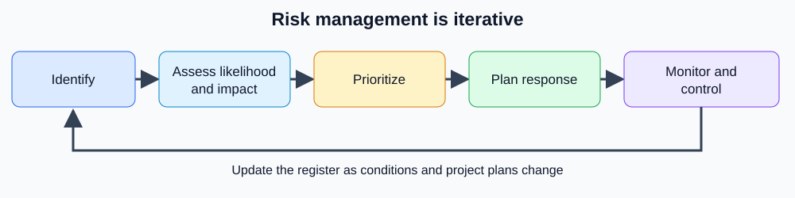
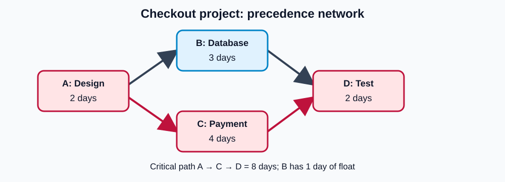
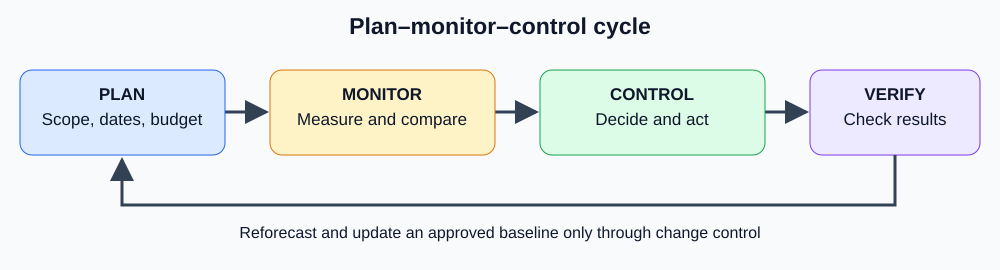
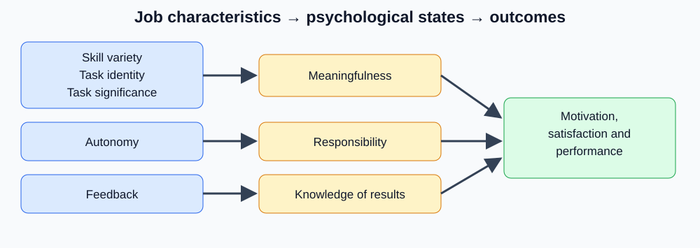
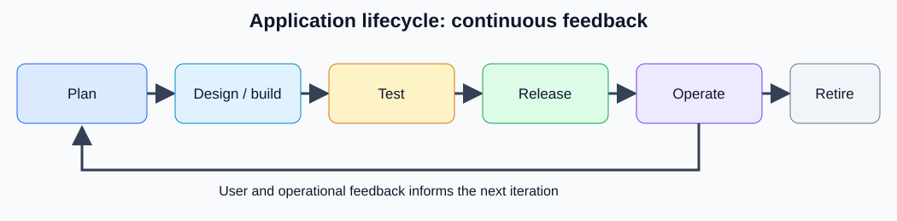

# SPM: 2024 Nov-Dec — detailed answers

[Question paper](SPM_Endsem_2024_Nov-Dec.pdf) | [Study index](../Study/README.md)

Question headings are paraphrased. Both sides of every OR are answered; use the paper's actual marks and instructions in the exam. Each response is prepared for approximately nine marks. Examples are illustrative, not paper data.

## Q1(a) — Risk management

### Risk management process

A **risk** is an uncertain event or condition that may affect objectives; an issue has already occurred. Risk management is the iterative identification, assessment, response and monitoring of uncertainty, not a guarantee of avoiding every problem.



*Original diagram: risk management continues as project conditions change.*

```text
Identify -> Assess probability and impact -> Prioritize -> Plan response
    ^                                              |
    +------- Monitor, control and update <---------+
```

1. **Identify:** use brainstorming, interviews, checklists, historical data and assumption analysis; record cause, event and consequence.
2. **Assess:** estimate probability and impact on cost, schedule, quality or security; use a qualitative matrix or a justified numerical model.
3. **Prioritize:** compare exposures and urgency; `probability × impact` provides an approximate expected loss for a quantified risk.
4. **Plan:** select response, owner, trigger, budget and contingency; record residual and secondary risks.
5. **Monitor and control:** check triggers and effectiveness, implement responses, track issues, reassess and close or escalate risks.

**Example:** payment gateway approval might take 5 extra days with probability 0.3. Expected schedule impact considered in isolation is `0.3 × 5 = 1.5 days`; it is not automatically a 1.5-day project delay because path, float and dependencies matter. Assign an owner to obtain approval early and define an escalation trigger.

**Risk versus issue:** “Approval may arrive late” is a risk; “approval is now overdue” is an issue requiring action. A *risk owner* tracks the uncertain event and response; a trigger is an observable warning, such as no vendor response by a specified date. A contingency is an action or reserve used if the risk occurs. Reassess after each review because new information can change the priority or reveal a new risk.

**Further study:** [Unit 3: Risk management process](../Study/unit-3-activity-risk.md#risk-management-process).

## Q1(b) — Formulating a network model

### Network models and dependencies

A **network model** represents activities and their dependencies. In an activity-on-node (AON) diagram, nodes represent activities and arrows represent precedence. It exposes parallelism and supports critical-path calculations.



*Original diagram. Red marks the critical path; durations are illustrative days.*

```text
Start -> A: design (2) -> B: database (3) --+
                     \-> C: payment (4) ----+-> D: test (2) -> Finish
```

Construct it by listing activities and durations, identifying immediate predecessors, drawing arrows without cycles, checking start/end connections and verifying the dependency sequence. Here A precedes B and C; B and C both precede D. B and C are parallel in the logic, although actual execution also requires sufficient resources. A is D's indirect predecessor; B is A's successor. For example, design precedes database creation, while payment integration and database work can proceed concurrently after design.

The paths are `A-B-D = 7` and `A-C-D = 8` days; the latter is the **critical path**, so its activities have zero total float in this example. The network assumes durations, dependencies and available resources are valid; dependencies must be revisited as the project changes.

**Precedence terminology:** A *predecessor* must finish before the dependent activity starts under the finish-to-start assumption; a *successor* follows it. Parallel activities are not ordered relative to one another in the network. Thus A is the immediate predecessor of B and C; B and C are immediate predecessors of D. If C slips by two days, D cannot begin until day 8 and the project finishes on day 10. If B slips one day, it still finishes by day 6, so D's start remains unchanged.

**Good network rules:** each activity needs a clear start and finish, dependencies must not form a cycle, and an arrow must represent a real constraint. Check for omitted external approvals and test environments. Other representations, including activity-on-arrow, place activities on arrows; label the convention used in a drawing.

### Forward pass and backward pass

The **forward pass** finds earliest start (ES) and earliest finish (EF): `EF = ES + duration`; at a merge, ES is the maximum EF of all immediate predecessors. The **backward pass** finds latest finish (LF) and latest start (LS): `LS = LF − duration`; at a split, LF is the minimum LS of immediate successors. Set final LF to project duration unless an imposed deadline is specified. Total float is `LS − ES = LF − EF`.

Using the preceding network:

| Activity | Duration | Predecessor | ES | EF | LS | LF | Float |
|---|---:|---|---:|---:|---:|---:|---:|
| A | 2 | — | 0 | 2 | 0 | 2 | 0 |
| B | 3 | A | 2 | 5 | 3 | 6 | 1 |
| C | 4 | A | 2 | 6 | 2 | 6 | 0 |
| D | 2 | B, C | 6 | 8 | 6 | 8 | 0 |

The forward pass uses `max(5,6)=6` for D; the backward pass uses `min(3,2)=2` as A's LF. Project duration is **8 days** and `A-C-D` is critical. B can slip one day without delaying completion, assuming no other changes. Forward pass asks “how soon?”; backward pass asks “how late without delaying the finish?”.

**Calculation walkthrough:**

1. Start A at day 0: `ES(A)=0`, `EF(A)=0+2=2`.
2. B and C follow A, so both start at day 2. B finishes on day 5 and C on day 6.
3. D waits for **both** activities: `ES(D)=max(5,6)=6`, `EF(D)=6+2=8`.
4. Work backward from the day-8 finish: `LF(D)=8`, `LS(D)=6`.
5. Both B and C must finish by day 6: B's `LS=6−3=3`, C's `LS=6−4=2`.
6. A must finish by the earlier of its successors' latest starts: `LF(A)=min(3,2)=2`, so `LS(A)=0`.

| Comparison | Forward pass | Backward pass |
|---|---|---|
| Direction | Start to finish | Finish to start |
| Finds | Earliest start and finish | Latest start and finish |
| At multiple connections | Use maximum predecessor EF | Use minimum successor LS |
| Purpose | Find earliest completion | Find allowable delay and float |

**Further study:** [Unit 3: Network models and dependencies](../Study/unit-3-activity-risk.md#network-models-and-dependencies) · [Unit 3: Forward pass and backward pass](../Study/unit-3-activity-risk.md#forward-pass-and-backward-pass).

## Q2(a) — Forward versus backward pass

### Network models and dependencies

A **network model** represents activities and their dependencies. In an activity-on-node (AON) diagram, nodes represent activities and arrows represent precedence. It exposes parallelism and supports critical-path calculations.


*Original diagram. Red marks the critical path; durations are illustrative days.*

```text
Start -> A: design (2) -> B: database (3) --+
                     \-> C: payment (4) ----+-> D: test (2) -> Finish
```

Construct it by listing activities and durations, identifying immediate predecessors, drawing arrows without cycles, checking start/end connections and verifying the dependency sequence. Here A precedes B and C; B and C both precede D. B and C are parallel in the logic, although actual execution also requires sufficient resources. A is D's indirect predecessor; B is A's successor. For example, design precedes database creation, while payment integration and database work can proceed concurrently after design.

The paths are `A-B-D = 7` and `A-C-D = 8` days; the latter is the **critical path**, so its activities have zero total float in this example. The network assumes durations, dependencies and available resources are valid; dependencies must be revisited as the project changes.

**Precedence terminology:** A *predecessor* must finish before the dependent activity starts under the finish-to-start assumption; a *successor* follows it. Parallel activities are not ordered relative to one another in the network. Thus A is the immediate predecessor of B and C; B and C are immediate predecessors of D. If C slips by two days, D cannot begin until day 8 and the project finishes on day 10. If B slips one day, it still finishes by day 6, so D's start remains unchanged.

**Good network rules:** each activity needs a clear start and finish, dependencies must not form a cycle, and an arrow must represent a real constraint. Check for omitted external approvals and test environments. Other representations, including activity-on-arrow, place activities on arrows; label the convention used in a drawing.

### Forward pass and backward pass

The **forward pass** finds earliest start (ES) and earliest finish (EF): `EF = ES + duration`; at a merge, ES is the maximum EF of all immediate predecessors. The **backward pass** finds latest finish (LF) and latest start (LS): `LS = LF − duration`; at a split, LF is the minimum LS of immediate successors. Set final LF to project duration unless an imposed deadline is specified. Total float is `LS − ES = LF − EF`.

Using the preceding network:

| Activity | Duration | Predecessor | ES | EF | LS | LF | Float |
|---|---:|---|---:|---:|---:|---:|---:|
| A | 2 | — | 0 | 2 | 0 | 2 | 0 |
| B | 3 | A | 2 | 5 | 3 | 6 | 1 |
| C | 4 | A | 2 | 6 | 2 | 6 | 0 |
| D | 2 | B, C | 6 | 8 | 6 | 8 | 0 |

The forward pass uses `max(5,6)=6` for D; the backward pass uses `min(3,2)=2` as A's LF. Project duration is **8 days** and `A-C-D` is critical. B can slip one day without delaying completion, assuming no other changes. Forward pass asks “how soon?”; backward pass asks “how late without delaying the finish?”.

**Calculation walkthrough:**

1. Start A at day 0: `ES(A)=0`, `EF(A)=0+2=2`.
2. B and C follow A, so both start at day 2. B finishes on day 5 and C on day 6.
3. D waits for **both** activities: `ES(D)=max(5,6)=6`, `EF(D)=6+2=8`.
4. Work backward from the day-8 finish: `LF(D)=8`, `LS(D)=6`.
5. Both B and C must finish by day 6: B's `LS=6−3=3`, C's `LS=6−4=2`.
6. A must finish by the earlier of its successors' latest starts: `LF(A)=min(3,2)=2`, so `LS(A)=0`.

| Comparison | Forward pass | Backward pass |
|---|---|---|
| Direction | Start to finish | Finish to start |
| Finds | Earliest start and finish | Latest start and finish |
| At multiple connections | Use maximum predecessor EF | Use minimum successor LS |
| Purpose | Find earliest completion | Find allowable delay and float |

**Further study:** [Unit 3: Network models and dependencies](../Study/unit-3-activity-risk.md#network-models-and-dependencies) · [Unit 3: Forward pass and backward pass](../Study/unit-3-activity-risk.md#forward-pass-and-backward-pass).

## Q2(b) — Evaluating schedule risk using PERT

### Risk responses and schedule risk

For **threats**, avoid by changing the plan, mitigate by reducing likelihood or impact, transfer appropriate financial responsibility through contract or insurance, or accept with a contingency. For opportunities, common responses are exploit, enhance, share or accept. Transferring a contract does not eliminate accountability for monitoring it.

| Threat response | Meaning | Example |
|---|---|---|
| Avoid | Remove the threat by changing an objective or approach | Use a known gateway instead of an untested one |
| Mitigate | Reduce probability or impact | Prototype the gateway interface early |
| Transfer | Allocate specified financial consequences to another party | Negotiate an appropriate supplier warranty |
| Accept | Acknowledge and monitor the risk, with contingency if justified | Reserve time for a low-probability approval delay |

PERT estimates each uncertain activity's expected duration `te = (O + 4M + P)/6` and approximate variance `((P − O)/6)²`. Example: for a gateway task, `O=2, M=4, P=8` days gives `te=26/6≈4.33` days and variance `1 day²`. Substitute expected durations in the network and find the expected critical path. Under the simplified assumptions of independent activity durations and a fixed critical path, sum the variances on that path; its standard deviation is the square root of that sum. Compare a deadline with the estimated distribution only if the model assumptions are justified.

For a complete illustrative schedule, suppose design takes 2 days, the gateway task above follows design, and final testing takes 2 days. With no other paths, the expected project duration is `2 + 4.33 + 2 = 8.33` days. If the two fixed tasks have zero variance, the path variance is `1` and its standard deviation is `1` day. For a 10-day deadline, the normal approximation gives `z = (10 − 8.33)/1 ≈ 1.67`, or roughly a **95%** chance of meeting it under the model assumptions. The pessimistic gateway estimate increases the expected duration and introduces uncertainty; an early approval or backup gateway could reduce the risk. This is a simplified illustration, not a guarantee or a substitute for considering other paths.

Uncertain paths may change and risks can be correlated; a single-path normal approximation can underestimate deadline risk. Use scenario analysis or simulation where appropriate, and maintain contingency rather than treating an expected date as a promise. If the task is not critical and has enough float, its delay need not delay the project.

### Network models and dependencies

A **network model** represents activities and their dependencies. In an activity-on-node (AON) diagram, nodes represent activities and arrows represent precedence. It exposes parallelism and supports critical-path calculations.


*Original diagram. Red marks the critical path; durations are illustrative days.*

```text
Start -> A: design (2) -> B: database (3) --+
                     \-> C: payment (4) ----+-> D: test (2) -> Finish
```

Construct it by listing activities and durations, identifying immediate predecessors, drawing arrows without cycles, checking start/end connections and verifying the dependency sequence. Here A precedes B and C; B and C both precede D. B and C are parallel in the logic, although actual execution also requires sufficient resources. A is D's indirect predecessor; B is A's successor. For example, design precedes database creation, while payment integration and database work can proceed concurrently after design.

The paths are `A-B-D = 7` and `A-C-D = 8` days; the latter is the **critical path**, so its activities have zero total float in this example. The network assumes durations, dependencies and available resources are valid; dependencies must be revisited as the project changes.

**Precedence terminology:** A *predecessor* must finish before the dependent activity starts under the finish-to-start assumption; a *successor* follows it. Parallel activities are not ordered relative to one another in the network. Thus A is the immediate predecessor of B and C; B and C are immediate predecessors of D. If C slips by two days, D cannot begin until day 8 and the project finishes on day 10. If B slips one day, it still finishes by day 6, so D's start remains unchanged.

**Good network rules:** each activity needs a clear start and finish, dependencies must not form a cycle, and an arrow must represent a real constraint. Check for omitted external approvals and test environments. Other representations, including activity-on-arrow, place activities on arrows; label the convention used in a drawing.

**Further study:** [Unit 3: Risk responses and schedule risk](../Study/unit-3-activity-risk.md#risk-responses-and-schedule-risk) · [Unit 3: Network models and dependencies](../Study/unit-3-activity-risk.md#network-models-and-dependencies).

## Q3(a) — Types of contracts and typical terms

### Contracts and contract management

| Contract type | Payment basis | Typical risk |
|---|---|---|
| Fixed price | Agreed price for defined deliverables | Supplier bears more cost-overrun risk; scope changes need control |
| Time and materials | Actual approved time and materials at agreed rates | Buyer bears more effort uncertainty; use a cap and monitoring |
| Cost reimbursable | Allowable costs plus agreed fee | Buyer bears cost uncertainty; audit and incentives matter |

Typical terms cover scope and acceptance, schedule/milestones, price and payment, change procedure, intellectual property, confidentiality, security, warranties, liability, dispute resolution and termination. Exact legal terms require professional advice.

Stages: identify need and strategy → select supplier and negotiate → authorize/sign → monitor performance and manage changes → accept deliverables and close. Common challenges are ambiguous scope, vendor dependency and weak evidence of acceptance. Clear responsibilities and documented reviews improve accountability.

For example, purchase a payment gateway integration under a fixed-price contract only when its scope and acceptance tests are sufficiently clear; record how an extra payment method is priced and approved. A time-and-materials arrangement may suit uncertain discovery work, but the buyer should monitor authorized hours and deliverables. During closure confirm acceptance, outstanding defects, final payment and handover; do not assume signing a contract completes supplier management.

**Further study:** [Unit 4: Contracts and contract management](../Study/unit-4-tracking-control.md#contracts-and-contract-management).

## Q3(b) — Monitoring and control framework

### Monitoring and control framework

**Project tracking** collects and compares actual progress against the plan; **control** chooses and implements actions to correct unacceptable deviations. Monitoring observes and reports, while control acts and checks the effect. Establish a framework by defining scope and a baseline, breaking work into measurable deliverables, choosing metrics and tolerances, assigning owners, agreeing collection/reporting intervals, analyzing variances and risks, escalating decisions, implementing approved actions and reviewing results.



*Original diagram. Feedback is used to revise forecasts and improve the plan.*

```text
Set plan and baseline -> Collect actual data -> Compare -> Decide action
       ^                                                 |
       +----------- Verify results and update <----------+
```

In an online shop project, set payment integration as a milestone, collect weekly completion and expenditure, compare them with the baseline, investigate a delay, approve an appropriate corrective action, and review its effects. A good status report identifies the reporting period, accomplishments, planned next steps, variances, risks/issues, decisions required and accountable owners; it is accurate, timely, concise and actionable.

**Tools and methods:** milestone reviews, Gantt or slip charts, dashboards, issue and risk registers, stand-ups, status reports, timesheets, earned value analysis and change control. Use evidence from tests or completed deliverables, not only subjective “percent done”. Measurements should be consistent and privacy-aware; avoid using individual metrics as punishment.

**Building the framework step by step:**

1. Establish an approved scope, schedule and cost baseline, including measurable acceptance criteria.
2. Select leading and lagging indicators: for example, unresolved blockers and accepted tests.
3. Assign a responsible owner and data source to each indicator; agree reporting frequency and quality checks.
4. Define tolerances, such as a milestone slip requiring escalation beyond two working days.
5. Compare actuals and forecasts with the baseline, investigate causes and evaluate options.
6. Authorize corrective action, document decisions and check whether it actually resolves the variance.

A framework also needs an escalation route and a change authority: the project manager may correct minor staffing issues, whereas a baseline scope or budget change may require sponsor approval. Recording a forecast separately from the baseline preserves a meaningful comparison.

**Further study:** [Unit 4: Monitoring and control framework](../Study/unit-4-tracking-control.md#monitoring-and-control-framework).

## Q4(a) — Visualizing progress

### Visualizing progress


*Abstract Kanban Board by Jennifer Falco, [Wikimedia Commons](https://commons.wikimedia.org/wiki/File:Abstract_Kanban_Board.svg), [CC BY 4.0](https://creativecommons.org/licenses/by/4.0/); unmodified. Each card is a work item, and its column shows its current workflow stage.*

| Technique | Purpose and example | Limitation |
|---|---|---|
| Gantt chart | Bars show start, finish and progress of checkout tasks | Complex dependencies are hard to read at scale |
| Milestone chart | Shows approval, test and release dates | Does not show detailed work |
| Slip chart | Compares planned and forecast/actual milestone dates over time | Requires regular reliable estimates |
| Kanban board | Displays workflow and bottlenecks in To do, Doing, Done | Card count alone is not business value |
| Calendar | Shows events, deadlines and availability | Limited insight into dependencies |
| S-curve / earned value chart | Compares cumulative baseline, earned value and actual cost over time | Depends on a credible baseline and progress measurement |
| Dashboard | Summarizes exceptions, risk and KPIs | Can hide context or encourage metric gaming |

```text
To do            Doing               Done
[refund tests]   [payment gateway]   [checkout design]
```

Limit work in progress when using Kanban, define “Done”, and investigate aging blocked cards. A visualization helps prompt a conversation; it does not replace checking the underlying data.

**How to read the visualizations:** A Gantt chart shows whether the bar for payment testing extends beyond its baseline date. A milestone chart highlights whether gateway approval was achieved. A slip chart tracks how the forecast milestone date changes at successive reviews: repeated rightward movement signals growing delay. A Kanban board reveals work accumulating in a state; confirm whether the constraint is capacity, missing inputs or a policy problem before taking action. An S-curve can show that actual expenditure is above plan while earned value is below plan.

**Example dashboard:** report release forecast, accepted stories, open critical defects, budget and top risks for the same reporting date; mark an overdue approval with its owner and next action. Use labels in addition to colors so the information remains accessible.

See the [Technical book's traffic-light assessment, figure 4.4.2, PDF page 56](../Books/SPM_Technical_Units03-06.pdf#page=56), for a different way to record status over successive weeks. Define the meaning of each status before reporting.

**Further study:** [Unit 4: Visualizing progress](../Study/unit-4-tracking-control.md#visualizing-progress).

## Q4(b) — SCM and its tasks

### Software configuration management

**Software configuration management (SCM)** identifies, controls, records and audits changes to software artifacts across their lifecycle. A configuration item (CI) can be source code, requirements, tests, builds or configuration; a **baseline** is an agreed version that changes only through an authorized process.

Core tasks: identify CIs and naming rules; manage versions and branches; control change requests; record configuration status and history; audit whether changes and deliverables match approvals; build and release reproducibly. For an online shop, version the payment API code, tests and deployment configuration together, review changes and label the release.

Participants typically include the requester, project manager, configuration manager, developers, testers, release manager and the change authority or CCB. The configuration manager maintains identification and records; developers implement approved changes; testers verify them; the CCB makes decisions within its authority; and release staff package an approved baseline. A small project may combine roles but should preserve appropriate review.

Git tracks versions and supports branches, reviews and merges; Team Foundation Server/Azure DevOps Server provides integrated version control and work management; Ansible helps define and apply infrastructure configuration. Ansible is not a substitute for version control: store its playbooks in a versioned repository. Choose tools based on access control, traceability, integration and audit needs.

**Typical SCM lifecycle:** identify the requirements document, source repository and deployment playbooks as configuration items; record approved versions as a baseline; link a change request to commits and tests; record its approval and implementation status; audit that the released artifacts match the approved versions. A version label makes it possible to recreate or investigate a release. An audit can check both that required changes were implemented and that the recorded configuration matches what was delivered.

**Further study:** [Unit 4: Software configuration management](../Study/unit-4-tracking-control.md#software-configuration-management).

## Q5(a) — Leadership and styles

### Leadership and management

**Leadership** influences people toward shared goals. Management plans, organizes, coordinates and controls work; leadership emphasizes direction, motivation, alignment and change. Effective project managers usually need both.

| Aspect | Management | Leadership |
|---|---|---|
| Focus | Plans, resources, consistency | Vision, people, adaptation |
| Example | Allocate test capacity and track schedule | Explain release purpose and build commitment |
| Time horizon | Operational control and delivery | Direction and sustainable change |

Approaches include trait (personal qualities), behavioral (what leaders do), and contingency/situational (style depends on context). Styles include autocratic (fast centralized decisions), democratic (participation), laissez-faire/delegative (team autonomy), transactional (agreed goals and feedback/rewards), and transformational (shared vision and development). No style is always best: urgent incident response may require decisive coordination; design decisions benefit from team participation. Clearly explain authority, listen and remain accountable.

| Style | Advantage | Risk if overused |
|---|---|---|
| Autocratic | Quick direction in a time-critical incident | Reduces participation and may miss expertise |
| Democratic | Better buy-in and broader ideas | Consultation can delay urgent decisions |
| Delegative | Develops ownership in a capable team | Unclear boundaries can leave decisions unmade |
| Transactional | Clarifies expectations and feedback | Can overemphasize short-term targets |
| Transformational | Builds commitment around a shared vision | A vision needs concrete delivery and follow-through |

For example, the leader can invite the team to choose a checkout design but direct a coordinated rollback during an outage. A manager then allocates time, updates the risk register and monitors whether the rollback restores service.

**Further study:** [Unit 5: Leadership and management](../Study/unit-5-people-teams.md#leadership-and-management).

## Q5(b) — Hackman–Oldham model

### Job characteristics model

The Hackman–Oldham model connects job design to motivation through five core characteristics:



*Original illustration of the model; outcomes depend on individual and organizational conditions.*

1. **Skill variety:** use different skills, such as coding and customer communication.
2. **Task identity:** complete an identifiable whole, such as delivering a checkout feature.
3. **Task significance:** understand its effect on users and business.
4. **Autonomy:** have appropriate discretion over implementation.
5. **Feedback:** receive usable information about performance from work and stakeholders.

```text
Variety + identity + significance -> experienced meaningfulness
Autonomy -------------------------> experienced responsibility
Feedback -------------------------> knowledge of results
                                  -> motivation, satisfaction, performance
```

The model's illustrative motivating potential score is `MPS = ((variety + identity + significance)/3) × autonomy × feedback`. Example: scores 4, 3, 5, 4 and 3 give `MPS = ((4+3+5)/3) × 4 × 3 = 48`. Scores depend on the scale used and are diagnostic rather than an absolute prediction. Improve a repetitive development role by giving ownership from design through release, user context, choice within standards and timely test/user feedback. Individual growth needs and organizational conditions affect outcomes.

**Interpretation:** A developer who only fixes isolated UI defects may see little task identity. Assigning responsibility for the whole checkout flow, within appropriate review and security boundaries, increases ownership. Discussing how accessibility improvements help shoppers strengthens task significance; automated tests and user feedback improve knowledge of results. An autonomy score of zero would make the model's multiplicative score zero even when other scores are high, illustrating why job design must consider all five dimensions.

**Further study:** [Unit 5: Job characteristics model](../Study/unit-5-people-teams.md#job-characteristics-model).

## Q6(a) — Factors involved in making a team

### Making a team, decision making and communication

Good teams need a shared goal, complementary skills, clear roles, manageable size, trust and psychological safety, agreed decisions, coordination, feedback and conflict resolution. A decision process defines the problem, gathers evidence, considers alternatives, chooses with explicit authority, records the decision and revisits outcomes. Consensus can improve buy-in but may take time; urgent issues may need a delegated decision.

For example, a checkout team needs developers, testers and domain knowledge; one person owns payment integration while another owns acceptance testing. They agree response times and escalation rules, review dependencies weekly, and resolve a dispute about scope against the shared release goal. Trust lets members report defects early; complementary skills alone do not help if responsibilities and handoffs are unclear.

**Coordination dependencies** arise when one person's output, shared resource or decision affects another. Manage them through interface agreements, a visible dependency board, milestones and explicit owners. A communication plan identifies audience, purpose, channel, frequency, owner and escalation path: daily team stand-up for blockers, weekly stakeholder report for status and immediate incident channel for security issues. Genres include reports, meetings, chat and technical documentation; select a channel suitable for urgency and permanence.

| Team factor | Why it matters | Example practice |
|---|---|---|
| Shared goal | Aligns individual work | Agree a release outcome and acceptance criteria |
| Complementary skills | Covers delivery and quality needs | Include security and testing alongside development |
| Roles and authority | Prevents duplicated or missed work | Name an owner for gateway integration |
| Trust and communication | Makes blockers and defects visible | Encourage questions and review decisions openly |
| Coordination and feedback | Keeps dependent work aligned | Agree an API contract and check progress weekly |
| Conflict resolution | Keeps disagreement productive | Compare options against criteria and record the decision |

**Further study:** [Unit 5: Making a team, decision making and communication](../Study/unit-5-people-teams.md#making-a-team-decision-making-and-communication).

## Q6(b) — Team formation and improving motivation

### Team formation and motivation

Tuckman's model describes **forming** (orientation), **storming** (conflict and roles), **norming** (agreed working practices), **performing** (effective cooperation) and **adjourning** (closure). Teams can revisit stages when membership or scope changes; the stages are a useful model, not an inevitable fixed sequence.

For a checkout team, establish goals and introductions; resolve disagreements about responsibilities; agree coding and review norms; deliver and improve together; then document lessons and recognize contributions at closure.

Motivation can be improved through fair pay and safe conditions, clear meaningful objectives, autonomy with support, recognition, timely feedback, learning, manageable workload, participation and growth opportunities. Managers should ask individuals what helps them and review whether interventions work.

| Stage | Typical behavior | Helpful manager action |
|---|---|---|
| Forming | Members seek purpose and responsibilities | Clarify goal, roles and working agreements |
| Storming | Conflicts arise over priorities or methods | Facilitate respectful discussion and decisions |
| Norming | The team agrees routines and expectations | Reinforce useful norms and feedback |
| Performing | Members coordinate and solve problems effectively | Delegate, remove obstacles and support improvement |
| Adjourning | Work ends or the team changes | Complete handover, capture lessons and recognize work |

To improve motivation, connect a task to customer value, offer training and appropriate autonomy, recognize specific contributions, and provide timely feedback. Check workload and prerequisites: asking for “more motivation” cannot compensate for unavailable tools or an unsafe schedule.

**Further study:** [Unit 5: Team formation and motivation](../Study/unit-5-people-teams.md#team-formation-and-motivation).

## Q7(a) — Agile management best practices

### Agile management with Azure DevOps

Agile project management delivers value iteratively, prioritizes feedback and adapts plans. Create a product backlog, order work by value and risk, refine user stories with acceptance criteria, plan an iteration, track execution, demonstrate working software and retrospect. Azure Boards supports backlog items, sprint planning, assignments, task boards and queries; Repos and Pipelines connect implementation and delivery.

Example: prioritize checkout before recommendations; split checkout into stories for cart, payment and confirmation; review a working increment with users at sprint end. Benefits include a shared view of priorities and traceability from work to delivery. Do not equate use of a board with being agile.

Common Azure DevOps process templates include **Agile, Scrum, CMMI and Basic**, depending on product version and project configuration. Scrum emphasizes product backlog items and sprints; Agile typically uses user stories; CMMI supports more formal process tracking; Basic offers a simpler issue/epic/task model. Choose to fit governance and team needs; all can support iterative working when used appropriately.

Good practices: keep items small and testable, set explicit acceptance criteria, prioritize continuously, limit work in progress, automate relevant tests, review increments with stakeholders, make blockers visible, retrospect and improve. Avoid using velocity as a target for comparing teams.

**Iteration example:** The product owner places payment confirmation ahead of promotional features because it is necessary for purchase completion. The team agrees acceptance criteria, breaks the story into tasks and tests, then tracks work daily on the board. At the review, stakeholders try the feature and request a clearer failure message. The team records that feedback, updates the backlog and discusses how to improve testing in the retrospective. The board supports the conversation; working software and feedback are the objective.

**Further study:** [Unit 6: Agile management with Azure DevOps](../Study/unit-6-azure-agile.md#agile-management-with-azure-devops).

## Q7(b) — Azure DevOps fundamental components

### Azure DevOps and TFS

Azure DevOps is a set of services for planning and delivering software. Core components include **Boards** for work items and planning, **Repos** for version control, **Pipelines** for builds and deployments, **Test Plans** for test management, and **Artifacts** for packages. Access depends on product edition, configuration and licensing.

| Aspect | TFS / Azure DevOps Server | Azure DevOps Services |
|---|---|---|
| Hosting | Primarily self-managed, on-premises deployment | Microsoft-hosted cloud service |
| Administration | Organization manages server and upgrades | Provider manages service infrastructure |
| Updates | Installed by the organization | Delivered to the service |
| Version control | Supported options depend on version/configuration | Git and TFVC support depends on project setup |

Team Foundation Server (TFS) is the older name of the on-premises product now called Azure DevOps Server. Features and availability differ across versions; avoid treating TFS as an entirely unrelated product. Both support integrated planning, code and delivery workflows.

**Components in an example:** Boards stores the checkout requirement and tasks; Repos stores implementation and review history; Pipelines builds and tests a version; Test Plans can organize manual test cases; Artifacts stores packages. Linking these records supports impact analysis: when a checkout story changes, a reviewer can find its associated code and tests. Availability and organization policies should be checked for the version in use.

**Further study:** [Unit 6: Azure DevOps and TFS](../Study/unit-6-azure-agile.md#azure-devops-and-tfs).

## Q7(c) — Agile and project management metrics

### Metrics and reporting

Metrics inform decisions; define the question, unit, data source, time window and limitations before measuring. Use a balanced set and validate data quality.

| Metric | Definition / interpretation | Caution |
|---|---|---|
| Lead time | Time from request to delivery, with explicit start/end | Context and work type affect comparisons |
| Cycle time | Time from work start to completion | Define workflow states consistently |
| Throughput | Work items completed per interval | Item sizes differ |
| Velocity | Story points completed per sprint | Team-specific estimates, not productivity ranking |
| Defect escape rate | Defects found after release relative to an agreed denominator | Severity and detection effort matter |
| Build success rate | Successful builds divided by total builds in a period | Can be gamed by excluding failures |
| Deployment frequency | Deployments per time period | Must be paired with quality and reliability |
| Change failure rate | Failed deployments / deployments under an agreed definition | Definitions must be consistent |
| Mean time to restore | Average restoration time for included incidents | Report distribution and severity too |

Developer practice metrics can include build success, test pass rate, code-review turnaround and escaped defects. Agile reports include sprint burndown, burnup, cumulative flow and velocity charts. A burndown plots remaining work; a burnup shows completed work and scope; cumulative flow shows work in each state over time; velocity shows points completed per iteration. Example: a widening “testing” band in cumulative flow suggests a bottleneck to investigate, not proof of an individual failure.

For a concrete developer-practice report, suppose 18 of 20 builds pass: build success is `18/20 = 90%`. If 48 of 50 executed tests pass, test pass rate is `48/50 = 96%`; this says nothing about untested requirements or test quality. Review turnaround is measured from pull-request creation to an agreed review event; a rising median may identify a review bottleneck. Track escaped defects by release and severity to focus quality improvement, not blame. Compare trends only when definitions and context are stable.

For four report examples, a team can inspect (1) **sprint burndown** to see whether remaining work is falling, (2) **burnup** to distinguish progress from scope growth, (3) **cumulative flow** to identify accumulating work in a state, and (4) **velocity** to inform the same team's tentative iteration planning. Unexpected scope changes and inconsistent estimates make the charts less reliable; discuss underlying work before acting.

**Further study:** [Unit 6: Metrics and reporting](../Study/unit-6-azure-agile.md#metrics-and-reporting).

## Q8(a) — Agile management in Azure DevOps and TFS

### Agile management with Azure DevOps

Agile project management delivers value iteratively, prioritizes feedback and adapts plans. Create a product backlog, order work by value and risk, refine user stories with acceptance criteria, plan an iteration, track execution, demonstrate working software and retrospect. Azure Boards supports backlog items, sprint planning, assignments, task boards and queries; Repos and Pipelines connect implementation and delivery.

Example: prioritize checkout before recommendations; split checkout into stories for cart, payment and confirmation; review a working increment with users at sprint end. Benefits include a shared view of priorities and traceability from work to delivery. Do not equate use of a board with being agile.

Common Azure DevOps process templates include **Agile, Scrum, CMMI and Basic**, depending on product version and project configuration. Scrum emphasizes product backlog items and sprints; Agile typically uses user stories; CMMI supports more formal process tracking; Basic offers a simpler issue/epic/task model. Choose to fit governance and team needs; all can support iterative working when used appropriately.

Good practices: keep items small and testable, set explicit acceptance criteria, prioritize continuously, limit work in progress, automate relevant tests, review increments with stakeholders, make blockers visible, retrospect and improve. Avoid using velocity as a target for comparing teams.

**Iteration example:** The product owner places payment confirmation ahead of promotional features because it is necessary for purchase completion. The team agrees acceptance criteria, breaks the story into tasks and tests, then tracks work daily on the board. At the review, stakeholders try the feature and request a clearer failure message. The team records that feedback, updates the backlog and discusses how to improve testing in the retrospective. The board supports the conversation; working software and feedback are the objective.

### Azure DevOps and TFS

Azure DevOps is a set of services for planning and delivering software. Core components include **Boards** for work items and planning, **Repos** for version control, **Pipelines** for builds and deployments, **Test Plans** for test management, and **Artifacts** for packages. Access depends on product edition, configuration and licensing.

| Aspect | TFS / Azure DevOps Server | Azure DevOps Services |
|---|---|---|
| Hosting | Primarily self-managed, on-premises deployment | Microsoft-hosted cloud service |
| Administration | Organization manages server and upgrades | Provider manages service infrastructure |
| Updates | Installed by the organization | Delivered to the service |
| Version control | Supported options depend on version/configuration | Git and TFVC support depends on project setup |

Team Foundation Server (TFS) is the older name of the on-premises product now called Azure DevOps Server. Features and availability differ across versions; avoid treating TFS as an entirely unrelated product. Both support integrated planning, code and delivery workflows.

**Components in an example:** Boards stores the checkout requirement and tasks; Repos stores implementation and review history; Pipelines builds and tests a version; Test Plans can organize manual test cases; Artifacts stores packages. Linking these records supports impact analysis: when a checkout story changes, a reviewer can find its associated code and tests. Availability and organization policies should be checked for the version in use.

**Further study:** [Unit 6: Agile management with Azure DevOps](../Study/unit-6-azure-agile.md#agile-management-with-azure-devops) · [Unit 6: Azure DevOps and TFS](../Study/unit-6-azure-agile.md#azure-devops-and-tfs).

## Q8(b) — Traceability, visibility and collaboration

### Visibility, traceability, collaboration and extensibility

* **Visibility:** stakeholders can see current work, progress, blockers and delivery status, subject to access permissions. Enable it using shared boards/backlogs, dashboards and reports, and build/test/release status.
* **Traceability:** links connect a requirement or work item to commits, tests, builds and releases. It helps change impact analysis and audit, though links must be maintained.
* **Collaboration:** shared work items, discussion, pull requests, notifications and reviews help developers, testers and stakeholders coordinate. Agree ownership and communication norms.
* **Extensibility:** APIs, service hooks, extensions and integrations can adapt workflows and connect external systems. Evaluate permissions, compatibility and maintenance before adding extensions.

Example: the checkout story links to a pull request, automated tests and a pipeline run. The team sees a failed test on a dashboard, discusses the fix on the work item, then traces the successful deployment to the release. Sensitive data should not be exposed merely to increase visibility.

**Three ways to enable visibility:** (1) publish a prioritized backlog and board with clear work states and owners; (2) show team dashboards or reports for milestones, defects and relevant trends; (3) make build, test and deployment results visible with links to the associated work. Agree who needs access, update work promptly and explain what each metric means.

Traceability answers “what changed and why?”, collaboration answers “how do the people coordinate?”, visibility answers “what is happening?”, and extensibility answers “how can the process connect to other tools?”. Together they improve decision-making, but inaccurate links or outdated status can create false confidence.

**Further study:** [Unit 6: Visibility, traceability, collaboration and extensibility](../Study/unit-6-azure-agile.md#visibility-traceability-collaboration-and-extensibility).

## Q8(c) — ALM process

### Application lifecycle management

**Application lifecycle management (ALM)** coordinates a software product from initial idea through retirement, integrating people, processes, artifacts and tools. Typical stages are requirements and planning, design, development, testing, release/deployment, operation and maintenance, and eventual retirement. These stages overlap and repeat in iterative work; ALM is broader than coding or a single release.



*Original diagram. Phases can overlap and repeat; retirement occurs when the application is no longer needed.*

```text
Idea -> Plan -> Design -> Build -> Test -> Release -> Operate
         ^                                           |
         +---------------- feedback -----------------+
```

For an online shop, capture a checkout requirement, plan it as a work item, link its code and tests, deploy the approved build, monitor incidents and use feedback to update the backlog. Traceable links enable teams to assess the impact of a change and demonstrate what was tested.

ALM tools can include Azure DevOps, Jira combined with development tools, and GitLab; configurations and features vary. Select based on requirements coverage, traceability, version control and CI integration, reporting, access control, extensibility, usability, hosting, support and total cost. A tool does not automatically supply a sound development process.

| Lifecycle stage | Main activities | Online-shopping example |
|---|---|---|
| Requirements and planning | Identify users, priorities, constraints and acceptance criteria | Record a secure-payment story |
| Design and development | Decide architecture and implement changes | Build the gateway adapter |
| Testing | Verify functionality, integration and quality attributes | Run payment and failure-path tests |
| Release | Approve and deploy a known version | Publish and deploy the tested build |
| Operation and maintenance | Monitor, support, fix and improve the product | Investigate declined-payment incidents |
| Retirement | Remove or migrate the application safely | Archive required records and decommission a legacy gateway |

For tool selection, list required capabilities and constraints, trial the candidates on a representative workflow, check security and administration costs, and evaluate integrations and export options. For example, a small team may prioritize usability and repository integration while a regulated organization may require stronger audit and hosting controls.

**Further study:** [Unit 6: Application lifecycle management](../Study/unit-6-azure-agile.md#application-lifecycle-management).
