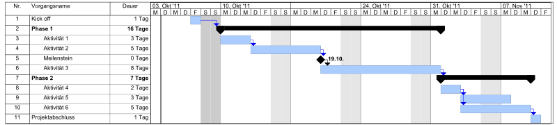
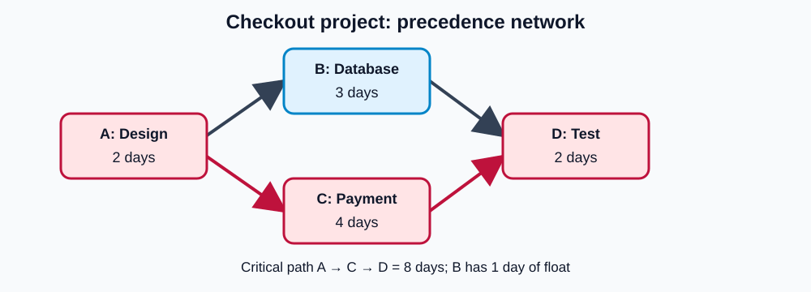
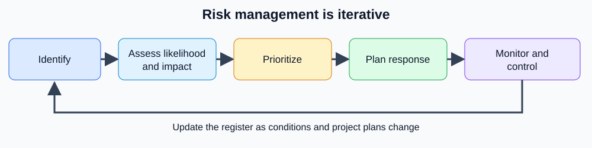

# Unit 3: Activity Planning and Risk Management

[Study index](README.md) | [Curriculum](../SPM%20-%20SPPU%20BE%20IT%20Curriculum.pdf) | [Technical book, unit 3](../Books/SPM_Technical_Units03-06.pdf#page=1) | [Existing unit 3 notes](SPM_unit-3.pdf)

The examples below are illustrative. Times use a common zero-based time origin, finish-to-start dependencies and no resource constraints unless stated otherwise.

## Activity planning and identification

**Activity planning** turns project deliverables into an ordered, resourced and time-bound set of tasks. It aims to establish a realistic completion date, coordinate dependencies, allocate people and equipment, identify critical work, estimate cash flows, communicate responsibilities, and create a baseline for control. It also exposes risks and supports alternative schedules.

**Objectives in detail:**

1. **Feasibility:** check whether the required work can fit the available time, budget and people; identify an unrealistic deadline early.
2. **Coordination:** identify the order of work and the outputs each activity must receive from its predecessors.
3. **Resource allocation:** arrange staff, tools and infrastructure when they are needed, resolving conflicts between simultaneous tasks.
4. **Control:** establish measurable dates and milestones so actual progress can be compared with the authorized baseline.
5. **Communication and accountability:** make ownership, delivery dates and dependencies clear to team members and stakeholders.
6. **Risk and cash-flow planning:** expose deadline-sensitive activities and forecast when major costs will occur.

**Identify activities** using: (1) a product-based approach, decomposing deliverables into products and then the tasks needed to create them; (2) an activity-based approach, decomposing the work into phases and tasks through a work breakdown structure (WBS); or (3) a hybrid combining deliverables and lifecycle activities. Workshops, past plans, expert judgment and checklists help find missing tasks. Each activity should have an owner, output, estimate and completion criteria.

**Example:** For an online shopping system, decompose the checkout deliverable into design, payment integration and testing. Identify procurement or security review as dependencies, estimate each task, assign owners and reserve time for rework. The manager compares planned and actual completion against this baseline.

| Approach | How activities are found | Checkout illustration |
|---|---|---|
| Product-based | List deliverables, break each into components and ask what work produces them | Payment module → interface specification, implementation and verified tests |
| Activity-based | Start from lifecycle phases and decompose the work | Analysis → design → development → testing → deployment |
| Hybrid | Cross-check a product breakdown against lifecycle activities | For each component include design, build, review, test and release |

The hybrid cross-check helps detect forgotten tasks, such as deployment or documentation. Excessively broad tasks conceal progress; excessively tiny tasks create unnecessary administration. Stop decomposing when a task has a clear deliverable, owner and practical estimate.

For a textbook example of a product breakdown, see [Technical book figure 3.3.2, PDF page 8](../Books/SPM_Technical_Units03-06.pdf#page=8).

**Scheduling steps:** define scope and deliverables → list activities → identify dependencies → estimate durations and resources → draw the network → calculate early/late dates → resolve resource conflicts → approve and monitor the baseline. A milestone schedule shows major zero-duration events; a detailed activity schedule records individual tasks; a Gantt chart shows their durations against time. Milestones communicate progress but cannot replace the detailed schedule.

## Scheduling techniques and CPM versus PERT

**Scheduling techniques** include Gantt charts (bars against a calendar), milestone charts (major events), critical path method (CPM), program evaluation and review technique (PERT) and precedence networks. The network shows dependency logic; the Gantt chart is especially useful for communicating dates and progress.

| Aspect | CPM | PERT |
|---|---|---|
| Duration | Typically one deterministic estimate per activity | Optimistic `O`, most likely `M`, pessimistic `P` |
| Main use | Identify critical path; analyze time/cost trade-offs | Plan under uncertain activity durations |
| Calculation | Fixed activity durations | Expected duration `(O + 4M + P)/6` |
| Risk | Deterministic dates do not capture uncertainty | Estimates uncertainty under simplifying assumptions |

Both use dependency networks and can identify a critical path. CPM can also incorporate uncertain estimates; the distinction is a useful textbook convention, not a strict rule. For checkout, use CPM with agreed estimates for integration tasks; use PERT when a new payment provider makes duration uncertain. A Gantt chart is readable, but does not by itself reveal all dependencies or resource conflicts.



*Gantt diagram by Frank Murmann, [Wikimedia Commons](https://commons.wikimedia.org/wiki/File:Gantt_diagramm.svg), released into the public domain by its author; unmodified. The German labels “Aktivität”, “Dauer” and “Meilenstein” mean activity, duration and milestone. Bars represent scheduled durations; arrows show dependencies and the diamond is a milestone.*

For another example, see the [Technical book's project-plan bar chart, figure 3.4.1, PDF page 12](../Books/SPM_Technical_Units03-06.pdf#page=12).

**How to use the techniques:** First identify activities, predecessors and durations. Draw a network and calculate the earliest and latest times to identify the critical path; translate dates into a Gantt chart for communication. Add milestones for decision points such as approval and deployment. Where estimates are uncertain, record the optimistic, most likely and pessimistic values, and use PERT to understand their effect on the planned duration. Review dates after resource allocation: the theoretical critical path assumes the resources needed for parallel work are available.

**Time–cost trade-off:** CPM can be used to explore *crashing*: add resources or use a faster method for a critical activity, then recompute the network and cost. Shortening a noncritical activity within its float does not necessarily shorten the project. Crashing may raise cost or make another path critical; it is not always feasible.

## Network models and dependencies

A **network model** represents activities and their dependencies. In an activity-on-node (AON) diagram, nodes represent activities and arrows represent precedence. It exposes parallelism and supports critical-path calculations.



*Original diagram. Red marks the critical path; durations are illustrative days.*

```text
Start -> A: design (2) -> B: database (3) --+
                     \-> C: payment (4) ----+-> D: test (2) -> Finish
```

Construct it by listing activities and durations, identifying immediate predecessors, drawing arrows without cycles, checking start/end connections and verifying the dependency sequence. Here A precedes B and C; B and C both precede D. B and C are parallel in the logic, although actual execution also requires sufficient resources. A is D's indirect predecessor; B is A's successor. For example, design precedes database creation, while payment integration and database work can proceed concurrently after design.

The paths are `A-B-D = 7` and `A-C-D = 8` days; the latter is the **critical path**, so its activities have zero total float in this example. The network assumes durations, dependencies and available resources are valid; dependencies must be revisited as the project changes.

**Precedence terminology:** A *predecessor* must finish before the dependent activity starts under the finish-to-start assumption; a *successor* follows it. Parallel activities are not ordered relative to one another in the network. Thus A is the immediate predecessor of B and C; B and C are immediate predecessors of D. If C slips by two days, D cannot begin until day 8 and the project finishes on day 10. If B slips one day, it still finishes by day 6, so D's start remains unchanged.

**Good network rules:** each activity needs a clear start and finish, dependencies must not form a cycle, and an arrow must represent a real constraint. Check for omitted external approvals and test environments. Other representations, including activity-on-arrow, place activities on arrows; label the convention used in a drawing.

## Forward pass and backward pass

The **forward pass** finds earliest start (ES) and earliest finish (EF): `EF = ES + duration`; at a merge, ES is the maximum EF of all immediate predecessors. The **backward pass** finds latest finish (LF) and latest start (LS): `LS = LF − duration`; at a split, LF is the minimum LS of immediate successors. Set final LF to project duration unless an imposed deadline is specified. Total float is `LS − ES = LF − EF`.

Using the preceding network:

| Activity | Duration | Predecessor | ES | EF | LS | LF | Float |
|---|---:|---|---:|---:|---:|---:|---:|
| A | 2 | — | 0 | 2 | 0 | 2 | 0 |
| B | 3 | A | 2 | 5 | 3 | 6 | 1 |
| C | 4 | A | 2 | 6 | 2 | 6 | 0 |
| D | 2 | B, C | 6 | 8 | 6 | 8 | 0 |

The forward pass uses `max(5,6)=6` for D; the backward pass uses `min(3,2)=2` as A's LF. Project duration is **8 days** and `A-C-D` is critical. B can slip one day without delaying completion, assuming no other changes. Forward pass asks “how soon?”; backward pass asks “how late without delaying the finish?”.

**Calculation walkthrough:**

1. Start A at day 0: `ES(A)=0`, `EF(A)=0+2=2`.
2. B and C follow A, so both start at day 2. B finishes on day 5 and C on day 6.
3. D waits for **both** activities: `ES(D)=max(5,6)=6`, `EF(D)=6+2=8`.
4. Work backward from the day-8 finish: `LF(D)=8`, `LS(D)=6`.
5. Both B and C must finish by day 6: B's `LS=6−3=3`, C's `LS=6−4=2`.
6. A must finish by the earlier of its successors' latest starts: `LF(A)=min(3,2)=2`, so `LS(A)=0`.

| Comparison | Forward pass | Backward pass |
|---|---|---|
| Direction | Start to finish | Finish to start |
| Finds | Earliest start and finish | Latest start and finish |
| At multiple connections | Use maximum predecessor EF | Use minimum successor LS |
| Purpose | Find earliest completion | Find allowable delay and float |

## Risk management process

A **risk** is an uncertain event or condition that may affect objectives; an issue has already occurred. Risk management is the iterative identification, assessment, response and monitoring of uncertainty, not a guarantee of avoiding every problem.



*Original diagram: risk management continues as project conditions change.*

```text
Identify -> Assess probability and impact -> Prioritize -> Plan response
    ^                                              |
    +------- Monitor, control and update <---------+
```

1. **Identify:** use brainstorming, interviews, checklists, historical data and assumption analysis; record cause, event and consequence.
2. **Assess:** estimate probability and impact on cost, schedule, quality or security; use a qualitative matrix or a justified numerical model.
3. **Prioritize:** compare exposures and urgency; `probability × impact` provides an approximate expected loss for a quantified risk.
4. **Plan:** select response, owner, trigger, budget and contingency; record residual and secondary risks.
5. **Monitor and control:** check triggers and effectiveness, implement responses, track issues, reassess and close or escalate risks.

**Example:** payment gateway approval might take 5 extra days with probability 0.3. Expected schedule impact considered in isolation is `0.3 × 5 = 1.5 days`; it is not automatically a 1.5-day project delay because path, float and dependencies matter. Assign an owner to obtain approval early and define an escalation trigger.

**Risk versus issue:** “Approval may arrive late” is a risk; “approval is now overdue” is an issue requiring action. A *risk owner* tracks the uncertain event and response; a trigger is an observable warning, such as no vendor response by a specified date. A contingency is an action or reserve used if the risk occurs. Reassess after each review because new information can change the priority or reveal a new risk.

## IT risk identification and prioritization

An **IT project risk identification framework** systematically reviews sources across the project's lifecycle: requirements and scope, technology and architecture, people and suppliers, security and compliance, schedule and cost, operations and external environment. Review stakeholders and assumptions, collect potential events using interviews, checklists, past project lessons and workshops, then document each risk in a register.

| Category | Example for online shopping | Potential consequence |
|---|---|---|
| Requirements | Payment rules change late | Rework and delay |
| Technical | Gateway API proves incompatible | Integration fails |
| People | Key developer becomes unavailable | Reduced capacity |
| External/vendor | Provider approval is late | Testing cannot start |
| Security/compliance | Customer data is exposed | Incident and regulatory impact |
| Schedule/cost | Estimates omit integration testing | Budget or deadline overrun |

Score likelihood and impact on an agreed scale, for example 1–5, and use the product as a screening priority. A rare catastrophic breach must not be dismissed solely because its product score is low. Record assumptions, use qualitative judgment, review correlation and assign owners. A risk register includes ID, cause/event/effect, category, probability, impact, response, owner and status.

**Illustrative register entry:**

| Field | Payment integration risk |
|---|---|
| Cause → event → effect | Vendor review takes longer than assumed → credentials arrive late → integration testing may slip |
| Likelihood / impact | Medium / high, assessed with team judgment |
| Owner | Payment integration lead |
| Response | Submit documents early and schedule a vendor checkpoint |
| Trigger / contingency | No approval by agreed checkpoint → escalate and evaluate backup provider |
| Review | Check weekly; update likelihood, status and residual exposure |

**Identification techniques** are complementary: interviews expose stakeholder concerns; brainstorming generates alternatives; checklists use lessons from earlier projects; document and assumption reviews find weak requirements or dependencies; and a work breakdown review finds risks associated with specific deliverables. A probability-impact matrix helps rank threats, but its scores are ordinal unless the chosen scales justify arithmetic.

## Risk responses and schedule risk

For **threats**, avoid by changing the plan, mitigate by reducing likelihood or impact, transfer appropriate financial responsibility through contract or insurance, or accept with a contingency. For opportunities, common responses are exploit, enhance, share or accept. Transferring a contract does not eliminate accountability for monitoring it.

| Threat response | Meaning | Example |
|---|---|---|
| Avoid | Remove the threat by changing an objective or approach | Use a known gateway instead of an untested one |
| Mitigate | Reduce probability or impact | Prototype the gateway interface early |
| Transfer | Allocate specified financial consequences to another party | Negotiate an appropriate supplier warranty |
| Accept | Acknowledge and monitor the risk, with contingency if justified | Reserve time for a low-probability approval delay |

PERT estimates each uncertain activity's expected duration `te = (O + 4M + P)/6` and approximate variance `((P − O)/6)²`. Example: for a gateway task, `O=2, M=4, P=8` days gives `te=26/6≈4.33` days and variance `1 day²`. Substitute expected durations in the network and find the expected critical path. Under the simplified assumptions of independent activity durations and a fixed critical path, sum the variances on that path; its standard deviation is the square root of that sum. Compare a deadline with the estimated distribution only if the model assumptions are justified.

For a complete illustrative schedule, suppose design takes 2 days, the gateway task above follows design, and final testing takes 2 days. With no other paths, the expected project duration is `2 + 4.33 + 2 = 8.33` days. If the two fixed tasks have zero variance, the path variance is `1` and its standard deviation is `1` day. For a 10-day deadline, the normal approximation gives `z = (10 − 8.33)/1 ≈ 1.67`, or roughly a **95%** chance of meeting it under the model assumptions. The pessimistic gateway estimate increases the expected duration and introduces uncertainty; an early approval or backup gateway could reduce the risk. This is a simplified illustration, not a guarantee or a substitute for considering other paths.

Uncertain paths may change and risks can be correlated; a single-path normal approximation can underestimate deadline risk. Use scenario analysis or simulation where appropriate, and maintain contingency rather than treating an expected date as a promise. If the task is not critical and has enough float, its delay need not delay the project.

## Risk tools and case study

SpiraPlan, Risk Management Studio and GRC Cloud are examples named in the curriculum. A risk tool can centralize registers, ownership, scoring, mitigation actions and reports; capabilities and editions should be checked against current product documentation. The tool supports, but cannot replace, expert assessment.

For an online shop, record a gateway-approval risk, set an early-approval action and trigger, assign a payment lead, track the due date and report exposure at weekly reviews. Connect the risk to the testing milestone so a missed approval can prompt a revised forecast.
