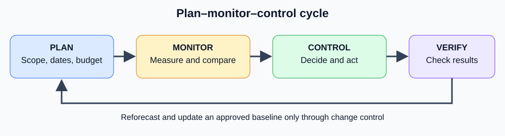
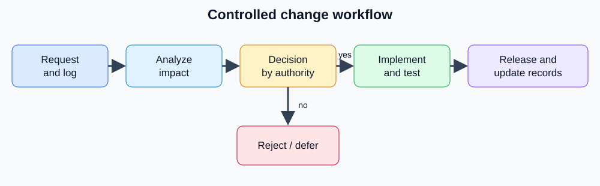

# Unit 4: Project Tracking, Monitoring and Control

[Study index](README.md) | [Curriculum](../SPM%20-%20SPPU%20BE%20IT%20Curriculum.pdf) | [Technical book, unit 4](../Books/SPM_Technical_Units03-06.pdf#page=48) | [Existing unit 4 notes](SPM_unit-4.pdf)

Examples are illustrative; currency is in project monetary units.

## Monitoring and control framework

**Project tracking** collects and compares actual progress against the plan; **control** chooses and implements actions to correct unacceptable deviations. Monitoring observes and reports, while control acts and checks the effect. Establish a framework by defining scope and a baseline, breaking work into measurable deliverables, choosing metrics and tolerances, assigning owners, agreeing collection/reporting intervals, analyzing variances and risks, escalating decisions, implementing approved actions and reviewing results.



*Original diagram. Feedback is used to revise forecasts and improve the plan.*

```text
Set plan and baseline -> Collect actual data -> Compare -> Decide action
       ^                                                 |
       +----------- Verify results and update <----------+
```

In an online shop project, set payment integration as a milestone, collect weekly completion and expenditure, compare them with the baseline, investigate a delay, approve an appropriate corrective action, and review its effects. A good status report identifies the reporting period, accomplishments, planned next steps, variances, risks/issues, decisions required and accountable owners; it is accurate, timely, concise and actionable.

**Tools and methods:** milestone reviews, Gantt or slip charts, dashboards, issue and risk registers, stand-ups, status reports, timesheets, earned value analysis and change control. Use evidence from tests or completed deliverables, not only subjective “percent done”. Measurements should be consistent and privacy-aware; avoid using individual metrics as punishment.

**Building the framework step by step:**

1. Establish an approved scope, schedule and cost baseline, including measurable acceptance criteria.
2. Select leading and lagging indicators: for example, unresolved blockers and accepted tests.
3. Assign a responsible owner and data source to each indicator; agree reporting frequency and quality checks.
4. Define tolerances, such as a milestone slip requiring escalation beyond two working days.
5. Compare actuals and forecasts with the baseline, investigate causes and evaluate options.
6. Authorize corrective action, document decisions and check whether it actually resolves the variance.

A framework also needs an escalation route and a change authority: the project manager may correct minor staffing issues, whereas a baseline scope or budget change may require sponsor approval. Recording a forecast separately from the baseline preserves a meaningful comparison.

## Plan-monitor-control cycle and mechanisms

**Plan:** set objectives, schedule, budget and acceptance criteria. **Monitor:** measure actual results and compare with the baseline. **Control:** analyze root causes, choose corrective/preventive actions, obtain approval where needed, implement, and check whether results improved. Repeat throughout the project.

Example: checkout testing is planned to finish in week 4; at the review only half is complete. Investigate blocked test data, assign a data owner and reforecast. Escalate if the revised delivery exceeds tolerance; track whether the remedy removed the bottleneck. Do not silently change the approved baseline to conceal variance.

| Mechanism | When or how it operates | Example |
|---|---|---|
| Feedforward / preventive | Before work, reduce expected deviations | Validate requirements and test environment |
| Concurrent / steering | During work, measure and adjust | Review a sprint and resolve blockers |
| Feedback / post-action | After output, compare with standards | Inspect test results and fix defects |
| Change control | Authorize changes to controlled baselines | Approve a scope increase after impact analysis |

Use the mechanism appropriate to the risk and cost of correction; preventive controls reduce rework but do not replace feedback.

For the delayed checkout tests, a preventive control is checking environment readiness before testing starts. Concurrent control is a daily review of blocked tests while testing is underway. Feedback control is inspection of completed test results and defect trends. The manager selects corrective action based on the cause: adding testers will not fix an unavailable test environment, and may increase cost without reducing delay.

## Collecting and reporting project data

Collect completed work, effort, cost, defects, risk, milestones and forecast using consistent definitions. Methods include in-person interviews (rich context, more costly), phone/video interviews (remote access, less nonverbal context), online forms (scalable but may lack detail), direct observation, automated tool reports, logs and document reviews. Triangulate sources, validate data, establish cadence and protect sensitive information.

Partial completion can be reported with **0/100** (credit only at completion), **50/50** (half on start and half on finish), weighted milestones, or evidence-based percent complete. Choose consistently: subjective percentages may exaggerate progress. For checkout testing, award earned progress only when agreed test cases are accepted.

Example: a test package worth 100 budget units has four agreed milestones weighted 10%, 20%, 30% and 40%. If the first two are accepted, earned progress is `10 + 20 = 30` units, not an arbitrary 60% because the activity has been underway for several weeks. In an interview, ask what has been completed, what evidence supports it, what is blocked and what completion date is now realistic. Validate the answers against test records and record unresolved disagreements.

## Visualizing progress


*Abstract Kanban Board by Jennifer Falco, [Wikimedia Commons](https://commons.wikimedia.org/wiki/File:Abstract_Kanban_Board.svg), [CC BY 4.0](https://creativecommons.org/licenses/by/4.0/); unmodified. Each card is a work item, and its column shows its current workflow stage.*

| Technique | Purpose and example | Limitation |
|---|---|---|
| Gantt chart | Bars show start, finish and progress of checkout tasks | Complex dependencies are hard to read at scale |
| Milestone chart | Shows approval, test and release dates | Does not show detailed work |
| Slip chart | Compares planned and forecast/actual milestone dates over time | Requires regular reliable estimates |
| Kanban board | Displays workflow and bottlenecks in To do, Doing, Done | Card count alone is not business value |
| Calendar | Shows events, deadlines and availability | Limited insight into dependencies |
| S-curve / earned value chart | Compares cumulative baseline, earned value and actual cost over time | Depends on a credible baseline and progress measurement |
| Dashboard | Summarizes exceptions, risk and KPIs | Can hide context or encourage metric gaming |

```text
To do            Doing               Done
[refund tests]   [payment gateway]   [checkout design]
```

Limit work in progress when using Kanban, define “Done”, and investigate aging blocked cards. A visualization helps prompt a conversation; it does not replace checking the underlying data.

**How to read the visualizations:** A Gantt chart shows whether the bar for payment testing extends beyond its baseline date. A milestone chart highlights whether gateway approval was achieved. A slip chart tracks how the forecast milestone date changes at successive reviews: repeated rightward movement signals growing delay. A Kanban board reveals work accumulating in a state; confirm whether the constraint is capacity, missing inputs or a policy problem before taking action. An S-curve can show that actual expenditure is above plan while earned value is below plan.

**Example dashboard:** report release forecast, accepted stories, open critical defects, budget and top risks for the same reporting date; mark an overdue approval with its owner and next action. Use labels in addition to colors so the information remains accessible.

See the [Technical book's traffic-light assessment, figure 4.4.2, PDF page 56](../Books/SPM_Technical_Units03-06.pdf#page=56), for a different way to record status over successive weeks. Define the meaning of each status before reporting.

## Cost monitoring and earned value

Cost management includes **resource planning**, **cost estimation**, **budget determination/baselining**, and **cost control**. During monitoring compare authorized budget, actual spending and completed work, investigate variance and forecast the final cost. An approved baseline changes only via change control.

Earned value management integrates scope, schedule and cost:

* **PV** (planned value): budgeted value of work scheduled.
* **EV** (earned value): budgeted value of work actually completed.
* **AC** (actual cost): actual cost of completed work.
* `SV = EV − PV`; `CV = EV − AC`; `SPI = EV/PV`; `CPI = EV/AC` when denominators are nonzero.

Example: `PV=100`, `EV=80`, `AC=100`: `SV=-20`, `CV=-20`, `SPI=0.8`, `CPI=0.8`. The project has earned 80% of the planned value and earned 0.8 units of budgeted work per unit spent. It is behind the planned earned-value schedule and over budget for work performed. If `BAC=200` and the current CPI is expected to continue, a simple `EAC=BAC/CPI=250`; this forecast assumes continued cost efficiency and is not guaranteed. SPI alone is not a direct measure of calendar days late.

**Cost-management steps in practice:** Resource planning lists necessary people, facilities and tools. Cost estimation assigns expected prices and effort to work packages. Budgeting distributes the approved estimates over time to form a cost baseline. Cost control measures actuals and earned work, investigates differences and forecasts the remaining cost. For checkout, distinguish a one-time gateway setup fee from recurring service costs and development effort; record assumptions and include approved contingency.

In the example, the negative cost variance `80−100=−20` means 20 more units were spent than the budgeted value of the completed work. The negative schedule variance `80−100=−20` is expressed in budget units, not days. Investigate root causes before changing the forecast; a high actual cost can arise from rework, rate increases or different work being performed.

## Software configuration management

**Software configuration management (SCM)** identifies, controls, records and audits changes to software artifacts across their lifecycle. A configuration item (CI) can be source code, requirements, tests, builds or configuration; a **baseline** is an agreed version that changes only through an authorized process.

Core tasks: identify CIs and naming rules; manage versions and branches; control change requests; record configuration status and history; audit whether changes and deliverables match approvals; build and release reproducibly. For an online shop, version the payment API code, tests and deployment configuration together, review changes and label the release.

Participants typically include the requester, project manager, configuration manager, developers, testers, release manager and the change authority or CCB. The configuration manager maintains identification and records; developers implement approved changes; testers verify them; the CCB makes decisions within its authority; and release staff package an approved baseline. A small project may combine roles but should preserve appropriate review.

Git tracks versions and supports branches, reviews and merges; Team Foundation Server/Azure DevOps Server provides integrated version control and work management; Ansible helps define and apply infrastructure configuration. Ansible is not a substitute for version control: store its playbooks in a versioned repository. Choose tools based on access control, traceability, integration and audit needs.

**Typical SCM lifecycle:** identify the requirements document, source repository and deployment playbooks as configuration items; record approved versions as a baseline; link a change request to commits and tests; record its approval and implementation status; audit that the released artifacts match the approved versions. A version label makes it possible to recreate or investigate a release. An audit can check both that required changes were implemented and that the recorded configuration matches what was delivered.

## Change control and version control



*Original diagram. An unapproved change does not proceed to implementation as an approved baseline change.*

```text
Request -> Log and classify -> Impact analysis -> Change authority decision
                                                       |             |
                                              reject/defer        approve
                                                                     |
                                  update records <- release <- test <- implement
```

The change request states the reason, affected items, priority and requester. Analyze effects on scope, cost, schedule, risks and dependencies; the appropriate change control board (CCB) or delegated authority approves, rejects or defers. Implement approved changes in a branch, review and test them, update documentation and baselines if authorized, and notify stakeholders. Typical request types include corrective, preventive, defect repair and enhancement.

**Version control** records artifact history and supports branching, comparison and rollback. **Change control** governs whether and how a proposed change is authorized. For example, adding refund support needs approval of scope and budget; Git then records the reviewed implementation and release tag. A commit alone is not evidence that the business change was approved.

**Worked example:** A stakeholder requests refunds after checkout. Log the request and analyze payment-provider compatibility, security, testing effort and delivery cost. The CCB may reject it, defer it, or approve it with a revised delivery date. On approval, implement and review the change, run refund and regression tests, then release and update the change record and affected documentation. Emergency fixes can use an expedited process, but still need documented authority and later review.

## Contracts and contract management

| Contract type | Payment basis | Typical risk |
|---|---|---|
| Fixed price | Agreed price for defined deliverables | Supplier bears more cost-overrun risk; scope changes need control |
| Time and materials | Actual approved time and materials at agreed rates | Buyer bears more effort uncertainty; use a cap and monitoring |
| Cost reimbursable | Allowable costs plus agreed fee | Buyer bears cost uncertainty; audit and incentives matter |

Typical terms cover scope and acceptance, schedule/milestones, price and payment, change procedure, intellectual property, confidentiality, security, warranties, liability, dispute resolution and termination. Exact legal terms require professional advice.

Stages: identify need and strategy → select supplier and negotiate → authorize/sign → monitor performance and manage changes → accept deliverables and close. Common challenges are ambiguous scope, vendor dependency and weak evidence of acceptance. Clear responsibilities and documented reviews improve accountability.

For example, purchase a payment gateway integration under a fixed-price contract only when its scope and acceptance tests are sufficiently clear; record how an extra payment method is priced and approved. A time-and-materials arrangement may suit uncertain discovery work, but the buyer should monitor authorized hours and deliverables. During closure confirm acceptance, outstanding defects, final payment and handover; do not assume signing a contract completes supplier management.
