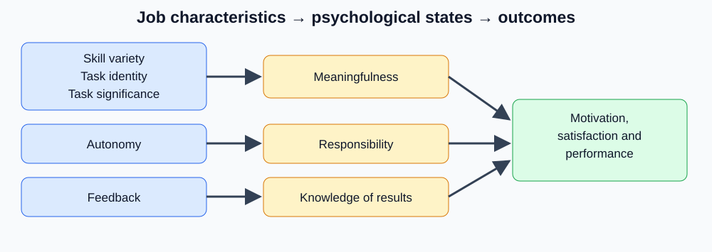

# Unit 5: Managing People and Organizing Teams

[Study index](README.md) | [Curriculum](../SPM%20-%20SPPU%20BE%20IT%20Curriculum.pdf) | [Technical book, unit 5](../Books/SPM_Technical_Units03-06.pdf#page=82) | [Existing unit 5 notes](SPM_unit-5.pdf)

## Managing people and organizational behavior

Managing people aims to recruit suitable skills, clarify responsibilities, motivate and develop staff, build healthy teams, support ethical conduct and deliver project objectives sustainably. **Organizational behavior** studies how individuals, groups and organizational structures affect behavior at work.

Individual differences include ability, personality, values, experience and motivation; team factors include trust, norms, communication, conflict and group dynamics; organizational factors include culture, incentives, structure and leadership. For example, a talented developer may still struggle if requirements are unclear or a team discourages questions.

Theories provide lenses, not guarantees: Maslow's hierarchy suggests different categories of needs, Herzberg distinguishes hygiene factors from motivators, and expectancy theory relates motivation to perceived effort–performance–reward relationships. Apply them cautiously: ask people what matters, offer fair conditions and recognize meaningful work rather than assuming a universal hierarchy.

| Perspective | Main idea | Project-management application |
|---|---|---|
| Maslow | People can have physiological, safety, social, esteem and growth needs | Provide fair conditions and belonging as well as learning opportunities; do not assume everyone progresses through a fixed sequence |
| Herzberg | Working conditions can prevent dissatisfaction, while achievement, recognition and responsibility can support satisfaction | Fix poor working conditions and give meaningful ownership; pay alone need not solve every motivation problem |
| Expectancy | Effort is more motivating when people believe it can produce performance and a valued result | Provide tools, attainable goals and a transparent link between contribution and recognition |

Individual personality and experience affect how people prefer to communicate; group dynamics affect whether information is shared and problems are raised. Organizational norms also matter: a blame-oriented culture can hide defects even when staff are technically skilled. A manager should observe outcomes and ask for feedback instead of using a theory to label individuals.

## Selecting the right person

1. Analyze the role, responsibilities and expected outcomes.
2. Define essential and desirable skills, experience and fair selection criteria.
3. Advertise the role and source a diverse applicant pool.
4. Screen consistently against job-related requirements.
5. Use structured interviews and relevant work samples, with reasonable accommodations.
6. Check references appropriately, compare evidence and select.
7. Make an offer, onboard, mentor and review progress.

Example: a payment-integration role requires API and security skills, collaboration and testing. A consistent practical exercise can reveal relevant skills; interview ratings should follow a common rubric. Avoid personal stereotypes and unnecessary sensitive data. Recruitment is only a start: training and clear feedback help the person succeed.

**Instruction in the best methods:** identify the skills needed for the role and compare them with current capability; agree a learning plan; use onboarding, mentoring, demonstrations and supervised practice; then assess results through feedback and actual work. Document team standards while leaving room to improve them. For the payment role, pair a new developer with an experienced engineer on a sandbox integration and review security and test results before independent work.

In a structured selection exercise, define criteria before reviewing candidates. For example, score API reasoning, testing, security and communication against the same rubric and combine interview evidence with a work sample. Provide feedback to the successful candidate during onboarding and revisit the skills plan after the first milestone. This limits inconsistent decisions, though no single test perfectly predicts performance.

## Job characteristics model

The Hackman–Oldham model connects job design to motivation through five core characteristics:



*Original illustration of the model; outcomes depend on individual and organizational conditions.*

1. **Skill variety:** use different skills, such as coding and customer communication.
2. **Task identity:** complete an identifiable whole, such as delivering a checkout feature.
3. **Task significance:** understand its effect on users and business.
4. **Autonomy:** have appropriate discretion over implementation.
5. **Feedback:** receive usable information about performance from work and stakeholders.

```text
Variety + identity + significance -> experienced meaningfulness
Autonomy -------------------------> experienced responsibility
Feedback -------------------------> knowledge of results
                                  -> motivation, satisfaction, performance
```

The model's illustrative motivating potential score is `MPS = ((variety + identity + significance)/3) × autonomy × feedback`. Example: scores 4, 3, 5, 4 and 3 give `MPS = ((4+3+5)/3) × 4 × 3 = 48`. Scores depend on the scale used and are diagnostic rather than an absolute prediction. Improve a repetitive development role by giving ownership from design through release, user context, choice within standards and timely test/user feedback. Individual growth needs and organizational conditions affect outcomes.

**Interpretation:** A developer who only fixes isolated UI defects may see little task identity. Assigning responsibility for the whole checkout flow, within appropriate review and security boundaries, increases ownership. Discussing how accessibility improvements help shoppers strengthens task significance; automated tests and user feedback improve knowledge of results. An autonomy score of zero would make the model's multiplicative score zero even when other scores are high, illustrating why job design must consider all five dimensions.

## Leadership and management

**Leadership** influences people toward shared goals. Management plans, organizes, coordinates and controls work; leadership emphasizes direction, motivation, alignment and change. Effective project managers usually need both.

| Aspect | Management | Leadership |
|---|---|---|
| Focus | Plans, resources, consistency | Vision, people, adaptation |
| Example | Allocate test capacity and track schedule | Explain release purpose and build commitment |
| Time horizon | Operational control and delivery | Direction and sustainable change |

Approaches include trait (personal qualities), behavioral (what leaders do), and contingency/situational (style depends on context). Styles include autocratic (fast centralized decisions), democratic (participation), laissez-faire/delegative (team autonomy), transactional (agreed goals and feedback/rewards), and transformational (shared vision and development). No style is always best: urgent incident response may require decisive coordination; design decisions benefit from team participation. Clearly explain authority, listen and remain accountable.

| Style | Advantage | Risk if overused |
|---|---|---|
| Autocratic | Quick direction in a time-critical incident | Reduces participation and may miss expertise |
| Democratic | Better buy-in and broader ideas | Consultation can delay urgent decisions |
| Delegative | Develops ownership in a capable team | Unclear boundaries can leave decisions unmade |
| Transactional | Clarifies expectations and feedback | Can overemphasize short-term targets |
| Transformational | Builds commitment around a shared vision | A vision needs concrete delivery and follow-through |

For example, the leader can invite the team to choose a checkout design but direct a coordinated rollback during an outage. A manager then allocates time, updates the risk register and monitors whether the rollback restores service.

## Team structures and organization

A **functional** structure groups staff by specialty; expertise is deep but cross-functional coordination can be slow. A **projectized** structure assigns people largely to a project manager, improving focus but potentially duplicating specialists. A **matrix** shares authority between functional and project managers; it improves sharing but can create conflicting priorities. In software teams, centralized/chief-programmer arrangements emphasize a designated technical lead; decentralized arrangements distribute decisions and communication. Hybrid structures are common.

Four useful team types are functional, cross-functional, self-managing and virtual. A cross-functional checkout team can include developers, testers, design and security. A virtual team collaborates across locations/time zones using documented decisions, overlapping hours, accessible channels and explicit handoffs. Remote work requires deliberate trust and communication; co-location alone does not ensure cooperation.

| Team type | How it works | Advantage and challenge |
|---|---|---|
| Functional | People with similar specialties work under a functional lead | Deep expertise; handoffs can slow a project |
| Cross-functional | Different specialties jointly deliver a result | Faster feedback; differing priorities need coordination |
| Self-managing | Team organizes day-to-day work within agreed boundaries | Ownership and adaptability; requires clear accountability |
| Virtual | Members collaborate across locations | Access to diverse expertise; time zones and trust need attention |

These are overlapping categories rather than mutually exclusive labels: a virtual team may also be cross-functional. Select a structure based on project size, complexity, authority and available skills.

The [Technical book's stepwise planning and collaboration figure 5.9.1, PDF page 90](../Books/SPM_Technical_Units03-06.pdf#page=90), shows how project planning and team coordination interact.

**Organization structure comparison:** In a functional organization, a developer reports to the development manager and may serve several projects. In a projectized organization, the checkout manager has more direct control of project staff. In a matrix, the developer may answer to both a functional manager and project manager; agree priorities and conflict-resolution authority in advance. Stronger project control can improve delivery focus, while shared functional groups retain specialist expertise.

## Team formation and motivation

Tuckman's model describes **forming** (orientation), **storming** (conflict and roles), **norming** (agreed working practices), **performing** (effective cooperation) and **adjourning** (closure). Teams can revisit stages when membership or scope changes; the stages are a useful model, not an inevitable fixed sequence.

For a checkout team, establish goals and introductions; resolve disagreements about responsibilities; agree coding and review norms; deliver and improve together; then document lessons and recognize contributions at closure.

Motivation can be improved through fair pay and safe conditions, clear meaningful objectives, autonomy with support, recognition, timely feedback, learning, manageable workload, participation and growth opportunities. Managers should ask individuals what helps them and review whether interventions work.

| Stage | Typical behavior | Helpful manager action |
|---|---|---|
| Forming | Members seek purpose and responsibilities | Clarify goal, roles and working agreements |
| Storming | Conflicts arise over priorities or methods | Facilitate respectful discussion and decisions |
| Norming | The team agrees routines and expectations | Reinforce useful norms and feedback |
| Performing | Members coordinate and solve problems effectively | Delegate, remove obstacles and support improvement |
| Adjourning | Work ends or the team changes | Complete handover, capture lessons and recognize work |

To improve motivation, connect a task to customer value, offer training and appropriate autonomy, recognize specific contributions, and provide timely feedback. Check workload and prerequisites: asking for “more motivation” cannot compensate for unavailable tools or an unsafe schedule.

## Making a team, decision making and communication

Good teams need a shared goal, complementary skills, clear roles, manageable size, trust and psychological safety, agreed decisions, coordination, feedback and conflict resolution. A decision process defines the problem, gathers evidence, considers alternatives, chooses with explicit authority, records the decision and revisits outcomes. Consensus can improve buy-in but may take time; urgent issues may need a delegated decision.

For example, a checkout team needs developers, testers and domain knowledge; one person owns payment integration while another owns acceptance testing. They agree response times and escalation rules, review dependencies weekly, and resolve a dispute about scope against the shared release goal. Trust lets members report defects early; complementary skills alone do not help if responsibilities and handoffs are unclear.

**Coordination dependencies** arise when one person's output, shared resource or decision affects another. Manage them through interface agreements, a visible dependency board, milestones and explicit owners. A communication plan identifies audience, purpose, channel, frequency, owner and escalation path: daily team stand-up for blockers, weekly stakeholder report for status and immediate incident channel for security issues. Genres include reports, meetings, chat and technical documentation; select a channel suitable for urgency and permanence.

| Team factor | Why it matters | Example practice |
|---|---|---|
| Shared goal | Aligns individual work | Agree a release outcome and acceptance criteria |
| Complementary skills | Covers delivery and quality needs | Include security and testing alongside development |
| Roles and authority | Prevents duplicated or missed work | Name an owner for gateway integration |
| Trust and communication | Makes blockers and defects visible | Encourage questions and review decisions openly |
| Coordination and feedback | Keeps dependent work aligned | Agree an API contract and check progress weekly |
| Conflict resolution | Keeps disagreement productive | Compare options against criteria and record the decision |

## Stress, safety, ethics and professionalism

Stress can result from persistent overload, unclear roles, unrealistic deadlines or conflict. Manage it by monitoring workload, clarifying priorities, allowing recovery, providing support and addressing causes rather than blaming individuals. Health and safety include ergonomic equipment, breaks, safe work environments and access to appropriate support.

Professional concerns include competence, honesty about estimates and defects, confidentiality, privacy, security, intellectual property and conflicts of interest. For example, a developer who discovers exposed customer data should follow the incident process promptly rather than conceal it to protect a deadline. Record decisions and escalate unresolved risks appropriately; avoid claiming a particular law applies without checking jurisdiction.

**Stress controls:** agree a realistic workload, identify recurring overtime, establish priorities and allow regular recovery. **Safety controls:** assess workstation ergonomics, lighting and breaks, and provide an appropriate reporting mechanism. **Professional practice:** only claim skills that can be demonstrated, respect customer data, disclose conflicts and communicate quality risks honestly. Confidential health matters should be handled sensitively and according to applicable policies.

## Team-building case study

For an academic online-shop project, assign roles for requirements, UI, backend and testing while allowing shared learning. Agree acceptance criteria and weekly milestones, use a shared repository and issue board, review pull requests, and rotate a meeting facilitator. Resolve a payment-interface dependency through an agreed API contract, document decisions and hold a retrospective. Assess team outcomes with working software, feedback and sustainable collaboration rather than individual commit counts alone.
