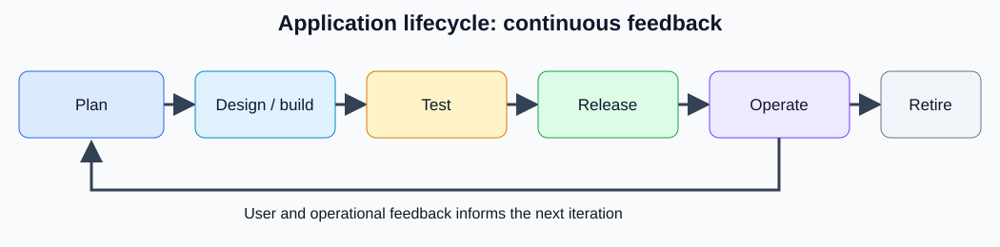
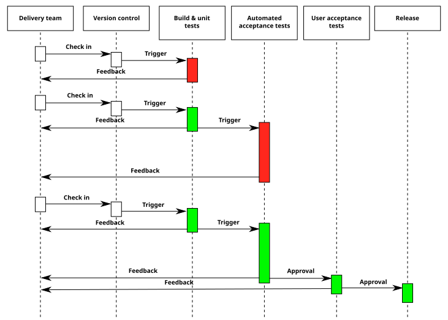

# Unit 6: Applications of Software Project Management in Industry

[Study index](README.md) | [Curriculum](../SPM%20-%20SPPU%20BE%20IT%20Curriculum.pdf) | [Technical book, ALM discussion](../Books/SPM_Technical_Units03-06.pdf#page=105) | [Existing unit 6 notes](SPM_unit-6.pdf)

## Application lifecycle management

**Application lifecycle management (ALM)** coordinates a software product from initial idea through retirement, integrating people, processes, artifacts and tools. Typical stages are requirements and planning, design, development, testing, release/deployment, operation and maintenance, and eventual retirement. These stages overlap and repeat in iterative work; ALM is broader than coding or a single release.



*Original diagram. Phases can overlap and repeat; retirement occurs when the application is no longer needed.*

```text
Idea -> Plan -> Design -> Build -> Test -> Release -> Operate
         ^                                           |
         +---------------- feedback -----------------+
```

For an online shop, capture a checkout requirement, plan it as a work item, link its code and tests, deploy the approved build, monitor incidents and use feedback to update the backlog. Traceable links enable teams to assess the impact of a change and demonstrate what was tested.

ALM tools can include Azure DevOps, Jira combined with development tools, and GitLab; configurations and features vary. Select based on requirements coverage, traceability, version control and CI integration, reporting, access control, extensibility, usability, hosting, support and total cost. A tool does not automatically supply a sound development process.

| Lifecycle stage | Main activities | Online-shopping example |
|---|---|---|
| Requirements and planning | Identify users, priorities, constraints and acceptance criteria | Record a secure-payment story |
| Design and development | Decide architecture and implement changes | Build the gateway adapter |
| Testing | Verify functionality, integration and quality attributes | Run payment and failure-path tests |
| Release | Approve and deploy a known version | Publish and deploy the tested build |
| Operation and maintenance | Monitor, support, fix and improve the product | Investigate declined-payment incidents |
| Retirement | Remove or migrate the application safely | Archive required records and decommission a legacy gateway |

For tool selection, list required capabilities and constraints, trial the candidates on a representative workflow, check security and administration costs, and evaluate integrations and export options. For example, a small team may prioritize usability and repository integration while a regulated organization may require stronger audit and hosting controls.

## Azure DevOps and TFS

Azure DevOps is a set of services for planning and delivering software. Core components include **Boards** for work items and planning, **Repos** for version control, **Pipelines** for builds and deployments, **Test Plans** for test management, and **Artifacts** for packages. Access depends on product edition, configuration and licensing.

| Aspect | TFS / Azure DevOps Server | Azure DevOps Services |
|---|---|---|
| Hosting | Primarily self-managed, on-premises deployment | Microsoft-hosted cloud service |
| Administration | Organization manages server and upgrades | Provider manages service infrastructure |
| Updates | Installed by the organization | Delivered to the service |
| Version control | Supported options depend on version/configuration | Git and TFVC support depends on project setup |

Team Foundation Server (TFS) is the older name of the on-premises product now called Azure DevOps Server. Features and availability differ across versions; avoid treating TFS as an entirely unrelated product. Both support integrated planning, code and delivery workflows.

**Components in an example:** Boards stores the checkout requirement and tasks; Repos stores implementation and review history; Pipelines builds and tests a version; Test Plans can organize manual test cases; Artifacts stores packages. Linking these records supports impact analysis: when a checkout story changes, a reviewer can find its associated code and tests. Availability and organization policies should be checked for the version in use.

## Visibility, traceability, collaboration and extensibility

* **Visibility:** stakeholders can see current work, progress, blockers and delivery status, subject to access permissions. Enable it using shared boards/backlogs, dashboards and reports, and build/test/release status.
* **Traceability:** links connect a requirement or work item to commits, tests, builds and releases. It helps change impact analysis and audit, though links must be maintained.
* **Collaboration:** shared work items, discussion, pull requests, notifications and reviews help developers, testers and stakeholders coordinate. Agree ownership and communication norms.
* **Extensibility:** APIs, service hooks, extensions and integrations can adapt workflows and connect external systems. Evaluate permissions, compatibility and maintenance before adding extensions.

Example: the checkout story links to a pull request, automated tests and a pipeline run. The team sees a failed test on a dashboard, discusses the fix on the work item, then traces the successful deployment to the release. Sensitive data should not be exposed merely to increase visibility.

**Three ways to enable visibility:** (1) publish a prioritized backlog and board with clear work states and owners; (2) show team dashboards or reports for milestones, defects and relevant trends; (3) make build, test and deployment results visible with links to the associated work. Agree who needs access, update work promptly and explain what each metric means.

Traceability answers “what changed and why?”, collaboration answers “how do the people coordinate?”, visibility answers “what is happening?”, and extensibility answers “how can the process connect to other tools?”. Together they improve decision-making, but inaccurate links or outdated status can create false confidence.

## Agile management with Azure DevOps

Agile project management delivers value iteratively, prioritizes feedback and adapts plans. Create a product backlog, order work by value and risk, refine user stories with acceptance criteria, plan an iteration, track execution, demonstrate working software and retrospect. Azure Boards supports backlog items, sprint planning, assignments, task boards and queries; Repos and Pipelines connect implementation and delivery.

Example: prioritize checkout before recommendations; split checkout into stories for cart, payment and confirmation; review a working increment with users at sprint end. Benefits include a shared view of priorities and traceability from work to delivery. Do not equate use of a board with being agile.

Common Azure DevOps process templates include **Agile, Scrum, CMMI and Basic**, depending on product version and project configuration. Scrum emphasizes product backlog items and sprints; Agile typically uses user stories; CMMI supports more formal process tracking; Basic offers a simpler issue/epic/task model. Choose to fit governance and team needs; all can support iterative working when used appropriately.

Good practices: keep items small and testable, set explicit acceptance criteria, prioritize continuously, limit work in progress, automate relevant tests, review increments with stakeholders, make blockers visible, retrospect and improve. Avoid using velocity as a target for comparing teams.

**Iteration example:** The product owner places payment confirmation ahead of promotional features because it is necessary for purchase completion. The team agrees acceptance criteria, breaks the story into tasks and tests, then tracks work daily on the board. At the review, stakeholders try the feature and request a clearer failure message. The team records that feedback, updates the backlog and discusses how to improve testing in the retrospective. The board supports the conversation; working software and feedback are the objective.

## Azure Boards

Boards organizes work into items such as epics, features, stories or backlog items, tasks and bugs; exact types depend on the process. A backlog orders work, a sprint view plans an iteration, and a Kanban board shows workflow. Queries, links, tags and dashboards help find and report work.

```text
Backlog           Active              Done
Refund story      Payment API         Cart UI
```

For a checkout story, record acceptance criteria, assign a responsible person, add development and test tasks, link the pull request and update status only after the agreed definition of done. Reprioritize when a payment compliance issue becomes urgent.


*Abstract Kanban Board by Jennifer Falco, [Wikimedia Commons](https://commons.wikimedia.org/wiki/File:Abstract_Kanban_Board.svg), [CC BY 4.0](https://creativecommons.org/licenses/by/4.0/); unmodified. This generic board illustrates the concept rather than the Azure DevOps interface.*

For an example of a work item assigned to a team member in the book, see [figure 6.5.3, PDF page 115](../Books/SPM_Technical_Units03-06.pdf#page=115). The depicted interface may differ from current product versions.

Example story: “As a shopper, I want confirmation after payment so I know my order was placed.” Acceptance criteria include showing an order number after successful payment and a helpful message if payment fails. Tasks may include implementing the callback, writing tests and updating the UI. A bug found during review is linked to the story; the item moves to Done only when the agreed tests and review are complete. A board column represents a workflow state, not a guarantee of quality by itself.

## Metrics and reporting

Metrics inform decisions; define the question, unit, data source, time window and limitations before measuring. Use a balanced set and validate data quality.

| Metric | Definition / interpretation | Caution |
|---|---|---|
| Lead time | Time from request to delivery, with explicit start/end | Context and work type affect comparisons |
| Cycle time | Time from work start to completion | Define workflow states consistently |
| Throughput | Work items completed per interval | Item sizes differ |
| Velocity | Story points completed per sprint | Team-specific estimates, not productivity ranking |
| Defect escape rate | Defects found after release relative to an agreed denominator | Severity and detection effort matter |
| Build success rate | Successful builds divided by total builds in a period | Can be gamed by excluding failures |
| Deployment frequency | Deployments per time period | Must be paired with quality and reliability |
| Change failure rate | Failed deployments / deployments under an agreed definition | Definitions must be consistent |
| Mean time to restore | Average restoration time for included incidents | Report distribution and severity too |

Developer practice metrics can include build success, test pass rate, code-review turnaround and escaped defects. Agile reports include sprint burndown, burnup, cumulative flow and velocity charts. A burndown plots remaining work; a burnup shows completed work and scope; cumulative flow shows work in each state over time; velocity shows points completed per iteration. Example: a widening “testing” band in cumulative flow suggests a bottleneck to investigate, not proof of an individual failure.

For a concrete developer-practice report, suppose 18 of 20 builds pass: build success is `18/20 = 90%`. If 48 of 50 executed tests pass, test pass rate is `48/50 = 96%`; this says nothing about untested requirements or test quality. Review turnaround is measured from pull-request creation to an agreed review event; a rising median may identify a review bottleneck. Track escaped defects by release and severity to focus quality improvement, not blame. Compare trends only when definitions and context are stable.

For four report examples, a team can inspect (1) **sprint burndown** to see whether remaining work is falling, (2) **burnup** to distinguish progress from scope growth, (3) **cumulative flow** to identify accumulating work in a state, and (4) **velocity** to inform the same team's tentative iteration planning. Unexpected scope changes and inconsistent estimates make the charts less reliable; discuss underlying work before acting.

## Branching, merging and pipelines

A branch isolates work; developers commit changes, open a pull request, review and run checks, resolve conflicts and merge to the agreed target branch. A protected main branch and short-lived branches can reduce integration risk, but policies should fit the team's workflow. Link work items and tests; never commit secrets.

```text
main:     A ---- B ------------ M -> release
                   \\          /
feature:            C ---- D -- 
```

Continuous integration automatically builds and tests changes frequently. Continuous delivery keeps a tested artifact ready for deployment; continuous deployment automatically releases passing changes where policy permits. An Azure Pipeline can trigger on a pull request, restore dependencies, build, run tests and security checks, publish a versioned artifact, and deploy to a test environment; release to production follows the configured approvals and safeguards. Failures should block the relevant gate and be visible.



*Continuous Delivery process diagram by Grégoire Détrez, derived from a diagram by Jez Humble; multilingual version by TAKAHASHI Shuuji. [Wikimedia Commons](https://commons.wikimedia.org/wiki/File:Continuous_Delivery_process_diagram.svg), [CC BY-SA 4.0](https://creativecommons.org/licenses/by-sa/4.0/); downloaded without modification. This is a general example, not a prescribed Azure pipeline; actual checks and approvals depend on the project.*

**Example workflow:**

1. Create a short-lived branch for the payment story and make focused commits.
2. Open a pull request linked to the work item; request review and run the configured build and tests.
3. Address review feedback and merge conflicts, then merge after required checks pass.
4. Build and label an artifact, deploy it to staging and run integration tests against a test gateway.
5. Promote the same approved artifact to production under the configured release policy; monitor outcomes and roll back if necessary.

Secrets belong in an appropriate secret store, not in source files or logs. A deployment approval is a policy choice and does not mean every organization uses the same pipeline stages.

## Customizing process templates

Adapt work-item types, fields, states, rules and boards to the team's needs where the chosen Azure DevOps process model permits it. First identify the information needed, map the workflow, test a small change, document the rules, migrate or update existing items carefully and gather feedback. Inherited-process customization in Services and XML-based approaches on some Server installations differ by version; verify the current product documentation. Avoid excessive mandatory fields that make reporting harder.

For example, the team may need a “security review required” field and a visible review state for payment work. Define who updates it and what qualifies for completion, test the change with a small group, check existing reporting and permissions, then document the new workflow. Measure whether the customization improved coordination rather than adding fields simply because the tool allows them.

## Online shopping case study

Create a checkout epic and prioritized stories in Boards, link a Git feature branch and pull request, run automated unit and integration tests in Pipelines, store the versioned artifact, deploy to a staging environment and review results. Use dashboards for story progress and build health, then gather user feedback before deciding the next iteration. Protect payment credentials and limit access to customer data.
